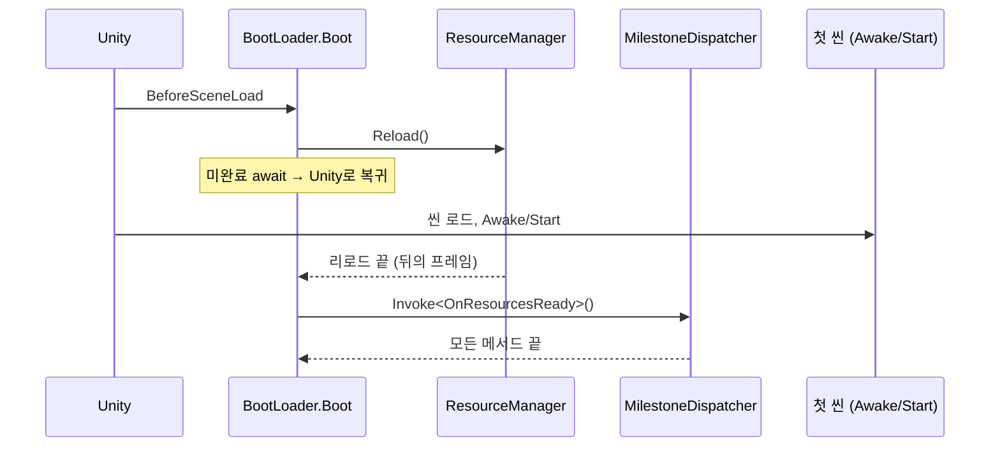

# 2. `BootLoader`

> 기준 커밋: `1f1bb93d`. [← 목차](README.md) · 이전: [1. 수명 주기 훅](01-lifecycle-hooks.md) · 다음: [3. 마일스톤](03-milestones.md)

[`BootLoader`](../../Runtime/Booting/BootLoader.cs#L12)는 플레이어가 시작할 때(에디터에서는 Play 모드에 들어갈 때마다) 리소스를 처음 읽고, 그다음 [`[OnResourcesReady]`](03-milestones.md) 메서드를 부릅니다. 에디터의 Edit 모드에서 리소스를 읽는 진입점은 따로 있습니다([Resource 4.5](../Resource/04-reload-pipeline.md#45-누가-리로드를-시작하나)).

- [2.1 코드](#21-코드)
- [2.2 씬 로드와의 관계](#22-씬-로드와의-관계)

## 2.1 코드

```csharp
// Runtime/Booting/BootLoader.cs
14  // UniTask 버그로 인해 작업이 취소되는 문제가 있음
15  #if FALSE //UNITY_2020_1_OR_NEWER
16      [RuntimeInitializeOnLoadMethod(RuntimeInitializeLoadType.AfterAssembliesLoaded)]
17  #else
18      [RuntimeInitializeOnLoadMethod(RuntimeInitializeLoadType.BeforeSceneLoad)]
19  #endif
21  static async UniTaskVoid Boot()
22  {
    …   // 주석 처리된 옛 단계 (UniTask PlayerLoop 초기화, [Awaken] 호출)
33      Debug.RuntimeLog("Loading the resource registry");
35      await ResourceManager.Reload();
38      Debug.RuntimeLog("On Resources Ready Method Invoke");
39      await MilestoneDispatcher.Invoke<OnResourcesReadyAttribute>();
41      Debug.RuntimeLog("Exit bootloader");
42  }
```

| 줄 | 설명 |
| --- | --- |
| 14–19 | `#if FALSE`라 16행은 컴파일되지 않고, 항상 `BeforeSceneLoad`가 쓰입니다. 14행 주석이 `AfterAssembliesLoaded`를 쓰지 않는 이유를 UniTask 쪽 문제로 적어 둡니다. |
| 21 | `async UniTaskVoid`. Unity는 이 메서드를 동기 메서드처럼 부르고 돌려받는 것이 없습니다. 첫 미완료 `await`에서 Unity로 제어가 돌아갑니다. |
| 33·38·41 | [`Debug.RuntimeLog`](../../Runtime/Debug.cs#L43)는 빌드에서도 남는 로그입니다. 부팅 단계가 로그에 찍힙니다. |
| 35 | 첫 리소스 리로드. [`ResourceManager.Reload`](../Resource/04-reload-pipeline.md#41-진입점)는 게이트를 거치므로, 이미 다른 리로드가 진행 중이면 그 배치가 끝날 때까지 기다립니다. 리로드가 실패해도 예외로 끝나지 않고 다음 줄로 갑니다([Resource 4.4](../Resource/04-reload-pipeline.md#44-완료-단계-이벤트-그다음-ireloadable)). |
| 39 | 마일스톤 발생. 동기 메서드를 모두 부르고, 비동기 메서드가 모두 끝날 때까지 기다립니다([3.3절](03-milestones.md#33-milestonedispatcher-호출)). |

`Boot` 밖으로 예외가 나가는 경로는 거의 없습니다. `ReloadCore`는 본문의 예외를 잡아 로그로 남기고([`ResourceManager.cs#L152`](../../Runtime/Resource/ResourceManager.cs#L152) 근처), 39행의 `Invoke`는 메서드별 예외를 삼킵니다.

## 2.2 씬 로드와의 관계



`Boot`는 기다려지지 않는 작업입니다. 그래서 첫 `await`가 바로 끝나지 않으면 Unity는 씬을 로드하고, 첫 씬의 `Awake`·`Start`가 **리소스 준비 전에 불릴 수 있습니다**. 리로드가 비동기로 넘어가지 않고 바로 끝나는 경우에는 이 순서가 달라질 수 있습니다. 그림은 넘어가는 경우입니다.

이것은 의도된 동작입니다. 씬은 리소스를 기다리지 않으며, 리소스가 필요한 코드는 다음 중 하나로 받습니다.

- 부팅 한 번에 한 번이면 [`[OnResourcesReady]`](03-milestones.md).
- 리로드될 때마다 새 에셋으로 갈아타야 하면 [`IReloadable`](../Resource/04-reload-pipeline.md#44-완료-단계-이벤트-그다음-ireloadable)이나 [`AssetScopeBinder`](../Resource/08-asset-ref-and-binders.md#83-assetscopebinder).

부팅 완료를 알리는 `Task`나 플래그는 따로 없습니다. `ResourceManager.isPreloaded`는 첫 리로드 패스가 끝나면 `true`가 되지만, `[OnResourcesReady]`가 끝났다는 뜻은 아닙니다.

> 이 부분은 바뀔 예정입니다. 스플래시·로딩 씬과 미리 읽을 에셋 목록을 다루는 시스템이 생기면, `Awake`·`Start`가 리소스 준비 전에 불리는 현상은 없어집니다.
