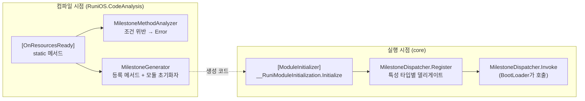

# 3. 마일스톤

> 기준 커밋: `1f1bb93d`. [← 목차](README.md) · 이전: [2. `BootLoader`](02-bootloader.md) · 다음: [4. `Kernel`](04-kernel.md)

마일스톤은 "부팅이 어느 지점에 도달했다"는 신호입니다. 지금은 [`[OnResourcesReady]`](../../Runtime/Milestones/OnResourcesReadyAttribute.cs#L4) 하나뿐이고, [`BootLoader`](02-bootloader.md)가 첫 리소스 리로드를 마친 뒤 이 특성이 붙은 정적 메서드를 모두 부릅니다.

```csharp
public static partial class MyFeature
{
    [OnResourcesReady]
    static void Init() { /* 리소스가 준비된 뒤 한 번 */ }

    [OnResourcesReady]
    static async UniTask InitAsync() { /* 비동기도 됨 */ }
}
```

리플렉션으로 특성을 찾지 않습니다. 소스 생성기가 컴파일할 때 등록 코드를 만들고, 그 코드가 [`MilestoneDispatcher`](../../Runtime/Milestones/MilestoneDispatcher.cs#L6)에 메서드를 넣습니다.

- [3.1 전체 흐름](#31-전체-흐름)
- [3.2 `MilestoneDispatcher`: 등록](#32-milestonedispatcher-등록)
- [3.3 `MilestoneDispatcher`: 호출](#33-milestonedispatcher-호출)
- [3.4 언제 등록되나](#34-언제-등록되나)
- [3.5 소스 생성기](#35-소스-생성기)
- [3.6 분석기 규칙](#36-분석기-규칙)
- [3.7 새 마일스톤 특성](#37-새-마일스톤-특성)

## 3.1 전체 흐름



생성기와 분석기는 독립 .NET 프로젝트 [`RuniOS.CodeAnalysis`](../../../../RuniOS.CodeAnalysis/README.md)에 있고, 빌드 결과는 core의 `Plugins/RuniOS.CodeAnalysis/RuniOS.CodeAnalysis.dll`로 들어갑니다.

## 3.2 `MilestoneDispatcher`: 등록

```csharp
// Runtime/Milestones/MilestoneAttribute.cs
4   [AttributeUsage(AttributeTargets.Method, Inherited = false)]
5   public abstract class MilestoneAttribute : Attribute;

// Runtime/Milestones/MilestoneDispatcher.cs
8   static readonly Dictionary<Type, Action> _methods = [];
9   internal static IReadOnlyDictionary<Type, Action> methods { get; } = _methods.AsReadOnly();
11  static readonly Dictionary<Type, Func<UniTask>> _asyncMethods = [];
12  internal static IReadOnlyDictionary<Type, Func<UniTask>> asyncMethods { get; } = _asyncMethods.AsReadOnly();
14  public static void Register<T>(Action method) where T : MilestoneAttribute => Register(typeof(T), method);
16  public static void Register<T>(Func<UniTask> method) where T : MilestoneAttribute => Register(typeof(T), method);
18  public static void Register(Type type, Action method)
19  {
20      if (!typeof(MilestoneAttribute).IsAssignableFrom(type))
21          throw new ArgumentException();
23      Action? value = _methods.GetValueOrDefault(type);
24      _methods[type] = value + method;
25  }
27  public static void Register(Type type, Func<UniTask> method) { /* 같은 모양, _asyncMethods에 */ }
```

| 줄 | 설명 |
| --- | --- |
| 4–5 | 모든 마일스톤 특성의 부모. 메서드에만 붙고, 상속되지 않습니다. |
| 8–12 | 특성 타입 하나에 **동기 델리게이트 하나, 비동기 델리게이트 하나**를 둡니다. 메서드가 여러 개면 멀티캐스트 델리게이트로 합칩니다. 읽기 전용 뷰는 `internal`입니다. |
| 14–16 | 제네릭 오버로드. `void` 메서드는 `Action`, `UniTask`를 돌려주는 메서드는 `Func<UniTask>` 쪽으로 갑니다. 생성 코드는 이 오버로드를 씁니다([3.5절](#35-소스-생성기)). |
| 20–21 | `Type` 오버로드는 컴파일 타임 제약이 없으므로 실행 중에 `MilestoneAttribute` 파생인지 검사합니다. |
| 23–24 | 기존 델리게이트 뒤에 붙입니다. 같은 메서드를 두 번 등록하면 두 번 불립니다. |

등록을 취소하는 API는 없습니다.

## 3.3 `MilestoneDispatcher`: 호출

```csharp
// Runtime/Milestones/MilestoneDispatcher.cs
36  internal static UniTask Invoke<T>() where T : MilestoneAttribute => Invoke(typeof(T));
38  internal static async UniTask Invoke(Type type)
39  {
40      if (!typeof(MilestoneAttribute).IsAssignableFrom(type))
41          throw new ArgumentException();
43      methods.GetValueOrDefault(type)?.SafeInvoke();
45      if (!MilestoneDispatcher.asyncMethods.TryGetValue(type, out Func<UniTask>? asyncMethod))
46          return;
48      Func<UniTask>[] asyncMethods =
49      [
50          ..asyncMethod
51              .GetInvocationList()
52              .Cast<Func<UniTask>>()
53      ];
55      await UniTask.WhenAll(asyncMethods.Select(InvokeAsync));
56  }
58  static async UniTask InvokeAsync(Func<UniTask> method)
59  {
60      try
61      {
62          await method.Invoke();
63      }
64      catch (Exception e)
65      {
66          Debug.LogException(e);
67      }
68  }
```

| 줄 | 설명 |
| --- | --- |
| 36–38 | `internal`입니다. 마일스톤을 발생시키는 쪽은 core(와 `InternalsVisibleTo`로 열어 둔 `RuniOS.Editor`, `RuniOS.Patches`)뿐이고, 현재 부르는 곳은 `BootLoader` 하나입니다. |
| 43 | **동기 메서드를 먼저 모두** 부릅니다. [`SafeInvoke`](../../Runtime/Utility/EventUtility.cs#L7)는 멀티캐스트의 각 델리게이트를 따로 `DynamicInvoke`하고 예외를 로그로 남긴 뒤 다음으로 넘어갑니다. 그래서 하나가 던져도 나머지는 불리고, 로그에 찍히는 예외는 `TargetInvocationException`으로 감싸져 있습니다. |
| 45–46 | 비동기 메서드가 없으면 여기서 끝납니다. |
| 48–53 | 멀티캐스트를 개별 델리게이트 배열로 풉니다. 멀티캐스트 `Func<UniTask>`를 그대로 부르면 마지막 메서드의 `UniTask`만 돌아오지만, 이렇게 풀면 메서드마다 따로 기다릴 수 있습니다. |
| 55 | 각 메서드를 `InvokeAsync`로 감싸 시작하고 모두 끝날 때까지 기다립니다. 메서드는 배열 순서대로 시작하지만 첫 `await`에서 양보하므로, 그 뒤로는 **동시에** 진행됩니다. |
| 58–67 | 비동기 메서드 하나의 예외는 로그만 남기고 삼킵니다. 따라서 `Invoke`가 끝났다는 것은 "모두 끝났다(성공이든 실패든)"는 뜻입니다. |

정리하면 다음과 같은 계약입니다. 모두 의도된 동작입니다.

- 동기 메서드가 비동기 메서드보다 먼저 불립니다.
- 같은 종류 안의 순서는 등록 순서입니다. 등록 순서는 생성기가 모은 순서와 어셈블리별 모듈 초기화 순서로 정해지며, 사용자 코드가 정할 수 없습니다. 순서에 기대면 안 됩니다.
- 비동기 메서드는 서로를 기다리지 않습니다.
- 예외는 어느 쪽이든 로그만 남고, 다른 메서드와 부팅을 멈추지 않습니다.
- `Invoke`에는 "이미 발생함" 상태가 없습니다. `Invoke`가 지나간 뒤 `Register`한 메서드는 그 부팅에서 불리지 않습니다. 마일스톤 메서드는 가능한 한 빨리 등록되어야 하고, 그 등록은 생성기가 맡습니다. `Register`를 직접 부르는 것은 특수한 경우이며, 발생 뒤에 등록하는 것은 올바른 사용법이 아닙니다.

에디터에서는 코드 리로드가 꺼져 있어 등록이 그대로 남고, `BootLoader`는 Play 모드에 들어갈 때마다 다시 돕니다([1.3절](01-lifecycle-hooks.md#13-play-모드-진입-시-코드-리로드-끔), 이 전제는 확인하지 않음). 그러면 같은 메서드가 **Play 세션마다 한 번씩** 불립니다.

## 3.4 언제 등록되나

등록은 수명 주기 특성(`OnAssemblyLoaded`, `OnCodeLoaded`)이 아니라 생성기가 만든 C# **모듈 초기화자**(`[ModuleInitializer]`)에서 일어납니다. 모듈 초기화자는 어셈블리 하나에 하나이고, 그 어셈블리의 모든 `[OnResourcesReady]` 메서드를 한꺼번에 등록합니다.

> **확인하지 않음:** C#은 모듈 초기화자가 그 모듈의 코드가 처음 실행되기 전에 돈다는 것만 보장합니다. Unity가 어셈블리를 로드할 때 곧바로 실행하는지, `BootLoader.Boot`보다 먼저인지는 확인하지 않았습니다([1.4절](01-lifecycle-hooks.md#14-확인하지-않은-것)).

## 3.5 소스 생성기

[`MilestoneGenerator`](../../../../RuniOS.CodeAnalysis/Generators/Milestones/MilestoneGenerator.cs#L15)는 증분 생성기입니다.

```csharp
// RuniOS.CodeAnalysis/Generators/Milestones/MilestoneGenerator.cs
17  public static ImmutableArray<string> targetAttributes { get; } = ImmutableArray.Create("RuniOS.Milestones.OnResourcesReadyAttribute");
…
23  IncrementalValuesProvider<MilestoneMethodInfo> milestoneMethods = context.SyntaxProvider
24      .ForAttributeWithMetadataName(targetAttributes[0], IsCandidateMethod, CreateMethodInfo)
25      .WhereNotNull();
27  context.RegisterSourceOutput(milestoneMethods, GenerateRegistrationMethod);
29  IncrementalValueProvider<ImmutableArray<MilestoneMethodInfo>> allMilestoneMethods = milestoneMethods.Collect();
30  for (int i = 1; i < targetAttributes.Length; i++) { /* 특성이 더 있으면 같은 처리 후 합침 */ }
43  context.RegisterSourceOutput(allMilestoneMethods, GenerateModuleInitialization);
```

| 줄 | 설명 |
| --- | --- |
| 17 | 대상 특성 이름은 하드코딩된 목록입니다. 지금은 하나입니다. |
| 23–25 | 특성이 붙은 메서드마다 두 단계로 거릅니다. 문법만 보는 `IsCandidateMethod`(46–55행)와 의미를 보는 `CreateMethodInfo`(57–93행)입니다. 통과하지 못하면 `null`이 되어 빠집니다. |
| 27 | 통과한 메서드마다 **등록 메서드** 파일 하나를 만듭니다. |
| 29–43 | 모든 메서드를 모아 **모듈 초기화자** 파일 하나를 만듭니다. |

**거르는 조건**

| 단계 | 조건 | 행 |
| --- | --- | --- |
| 문법 | `static`, 매개변수 없음, 제네릭 아님, 감싸는 모든 타입이 `partial`이고 제네릭 아님 | [46–55](../../../../RuniOS.CodeAnalysis/Generators/Milestones/MilestoneGenerator.cs#L46) |
| 의미 | 감싸는 모든 타입이 `public` 또는 `internal` | [60–61](../../../../RuniOS.CodeAnalysis/Generators/Milestones/MilestoneGenerator.cs#L60), [95–104](../../../../RuniOS.CodeAnalysis/Generators/Milestones/MilestoneGenerator.cs#L95) |
| 의미 | 반환형이 `void` 또는 제네릭이 아닌 `UniTask` | [63–64](../../../../RuniOS.CodeAnalysis/Generators/Milestones/MilestoneGenerator.cs#L63) |

생성기는 조건을 어긴 메서드를 **말없이 건너뜁니다**. 대신 [3.6절](#36-분석기-규칙)의 분석기가 같은 조건을 Error로 보고하므로 컴파일이 실패합니다. 테스트 [`GeneratorSkipsMethodsThatDoNotSatisfyItsExistingFastPathOrSemanticValidation`](../../../../RuniOS.CodeAnalysis.Tests/MilestoneMethodAnalyzerTests.cs#L170)이 이 동작을 확인합니다.

메서드 자체의 접근 한정자는 묻지 않습니다. 등록 메서드가 같은 타입 안에 생성되므로 `private` 메서드도 됩니다. 감싸는 타입이 `partial`이어야 하는 것은 그 안에 메서드를 넣기 위해서이고, `public`이나 `internal`이어야 하는 것은 바깥의 모듈 초기화자가 그 메서드를 부르기 위해서입니다.

**생성되는 코드**

[106–132행](../../../../RuniOS.CodeAnalysis/Generators/Milestones/MilestoneGenerator.cs#L106)과 [134–160행](../../../../RuniOS.CodeAnalysis/Generators/Milestones/MilestoneGenerator.cs#L134)이 쓰는 문자열을 이 장 첫머리의 `MyFeature`에 적용하면 다음과 같습니다(네임스페이스 생략).

```csharp
// <MyFeature의 힌트 이름>.Init.OnResourcesReadyAttribute.RegisterMilestoneMethod
partial class MyFeature
{
    [global::System.Runtime.CompilerServices.CompilerGenerated]
    [global::System.ComponentModel.EditorBrowsable(global::System.ComponentModel.EditorBrowsableState.Never)]
    internal static void __Init_OnResourcesReadyAttribute_RegisterMilestoneMethod()
    {
        global::RuniOS.Milestones.MilestoneDispatcher.Register<global::RuniOS.Milestones.OnResourcesReadyAttribute>(Init);
    }
}

// __RuniModuleInitialization.g.cs
namespace RuniOS.Milestones.Generated
{
    [global::System.Runtime.CompilerServices.CompilerGenerated]
    internal static class __RuniModuleInitialization
    {
        [global::System.Runtime.CompilerServices.CompilerGenerated]
        [global::System.Runtime.CompilerServices.ModuleInitializer]
        internal static void Initialize()
        {
            global::MyFeature.__Init_OnResourcesReadyAttribute_RegisterMilestoneMethod();
            global::MyFeature.__InitAsync_OnResourcesReadyAttribute_RegisterMilestoneMethod();
        }
    }
}
```

- `Register<…>(Init)`에 메서드 그룹을 넘기므로, C# 오버로드 해석이 반환형에 따라 `Action`과 `Func<UniTask>` 중 하나를 고릅니다.
- 감싸는 타입의 선언(네임스페이스, 중첩 `partial` 타입)은 `PartialTypeDeclarationsSerializer`가 그대로 다시 씁니다. 이 직렬화가 실패하면 특성 위치에 진단을 보고하고 그 메서드의 파일을 만들지 않습니다(113–122행).
- 메서드가 하나도 없으면 모듈 초기화자 파일도 만들지 않습니다(136–137행).

## 3.6 분석기 규칙

[`MilestoneMethodAnalyzer`](../../../../RuniOS.CodeAnalysis/Analyzers/MilestoneMethodAnalyzer.cs#L13)는 `[OnResourcesReady]`가 붙은 메서드와 그 메서드를 감싸는 모든 타입을 검사합니다. 진단은 [`MilestoneDiagnostics`](../../../../RuniOS.CodeAnalysis/Diagnostics/MilestoneDiagnostics.cs)에 있고 모두 **Error**입니다.

| ID | 내용 (한국어 메시지) |
| --- | --- |
| ROS0029 | 마일스톤 특성이 적용된 메서드는 static이어야 합니다 |
| ROS0030 | 마일스톤 특성이 적용된 메서드는 매개변수를 선언할 수 없습니다 |
| ROS0031 | 마일스톤 특성이 적용된 메서드는 제네릭일 수 없습니다 |
| ROS0032 | 마일스톤 메서드를 포함하는 모든 타입은 partial이어야 합니다 |
| ROS0033 | 마일스톤 메서드를 포함하는 모든 타입은 제네릭일 수 없습니다 |
| ROS0034 | 마일스톤 메서드는 void 또는 제네릭이 아닌 Cysharp.Threading.Tasks.UniTask를 반환해야 합니다 |
| ROS0035 | 마일스톤 메서드를 포함하는 모든 타입은 public 또는 internal이어야 합니다 |

## 3.7 새 마일스톤 특성

`MilestoneAttribute`를 상속한 특성을 새로 만들어도, 그것만으로는 등록 코드가 생성되지 않습니다. 생성기의 [`targetAttributes`](../../../../RuniOS.CodeAnalysis/Generators/Milestones/MilestoneGenerator.cs#L17)와 분석기의 [`milestoneAttributeMetadataName`](../../../../RuniOS.CodeAnalysis/Analyzers/MilestoneMethodAnalyzer.cs#L15)이 둘 다 `OnResourcesReadyAttribute` 이름을 직접 가지고 있습니다. 생성기는 목록이라 이름을 더하면 되지만, 분석기는 상수 하나라 검사를 넓히려면 코드를 바꿔야 합니다. 그리고 특성을 발생시킬 `Invoke` 호출을 core 쪽에 추가해야 합니다.

현재 저장소에는 `[OnResourcesReady]`를 붙인 메서드가 없습니다.
