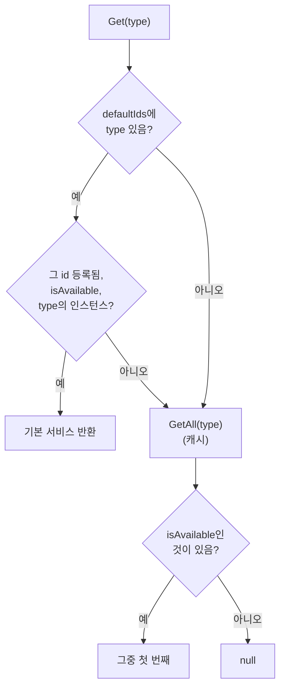

# 5. `ServiceRegistry`

> 기준 커밋: `1f1bb93d`. [← 목차](README.md) · 이전: [4. `Kernel`](04-kernel.md) · 다음: [6. 차이와 기존 문서](06-differences.md)

[`ServiceRegistry`](../../Runtime/Services/ServiceRegistry.cs#L16)는 플랫폼마다 다르게 구현되는 기능(파일 관리자 열기, 휴지통, StreamingAssets 등)을 **계약 타입으로 찾게** 해 주는 정적 등록소입니다. core는 계약 인터페이스만 정의하고, 구현은 각 플랫폼 패키지가 등록합니다.

```csharp
if (ServiceRegistry.TryGet(out IFileManagerService? fileManager))
    await fileManager.ShowFolder(path);
```

- [5.1 `IService`](#51-iservice)
- [5.2 상태](#52-상태)
- [5.3 등록과 해제](#53-등록과-해제)
- [5.4 계약으로 찾기: `Get`](#54-계약으로-찾기-get)
- [5.5 기본 서비스](#55-기본-서비스)
- [5.6 `GetAll`과 `GetServiceTypes`](#56-getall과-getservicetypes)
- [5.7 계약과 구현](#57-계약과-구현)

## 5.1 `IService`

```csharp
// Runtime/Services/IService.cs
15  public interface IService
16  {
26      Identifier id { get; }
36      bool isAvailable => true;
37  }
```

- `id`는 계약과 관계없이 **등록된 모든 서비스 사이에서 고유**해야 합니다. 같은 id로 두 번째 서비스를 등록하면 예외입니다.
- `isAvailable`은 "지금 계약을 이행할 수 있는가"이며, 실행 중에 바뀌어도 됩니다. 기본 구현은 `true`입니다. `Get`은 부를 때마다 이 값을 다시 읽습니다.

**계약**은 `IService`를 상속한 인터페이스입니다. 서비스는 등록할 때 계약을 밝히지 않습니다. 호출자가 `Get<T>()`에 넘긴 타입의 인스턴스이면 그 계약의 서비스입니다. 한 서비스가 여러 계약을 구현하면 여러 계약으로 찾을 수 있습니다.

## 5.2 상태

```csharp
// Runtime/Services/ServiceRegistry.cs
18  static readonly HashSet<IService> services = [];
19  static readonly Dictionary<Identifier, IService> registriesById = [];
20  static readonly Dictionary<Type, IService[]> servicesByContract = [];
21  static readonly Dictionary<Type, Identifier> defaultIds = [];
22  static Type[]? serviceTypes;
```

| 필드 | 뜻 | 바뀌는 때 |
| --- | --- | --- |
| `services` | 등록된 서비스 집합 | 등록·해제 |
| `registriesById` | id → 서비스 | 등록·해제 |
| `servicesByContract` | 계약 타입 → 그 인스턴스인 서비스 배열 (**캐시**) | 처음 조회할 때 채우고, 등록·해제 때 모두 버림 |
| `defaultIds` | 계약 타입 → 선호하는 서비스 id | `SetDefault` |
| `serviceTypes` | 등록된 서비스가 구현한 계약 목록 (**캐시**) | 처음 조회할 때 채우고, 등록·해제 때 버림 |

`isAvailable`은 캐시하지 않습니다. 캐시는 "어떤 서비스가 그 계약의 인스턴스인가"까지만 기억하고, 사용 가능 여부는 조회할 때마다 묻습니다. 잠금은 없습니다.

## 5.3 등록과 해제

```csharp
// Runtime/Services/ServiceRegistry.cs
36  public static void Register(IService service)
37  {
38      if (!registriesById.TryAdd(service.id, service))
39          throw new InvalidOperationException($"Registry ID conflict: {service.id}");
41      services.Add(service);
42      servicesByContract.Clear();
43      serviceTypes = null;
44  }
58  public static void Unregister(IService service)
59  {
60      if (Get(service.id) is not { } otherService)
61          throw new InvalidOperationException($"Unregistered registry: {service.id}");
62      if (service != otherService)
63          throw new InvalidOperationException($"Unregistered registry instance: {service.id}");
65      services.Remove(service);
66      registriesById.Remove(service.id);
67      servicesByContract.Clear();
68      serviceTypes = null;
69  }
```

| 줄 | 설명 |
| --- | --- |
| 38–39 | id를 먼저 차지합니다. 이미 있으면 집합을 건드리지 않고 예외를 던집니다. |
| 41–43 | 집합에 넣고 두 캐시를 모두 버립니다. 어떤 계약에 영향을 주는지 따지지 않고 전부 버립니다. |
| 60–63 | 그 id로 등록된 것이 없거나, 같은 id의 **다른 인스턴스**가 등록되어 있으면 예외입니다. 해제는 등록한 바로 그 객체로만 됩니다. |
| 65–68 | 등록의 반대. |

등록 쪽은 모두 같은 모양입니다. 서비스 클래스가 정적 `instance`를 갖고, `[OnAssemblyLoaded]`에서 등록하고 `[OnAssemblyUnloading]`에서 해제합니다([1.2절](01-lifecycle-hooks.md#12-core가-쓰는-훅)). 플랫폼 조건은 `#if`(예: `UNITY_EDITOR_WIN || !UNITY_EDITOR`)나 asmdef의 플랫폼 설정으로 겁니다.

```csharp
// io.github.rumi727.runios.linux/Runtime/IO/Locations/Linux/LinuxFileManagerService.cs
25  public static LinuxFileManagerService instance { get; } = new();
31  public static readonly Identifier id = new Identifier("runios", "file-manager/linux");
…
67  static void OnAssemblyLoaded() => ServiceRegistry.Register(instance);
```

## 5.4 계약으로 찾기: `Get`

```csharp
// Runtime/Services/ServiceRegistry.cs
153 public static IService? Get(Identifier identifier) => registriesById.GetValueOrDefault(identifier);
167 public static T? Get<T>() where T : IService => (T?)Get(typeof(T));
188 public static IService? Get(Type type)
189 {
190     if (defaultIds.TryGetValue(type, out Identifier id) && Get(id) is { isAvailable: true } defaultService && type.IsInstanceOfType(defaultService))
191         return defaultService;
193     return GetAll(type).FirstOrDefault(x => x.isAvailable);
194 }
212 public static bool TryGet<T>([NotNullWhen(true)] out T? service) where T : IService { service = Get<T>(); return service != null; }
```

| 줄 | 설명 |
| --- | --- |
| 153 | id로 찾기. `isAvailable`을 보지 않습니다. |
| 190–191 | 그 계약에 기본 서비스가 정해져 있고, ① 그 id로 등록되어 있고 ② 사용 가능하고 ③ 그 계약의 인스턴스이면 그것을 돌려줍니다. |
| 193 | 아니면 그 계약의 서비스 중 **사용 가능한 첫 번째**. 배열은 `HashSet` 순서로 만들어지므로, 여러 개가 사용 가능할 때 어느 것이 나오는지는 정해져 있지 않습니다(XML에 "지정되지 않음"으로 적혀 있습니다). 없으면 `null`. |
| 212 | `TryGet`은 `Get` 결과가 `null`이 아닌지를 돌려줄 뿐입니다. `Type` 판(234행)도 같습니다. |



## 5.5 기본 서비스

```csharp
// Runtime/Services/ServiceRegistry.cs
87  public static void SetDefault(Type type, Identifier? serviceId)
88  {
89      if (serviceId is { } id)
90          defaultIds[type] = id;
91      else
92          defaultIds.Remove(type);
93  }
125 public static Identifier? GetDefault(Type type) => defaultIds.TryGetValue(type, out Identifier id) ? id : (Identifier?)null;
```

기본값은 **선호**일 뿐입니다. 설정할 때 그 id가 등록되어 있는지, 계약의 인스턴스인지 검사하지 않습니다. 조건이 맞지 않는 동안에는 [5.4절](#54-계약으로-찾기-get)의 190행에서 건너뛰지만 설정은 남아 있어서, 서비스가 등록되거나 다시 사용 가능해지면 다시 적용됩니다. `GetDefault`는 설정한 값을 그대로 돌려줍니다. 기본값은 정확한 타입 키로 찾으므로, 부모 계약에 정한 기본값은 자식 계약 조회에 적용되지 않습니다.

현재 저장소에서 `SetDefault`를 부르는 곳은 없습니다.

## 5.6 `GetAll`과 `GetServiceTypes`

```csharp
// Runtime/Services/ServiceRegistry.cs
248 public static ReadOnlySet<IService> GetAll() => services.AsReadOnly();
262 public static IEnumerable<T> GetAll<T>() where T : IService => GetAll(typeof(T)).Cast<T>();
280 public static IReadOnlyList<IService> GetAll(Type type)
281 {
282     if (!servicesByContract.TryGetValue(type, out IService[]? array))
283         servicesByContract[type] = array = [..services.Where(type.IsInstanceOfType)];
285     return array;
286 }
303 public static IReadOnlyList<Type> GetServiceTypes() => serviceTypes ??=
304 [
305     ..services.SelectMany(x => x.GetType().GetInterfaces())
306         .Where(x => x != typeof(IService) && typeof(IService).IsAssignableFrom(x))
307         .Distinct()
308 ];
```

| 줄 | 설명 |
| --- | --- |
| 248 | 등록된 전부를 읽기 전용으로. |
| 262·280–286 | 그 계약의 인스턴스인 **등록된 서비스 전부**입니다. `isAvailable`로 거르지 않습니다. 사용 가능한 것만 필요하면 호출자가 거릅니다. 예를 들어 기본 리소스 팩은 [`ResourcePack.Static.cs#L41`](../../Runtime/Resource/ResourcePack.Static.cs#L41)에서 `GetAll<IStreamingAssetsService>().Where(x => x.isAvailable)`로 거릅니다([IO 7.1](../IO/07-streaming-assets.md#71-istreamingassetsservice)). |
| 283 | 계약별 결과를 처음 조회할 때 만들어 둡니다. 돌려준 배열은 캐시 자체이므로, 다음 등록·해제 뒤에도 호출자가 쥔 배열은 옛 내용 그대로입니다. |
| 303–308 | 등록된 서비스가 구현한 인터페이스 중 `IService`를 상속한 것(자신 제외)을 모읍니다. 상속 사슬의 모든 인터페이스가 들어갑니다. |

## 5.7 계약과 구현

계약 인터페이스는 core의 `Runtime/IO`에 있습니다. 각 계약의 메서드는 [IO 10.1](../IO/10-locations.md#101-서비스-계약)과 [IO 7.1](../IO/07-streaming-assets.md#71-istreamingassetsservice)에 정리되어 있습니다.

| 계약 | core | linux | windows |
| --- | --- | --- | --- |
| `IStreamingAssetsService` | `PlayerStreamingAssetsService`, `AndroidStreamingAssetsService`, `EditorStreamingAssetsService`(Editor) | | |
| `IFileManagerService` | | `LinuxFileManagerService` | `WindowsFileManagerService` |
| `IFileOpenService` | | `LinuxFileOpenService` | `WindowsFileOpenService` |
| `ITrashService` | | `LinuxTrashService` | `WindowsTrashService` |
| `IBookmarkService` | | `LinuxBookmarkService` | `WindowsBookmarkService` |
| `IKnownDirectoryService` | | `LinuxKnownDirectoryService` | `WindowsKnownDirectoryService` |
| `IDeviceLocationService` | | `LinuxDeviceLocationService` | `WindowsDeviceLocationService` |
| `IMountService` | | `LinuxMountService` | `WindowsMountService` |
| `INetworkLocationService` | | `LinuxNetworkLocationService` | `WindowsNetworkLocationService` |
| `IRootAccessService` | | | |

`IRootAccessService`는 구현이 없고, uielements의 `FileSystemBrowser`가 `TryGet`으로 있을 때만 씁니다. uielements의 `IOBrowser`·`IONodeMultiColumnTreeView`는 `Get<IFileManagerService>() != null`로 "파일 관리자에서 열기" 메뉴를 켜고 끕니다.
