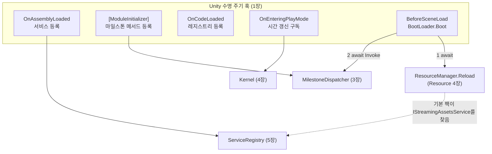

# 부팅·커널 작동 원리

> 기준 커밋: `1f1bb93d`. 코드 링크의 줄 번호는 이 커밋 기준입니다. [← core 문서 목차](../README.md)
>
> 함께 보기: [Resource 4장 리로드 파이프라인](../Resource/04-reload-pipeline.md), [IO 7장 StreamingAssets](../IO/07-streaming-assets.md), [IO 10장 Locations](../IO/10-locations.md)

`io.github.rumi727.runios.core`가 시작될 때 무엇이 어떤 순서로 준비되는지를 설명합니다. Unity 수명 주기 훅, 첫 리소스 리로드를 하는 `BootLoader`, 부팅 지점을 알리는 마일스톤, 실행 상태와 프레임 시간을 가진 `Kernel`, 플랫폼 기능을 계약으로 찾는 `ServiceRegistry`를 다룹니다. C#과 Unity를 아는 독자를 기준으로 썼습니다.

## 한 장으로 보기

그림의 훅은 순서대로 늘어놓은 것이 아닙니다. 훅 사이의 순서는 확인하지 않았습니다([1.4절](01-lifecycle-hooks.md#14-확인하지-않은-것)).

**핵심 아이디어 세 가지**

1. **시작점이 하나가 아니다.** 클래스마다 Unity 수명 주기 특성으로 자기 준비를 합니다. 에디터는 Play 모드에 들어갈 때 코드를 다시 로드하지 않으므로, 어셈블리 로드 때 한 등록은 남고 Play 모드 훅에서 건 구독은 세션마다 새로 걸립니다. → [1장](01-lifecycle-hooks.md)
2. **부팅은 씬을 기다리게 하지 않는다.** `BootLoader.Boot`는 기다려지지 않는 비동기 메서드라, 첫 씬의 `Awake`·`Start`가 리소스보다 먼저 올 수 있습니다. 리소스가 필요한 코드는 `[OnResourcesReady]`나 `IReloadable`로 받습니다. → [2장](02-bootloader.md), [3장](03-milestones.md)
3. **플랫폼 기능은 계약 타입으로 찾는다.** core는 인터페이스만 두고 플랫폼 패키지가 구현을 등록합니다. `Get<T>()`는 기본값, 그다음 사용 가능한 아무 구현 순으로 고릅니다. → [5장](05-service-registry.md)

## 읽는 순서

| 장 | 내용 | 깊이 |
| --- | --- | --- |
| [1. 수명 주기 훅](01-lifecycle-hooks.md) | 각 훅의 뜻, core가 쓰는 훅 표, Play 모드 진입 시 코드 리로드 끔 | 표 |
| [2. `BootLoader`](02-bootloader.md) | `Boot` 코드, 씬 로드와의 관계 | 핵심 줄 단위 |
| [3. 마일스톤](03-milestones.md) | `MilestoneDispatcher` 등록·호출, 소스 생성기, 분석기 규칙 | **줄 단위** |
| [4. `Kernel`](04-kernel.md) | 실행 상태, 프레임 시간, 갱신 구독, `quitting`과 `Quit` | 핵심 줄 단위 |
| [5. `ServiceRegistry`](05-service-registry.md) | 등록·해제, `Get` 해석 순서, 기본값, 캐시, 계약과 구현 표 | **줄 단위** |
| [6. 차이와 기존 문서](06-differences.md) | XML과 다른 곳, 관찰된 동작, 확인하지 않은 것, 사용처 없는 멤버 | 표 |

`UnityThread`, `RuniPlayerLoop`, `AsyncTask`, `Debug`, `InfiniteLoopDetector`는 [유틸리티 영역 문서](../Utility/README.md)에서 다룹니다.

## 용어집

| 용어 | 뜻 |
| --- | --- |
| **수명 주기 훅** | Unity가 정한 시점에 부르는 정적 메서드. `[OnAssemblyLoaded]` 같은 특성으로 표시 |
| **코드 리로드** | 에디터가 어셈블리를 다시 로드하는 것. Mono에서는 도메인 리로드 |
| **Play 세션** | 에디터에서 Play 모드에 한 번 들어갔다 나오기까지 |
| **마일스톤** | 부팅의 한 지점. 그 지점에서 특성이 붙은 메서드가 불림 |
| **계약** | `IService`를 상속한 인터페이스. 서비스를 찾는 키 |
| **기본 서비스** | 한 계약에서 `Get`이 먼저 고르도록 정한 서비스 id |

## 파일 지도

| 영역 | 파일 |
| --- | --- |
| 부팅 | `Runtime/Booting/BootLoader` |
| 마일스톤 | `Runtime/Milestones/MilestoneAttribute`, `OnResourcesReadyAttribute`, `MilestoneDispatcher` |
| 마일스톤 (생성·분석) | `RuniOS.CodeAnalysis/Generators/Milestones/MilestoneGenerator`, `Analyzers/MilestoneMethodAnalyzer`, `Diagnostics/MilestoneDiagnostics` |
| 커널 | `Runtime/Kernel`, `Runtime/Kernel.Time` |
| 서비스 | `Runtime/Services/IService`, `ServiceRegistry` |
| 설정 | `Runtime/csc.rsp`, `ProjectSettings/EditorSettings.asset` |
