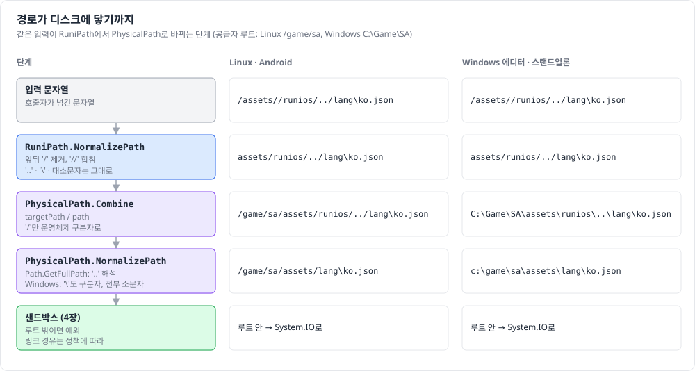

# 1. 경로: `RuniPath`, `PhysicalPath`, `FileExtension`

> 기준 커밋: `b3e1a343`. [← 목차](README.md) · 다음: [2. 공급자와 노드](02-providers-and-nodes.md)

IO 시스템에는 경로 타입이 둘 있습니다.

- **`RuniPath`**는 공급자(provider) 루트를 기준으로 한 **논리 경로**입니다. 구분자는 항상 `/`이고 앞에 루트가 붙지 않습니다. 모든 `IIOProvider` API가 이 타입을 받습니다.
- **`PhysicalPath`**는 운영체제가 이해하는 **절대 경로**입니다. 디스크에 닿는 공급자([4장](04-physical-and-sandbox.md))만 씁니다.

두 타입이 나뉘어 있어서 공급자 API는 "실제 파일이 어디에 있는가"를 몰라도 됩니다. 같은 `RuniPath`가 로컬 폴더, APK 안의 에셋, 메모리 속 가상 파일 중 어디로도 갈 수 있습니다. 이 장은 두 타입의 정규화 규칙과, `RuniPath`가 `PhysicalPath`로 바뀌는 순간 규칙이 어떻게 달라지는지를 다룹니다.

- [1.1 `RuniPath`의 정규화](#11-runipath의-정규화)
- [1.2 결합과 파생 경로](#12-결합과-파생-경로)
- [1.3 상위·상대 경로 판정](#13-상위상대-경로-판정)
- [1.4 `FileExtension`과 확장자 규칙](#14-fileextension과-확장자-규칙)
- [1.5 `PhysicalPath`: 디스크에 닿을 때](#15-physicalpath-디스크에-닿을-때)
- [1.6 직렬화](#16-직렬화)
- [1.7 정리: 경로가 디스크에 닿기까지](#17-정리-경로가-디스크에-닿기까지)

## 1.1 `RuniPath`의 정규화

[`RuniPath`](../../Runtime/IO/RuniPath.cs#L19)는 문자열 하나(`_value`)를 감싼 구조체입니다. 값이 들어오는 길은 생성자와 `value` setter 두 가지이고, 둘 다 `NormalizePath`를 거칩니다.

```csharp
// Runtime/IO/RuniPath.cs
43  public string value
    {
45      readonly get => _value ?? string.Empty;                      // ① default(RuniPath)도 빈 경로
46      set => _value = NormalizePath(value ?? string.Empty);
    }
48  [SerializeField, FieldName("runios-editor:gui.value"), NotNullField, Delayed, JsonIgnore] string? _value;
…
58  public RuniPath(string path) => _value = NormalizePath(path);
```

① `_value`가 `null`이어도 `value`는 빈 문자열을 돌려줍니다. 그래서 `default(RuniPath)`, `RuniPath.empty`, `new RuniPath("")`가 모두 같은 "공급자 루트"를 뜻합니다.

정규화 자체는 [`NormalizePath`](../../Runtime/IO/RuniPath.cs#L325)입니다. 길이를 먼저 세고(`CalculateNormalizeLength`) `string.Create`로 한 번에 채워 중간 문자열을 만들지 않습니다.

```csharp
// Runtime/IO/RuniPath.cs
325 public static string NormalizePath(string path)
    {
327     if (string.IsNullOrEmpty(path))
328         return string.Empty;
330     int length = CalculateNormalizeLength(path.AsSpan());          // ① 결과 길이를 먼저 계산
331     if (length == 0)
332         return string.Empty;
334     return string.Create(length, path, static (span, path) =>
        {
336         int dst = 0;
337         foreach (var item in path.AsSpan().Trim(directorySeparatorChar).SplitSpans(directorySeparatorChar))  // ② 앞뒤 '/' 제거 후 분할
            {
339             if (item.IsEmpty)                                       // ③ "//"가 만든 빈 조각은 버림
340                 continue;
342             if (dst > 0)
                {
344                 span[dst] = directorySeparatorChar;
345                 dst++;
                }
348             item.CopyTo(span.Slice(dst));
349             dst += item.Length;
            }
        });
    }
```

② 앞뒤 `/`를 잘라 루트 표기를 없앱니다. ③ 연속된 `/`는 하나로 합칩니다. 정규화가 **하지 않는 것**도 중요합니다.

| 입력 | 결과 | 이유 |
| --- | --- | --- |
| `"/a//b/"` | `"a/b"` | 앞뒤 `/` 제거, 빈 조각 제거 |
| `"a\b"` | `"a\b"` | `\`는 구분자가 아니라 이름의 일부 |
| `"a/../b"` | `"a/../b"` | `.`과 `..`은 해석하지 않고 이름으로 둠 |
| `"A/B"` | `"A/B"` | 대소문자 유지 |
| `""`, `"/"` | `""` | 빈 경로 = 공급자 루트 |

`RuniPath`가 `..`을 해석하지 않으므로, `..`이 어디를 가리키는지는 그 경로를 받은 공급자가 정하게 됩니다. 디스크 공급자는 [1.5절](#15-physicalpath-디스크에-닿을-때)에서 운영체제 규칙으로 해석하고, 루트 밖으로 나가는지는 [4장](04-physical-and-sandbox.md)의 샌드박스가 검사합니다.

허용하지 않는 문자도 검사하지 않습니다. [`RuniPathUtility.FixPathChars`](../../Runtime/Utility/RuniPathUtility.cs#L38)와 `FixFileNameChars`가 있지만 IO 코드 안에서는 부르지 않습니다.

**비교는 정규화된 문자열의 ordinal 비교입니다.** [`Equals`](../../Runtime/IO/RuniPath.cs#L416)는 `value == other.value`이고, `GetHashCode`도 `value`의 해시입니다. 대소문자를 구분합니다.

> **관찰된 동작:** `RuniPath == string` 연산자([`#L545`](../../Runtime/IO/RuniPath.cs#L545), [`#L563`](../../Runtime/IO/RuniPath.cs#L563))는 오른쪽 문자열을 정규화하지 않고 비교합니다. `RuniPath.From("a/b") == "/a/b"`는 `false`입니다.

## 1.2 결합과 파생 경로

`/` 연산자는 [`Combine`](../../Runtime/IO/RuniPath.cs#L262)입니다.

```csharp
// Runtime/IO/RuniPath.cs
262 public readonly RuniPath Combine(RuniPath path)
    {
264     if (length == 0 && path.length == 0)
265         return empty;
266     else if (length == 0)                     // ① 루트 / x = x
267         return path;
268     else if (path.length == 0)                // ② x / 루트 = x
269         return this;
271     return new RuniPath
        {
273         _value = string.Create(length + 1 + path.length, (left: this, right: path), static (span, state) =>
            { … 왼쪽 복사, '/' 하나, 오른쪽 복사 … })   // ③ 다시 정규화하지 않음
        };
    }
…
306 public readonly RuniPath Combine(string path) => Combine(new RuniPath(path));   // ④ 문자열은 먼저 정규화
```

③ 양쪽이 이미 정규화된 `RuniPath`이므로 `/` 하나로 이어 붙이기만 합니다. 결과는 정규화를 다시 거치지 않고 `_value`에 직접 들어갑니다. ④ 문자열 오버로드는 오른쪽을 먼저 `RuniPath`로 만들기 때문에 `path / "/x/"`도 안전합니다.

파생 경로를 만드는 메서드도 같은 방식으로 `_value`를 직접 채웁니다. 정규화된 경로의 일부를 잘라낸 결과는 여전히 정규화되어 있기 때문입니다.

| 메서드 | 줄 | 구현 | 예 (`"dir/name.tar.gz"`) |
| --- | --- | --- | --- |
| `GetFileName()` | [#L111](../../Runtime/IO/RuniPath.cs#L111) | 마지막 `/` 뒤 | `name.tar.gz` |
| `GetFileNameWithoutExtension()` | [#L121](../../Runtime/IO/RuniPath.cs#L121) | 마지막 확장자 제거 | `name.tar` |
| `GetPathWithoutExtension()` | [#L131](../../Runtime/IO/RuniPath.cs#L131) | 마지막 확장자 제거 | `dir/name.tar` |
| `GetParentPath()` | [#L141](../../Runtime/IO/RuniPath.cs#L141) | 마지막 `/` 앞 | `dir` |
| `GetExtension()` | [#L101](../../Runtime/IO/RuniPath.cs#L101) | `FileExtension` | `.gz` |
| `AddExtension(ext)` | [#L229](../../Runtime/IO/RuniPath.cs#L229) | 뒤에 붙임 | — |
| `SetExtension(ext)` | [#L245](../../Runtime/IO/RuniPath.cs#L245) | `GetPathWithoutExtension().AddExtension(ext)` | — |
| `Deconstruct(out dir, out name)` | [#L445](../../Runtime/IO/RuniPath.cs#L445) | 부모 + 파일 이름 | — |

## 1.3 상위·상대 경로 판정

상위 경로 판정은 [`RuniPathUtility.StartsWith`](../../Runtime/Utility/RuniPathUtility.cs#L346)에 있습니다.

```csharp
// Runtime/Utility/RuniPathUtility.cs
346 public static bool StartsWith(scoped ReadOnlySpan<char> path, scoped ReadOnlySpan<char> startPath)
    {
349     if (startPath.IsEmpty || path.SequenceEqual(startPath))          // ① 빈 경로(루트)는 모든 경로의 상위, 자기 자신도 포함
350         return true;
351     if (path.Length <= startPath.Length)
352         return false;
355     return path[startPath.Length] == RuniPath.directorySeparatorChar  // ② 접두사 바로 뒤가 '/'여야 함
            && path.StartsWith(startPath, StringComparison.Ordinal);
    }
```

② 문자열 접두사만 보면 `"folder_A"`가 `"folder"`의 하위로 잘못 판정됩니다. 접두사 바로 뒤에 구분자가 있는지 확인해 **조각 경계**에서만 맞춥니다.

상대 경로는 [`TryGetRelativePath`](../../Runtime/Utility/RuniPathUtility.cs#L304)가 같은 규칙으로 계산합니다. 같은 경로면 빈 경로, 기준이 루트면 경로 그대로, 하위면 `기준 + '/'` 뒤를 잘라 돌려줍니다. 하위가 아니면 `false`입니다. 이 함수는 [4장](04-physical-and-sandbox.md)의 열거와 [9장](09-virtual-fs.md)의 가상 트리에서 "루트 기준 경로"를 되돌릴 때 씁니다.

`GetRelativePath`(실패 시 결과를 돌려주는 버전)는 실패하면 빈 경로를 돌려줍니다([`RuniPathUtility.cs#L276`](../../Runtime/Utility/RuniPathUtility.cs#L276)). 빈 경로는 "루트"와 구분되지 않으므로, 하위인지 모르는 경로에는 `TryGetRelativePath`를 씁니다.

## 1.4 `FileExtension`과 확장자 규칙

[`FileExtension`](../../Runtime/IO/FileExtension.cs#L15)은 **점을 포함한** 확장자(`".json"`)입니다. setter가 입력 전체에서 확장자만 뽑아 저장합니다.

```csharp
// Runtime/IO/FileExtension.cs
61  public string value
    {
63      readonly get => _value ?? string.Empty;
64      set
        {
66          value ??= string.Empty;
67          _value = RuniPathUtility.GetExtension(value).ToString();   // ① 경로든 확장자든 마지막 확장자만 남김
        }
    }
```

① 그래서 `new FileExtension("dir/a.json")`과 `new FileExtension(".json")`은 같은 값입니다. 확장자를 찾는 규칙은 [`GetExtension`](../../Runtime/Utility/RuniPathUtility.cs#L150)입니다.

```csharp
// Runtime/Utility/RuniPathUtility.cs
155 int separatorIndex = path.LastIndexOf(RuniPath.directorySeparatorChar);
156 int extIndex = path.LastIndexOf(FileExtension.extensionSeparatorChar);
158 if (extIndex <= separatorIndex)                 // ① 마지막 '.'이 마지막 '/'보다 앞이면 확장자 없음
159     return ReadOnlySpan<char>.Empty;
161 return path.Slice(extIndex);                    // ② '.'부터 끝까지
```

이 규칙에서 나오는 결과를 표로 보면 다음과 같습니다.

| 입력 | `GetExtension` | 비고 |
| --- | --- | --- |
| `"a.tar.gz"` | `".gz"` | 마지막 확장자만 |
| `"dir.v2/readme"` | `""` | 점이 디렉터리 이름에만 있음 |
| `".json"` | `".json"` | |
| `"json"` | `""` | 점이 없음 |
| `"dir/.config"` | `".config"` | 점 파일은 이름 전체가 확장자 |

> **관찰된 동작:** 점 없이 `"json"`을 넘기면 빈 확장자가 됩니다([`FileExtension.cs#L47`](../../Runtime/IO/FileExtension.cs#L47)). 따라서 `AddExtension("json")`은 아무것도 붙이지 않고, `new ExtensionMatcher("json")`은 확장자가 없는 파일만 맞춥니다.

> **관찰된 동작:** 점 파일에서 [`GetPathWithoutExtension`](../../Runtime/Utility/RuniPathUtility.cs#L223)은 이름 전체를 지웁니다. `"dir/.config"` → `"dir"`(231~232행). 그 결과 `SetExtension(".txt")`는 `"dir.txt"`가 됩니다.

## 1.5 `PhysicalPath`: 디스크에 닿을 때

[`PhysicalPath`](../../Runtime/IO/PhysicalPath.cs#L19)는 항상 절대 경로입니다. 생성할 때 [`NormalizePath`](../../Runtime/IO/PhysicalPath.cs#L267)가 운영체제 규칙으로 정리합니다.

```csharp
// Runtime/IO/PhysicalPath.cs
267 public static string NormalizePath(string path)
    {
269     if (string.IsNullOrEmpty(path))
270         path = Directory.GetCurrentDirectory();           // ① 빈 경로 = 현재 작업 디렉터리
272     string fullPath = Path.GetFullPath(path);             // ② '..' 해석, Windows에서는 '\'도 구분자
273     int rootLength = Path.GetPathRoot(fullPath.AsSpan()).Length;
275     int trimmedLength = fullPath.Length;
276     while (trimmedLength > rootLength && (fullPath[trimmedLength - 1] == Path.DirectorySeparatorChar || fullPath[trimmedLength - 1] == Path.AltDirectorySeparatorChar))
277         trimmedLength--;                                  // ③ 끝 구분자 제거 (루트는 남김)
279 #if UNITY_EDITOR_WINDOWS || (!UNITY_EDITOR && UNITY_STANDALONE_WINDOWS)
280     bool needsCopy = true;
281 #else
282     bool needsCopy = trimmedLength != fullPath.Length || fullPath.Contains(Path.AltDirectorySeparatorChar);
283 #endif
284     if (!needsCopy)
285         return fullPath;                                  // ④ 바꿀 것이 없으면 할당 없이 반환
287     return string.Create(trimmedLength, fullPath, static (span, state) =>
        {
289         for (int i = 0; i < span.Length; i++)
            {
291             char c = state[i];
292 #if UNITY_EDITOR_WINDOWS || (!UNITY_EDITOR && UNITY_STANDALONE_WINDOWS)
293             c = char.ToLowerInvariant(c);                 // ⑤ Windows에서는 전부 소문자
294 #endif
295             if (c == Path.AltDirectorySeparatorChar)
296                 span[i] = Path.DirectorySeparatorChar;    // ⑥ '/'를 운영체제 구분자로
297             else
298                 span[i] = c;
            }
        });
    }
```

① `default(PhysicalPath)`의 `value`도 이 경로를 거쳐 현재 작업 디렉터리가 됩니다([`#L29`](../../Runtime/IO/PhysicalPath.cs#L29)). 매번 계산되므로 작업 디렉터리가 바뀌면 값도 바뀝니다. ② `Path.GetFullPath`가 `..`과 `.`을 해석합니다. `RuniPath`가 미뤄 둔 해석이 여기서 일어납니다.

> **관찰된 동작:** ⑤ Windows 에디터와 Windows 스탠드얼론에서는 물리 경로 전체를 소문자로 바꿉니다. 그래서 [`PhysicalIOProvider.EnumerateEntries`](../../Runtime/IO/PhysicalIOProvider.cs#L127)가 돌려주는 `IOEntry.path`도 Windows에서만 소문자가 되고(파일 이름 `metaData.name`은 원래 대소문자), Linux·Android·가상 공급자는 원래 대소문자를 유지합니다. 경로를 대소문자 구분 규칙으로 다시 검사하는 코드(예: [리소스 `Identifier`](../../Runtime/Resource/Identifier.cs#L296)는 소문자만 허용)는 플랫폼에 따라 결과가 달라질 수 있습니다.

`RuniPath`를 붙일 때는 [`Combine(RuniPath)`](../../Runtime/IO/PhysicalPath.cs#L202)를 씁니다.

```csharp
// Runtime/IO/PhysicalPath.cs
202 public readonly PhysicalPath Combine(RuniPath path)
    {
204     if (path.length == 0)
205         return this;
207     return (PhysicalPath)string.Create(length + 1 + path.length, (left: this, right: path), static (span, state) =>
        {
            … 왼쪽 복사, Path.DirectorySeparatorChar …
221         char c = state.right.value[i];
222         if (c == RuniPath.directorySeparatorChar)
223             span[index] = Path.DirectorySeparatorChar;   // ① 논리 구분자 '/'를 운영체제 구분자로
            …
        });                                                  // ② (PhysicalPath) 캐스트가 NormalizePath를 다시 부름
    }
```

② 결과를 `(PhysicalPath)`로 캐스트하면 [`explicit operator`](../../Runtime/IO/PhysicalPath.cs#L380)가 `NormalizePath`를 다시 부릅니다. 이때 `RuniPath` 안에 있던 `..`이 해석되고, Windows에서는 이름에 있던 `\`도 구분자가 됩니다. `RuniPath`에서는 이름의 일부였던 문자가 디스크에서는 경로 구조를 바꿀 수 있다는 뜻입니다. 이것을 루트 밖으로 나가지 못하게 막는 일이 [4장](04-physical-and-sandbox.md)의 샌드박스입니다.

상위 판정 [`StartsWith`](../../Runtime/IO/PhysicalPath.cs#L149)는 `RuniPath`와 같은 조각 경계 규칙에, 루트(`C:\`, `/`)는 이미 구분자로 끝나므로 접두사만 보는 분기를 더합니다(156~157행).

두 경로 타입의 문자열 변환 규칙은 다릅니다. `PhysicalPath`는 `string`으로 **암시적** 변환되고([`#L370`](../../Runtime/IO/PhysicalPath.cs#L370)) `System.IO` API에 바로 넘길 수 있습니다. `RuniPath`는 **명시적** 변환만 있습니다([`RuniPath.cs#L486`](../../Runtime/IO/RuniPath.cs#L486)). 그래서 논리 경로는 운영체제 API에 저절로 넘어가지 않고, 넘기려면 명시적으로 변환해야 합니다.

## 1.6 직렬화

세 타입 모두 Unity 직렬화(`[SerializeField] _value`)와 Newtonsoft JSON을 지원합니다.

- Unity 직렬화 콜백은 `value = value`입니다([`RuniPath.cs#L632`](../../Runtime/IO/RuniPath.cs#L632)). 인스펙터에서 직접 고친 문자열도 저장·로드할 때 정규화됩니다.
- JSON은 문자열 하나입니다. [`RuniPathConverter`](../../Runtime/Json/Converters/IO/RuniPathConverter.cs#L13)와 `PhysicalPathConverter`는 문자열이 아닌 토큰에서 `JsonReaderException`을 던집니다.

> **관찰된 동작:** `FileExtension`의 특성은 `[JsonConverter(typeof(FileExtension))]`로, 컨버터가 아니라 타입 자신을 가리킵니다([`FileExtension.cs#L14`](../../Runtime/IO/FileExtension.cs#L14)). 같은 폴더의 [`FileExtensionConverter`](../../Runtime/Json/Converters/IO/FileExtensionConverter.cs#L13)는 어디서도 참조하지 않습니다.

## 1.7 정리: 경로가 디스크에 닿기까지



| 단계 | 하는 일 | 바뀌지 않는 것 |
| --- | --- | --- |
| `RuniPath.NormalizePath` | 앞뒤 `/` 제거, 연속 `/` 합침 | `\`, `.`, `..`, 대소문자 |
| `RuniPath` `/` 결합 | `/` 하나로 이어 붙임 | 재정규화 없음 |
| `PhysicalPath.Combine` | `/` → 운영체제 구분자 | |
| `PhysicalPath.NormalizePath` | `GetFullPath`(`..` 해석), 끝 구분자 제거, Windows 소문자화 | |
| 샌드박스 ([4장](04-physical-and-sandbox.md)) | 루트 밖·링크 경유 거부 | |
