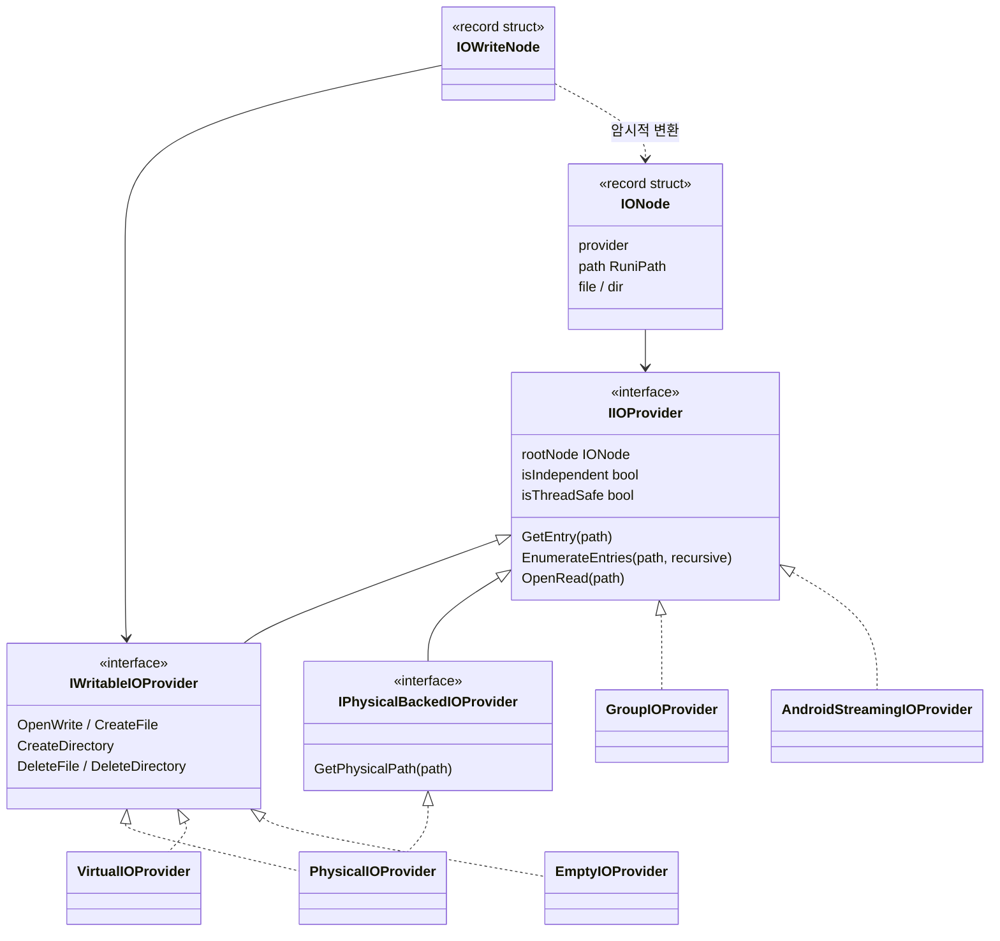

# 2. 공급자와 노드: `IIOProvider`, `IONode`

> 기준 커밋: `b3e1a343`. [← 목차](README.md) · 이전: [1. 경로](01-paths.md) · 다음: [3. 열거와 매처](03-enumeration-and-matchers.md)

IO 시스템의 중심은 **공급자(provider)**입니다. 공급자는 "어떤 저장소의 루트"를 나타내는 객체이고, 모든 파일 작업은 `공급자 + RuniPath`로 표현됩니다. 사용하는 쪽은 대개 공급자를 직접 부르지 않고 그 둘을 묶은 **노드(`IONode`)**를 씁니다.

이 장은 공급자 인터페이스의 계약(어떤 멤버를 구현해야 하고 어떤 멤버가 기본 구현으로 따라오는가), 노드가 하는 일, 엔트리와 메타데이터, 체크섬을 다룹니다.

- [2.1 계층 한눈에 보기](#21-계층-한눈에-보기)
- [2.2 `IIOProvider`: 읽기 계약](#22-iioprovider-읽기-계약)
- [2.3 `IWritableIOProvider`와 표시 인터페이스](#23-iwritableioprovider와-표시-인터페이스)
- [2.4 `IONode`: 공급자 + 경로](#24-ionode-공급자--경로)
- [2.5 `IOEntry`와 `FileMetaData`](#25-ioentry와-filemetadata)
- [2.6 `EmptyIOProvider`와 빈 노드](#26-emptyioprovider와-빈-노드)
- [2.7 체크섬](#27-체크섬)

## 2.1 계층 한눈에 보기



| 공급자 | 쓰기 | 디스크 | 장 |
| --- | --- | --- | --- |
| `PhysicalIOProvider` | O | O | [4장](04-physical-and-sandbox.md) |
| `GroupIOProvider` | X | X | [6장](06-group-provider.md) |
| `AndroidStreamingIOProvider` | X | X | [8장](08-android-assets.md) |
| `VirtualIOProvider` | O | X | [9장](09-virtual-fs.md) |
| `EmptyIOProvider` | O(버림) | X | [2.6절](#26-emptyioprovider와-빈-노드) |

## 2.2 `IIOProvider`: 읽기 계약

[`IIOProvider`](../../Runtime/IO/IIOProvider.cs#L16)는 읽기 전용이고 `IDisposable`입니다. 구현체가 반드시 만들어야 하는 멤버는 셋뿐입니다.

```csharp
// Runtime/IO/IIOProvider.cs
131 UniTask<IOEntry?> GetEntry(RuniPath path, CancellationToken cancellationToken = default);                         // ① 없으면 null
153 IUniTaskAsyncEnumerable<IOEntry> EnumerateEntries(RuniPath path, bool recursive, CancellationToken cancellationToken = default);
171 UniTask<Stream> OpenRead(RuniPath path, CancellationToken cancellationToken = default);
```

나머지는 이 셋 위에 기본 인터페이스 멤버로 구현되어 있습니다.

```csharp
// Runtime/IO/IIOProvider.cs
95  async UniTask<bool> DirectoryExists(RuniPath path, CancellationToken cancellationToken = default) => await GetEntry(path, cancellationToken) is { isDirectory: true };
113 async UniTask<bool> FileExists(RuniPath path, CancellationToken cancellationToken = default) => await GetEntry(path, cancellationToken) is { isDirectory: false };   // ② 존재 확인 = GetEntry
…
189 async UniTask<byte[]> ReadAllBytes(RuniPath path, CancellationToken cancellationToken = default)
    {
191     await using Stream? stream = await OpenRead(path, cancellationToken);
192     return await stream.ReadToEndAsync(cancellationToken);                // ③ MemoryStream으로 CopyToAsync
    }
…
211 async UniTask<string> ReadAllText(RuniPath path, CancellationToken cancellationToken = default)
    {
213     await using var stream = await OpenRead(path, cancellationToken);
214     using var reader = new StreamReader(stream);                          // ④ UTF-8 기본, BOM 감지
215     return await reader.ReadToEndAsync();
    }
```

② 기본 구현에서 존재 확인은 `GetEntry`의 결과를 보는 것뿐입니다. 공급자가 더 빠른 방법을 알면 덮어씁니다(예: Physical은 `File.Exists`). 덮어쓴 구현이 기본 구현과 다른 결과를 내는 경우는 [12장](12-differences.md)에 모았습니다.

③ [`ReadToEndAsync`](../../Runtime/Utility/StreamUtility.cs#L20)는 `Stream`을 `MemoryStream`에 복사하는 확장 메서드입니다.

다음 멤버들은 호출하는 쪽이 공급자를 어떻게 다룰지 정하는 데 씁니다.

| 속성 | 기본값 | 뜻 |
| --- | --- | --- |
| [`isThreadSafe`](../../Runtime/IO/IIOProvider.cs#L65) | `false` | `true`면 백그라운드 스레드에서 호출해도 됩니다. 긴 작업을 메인 스레드에서 하나씩 기다리지 않고 한꺼번에 처리하려는 호출자가 봅니다. |
| [`isIndependent`](../../Runtime/IO/IIOProvider.cs#L52) | (구현 필수) | 구조가 공급자 밖에서 바뀌지 않으면 `true`(가상 트리), 운영체제나 다른 프로그램이 바꿀 수 있으면 `false`(물리 폴더) |
| [`IsSameTarget(other)`](../../Runtime/IO/IIOProvider.cs#L77) | (구현 필수) | 두 공급자가 같은 대상을 가리키는지. 참조가 달라도 같은 폴더면 `true`일 수 있습니다. |

같은 폴더를 가리키는 `PhysicalIOProvider` 두 개는 다른 객체지만 `IsSameTarget`으로는 같은 대상입니다. 리소스 핸들은 리로드 때 이 판정으로 기존 핸들을 재사용할지 정합니다([11.3절](11-consumers.md#113-에셋-레지스트리와-핸들)).

> **관찰된 동작:** `isIndependent`는 모든 공급자가 구현하지만 읽는 코드가 없습니다. XML 주석은 압축 파일 공급자를 예로 들지만 그런 공급자는 없습니다([`#L25`](../../Runtime/IO/IIOProvider.cs#L25)).

## 2.3 `IWritableIOProvider`와 표시 인터페이스

[`IWritableIOProvider`](../../Runtime/IO/IWritableIOProvider.cs#L13)는 쓰기를 더합니다. 구현 필수 멤버는 다섯입니다.

| 멤버 | 줄 | 계약 |
| --- | --- | --- |
| `OpenWrite` | [#L61](../../Runtime/IO/IWritableIOProvider.cs#L61) | 쓰기 스트림. **기존 내용을 지우지 않음** |
| `CreateFile` | [#L93](../../Runtime/IO/IWritableIOProvider.cs#L93) | 새로 만들거나 비우고 쓰기 스트림 |
| `CreateDirectory` | [#L75](../../Runtime/IO/IWritableIOProvider.cs#L75) | 디렉터리 생성 |
| `DeleteFile` / `DeleteDirectory` | [#L121](../../Runtime/IO/IWritableIOProvider.cs#L121) / [#L107](../../Runtime/IO/IWritableIOProvider.cs#L107) | 삭제 |

복사·이동·`WriteAll*`은 이 다섯 위의 기본 구현입니다. 그 알고리즘과 실패했을 때 남는 상태는 [5장](05-write-operations.md)에서 다룹니다. `rootNode`는 `IOWriteNode`를 돌려주도록 다시 선언되어 있습니다([`#L19`](../../Runtime/IO/IWritableIOProvider.cs#L19)).

표시 인터페이스가 둘 더 있습니다.

- [`IPhysicalBackedIOProvider`](../../Runtime/IO/IPhysicalBackedIOProvider.cs#L12): `GetPhysicalPath(RuniPath)`로 실제 디스크 경로를 알려 줍니다. 쓰기 가능하다는 뜻은 아닙니다. 네이티브 라이브러리처럼 경로만 받는 API에 파일을 넘길 때, 바이트를 메모리로 읽지 않고 경로를 바로 넘기는 지름길로 씁니다(예: FMOD 패키지의 사운드 생성).
- [`IPrecalculatedIOChecksum`](../../Runtime/IO/IPrecalculatedIOChecksum.cs#L9): 체크섬을 미리 알고 있는 공급자용입니다([2.7절](#27-체크섬)).

## 2.4 `IONode`: 공급자 + 경로

[`IONode`](../../Runtime/IO/IONode.cs#L11)는 `(provider, path)` 두 값만 가진 `readonly record struct`입니다. 상태를 따로 갖지 않고, 모든 작업을 `provider.X(path)`로 넘깁니다.

```csharp
// Runtime/IO/IONode.cs
11  public readonly partial record struct IONode(IIOProvider provider, RuniPath path = default)
    {
17      public static IONode empty => EmptyIOProvider.instance.rootNode;
23      public bool isValid => _provider != null;                          // ① default(IONode)만 false
29      public IIOProvider provider => _provider ?? EmptyIOProvider.instance;   // ② null 공급자 대신 빈 공급자
30      readonly IIOProvider? _provider = provider;
…
54      public Directory dir => new Directory(this);                        // ③ 디렉터리 작업 묶음
60      public File file => new File(this);                                 // ③ 파일 작업 묶음
…
72      public IONode CreateChild(RuniPath childPath)
        {
74          if (childPath.IsEmpty())
75              return this;
77          return new IONode(provider, path / childPath);
        }
…
109     public IONode CreateInRoot(RuniPath path) => new IONode(provider, path);
…
137     public IONode Bind(IOEntry entry) => new IONode(provider, entry.path);   // ④ 엔트리 경로를 루트 기준으로
```

② `default(IONode)`로 멤버를 불러도 `NullReferenceException`이 나지 않게 빈 공급자로 대체합니다. ③ `node.file.ReadAllText()`, `node.dir.GetFiles()`처럼 파일과 디렉터리 작업을 이름으로 나눕니다. [`File`](../../Runtime/IO/IONode.File.cs#L18)과 [`Directory`](../../Runtime/IO/IONode.Directory.cs#L18)는 노드 하나를 감싼 구조체라 할당이 없습니다. `file.GetEntry()`는 디렉터리 엔트리를, `dir.GetEntry()`는 파일 엔트리를 걸러 `null`로 돌려줍니다.

④ 열거가 돌려주는 `IOEntry.path`는 **공급자 루트 기준** 경로입니다. 그래서 엔트리로 노드를 만들 때는 현재 노드의 경로에 붙이지 않고 루트에서 다시 만듭니다.

> **관찰된 동작:** `Bind`는 호출한 노드의 경로를 쓰지 않습니다. 어느 노드에서 불러도 `CreateInRoot(entry.path)`와 같습니다.

노드 비교는 두 가지입니다. 컴파일러가 만든 `==`는 공급자 **참조**와 경로를 비교하고, [`IsSameTarget`](../../Runtime/IO/IONode.cs#L121)은 공급자의 `IsSameTarget`과 경로를 비교합니다.

쓰기 쪽 [`IOWriteNode`](../../Runtime/IO/IOWriteNode.cs#L11)는 같은 모양에 쓰기 멤버를 더한 구조체이고, `IONode`로 암시적 변환됩니다([`#L141`](../../Runtime/IO/IOWriteNode.cs#L141)). 읽기 노드에서 쓰기 노드가 필요하면 [`AsWriteNode()`](../../Runtime/IO/IONode.cs#L139)를 부릅니다. 공급자가 `IWritableIOProvider`가 아니면 `null`입니다.

## 2.5 `IOEntry`와 `FileMetaData`

[`IOEntry`](../../Runtime/IO/IOEntry.cs#L23)는 `(path, metaData, isDirectory)` 스냅샷입니다. 열거와 `GetEntry`가 돌려줍니다.

[`FileMetaData`](../../Runtime/IO/FileMetaData.cs#L37)는 이름 외에는 모두 nullable입니다. 공급자마다 알 수 있는 정보가 다르기 때문입니다(예: Android 압축 에셋은 크기를 모름).

같은 파일이 바뀌었는지는 [`IsSameRevision`](../../Runtime/IO/FileMetaData.cs#L84)으로 판정합니다. 리소스 핸들이 리로드 때 "다시 읽어야 하는가"를 정하는 데 씁니다.

```csharp
// Runtime/IO/FileMetaData.cs
84  public bool IsSameRevision(FileMetaData other)
    {
87      if (lastWriteTime is not { } thisLastWriteTime || other.lastWriteTime is not { } otherLastWriteTime || thisLastWriteTime != otherLastWriteTime)
88          return false;                    // ① 수정 시간을 모르면 항상 "다름"
91      if (size is { } thisSize && other.size is { } otherSize && thisSize != otherSize)
92          return false;                    // ② 크기는 양쪽 다 알 때만
95      if (creationTime is { } thisCreationTime && other.creationTime is { } otherCreationTime && thisCreationTime != otherCreationTime)
96          return false;
99      return true;
    }
```

① 수정 시간을 한쪽이라도 모르면 **"다르다"**고 답합니다(86행 주석: 양쪽 모두 있어야 하고 같아야 함). 그래서 수정 시간을 주지 않는 공급자의 파일은 리로드 때마다 다시 읽힙니다. ② 크기와 생성 시간은 둘 다 알 때만 비교하는 보조 기준입니다.

## 2.6 `EmptyIOProvider`와 빈 노드

[`EmptyIOProvider`](../../Runtime/IO/EmptyIOProvider.cs#L12)는 아무것도 없는 쓰기 가능 싱글턴입니다. 존재 확인은 `false`, 열거는 빈 결과, 쓰기는 버립니다. `IONode.empty`와, 공급자가 `null`인 노드의 대체 공급자로 쓰입니다.

> **관찰된 동작:** `FileExists`는 `false`인데 `OpenRead`는 예외 없이 `Stream.Null`을 돌려줍니다([`#L27`](../../Runtime/IO/EmptyIOProvider.cs#L27), [`#L32`](../../Runtime/IO/EmptyIOProvider.cs#L32)). 그래서 빈 노드에서 `ReadAllText()`는 빈 문자열이 됩니다.

> **관찰된 동작:** `IONode.empty`(빈 공급자, `isValid == true`)와 `default(IONode)`(공급자 `null`, `isValid == false`)는 `==`로 다르지만 동작은 같습니다. `IOWriteNode`에서 `IONode`로 변환하면 `provider` 속성(빈 공급자로 대체된 값)을 넘기므로 `isValid`가 `false`에서 `true`로 바뀝니다([`IOWriteNode.cs#L141`](../../Runtime/IO/IOWriteNode.cs#L141)).

## 2.7 체크섬

[`IONode.GetFileChecksum()`](../../Runtime/IO/IONode.Checksum.cs#L16)은 대문자 16진수 MD5를 돌려줍니다.

```csharp
// Runtime/IO/IONode.Checksum.cs
16  public async UniTask<string> GetFileChecksum()
    {
19      if (provider is IPrecalculatedIOChecksum precalculated)
20          return await precalculated.GetPrecalculatedChecksum(path);   // ① 공급자가 이미 알면 그대로
22      await using Stream stream = await provider.OpenRead(path);       // ② 스트림은 호출 스레드에서 연다
24      SynchronizationContext? callerContext = SynchronizationContext.Current;
25      await UniTask.SwitchToThreadPool();                               // ③ 해시 계산만 스레드 풀에서
27      using var incrementalHash = IncrementalHash.CreateHash(HashAlgorithmName.MD5);
28      byte[] buffer = ArrayPool<byte>.Shared.Rent(8192);
        …
36          string result = Convert.ToHexString(incrementalHash.GetHashAndReset());
37          if (callerContext != null && SynchronizationContext.Current != callerContext)
38              await UniTask.SwitchToSynchronizationContext(callerContext);   // ④ 호출자 컨텍스트로 복귀
40          return result;
        …
    }
```

② 공급자 대부분이 스레드 안전하지 않으므로 스트림 열기는 호출 스레드에서 합니다. ③ 해시 계산은 CPU 작업이라 스레드 풀로 옮깁니다. 버퍼는 `ArrayPool`에서 빌려 매번 할당하지 않습니다.

> **관찰된 동작:** ③ 스트림 읽기 자체는 스레드 풀에서 일어나며 공급자의 `isThreadSafe`를 보지 않습니다. 예외가 나면 ④에 닿지 않아 원래 컨텍스트로 돌아오지 않습니다. 이 메서드와 `IPrecalculatedIOChecksum`은 현재 호출하는 곳이나 구현하는 곳이 없습니다.
