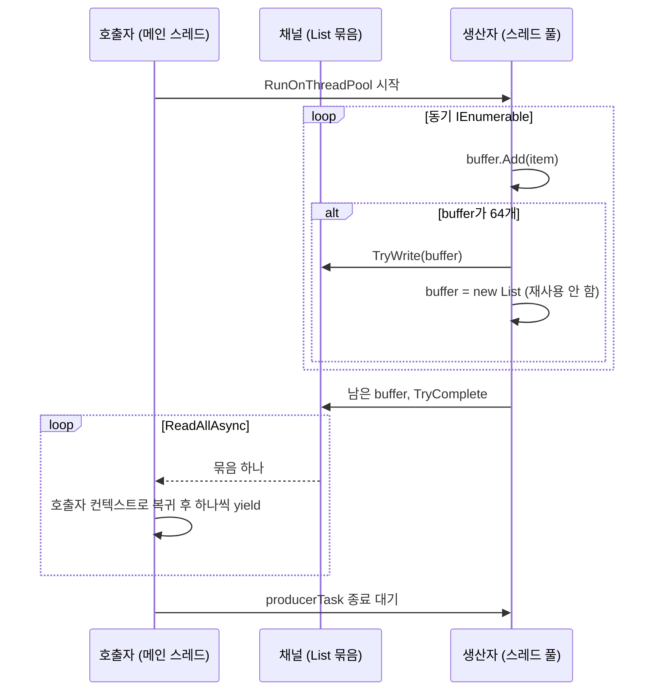

# 3. 열거와 매처

> 기준 커밋: `b3e1a343`. [← 목차](README.md) · 이전: [2. 공급자와 노드](02-providers-and-nodes.md) · 다음: [4. Physical과 샌드박스](04-physical-and-sandbox.md)

디렉터리 안의 파일을 찾는 일은 IO에서 가장 자주, 가장 많이 일어나는 작업입니다. 리소스 팩 하나를 읽을 때도 팩 폴더 전체를 재귀로 훑습니다. 이 장은 열거 API가 어떻게 생겼는지, 결과를 거르는 **매처**, 그리고 디스크·APK 열거를 메인 스레드를 막지 않고 처리하는 `EnumerateOnThreadPool`을 다룹니다.

- [3.1 열거 API](#31-열거-api)
- [3.2 매처](#32-매처)
- [3.3 `EnumerateOnThreadPool`: 스레드 풀에서 열거하기](#33-enumerateonthreadpool-스레드-풀에서-열거하기)
- [3.4 공급자별 열거 차이](#34-공급자별-열거-차이)

## 3.1 열거 API

공급자 쪽 원본은 하나입니다.

```csharp
// Runtime/IO/IIOProvider.cs
153 IUniTaskAsyncEnumerable<IOEntry> EnumerateEntries(RuniPath path, bool recursive, CancellationToken cancellationToken = default);
```

- 결과는 `IUniTaskAsyncEnumerable<IOEntry>`입니다. 결과 전체를 리스트로 모으지 않고 하나씩 흘려보내므로, 수만 개 파일도 메모리에 한꺼번에 올리지 않습니다.
- `IOEntry.path`는 **공급자 루트 기준** 경로입니다. 열거를 시작한 디렉터리 기준이 아닙니다. 엔트리로 노드를 만들 때 [`Bind`](02-providers-and-nodes.md#24-ionode-공급자--경로)를 쓰는 이유입니다.
- 파일과 디렉터리가 섞여 나옵니다. 순서는 정해져 있지 않습니다([3.4절](#34-공급자별-열거-차이)).

사용하는 쪽은 [`IONode.Directory`](../../Runtime/IO/IONode.Directory.cs#L18)의 이름 붙은 메서드를 씁니다. 모두 `EnumerateEntries`에 UniTask LINQ의 `Where`를 붙인 것입니다.

```csharp
// Runtime/IO/IONode.Directory.cs
55  public IUniTaskAsyncEnumerable<IOEntry> GetDirectories(…) => node.provider.EnumerateEntries(node.path, false, cancellationToken).Where(x => x.isDirectory);
…
135 public IUniTaskAsyncEnumerable<IOEntry> GetAllFiles(IPatternMatcher matcher, CancellationToken cancellationToken = default) =>
136     node.provider.EnumerateEntries(node.path, true, cancellationToken)
137         .Where(x => !x.isDirectory && matcher.IsMatch(x.path));          // ① 매처는 루트 기준 전체 경로를 받음
```

| 메서드 | 재귀 | 결과 |
| --- | --- | --- |
| `GetDirectories()` | X | 디렉터리 |
| `GetAllDirectories()` | O | 디렉터리 |
| `GetFiles()` / `GetFiles(matcher)` | X | 파일 (+ 매처) |
| `GetAllFiles()` / `GetAllFiles(matcher)` | O | 파일 (+ 매처) |

① 매처는 파일 이름이 아니라 루트 기준 **전체 경로**를 받습니다. 확장자 매처는 경로 끝만 보므로 상관없지만, 직접 만드는 매처는 이 점을 알고 써야 합니다.

## 3.2 매처

[`IPatternMatcher`](../../Runtime/IO/IPatternMatcher.cs#L4)는 메서드 하나짜리 인터페이스입니다.

```csharp
// Runtime/IO/IPatternMatcher.cs
16  bool IsMatch(scoped ReadOnlySpan<char> path);
17  bool IsMatch(string path) => IsMatch(path.AsSpan());
18  bool IsMatch(RuniPath path) => IsMatch(path.value.AsSpan());
```

`ReadOnlySpan<char>`를 받으므로, 열거 중 엔트리마다 불려도 경로 일부를 잘라 비교할 때 새 문자열을 만들지 않습니다.

| 매처 | 줄 | 동작 |
| --- | --- | --- |
| `ExtensionMatcher` | [#L4](../../Runtime/IO/ExtensionMatcher.cs#L4) | `GetExtension(path)`가 저장한 확장자와 **ordinal로** 같은지 |
| `PatternMatcherSet<T>` | [#L9](../../Runtime/IO/PatternMatcherSet%601.cs#L9) | 매처 중 하나라도 맞으면 참(OR). **빈 집합은 아무것도 맞지 않음** |
| `NotPatternMatcher` | [#L8](../../Runtime/IO/NotPatternMatcher.cs#L8) | 감싼 매처의 반대 |
| `AllPatternMatcher` | [#L4](../../Runtime/IO/AllPatternMatcher.cs#L4) | 항상 참 |
| `RegexMatcher` | [#L6](../../Runtime/IO/RegexMatcher.cs#L6) | `Regex.IsMatch` (span을 문자열로 바꿔 넘김) |

`ExtensionMatcher`와 `NotPatternMatcher`는 구조체이고, `PatternMatcherSet<T>`는 제네릭 `T`로 매처를 담아 인터페이스 박싱 없이 부릅니다. 확장자 묶음은 [`PatternMatcherSet.CreateExt`](../../Runtime/IO/PatternMatcherSet.cs#L40)로 만들고, `[CollectionBuilder]` 특성 덕분에 컬렉션 식(`[a, b]`)으로도 만들 수 있습니다.

```csharp
// Runtime/IO/PatternMatcherSet`1.cs
20  public bool IsMatch(scoped ReadOnlySpan<char> path)
    {
22      if (matchers.IsEmpty)
23          return false;                    // ① 빈 집합 = "아무 조건도 없음"이 아니라 "아무것도 아님"
25      foreach (var matcher in matchers)
        {
27          if (matcher.IsMatch(path))
28              return true;
        }
31      return false;
    }
```

`IPatternMatcher`에는 자주 쓰는 확장자 묶음이 정적 필드로 있습니다([`#L6`](../../Runtime/IO/IPatternMatcher.cs#L6)~14행): `pictureMatcher`, `textMatcher`, `musicMatcher`, `nbsMatcher`, `videoMatcher`, `compressMatcher`, `codeMatcher`, `jsonMatcher`, `allMatcher`.

확장자 비교는 대소문자를 구분합니다. `"a.PNG"`는 `pictureMatcher`에 맞지 않습니다. 점 없이 `"png"`를 넘기면 빈 확장자가 되는 규칙은 [1.4절](01-paths.md#14-fileextension과-확장자-규칙)을 보세요.

## 3.3 `EnumerateOnThreadPool`: 스레드 풀에서 열거하기

`System.IO`의 디렉터리 열거와 Android `AssetManager.list()`는 **동기** API입니다. 메인 스레드에서 돌리면 파일이 많거나 디스크가 느릴 때(네트워크 드라이브, 클라우드 동기화 폴더) 프레임이 멈춥니다. 그렇다고 결과를 전부 모아 한 번에 넘기면 첫 결과가 늦게 나옵니다.

[`EnumerateOnThreadPool`](../../Runtime/Utility/UniTaskLinqExtras.cs#L19)은 동기 `IEnumerable`을 스레드 풀에서 돌리고, 결과를 묶음(기본 64개) 단위로 호출자 컨텍스트에 넘깁니다.



```csharp
// Runtime/Utility/UniTaskLinqExtras.cs
31  SynchronizationContext? callerContext = SynchronizationContext.Current;      // ① 호출 시점 컨텍스트 기억
34  Channel<List<TSource>>? channel = Channel.CreateSingleConsumerUnbounded<List<TSource>>();
37  SemaphoreSlim? semaphore = queueLimit != null ? new SemaphoreSlim(queueLimit.Value, queueLimit.Value) : null;   // ② 선택적 배압
40  UniTask producerTask = UniTask.RunOnThreadPool(async () =>
    {
        …
54          if (buffer.Count >= batchSize)
            {
57              if (semaphore != null)
62                  await semaphore.WaitAsync(ct);
66              channel.Writer.TryWrite(buffer);
71              buffer = new List<TSource>(batchSize);                             // ③ 넘긴 리스트는 재사용하지 않음
            }
        …
88      catch (Exception exception)
90          channel.Writer.TryComplete(exception);                                // ④ 생산자 예외를 소비자에게 전달
        …
    }, cancellationToken: ct);
…
102 await foreach (var batch in channel.Reader.ReadAllAsync(ct))
    {
105     if (callerContext != null && SynchronizationContext.Current != callerContext)
106         await UniTask.SwitchToSynchronizationContext(callerContext);         // ⑤ 소비는 호출자 컨텍스트에서
108     foreach (var item in batch)
109         await writer.YieldAsync(item);
113     semaphore?.Release();
    }
…
120 catch (OperationCanceledException)
    {
        // 취소 시 예외 무시                                                    // ⑥
    }
124 finally
    {
128     await producerTask.SuppressCancellationThrow();                        // ⑦ 생산자가 끝날 때까지 기다림
129     semaphore?.Dispose();
    }
```

- **묶음으로 넘기는 효과:** 컨텍스트 전환이 항목마다가 아니라 묶음마다(최대 64개에 한 번) 일어나고, 첫 결과는 64개가 모이거나 열거가 끝나면 나옵니다.
- ③ 채널에 넘긴 리스트는 소비자가 아직 읽고 있을 수 있으므로 `Clear()`로 재사용하지 않고 새로 만듭니다. 묶음 하나당 리스트 하나를 할당하는 것은 이 경합을 피하기 위한 의도된 할당입니다.
- ② `queueLimit`을 주면 소비자가 처리하지 못한 묶음이 그 수에 닿을 때 생산자가 멈춥니다. 공급자 코드는 이 값을 주지 않으므로 채널은 무제한입니다.
- ⑤ 소비자는 결과를 받을 때마다 호출자 컨텍스트로 돌아갑니다. `await foreach`를 메인 스레드에서 시작했다면 루프 본문도 메인 스레드에서 돕니다.
- ⑦ 소비자가 중간에 그만둬도(예: `FirstAsync`) 생산자가 끝날 때까지 기다린 뒤 세마포어를 정리합니다.

> **관찰된 동작:** ⑥ 소비 루프는 `OperationCanceledException`을 삼킵니다. 그래서 이 함수를 쓰는 열거(Physical, Android)는 취소되면 예외 없이 **조용히 끝납니다**. 생산자가 던진 예외는 ④로 채널을 거쳐 소비자에게 그대로 전달됩니다.

## 3.4 공급자별 열거 차이

| | Physical ([4장](04-physical-and-sandbox.md)) | Android ([8장](08-android-assets.md)) | Virtual ([9장](09-virtual-fs.md)) | Group ([6장](06-group-provider.md)) |
| --- | --- | --- | --- | --- |
| 실행 위치 | 스레드 풀 (`EnumerateOnThreadPool`) | 스레드 풀 (`EnumerateOnThreadPool`) | 호출 스레드 | 자식 공급자를 따름 |
| 순서 | 파일 시스템 순서 | 너비 우선 | 이름 정렬, **자식이 부모보다 먼저**(후위) | 공급자 순서대로 이어 붙임 |
| 없는 디렉터리 | 예외 | 빈 결과 | 빈 결과 | 두 예외 종류만 삼킴 |
| 취소 | 조용히 끝남 | 조용히 끝남 | 예외 | 예외 |
| 숨김·`.meta` | 모두 포함 | — | — | 자식을 따름 |

> **관찰된 동작:** Physical은 `EnumerateOnThreadPool()`에 취소 토큰을 넘기지 않습니다([`PhysicalIOProvider.cs#L169`](../../Runtime/IO/PhysicalIOProvider.cs#L169)). 토큰으로는 멈추지 않고, 소비자가 열거를 그만둘 때(반복자 쪽 토큰) 멈춥니다. Android는 토큰을 넘깁니다([`AndroidStreamingIOProvider.cs#L149`](../../Runtime/IO/StreamingAssets/Android/AndroidStreamingIOProvider.cs#L149)).

> **관찰된 동작:** 가상 공급자의 재귀 열거는 하위 디렉터리의 내용을 그 디렉터리 엔트리보다 먼저 내보냅니다([`VirtualDirectoryBase.cs#L398`](../../Runtime/IO/Virtual/VirtualDirectoryBase.cs#L398)). Physical·Android는 디렉터리 엔트리가 먼저 나옵니다.
