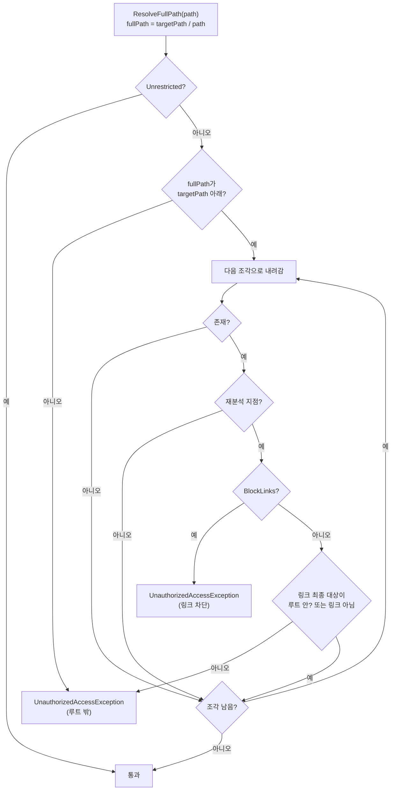

# 4. `PhysicalIOProvider`와 샌드박스

> 기준 커밋: `b3e1a343`. [← 목차](README.md) · 이전: [3. 열거와 매처](03-enumeration-and-matchers.md) · 다음: [5. 쓰기·복사·이동](05-write-operations.md)
>
> 선행: [1.5 `PhysicalPath`: 디스크에 닿을 때](01-paths.md#15-physicalpath-디스크에-닿을-때)

[`PhysicalIOProvider`](../../Runtime/IO/PhysicalIOProvider.cs#L19)는 실제 디스크 폴더 하나를 루트로 삼는 공급자입니다. 읽기·쓰기·심볼릭 링크를 모두 지원하고, `IPhysicalBackedIOProvider`라서 실제 경로도 알려 줍니다.

이 공급자의 핵심은 **샌드박스**입니다. `RuniPath`는 `..`을 해석하지 않은 채 들어오고([1.1절](01-paths.md#11-runipath의-정규화)), 디스크에 닿는 순간 운영체제가 `..`과 링크를 해석합니다. 그대로 두면 `"../../etc/passwd"`나 루트 안에 놓인 링크 하나로 루트 밖 파일에 닿습니다. 리소스 팩이나 모드처럼 남이 만든 폴더를 여는 공급자에게는 이것을 막는 장치가 필요합니다.

- [4.1 생성과 속성](#41-생성과-속성)
- [4.2 모든 경로가 지나는 `ResolveFullPath`](#42-모든-경로가-지나는-resolvefullpath)
- [4.3 `ValidateSandboxPolicy`](#43-validatesandboxpolicy)
- [4.4 열거와 샌드박스](#44-열거와-샌드박스)
- [4.5 읽기·쓰기는 동기로 끝난다](#45-읽기쓰기는-동기로-끝난다)
- [4.6 샌드박스를 거치지 않는 길](#46-샌드박스를-거치지-않는-길)

## 4.1 생성과 속성

```csharp
// Runtime/IO/PhysicalIOProvider.cs
33  public PhysicalIOProvider(PhysicalPath targetPath, SandboxPolicy sandboxPolicy = SandboxPolicy.BlockLinks)   // ① 기본은 가장 엄격한 정책
…
55  public bool isIndependent => false;            // ② 운영체제·다른 프로그램이 바꿀 수 있음
58  public bool isThreadSafe => true;              // ③ System.IO는 스레드 안전
61  public bool supportsSymbolicLink => true;
…
74  public bool IsSameTarget(IIOProvider other) => other is PhysicalIOProvider otherPhysical
        && targetPath == otherPhysical.targetPath && sandboxPolicy == otherPhysical.sandboxPolicy;   // ④ 정책까지 같아야 같은 대상
```

④ 같은 폴더라도 정책이 다르면 접근할 수 있는 파일 집합이 다르므로 다른 대상으로 봅니다.

정책은 [`SandboxPolicy`](../../Runtime/IO/SandboxPolicy.cs#L8) 세 가지입니다.

| 정책 | 루트 밖 경로 (`..`) | 루트 안의 링크·재분석 지점 |
| --- | --- | --- |
| `BlockLinks` (기본) | 거부 | **모두 거부** |
| `AllowInternalLinks` | 거부 | 최종 대상이 루트 안이면 허용, 밖이면 거부. 링크가 아닌 재분석 지점(OneDrive 자리 표시자 등)은 허용 |
| `Unrestricted` | 검사 안 함 | 검사 안 함 |

`Unrestricted`는 루트 자체가 신뢰할 수 있는 위치일 때 씁니다. 예를 들어 플레이어의 `Application.streamingAssetsPath`([7장](07-streaming-assets.md))와 에디터의 패키지 폴더가 그렇습니다.

## 4.2 모든 경로가 지나는 `ResolveFullPath`

`GetPhysicalPath`를 뺀 모든 멤버는 경로를 받자마자 [`ResolveFullPath`](../../Runtime/IO/PhysicalIOProvider.cs#L311)를 부릅니다. 존재 확인, 엔트리, 열거 시작점, 읽기, 쓰기, 삭제, 복사, 이동, 링크 생성 모두 같습니다.

```csharp
// Runtime/IO/PhysicalIOProvider.cs
311 string ResolveFullPath(RuniPath path)
    {
313     PhysicalPath fullPath = targetPath / path;     // ① PhysicalPath.Combine + NormalizePath: '..' 해석
314     ValidateSandboxPolicy(fullPath);               // ② 정책 검사, 위반이면 UnauthorizedAccessException
315     return fullPath.value;                         // ③ System.IO에 넘길 문자열
    }
```

① 여기서 `..`이 해석되므로 ②는 **해석이 끝난 최종 경로**를 검사합니다. 문자열에 `..`이 있는지 찾는 방식이 아니라서, `a/../b`처럼 루트 안에 머무는 `..`은 그대로 통과합니다.

## 4.3 `ValidateSandboxPolicy`

```csharp
// Runtime/IO/PhysicalIOProvider.cs
330 void ValidateSandboxPolicy(PhysicalPath fullPath)
    {
332     if (sandboxPolicy == SandboxPolicy.Unrestricted)
333         return;
335     if (!fullPath.TryGetRelativePath(targetPath, out RuniPath relativePath))
336         throw CreateSandboxException(fullPath, targetPath);            // ① 루트 밖
338     string currentPath = targetPath.value;
340     ReadOnlySpanSingleSplitter<char> segments = relativePath.GetSegmentsSpan();
341     foreach (var segment in segments)                                   // ② 루트에서 한 조각씩 내려감
        {
343         currentPath = Path.Combine(currentPath, segment.ToString());
345         FileAttributes attributes = new FileInfo(currentPath).Attributes;
346         if (attributes == (FileAttributes)(-1))
347             continue;                                                    // ③ 아직 없는 경로는 통과
349         if ((attributes & FileAttributes.ReparsePoint) == 0)
350             continue;                                                    // ④ 일반 파일·폴더
352         if (sandboxPolicy == SandboxPolicy.BlockLinks)
353             throw CreateReparsePointException(fullPath);                 // ⑤ 링크면 무조건 거부
356         FileSystemInfo? linkTarget = File.ResolveLinkTarget(currentPath, true);   // ⑥ 링크를 끝까지 따라감
357         if (linkTarget != null && !((PhysicalPath)linkTarget.FullName).TryGetRelativePath(targetPath, out _))
358             throw CreateSandboxException((PhysicalPath)linkTarget.FullName, targetPath);
        }
    }
```



- ① `TryGetRelativePath`는 [조각 경계 규칙](01-paths.md#13-상위상대-경로-판정)이라 `C:\Game2`가 `C:\Game`의 하위로 잘못 판정되지 않습니다.
- ② 최종 경로만 보지 않고 **루트부터 모든 중간 조각**을 확인합니다. `root/link/file`에서 `file`이 일반 파일이어도 `link`가 루트 밖을 가리키면 실제로는 루트 밖 파일이기 때문입니다.
- ③ 쓰기로 새로 만들 경로는 아직 없습니다. 없는 조각은 링크일 수 없으므로 통과시킵니다. `FileInfo.Attributes`는 없는 경로에서 `-1`을 돌려줍니다.
- ⑥ `returnFinalTarget: true`로 링크 사슬을 끝까지 따라갑니다. 링크가 다른 링크를 가리켜도 최종 위치로 판정합니다.

> **관찰된 동작:** 검사는 `targetPath` **아래** 조각만 봅니다. `targetPath` 자신이나 그 조상이 링크인 것은 검사하지 않습니다(338행에서 `targetPath`부터 시작). 또 검사와 실제 접근 사이에 시간 차가 있어, 그 사이 경로가 바뀌는 경우(TOCTOU)는 막지 않습니다.

## 4.4 열거와 샌드박스

[3장](03-enumeration-and-matchers.md)에서 본 열거는 시작 디렉터리를 `ResolveFullPath`로 검사한 뒤, **엔트리마다** 다시 검사합니다.

```csharp
// Runtime/IO/PhysicalIOProvider.cs
129 var enumerable = new FileSystemEnumerable<IOEntry>
    (
131     ResolveFullPath(path),                                         // ① 시작점 검사
132     (ref FileSystemEntry entry) =>
        {
134         PhysicalPath entryFullPath = (PhysicalPath)entry.ToFullPath();
135         ValidateSandboxPolicy(entryFullPath);                       // ② 엔트리마다 검사
137         if (!entryFullPath.TryGetRelativePath(targetPath, out RuniPath entryPath))
138             throw CreateSandboxException(entryFullPath, targetPath);
140         return new IOEntry { path = entryPath, … };                 // ③ 루트 기준 경로로 되돌림
        },
155     new EnumerationOptions
        {
157         RecurseSubdirectories = recursive,
158         IgnoreInaccessible = true,                                  // ④ 권한 없는 항목은 건너뜀
159         MatchCasing = MatchCasing.CaseSensitive,
161         ReturnSpecialDirectories = false,
163         AttributesToSkip = 0                                        // ⑤ 숨김·시스템 항목도 반환
        }
    );
169 return enumerable.EnumerateOnThreadPool();
```

③ 열거가 돌려주는 물리 경로를 루트 기준 `RuniPath`로 바꿉니다. 이 과정에서 [1.5절](01-paths.md#15-physicalpath-디스크에-닿을-때)의 정규화를 거치므로 Windows에서는 경로가 소문자가 됩니다. ⑤ 숨길지는 사용하는 쪽이 정합니다(예: 에디터의 팩 브라우저는 `.meta`를 직접 거릅니다).

**링크를 만나면 숨기지 않고 예외로 알리는 것이 이 공급자의 계약입니다.** 링크를 조용히 건너뛰면 호출자는 파일이 빠졌다는 사실을 모릅니다.

> **관찰된 동작:** ② 현재 구현은 예외가 열거 전체를 끝냅니다. `BlockLinks` 폴더 안에 링크가 하나라도 있으면 그 링크 앞까지만 결과가 나오고 열거가 예외로 중단됩니다. 반면 ④ 권한 없는 항목은 `IgnoreInaccessible`로 조용히 건너뜁니다. 이 공급자는 `supportsSymbolicLink`가 정책과 무관하게 `true`라서([#L61](../../Runtime/IO/PhysicalIOProvider.cs#L61)), `BlockLinks` 공급자로 링크를 만들면 그 링크가 있는 폴더를 열거할 수 없게 됩니다.

## 4.5 읽기·쓰기는 동기로 끝난다

```csharp
// Runtime/IO/PhysicalIOProvider.cs
174 // 비동기 파일 API는 스레드 풀을 거쳐, 메인 스레드에서 기다리면 호출마다 다음 업데이트까지 미뤄집니다.
175 // 로컬 파일 하나를 읽고 쓰는 일은 그보다 훨씬 빠르므로 바로 처리합니다.
178 public FileStream OpenRead(RuniPath path) => File.OpenRead(ResolveFullPath(path));
179 UniTask<Stream> IIOProvider.OpenRead(RuniPath path, CancellationToken cancellationToken) => UniTask.FromResult<Stream>(OpenRead(path));
…
186 public UniTask<string> ReadAllText(RuniPath path, CancellationToken cancellationToken = default) =>
187     UniTask.FromResult(File.ReadAllText(ResolveFullPath(path)));
```

시그니처는 `UniTask`지만 실제 작업은 호출 스레드에서 바로 끝나고 완료된 태스크를 돌려줍니다. 주석이 설명하듯, UniTask에서 진짜 비동기 파일 API를 메인 스레드에서 기다리면 결과를 받기까지 최소 한 프레임이 걸립니다. 작은 파일 수백 개를 읽는 리소스 로딩에서는 디스크 시간보다 그 대기가 훨씬 깁니다.

- 이 때문에 이 공급자의 읽기·쓰기는 **취소 토큰을 보지 않습니다.**
- 공개 동기 오버로드(`OpenRead`, `OpenWrite`, `CreateFile`이 `FileStream`을 돌려줌)는 공급자 타입을 알고 있는 호출자가 바로 쓸 수 있게 둔 것입니다.
- 열거만은 스레드 풀로 보냅니다([3.3절](03-enumeration-and-matchers.md#33-enumerateonthreadpool-스레드-풀에서-열거하기)). 167~168행 주석에 따르면 OneDrive처럼 실제 장치에 마운트되지 않은 폴더에서 메인 스레드 열거가 끊김을 만들었기 때문입니다.

존재 확인과 엔트리도 동기입니다. `DirectoryExists`/`FileExists`는 `Directory.Exists`/`File.Exists`이고([#L77](../../Runtime/IO/PhysicalIOProvider.cs#L77)), [`GetEntry`](../../Runtime/IO/PhysicalIOProvider.cs#L84)는 `FileInfo`를 먼저 보고 없으면 `DirectoryInfo`를 봅니다. 쓰기·삭제·복사·이동은 `File.*`/`Directory.*`를 그대로 부릅니다. 그 차이는 [5장](05-write-operations.md)에 있습니다.

## 4.6 샌드박스를 거치지 않는 길

[`GetPhysicalPath`](../../Runtime/IO/PhysicalIOProvider.cs#L71)는 `targetPath.Combine(path)`만 하고 정책을 적용하지 않습니다. XML 주석(67~70행)에 명시된 계약입니다.

```csharp
// Runtime/IO/PhysicalIOProvider.cs
71  public PhysicalPath GetPhysicalPath(RuniPath path) => targetPath.Combine(path);
```

경로를 받은 쪽이 그 경로로 무엇을 할지(읽기, 휴지통으로 보내기, 파일 관리자에서 보여 주기) 공급자가 모르기 때문에, 검사 책임을 호출자에게 넘긴 것입니다. 이 경로를 외부 API에 넘기는 코드는 `..`이나 링크가 루트 밖으로 나갈 수 있다는 점을 알고 써야 합니다. 현재 이 경로를 쓰는 곳은 [11장](11-consumers.md)에 있습니다.
