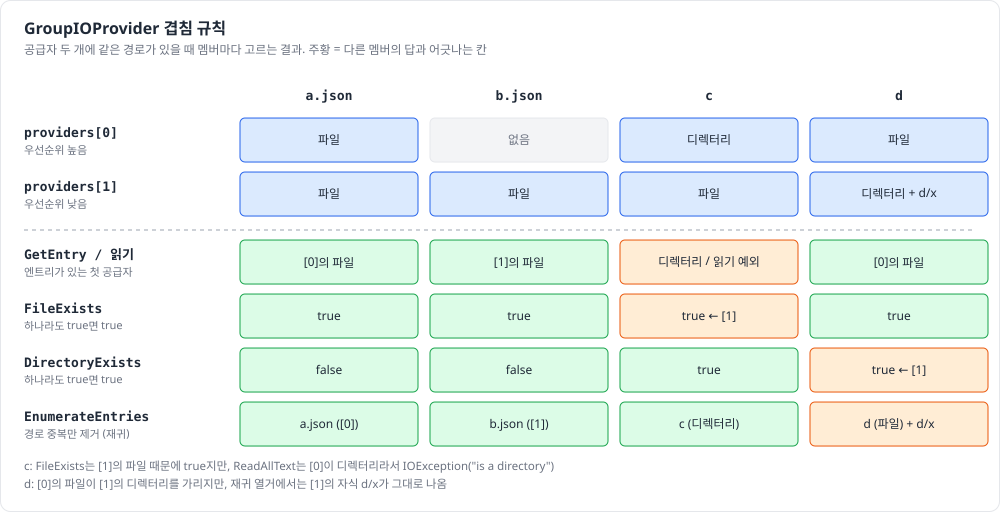

# 6. `GroupIOProvider`: 여러 공급자를 하나로

> 기준 커밋: `b3e1a343`. [← 목차](README.md) · 이전: [5. 쓰기·복사·이동](05-write-operations.md) · 다음: [7. StreamingAssets](07-streaming-assets.md)

[`GroupIOProvider`](../../Runtime/IO/GroupIOProvider.cs#L13)는 공급자 여러 개를 **겹쳐서** 하나처럼 보여 주는 읽기 전용 공급자입니다. 앞에 있는 공급자일수록 우선순위가 높고, 같은 경로가 여러 곳에 있으면 앞의 것이 뒤의 것을 가립니다.

이것이 필요한 대표적인 경우는 에디터의 StreamingAssets입니다. 프로젝트의 `Assets/StreamingAssets`와 패키지마다 있는 `StreamingAssets` 폴더를, 빌드한 플레이어에서처럼 폴더 **하나**로 보이게 해야 합니다([7장](07-streaming-assets.md)). 리소스 팩 코드는 그 폴더가 여러 곳을 겹친 것인지 모릅니다.

- [6.1 생성과 속성](#61-생성과-속성)
- [6.2 읽기: 엔트리가 있는 첫 공급자](#62-읽기-엔트리가-있는-첫-공급자)
- [6.3 존재 확인: 하나라도 있으면 참](#63-존재-확인-하나라도-있으면-참)
- [6.4 열거: 경로 중복 제거](#64-열거-경로-중복-제거)
- [6.5 겹침 규칙 한눈에 보기](#65-겹침-규칙-한눈에-보기)
- [6.6 `Dispose`와 `leaveOpen`](#66-dispose와-leaveopen)

## 6.1 생성과 속성

```csharp
// Runtime/IO/GroupIOProvider.cs
19  public GroupIOProvider(params IEnumerable<IIOProvider> providers) : this(providers, false) { }
33  public GroupIOProvider(IEnumerable<IIOProvider> providers, bool leaveOpen = false)
    {
35      this.providers = providers.ToArray();          // ① 순서 = 우선순위, 생성 후 고정
36      this.leaveOpen = leaveOpen;
    }
…
48  public bool isIndependent => providers.All(x => x.isIndependent);   // ② 하나라도 아니면 아님
51  public bool isThreadSafe => providers.All(x => x.isThreadSafe);
54  public bool IsSameTarget(IIOProvider other)
    {
56      if (ReferenceEquals(this, other))
57          return true;
59      if (other is not GroupIOProvider otherGroup || providers.Count != otherGroup.providers.Count)
60          return false;
63      for (int i = 0; i < providers.Count; i++)       // ③ 같은 순서로 같은 대상이어야 같은 그룹
        {
65          if (!providers[i].IsSameTarget(otherGroup.providers[i]))
66              return false;
        }
69      return true;
    }
```

① 공급자 목록을 배열로 복사해 고정합니다. ③ 순서가 다르면 가리는 관계가 달라지므로 다른 대상으로 봅니다.

## 6.2 읽기: 엔트리가 있는 첫 공급자

`GetEntry`는 공급자를 순서대로 물어 처음 나온 엔트리를 돌려줍니다([#L103](../../Runtime/IO/GroupIOProvider.cs#L103)). 읽기 멤버(`OpenRead`, `ReadAllBytes`, `ReadAllText`, `ReadLines`)는 모두 [`FindReadProvider`](../../Runtime/IO/GroupIOProvider.cs#L192)로 읽을 공급자를 고른 뒤 그 공급자에 넘깁니다.

```csharp
// Runtime/IO/GroupIOProvider.cs
192 async UniTask<IIOProvider?> FindReadProvider(RuniPath path, CancellationToken cancellationToken)
    {
194     foreach (IIOProvider provider in providers)
        {
196         cancellationToken.ThrowIfCancellationRequested();
198         IOEntry? entry = await provider.GetEntry(path, cancellationToken);
199         if (!entry.HasValue)
200             continue;                                   // ① 없으면 다음 공급자
202         if (entry.Value.isDirectory)
203             throw new IOException($"The path '{path}' is a directory.");   // ② 디렉터리가 가리면 거기서 멈춤
205         return provider;                                // ③ 파일이 있는 첫 공급자
        }
208     return null;                                        // ④ 호출자가 FileNotFoundException
    }
…
146 public async UniTask<Stream> OpenRead(RuniPath path, CancellationToken cancellationToken = default)
    {
148     IIOProvider? provider = await FindReadProvider(path, cancellationToken);
149     if (provider == null)
150         throw new FileNotFoundException($"Could not find file '{path}'.", path.value);
152     return await provider.OpenRead(path, cancellationToken);   // ⑤ 고른 공급자의 구현을 그대로 사용
    }
```

② 앞 공급자에 같은 이름의 디렉터리가 있으면 뒤 공급자의 파일을 찾지 않습니다. "앞이 뒤를 가린다"는 규칙을 엔트리 종류와 관계없이 지키는 것입니다. ⑤ 읽기 자체는 고른 공급자에 넘기므로, Physical이 고르면 동기로, Android가 고르면 스레드 풀에서 읽습니다.

읽기마다 `GetEntry`를 한 번 더 부르는 셈이라 공급자 하나보다 느립니다. 공급자가 많고 대상 파일이 뒤쪽에 있을수록 더 그렇습니다.

## 6.3 존재 확인: 하나라도 있으면 참

`FileExists`와 `DirectoryExists`는 읽기와 다른 규칙을 씁니다.

```csharp
// Runtime/IO/GroupIOProvider.cs
88  public async UniTask<bool> FileExists(RuniPath path, CancellationToken cancellationToken = default)
    {
90      foreach (IIOProvider provider in providers)
        {
92          cancellationToken.ThrowIfCancellationRequested();
94          bool exists = await provider.FileExists(path, cancellationToken);
95          if (exists)
96              return true;                                // 어느 공급자든 파일이 있으면 true
        }
99      return false;
    }
```

`DirectoryExists`도 같은 모양입니다([#L73](../../Runtime/IO/GroupIOProvider.cs#L73)).

> **관찰된 동작:** 존재 확인은 "어느 공급자에든 있는가", 읽기와 `GetEntry`는 "가장 앞 공급자에 무엇이 있는가"를 답합니다. 앞 공급자에 디렉터리 `c`, 뒤 공급자에 파일 `c`가 있으면 `FileExists("c")`는 `true`인데 `ReadAllText("c")`는 `IOException("is a directory")`를 던집니다. 반대로 앞에 파일, 뒤에 디렉터리가 있으면 `DirectoryExists`가 `true`입니다. `IIOProvider`의 기본 구현([2.2절](02-providers-and-nodes.md#22-iioprovider-읽기-계약))은 존재 확인을 `GetEntry`로 하므로, 이 공급자는 기본 구현과도 답이 다릅니다.

## 6.4 열거: 경로 중복 제거

```csharp
// Runtime/IO/GroupIOProvider.cs
118 public IUniTaskAsyncEnumerable<IOEntry> EnumerateEntries(RuniPath path, bool recursive, CancellationToken cancellationToken = default) => UniTaskAsyncEnumerable.Create<IOEntry>(async (writer, iterationToken) =>
    {
120     using var linkedCTS = CancellationTokenSource.CreateLinkedTokenSource(cancellationToken, iterationToken);
121     CancellationToken ct = linkedCTS.Token;
123     HashSet<RuniPath> yieldedPaths = [];                    // ① 이미 내보낸 경로
124     foreach (IIOProvider provider in providers)             // ② 공급자 순서대로 이어 붙임
        {
126         ct.ThrowIfCancellationRequested();
128         try
            {
130             await foreach (IOEntry entry in provider.EnumerateEntries(path, recursive, ct))
                {
132                 ct.ThrowIfCancellationRequested();
134                 if (!yieldedPaths.Add(entry.path))
135                     continue;                               // ③ 앞 공급자가 이미 낸 경로는 건너뜀
137                 await writer.YieldAsync(entry);
                }
            }
140         catch (DirectoryNotFoundException) { }              // ④ 이 공급자에 그 디렉터리가 없음
141         catch (FileNotFoundException) { }
        }
    });
```

- ② 공급자를 하나씩 끝까지 열거합니다. 앞 공급자의 엔트리가 모두 나온 뒤 뒤 공급자의 엔트리가 나옵니다. 결과가 앞 공급자 순서대로 나오므로 ③의 "먼저 낸 것이 이긴다"가 우선순위와 같아집니다.
- ① 중복 판정에는 지금까지 낸 경로를 모두 기억해야 하므로 열거마다 `HashSet`을 하나 만듭니다. 경로 비교는 `RuniPath`의 ordinal 비교입니다.
- ④ 어떤 공급자에는 그 디렉터리가 아예 없을 수 있습니다. Physical은 없는 디렉터리 열거에서 예외를 던지므로([3.4절](03-enumeration-and-matchers.md#34-공급자별-열거-차이)) 그 공급자만 건너뜁니다. 이 두 종류 말고 다른 예외는 그대로 전달됩니다.

> **관찰된 동작:** 중복 제거는 경로만 봅니다. 앞 공급자의 파일 `d`가 뒤 공급자의 디렉터리 `d`를 가려도, 재귀 열거에서는 뒤 공급자의 자식 `d/x`가 그대로 나옵니다. 결과에 파일 `d`와 `d/x`가 함께 있게 됩니다.

> **관찰된 동작:** ④에서 공급자의 열거가 중간에 실패하면, 그 공급자가 이미 낸 엔트리는 결과에 남고 나머지만 빠집니다.

## 6.5 겹침 규칙 한눈에 보기



| 멤버 | 규칙 | 줄 |
| --- | --- | --- |
| `GetEntry` | 엔트리가 있는 첫 공급자 | [#L103](../../Runtime/IO/GroupIOProvider.cs#L103) |
| 읽기 | 엔트리가 있는 첫 공급자. 그것이 디렉터리면 예외 | [#L192](../../Runtime/IO/GroupIOProvider.cs#L192) |
| `FileExists` / `DirectoryExists` | 하나라도 `true`면 `true` | [#L73](../../Runtime/IO/GroupIOProvider.cs#L73)~100 |
| `EnumerateEntries` | 공급자 순서로 이어 붙이고 경로 중복만 제거 | [#L118](../../Runtime/IO/GroupIOProvider.cs#L118) |

## 6.6 `Dispose`와 `leaveOpen`

```csharp
// Runtime/IO/GroupIOProvider.cs
211 public void Dispose()
    {
213     if (leaveOpen)
214         return;                                  // ① 자식 공급자는 다른 곳의 것
216     foreach (IIOProvider provider in providers)
217         provider.Dispose();                      // ② 그룹이 자식을 소유
    }
```

기본값(`leaveOpen: false`)은 그룹이 자식 공급자를 소유한다는 뜻입니다. 이미 다른 곳에서 쓰는 공급자(예: 서비스가 들고 있는 싱글턴 공급자)를 묶을 때는 `leaveOpen: true`로 소유하지 않게 합니다. 기본 리소스 팩을 만들 때 이 구분이 실제로 쓰이는 방식은 [11장](11-consumers.md#112-리소스-팩)에 있습니다.
