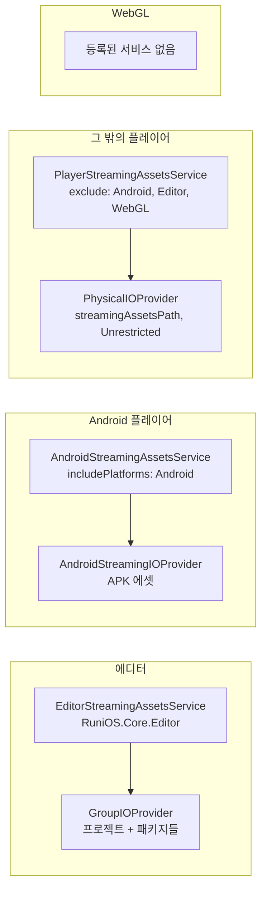

# 7. StreamingAssets: 플레이어·에디터·빌드

> 기준 커밋: `b3e1a343`. [← 목차](README.md) · 이전: [6. `GroupIOProvider`](06-group-provider.md) · 다음: [8. Android 에셋](08-android-assets.md)

Unity의 `StreamingAssets`는 빌드에 그대로 들어가는 파일 폴더입니다. 기본 리소스 팩(`runios:vanilla`)이 여기서 읽히므로 IO 시스템이 가장 먼저 다루는 저장소입니다.

문제는 이 폴더에 닿는 방법이 환경마다 다르다는 것입니다.

- **데스크톱 플레이어:** `Application.streamingAssetsPath`가 평범한 디스크 폴더입니다.
- **Android:** 같은 경로가 APK(zip) 안을 가리켜 `System.IO`로 열 수 없습니다.
- **에디터:** 프로젝트 폴더 하나만 있는 것이 아니라, 패키지마다 자기 `StreamingAssets`를 가질 수 있습니다. 빌드할 때 이것들을 합쳐 넣으므로, 에디터에서도 합쳐진 것처럼 보여야 합니다.

IO 시스템은 이 차이를 **서비스**로 숨깁니다. 환경마다 다른 `IStreamingAssetsService` 구현이 등록되고, 사용하는 쪽은 서비스의 `provider`만 봅니다.

- [7.1 `IStreamingAssetsService`](#71-istreamingassetsservice)
- [7.2 환경별 구현](#72-환경별-구현)
- [7.3 에디터: 프로젝트와 패키지 겹치기](#73-에디터-프로젝트와-패키지-겹치기)
- [7.4 빌드: 패키지 StreamingAssets 복사](#74-빌드-패키지-streamingassets-복사)
- [7.5 EditorStreamingAssets](#75-editorstreamingassets)

## 7.1 `IStreamingAssetsService`

```csharp
// Runtime/IO/IStreamingAssetsService.cs
14  public interface IStreamingAssetsService : IService
    {
20      public const string streamingAssetsFolderName = "StreamingAssets";
30      IIOProvider provider { get; }
    }
```

`IService`는 core의 서비스 레지스트리 계약입니다. 서비스는 어셈블리가 로드될 때(`[OnAssemblyLoaded]`) 자신을 등록하고, 언로드될 때 해제합니다. 사용하는 쪽은 레지스트리에서 꺼냅니다.

```csharp
IIOProvider provider = ServiceRegistry.Get<IStreamingAssetsService>()!.provider;
string json = await provider.rootNode.CreateChild("assets/runios/lang/ko_kr.json").file.ReadAllText();
```

## 7.2 환경별 구현

어느 구현이 들어갈지는 **어셈블리 정의의 플랫폼 설정**으로 정해집니다. 코드에 `#if`가 없고, 해당 환경에서 컴파일되는 어셈블리의 서비스 하나만 등록됩니다.



| 서비스 | 어셈블리 | 공급자 | id |
| --- | --- | --- | --- |
| [`PlayerStreamingAssetsService`](../../Runtime/IO/StreamingAssets/Player/PlayerStreamingAssetsService.cs#L13) | `RuniOS.StreamingAssets.Player` (Android·Editor·WebGL 제외) | `PhysicalIOProvider(streamingAssetsPath, Unrestricted)`, 처음 쓸 때 생성 | `runios:streaming-assets/player` |
| [`AndroidStreamingAssetsService`](../../Runtime/IO/StreamingAssets/Android/AndroidStreamingAssetsService.cs#L12) | `RuniOS.StreamingAssets.Android` (Android만) | `AndroidStreamingIOProvider` ([8장](08-android-assets.md)) | `runios:streaming-assets/android` |
| [`EditorStreamingAssetsService`](../../Editor/EditorStreamingAssetsService.cs#L19) | `RuniOS.Core.Editor` | 프로젝트 + 패키지를 겹친 `GroupIOProvider` | `runios:streaming-assets/editor` |

플레이어 공급자는 `Unrestricted`라서 샌드박스 검사를 하지 않습니다. 루트는 빌드에 포함된 폴더이고, 경로 조각마다 파일 시스템을 조회하는 링크 검사([4.3절](04-physical-and-sandbox.md#43-validatesandboxpolicy))도 일어나지 않습니다.

> **관찰된 동작:** WebGL은 플레이어 어셈블리에서 제외되어 있고 다른 구현도 없으므로 `IStreamingAssetsService`가 등록되지 않습니다. 이때 `ServiceRegistry.Get<IStreamingAssetsService>()`는 `null`이고, 기본 리소스 팩도 만들어지지 않습니다([11.2절](11-consumers.md#112-리소스-팩)).

## 7.3 에디터: 프로젝트와 패키지 겹치기

에디터 서비스는 위치(source) 목록을 만들고 그것을 [`GroupIOProvider`](06-group-provider.md)로 겹칩니다.

```csharp
// Editor/EditorStreamingAssetsService.cs
53  public readonly record struct Source(PackageInfo? package, IIOProvider provider);
63  public static IReadOnlyList<Source> sources => field ??= [.. CreateSources()];               // ① 처음 쓸 때 한 번 만듦
79  public static IIOProvider provider => field ??= new GroupIOProvider(sources.Select(x => x.provider));
…
88  static IEnumerable<Source> CreateSources()
    {
90      yield return new Source(null, new PhysicalIOProvider((PhysicalPath)Application.streamingAssetsPath, SandboxPolicy.Unrestricted));   // ② 프로젝트가 가장 앞
91      foreach (var item in PackageInfo.GetAllRegisteredPackages())
92          yield return new Source(item, CreatePackageProvider(item, IStreamingAssetsService.streamingAssetsFolderName));   // ③ 그다음 패키지들
    }
…
103 static IIOProvider CreatePackageProvider(PackageInfo package, string folderName)
    {
105     PhysicalPath path = (PhysicalPath)package.resolvedPath / folderName;
106     if (package.source is UnityEditor.PackageManager.PackageSource.Embedded or UnityEditor.PackageManager.PackageSource.Local)
107         return new PhysicalIOProvider(path, SandboxPolicy.Unrestricted);   // ④ 사용자가 관리하는 패키지: 쓰기 가능
109     return new PackageIOProvider(package, path, SandboxPolicy.Unrestricted);   // ⑤ 패키지 관리자가 관리: 읽기 전용
    }
```

- ② 프로젝트 폴더가 가장 앞이므로, 같은 경로의 파일이 있으면 프로젝트 파일이 패키지 파일을 가립니다. 빌드 규칙([7.4절](#74-빌드-패키지-streamingassets-복사))과 같습니다.
- 각 위치의 폴더는 없을 수도 있습니다. 없는 폴더를 열거하는 Physical의 예외는 그룹이 그 공급자만 건너뛰어 처리합니다([6.4절](06-group-provider.md#64-열거-경로-중복-제거)).
- ④⑤ 임베디드·로컬 패키지는 사용자가 직접 고치는 폴더라 쓰기 가능한 공급자를 씁니다. 레지스트리·Git 패키지는 패키지 관리자가 캐시에 내려받아 언제든 되돌리므로, 쓰기를 막기 위해 [`PackageIOProvider`](../../Editor/PackageIOProvider.cs#L21)로 감쌉니다. 이 클래스는 안쪽 `PhysicalIOProvider`에 읽기만 넘기고 `IWritableIOProvider`를 구현하지 않습니다. 에디터 도구는 `provider is IWritableIOProvider`로 쓰기 가능 여부를 판단합니다.
- `sources`는 그룹과 별도로 공개되어 있어, 에디터 도구가 "이 파일이 어느 패키지에서 왔는가"를 알 수 있습니다.

> **관찰된 동작:** ① `sources`와 `provider`는 도메인 리로드 전까지 캐시되며 무효화되지 않습니다. 에디터 실행 중 패키지를 추가하면 다음 도메인 리로드 전까지 반영되지 않습니다.

> **관찰된 동작:** 패키지 사이의 우선순위는 `PackageInfo.GetAllRegisteredPackages()`가 돌려주는 순서이고, 이 순서는 정해져 있지 않습니다. 두 패키지가 같은 경로의 파일을 가지면 어느 쪽이 이길지 정해져 있지 않습니다. 빌드([7.4절](#74-빌드-패키지-streamingassets-복사))도 같은 순서를 씁니다.

> **관찰된 동작:** 에디터 공급자는 Physical이므로 `.meta` 파일도 열거됩니다([4.4절](04-physical-and-sandbox.md#44-열거와-샌드박스)). 빌드에는 `.meta`가 들어가지 않으므로 에디터와 플레이어의 열거 결과가 다릅니다.

## 7.4 빌드: 패키지 StreamingAssets 복사

Unity는 프로젝트의 `Assets/StreamingAssets`만 빌드에 넣습니다. 패키지의 `StreamingAssets`는 [`PackageStreamingAssetsBuildProcessor`](../../Editor/PackageStreamingAssetsBuildProcessor.cs#L9)가 직접 추가합니다.

```csharp
// Editor/PackageStreamingAssetsBuildProcessor.cs
11  public override int callbackOrder => -1000;
13  public override void PrepareForBuild(BuildPlayerContext buildPlayerContext)
    {
15      HashSet<string> addedPaths = new(StringComparer.Ordinal);
16      foreach (PackageInfo packageInfo in PackageInfo.GetAllRegisteredPackages())
        { … AddStreamingAssets(buildPlayerContext, sourceRoot, addedPaths); }
    }
…
28  foreach (string sourceFile in Directory.EnumerateFiles(sourceRoot, "*", SearchOption.AllDirectories))
    {
30      if (sourceFile.EndsWith(".meta", StringComparison.OrdinalIgnoreCase))
31          continue;                                                  // ① .meta 제외
33      string relativePath = Path.GetRelativePath(sourceRoot, sourceFile).Replace('\\', '/');
34      if (!addedPaths.Add(relativePath))
35          continue;                                                  // ② 먼저 추가한 패키지가 이김
37      string projectPath = Path.Combine(Application.streamingAssetsPath, relativePath);
38      if (File.Exists(projectPath) || Directory.Exists(projectPath))
39          continue;                                                  // ③ 프로젝트 파일이 이김
41      buildPlayerContext.AddAdditionalPathToStreamingAssets(sourceFile, relativePath);
    }
```

②③은 에디터 그룹의 "앞이 이긴다" 규칙(프로젝트 → 패키지 순서)과 같은 결과를 냅니다. 그래서 에디터에서 보던 파일이 빌드에서도 같은 파일이 됩니다(패키지 사이 순서가 정해지지 않은 점은 같음). 다만 이 코드는 `GroupIOProvider`를 쓰지 않고 `System.IO`로 같은 규칙을 다시 구현했습니다.

## 7.5 EditorStreamingAssets

에디터 전용 파일(에디터 UI 번역, 에디터 아이콘 등)은 빌드에 들어가면 안 됩니다. 그래서 `StreamingAssets`와 같은 구조의 `EditorStreamingAssets` 폴더를 따로 둡니다.

```csharp
// Editor/EditorStreamingAssetsService.cs
86  public static IIOProvider editorProvider => field ??= new GroupIOProvider(editorSources.Select(x => x.provider));
…
95  static IEnumerable<Source> CreateEditorSources()
    {
97      yield return new Source(null, new PhysicalIOProvider((PhysicalPath)Directory.GetCurrentDirectory() / "Assets" / editorStreamingAssetsFolderName, SandboxPolicy.Unrestricted));
98      foreach (var item in PackageInfo.GetAllRegisteredPackages())
99          yield return new Source(item, CreatePackageProvider(item, editorStreamingAssetsFolderName));
    }
```

규칙은 [7.3절](#73-에디터-프로젝트와-패키지-겹치기)과 같고 폴더 이름만 다릅니다. 이 공급자는 `IStreamingAssetsService.provider`로 노출되지 않고, [`EditorResourcePack`](../../Editor/EditorResourcePack.cs#L12)이 `runios:editor` 리소스 팩을 만드는 데 씁니다. 빌드 프로세서는 이 폴더를 복사하지 않습니다.
