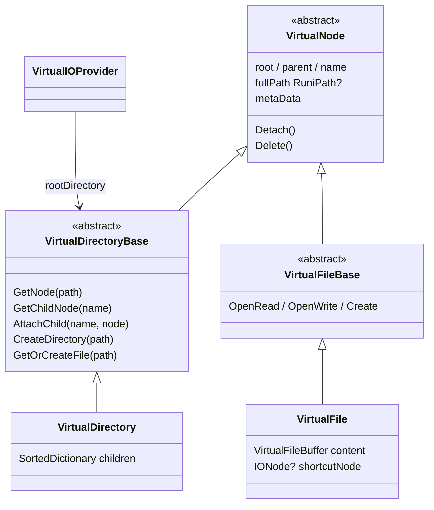
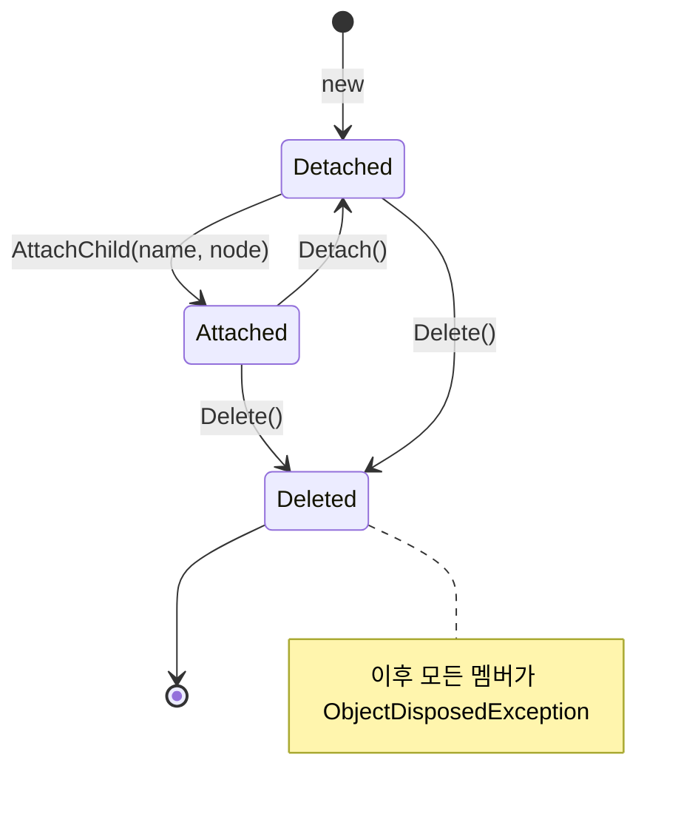
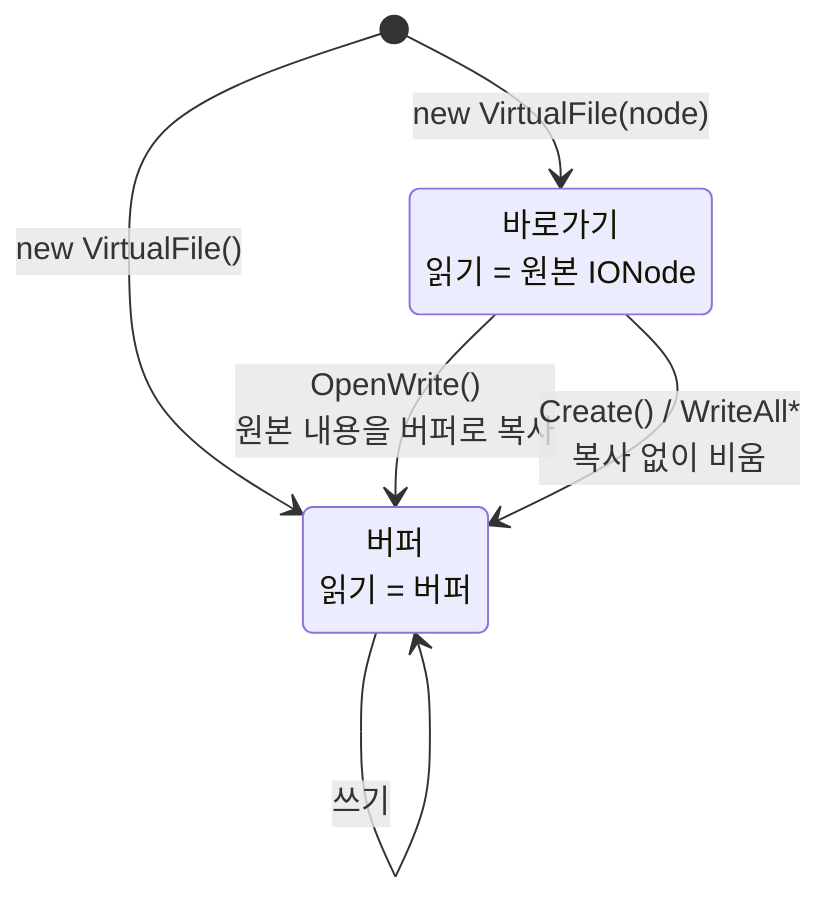

# 9. 가상 파일 시스템

> 기준 커밋: `b3e1a343`. [← 목차](README.md) · 이전: [8. Android 에셋](08-android-assets.md) · 다음: [10. Locations](10-locations.md)

`RuniOS.IO.Virtual` 네임스페이스는 메모리 안에만 있는 디렉터리 트리와, 그것을 `IWritableIOProvider`로 노출하는 [`VirtualIOProvider`](../../Runtime/IO/Virtual/VirtualIOProvider.cs#L13)를 제공합니다. 디스크에 없는 파일을 공급자 API로 보여 주거나, 다른 공급자의 파일을 이름만 바꿔 한 트리에 모을 때 씁니다.

현재 저장소에서 이 공급자를 쓰는 곳은 파일 브라우저 테스트 창(`Assets/IOBrowserTestWindow.cs`) 하나입니다.

- [9.1 노드 트리](#91-노드-트리)
- [9.2 노드의 상태: 붙음·떨어짐·삭제됨](#92-노드의-상태-붙음떨어짐삭제됨)
- [9.3 경로 조회와 캐시](#93-경로-조회와-캐시)
- [9.4 `VirtualFile`: 버퍼와 바로가기](#94-virtualfile-버퍼와-바로가기)
- [9.5 공급자로 노출하기](#95-공급자로-노출하기)

## 9.1 노드 트리



- 부모가 없는 디렉터리가 **루트**입니다([`isRoot`](../../Runtime/IO/Virtual/VirtualNode.cs#L23)). 루트의 `fullPath`는 빈 경로이고, 나머지 노드의 `fullPath`는 부모 경로에 자기 이름을 붙인 것입니다([#L47](../../Runtime/IO/Virtual/VirtualNode.cs#L47)).
- [`VirtualDirectory`](../../Runtime/IO/Virtual/VirtualDirectory.cs#L8)는 자식을 `SortedDictionary<string, VirtualNode>`에 둡니다. 그래서 열거 결과가 이름 순으로 정렬됩니다.
- 디렉터리와 파일에는 추상 기반 클래스(`VirtualDirectoryBase`, `VirtualFileBase`)가 있어, 같은 트리에 다른 구현을 끼울 수 있습니다. 현재 구현은 `VirtualDirectory`와 `VirtualFile` 하나씩입니다.

## 9.2 노드의 상태: 붙음·떨어짐·삭제됨



- [`OnAttached`](../../Runtime/IO/Virtual/VirtualNode.cs#L86)는 부모, 이름, 루트를 정하고 `metaData.name`을 바꿉니다. 이미 붙어 있거나 삭제된 노드는 붙일 수 없습니다.
- [`Detach`](../../Runtime/IO/Virtual/VirtualNode.cs#L116)는 부모에서 빠지고, 디렉터리라면 자기가 새 루트가 됩니다. 떨어진 서브트리는 그대로 다른 곳에 다시 붙일 수 있습니다. 가상 공급자의 이동([5.5절](05-write-operations.md#55-공급자별-재정의))이 이것을 씁니다.
- [`Delete`](../../Runtime/IO/Virtual/VirtualNode.cs#L135)는 되돌릴 수 없습니다. 디렉터리는 자식을 모두 지우고, 파일은 버퍼를 비웁니다.
- 노드 이름에는 `/`가 들어갈 수 없고 비어 있을 수 없습니다([`ThrowIfInvalidNodeName`](../../Runtime/IO/Virtual/VirtualNode.cs#L228)).

> **관찰된 동작:** `Detach`는 떨어지는 노드 자신의 `root`만 갱신합니다(123행). 떨어진 서브트리 안쪽 노드들의 `root`는 이전 트리의 루트를 계속 가리키므로, 그 노드들의 경로 캐시([9.3절](#93-경로-조회와-캐시))도 이전 트리의 캐시를 씁니다.

## 9.3 경로 조회와 캐시

경로로 노드를 찾는 [`GetNode`](../../Runtime/IO/Virtual/VirtualDirectoryBase.cs#L209)는 조각마다 자식을 따라 내려갑니다. 같은 경로를 여러 번 찾는 경우가 많아(존재 확인 후 읽기 등) 결과를 루트 단위 캐시에 넣습니다.

```csharp
// Runtime/IO/Virtual/VirtualDirectoryBase.cs
18  protected Dictionary<RuniPath, VirtualNode> rootDirectoryCache
    {
        get
        {
22          if (root == this)
23              return _rootDirectoryCache;
            else
25              return root!.rootDirectoryCache;                    // ① 트리 전체가 루트의 캐시 하나를 공유
        }
    }
…
209 public virtual VirtualNode? GetNode(RuniPath path)
    {
214     if (rootDirectoryCache.TryGetValue(fullPath?.Combine(path) ?? path, out VirtualNode? cachedNode))   // ② 키는 루트 기준 전체 경로
215         return cachedNode;
        …
226     foreach (var directoryName in path.value.AsSpan().SplitSpans(RuniPath.directorySeparatorChar))
        {
228         if (childNode != childDirectory)
231             return null;                                        // ③ 중간에 파일이 있거나 없으면 null
234         childNode = childDirectory.GetChildNode(new string(directoryName));
235         if (childNode is VirtualDirectoryBase valueDirectory)
236             childDirectory = valueDirectory;
        }
239     if (childNode != null)
240         rootDirectoryCache[fullPath?.Combine(path) ?? path] = childNode;   // ④ 찾은 것만 캐시
242     return childNode;
    }
```

② 어느 디렉터리에서 찾든 루트 기준 전체 경로를 키로 쓰므로, 트리의 어느 위치에서 찾은 결과도 같은 캐시를 씁니다. 구조가 바뀌면(붙이기, 떼기, 지우기) 캐시 전체를 비웁니다([`InvalidateCache`](../../Runtime/IO/Virtual/VirtualDirectoryBase.cs#L443)). 부분 무효화는 하지 않습니다.

> **관찰된 동작:** 자식 이름 사전(`SortedDictionary<string, …>`)은 기본 문자열 비교자(현재 문화권)를 쓰고([`VirtualDirectory.cs#L10`](../../Runtime/IO/Virtual/VirtualDirectory.cs#L10)), 경로 캐시는 `RuniPath`의 ordinal 비교를 씁니다.

## 9.4 `VirtualFile`: 버퍼와 바로가기

[`VirtualFile`](../../Runtime/IO/Virtual/VirtualFile.cs#L12)은 두 가지 상태를 가집니다.

- **버퍼:** 내용을 [`VirtualFileBuffer`](../../Runtime/IO/Virtual/VirtualFileBuffer.cs#L12)에 둡니다. 버퍼는 64 KB 조각(chunk)의 목록이라, 파일이 커져도 큰 배열을 다시 할당해 복사하지 않습니다.
- **바로가기:** 다른 공급자의 `IONode`를 가리킵니다([`VirtualFile(IONode)`](../../Runtime/IO/Virtual/VirtualFile.cs#L28)). 읽기는 그 노드로 넘깁니다. 디스크 파일을 복사하지 않고 가상 트리에 이름만 걸어 둘 때 씁니다.



```csharp
// Runtime/IO/Virtual/VirtualFile.cs
72  public override async UniTask<Stream> OpenWrite(CancellationToken cancellationToken = default)
    {
76      Stream stream = new VirtualFileBufferStream(content, FileAccess.Write);
78      if (shortcutNode != null)
        {
            … 원본 스트림을 열어 …
85          while ((readLength = await nodeStream.ReadAsync(buffer, cancellationToken)) != 0)
86              await stream.WriteAsync(buffer.AsMemory(0, readLength), cancellationToken);   // ① 원본 내용을 버퍼로
88          stream.Seek(0, SeekOrigin.Begin);
89          shortcutNode = null;                                                             // ② 이제 버퍼 파일
        }
92      return stream;
    }
96  public override UniTask<Stream> Create(CancellationToken cancellationToken = default)
    {
100     Stream stream = new VirtualFileBufferStream(content, FileAccess.Write);
101     stream.SetLength(0);
103     shortcutNode = null;                                                                 // ③ 원본은 버리고 비움
        …
    }
```

① `OpenWrite`는 기존 내용을 지우지 않는 계약([5.2절](05-write-operations.md#52-openwrite와-createfile))이므로, 바로가기였다면 원본 내용을 먼저 버퍼로 가져옵니다(쓰기 시 복사, copy-on-write). 원본 파일은 바뀌지 않습니다. ③ `Create`와 그것을 쓰는 `WriteAll*`은 어차피 내용을 비우므로 복사하지 않습니다.

> **관찰된 동작:** ①의 복사가 도중에 실패하면 버퍼에는 일부만 복사된 내용이 남고 `shortcutNode`는 그대로입니다. 이후 읽기는 여전히 원본으로 갑니다.

## 9.5 공급자로 노출하기

`VirtualIOProvider`는 생성자로 받은 디렉터리를 루트로 삼아 각 멤버를 트리 조작으로 바꿉니다.

| 공급자 멤버 | 트리 동작 |
| --- | --- |
| `GetEntry` / 열거 | `GetNode` / `EnumerateChildNodes`·`EnumerateNodes` ([3.4절](03-enumeration-and-matchers.md#34-공급자별-열거-차이)) |
| 읽기 | `GetFile(path)` → `VirtualFile` |
| `CreateDirectory` | 중간 디렉터리까지 만듦 |
| 쓰기 | `GetOrCreateFile(path)` (부모 디렉터리는 있어야 함) |
| 이동 | 노드 떼어 붙이기 ([5.5절](05-write-operations.md#55-공급자별-재정의)) |

- `isThreadSafe`는 기본값 `false`입니다. 트리와 캐시에 잠금이 없습니다.
- [`isIndependent`](../../Runtime/IO/Virtual/VirtualIOProvider.cs#L35)는 루트가 진짜 루트일 때 `true`입니다.
- `IsSameTarget`은 같은 루트 디렉터리 객체인지 봅니다([#L53](../../Runtime/IO/Virtual/VirtualIOProvider.cs#L53)).

> **관찰된 동작:** `FileExists`와 `DirectoryExists`([#L56](../../Runtime/IO/Virtual/VirtualIOProvider.cs#L56), [#L59](../../Runtime/IO/Virtual/VirtualIOProvider.cs#L59))는 `GetDirectory`/`GetFile`을 그대로 부르므로, 부모 디렉터리가 없거나 그 자리에 다른 종류의 노드가 있으면 `false` 대신 예외를 던집니다([`VirtualDirectoryBase.cs#L302`](../../Runtime/IO/Virtual/VirtualDirectoryBase.cs#L302), [#L327](../../Runtime/IO/Virtual/VirtualDirectoryBase.cs#L327), [#L339](../../Runtime/IO/Virtual/VirtualDirectoryBase.cs#L339)). Physical은 같은 경우 `false`입니다. 이 공급자를 [`GroupIOProvider`](06-group-provider.md)에 넣으면 그룹의 존재 확인도 예외로 끝납니다.

> **관찰된 동작:** 노드의 `metaData`는 만들 때의 시각으로 정해지고, 내용을 써도 `lastWriteTime`이 바뀌지 않습니다([`VirtualNode.cs#L53`](../../Runtime/IO/Virtual/VirtualNode.cs#L53)). 크기도 비어 있습니다. 따라서 [`IsSameRevision`](02-providers-and-nodes.md#25-ioentry와-filemetadata)은 내용이 바뀐 가상 파일도 같은 리비전으로 봅니다. 바로가기 파일의 메타데이터도 원본의 것을 따르지 않습니다.

> **관찰된 동작:** 없는 파일 `DeleteFile`은 예외를 던집니다([#L271](../../Runtime/IO/Virtual/VirtualIOProvider.cs#L271)). Physical은 조용히 넘어갑니다.
