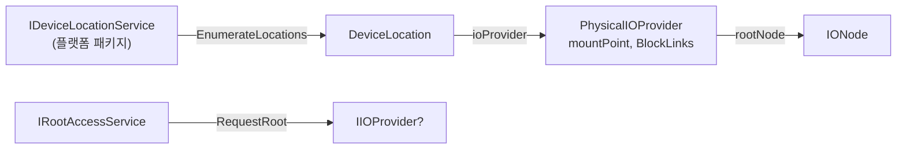

# 10. Locations: 운영체제 위치 서비스

> 기준 커밋: `b3e1a343`. [← 목차](README.md) · 이전: [9. 가상 파일 시스템](09-virtual-fs.md) · 다음: [11. 사용처](11-consumers.md)

`RuniOS.IO.Locations`는 공급자가 아니라, 파일 브라우저 같은 UI가 운영체제의 **위치**를 알아내는 데 쓰는 서비스 계약 모음입니다. "홈 폴더가 어디인가", "꽂혀 있는 USB는 무엇인가", "이 파일을 휴지통으로 보내라" 같은 일은 운영체제마다 방법이 다릅니다. core는 인터페이스만 정의하고, 구현은 플랫폼 패키지(`io.github.rumi727.runios.linux`, `io.github.rumi727.runios.windows`)가 [`IStreamingAssetsService`](07-streaming-assets.md#71-istreamingassetsservice)와 같은 방식(어셈블리 로드 때 `ServiceRegistry`에 등록)으로 제공합니다.

- [10.1 서비스 계약](#101-서비스-계약)
- [10.2 위치 데이터](#102-위치-데이터)
- [10.3 위치에서 공급자로](#103-위치에서-공급자로)

## 10.1 서비스 계약

| 서비스 | 멤버 | 하는 일 |
| --- | --- | --- |
| [`IKnownDirectoryService`](../../Runtime/IO/Locations/IKnownDirectoryService.cs#L11) | `EnumerateDirectories()` | 홈·바탕 화면·다운로드 등 알려진 폴더 |
| [`IBookmarkService`](../../Runtime/IO/Locations/IBookmarkService.cs#L11) | `EnumerateBookmarks()` | 파일 관리자의 즐겨찾기 |
| [`IMountService`](../../Runtime/IO/Locations/IMountService.cs#L11) | `EnumerateMounts()` | 마운트 지점 |
| [`IDeviceLocationService`](../../Runtime/IO/Locations/IDeviceLocationService.cs#L11) | `EnumerateLocations()` | 드라이브·이동식 장치 |
| [`INetworkLocationService`](../../Runtime/IO/Locations/INetworkLocationService.cs#L11) | `EnumerateLocations()` | 네트워크 위치 |
| [`ITrashService`](../../Runtime/IO/Locations/ITrashService.cs#L12) | `CanMoveToTrash`, `MoveToTrash` | 휴지통 |
| [`IFileManagerService`](../../Runtime/IO/Locations/IFileManagerService.cs#L11) | `ShowFolder`, `ShowItems` | 운영체제 파일 관리자에서 보여 주기 |
| [`IFileOpenService`](../../Runtime/IO/Locations/IFileOpenService.cs#L11) | `OpenFile` | 기본 프로그램으로 열기 |
| [`IRootAccessService`](../../Runtime/IO/Locations/IRootAccessService.cs#L12) | `RequestRoot()` | 새 루트 접근 요청 (예: 폴더 선택 대화 상자). 거부·취소는 `null` |

- 목록을 돌려주는 멤버는 모두 `IUniTaskAsyncEnumerable`이라, 구현이 결과를 하나씩 흘려보낼 수 있습니다.
- 운영체제에 넘기는 멤버(휴지통, 파일 관리자, 열기)는 `RuniPath`가 아니라 `PhysicalPath`를 받습니다. 운영체제가 이해하는 것은 물리 경로뿐이기 때문입니다. 공급자 노드에서 물리 경로를 얻는 방법은 [`IPhysicalBackedIOProvider.GetPhysicalPath`](04-physical-and-sandbox.md#46-샌드박스를-거치지-않는-길)입니다.

## 10.2 위치 데이터

| 타입 | 종류 | 내용 |
| --- | --- | --- |
| [`KnownDirectoryType`](../../Runtime/IO/Locations/KnownDirectoryType.cs#L4) | `record struct(string)` | `home`, `desktop`, `downloads`, `documents`, `music`, `pictures`, `videos`, `templates`, `public-share`, `contacts`, `favorites` 등. 문자열이라 플랫폼이 새 종류를 더할 수 있음 |
| [`KnownDirectory`](../../Runtime/IO/Locations/KnownDirectory.cs#L4) / [`Bookmark`](../../Runtime/IO/Locations/Bookmark.cs#L4) | `record struct` | 종류·이름 + `PhysicalPath` |
| [`Mount`](../../Runtime/IO/Locations/Mount.cs#L4) | 추상 클래스 | `mountPoint`, `fileSystemType`, `isReadOnly`, `isSystemInternal` |
| [`FileLocation`](../../Runtime/IO/Locations/FileLocation.cs#L4) | 추상 클래스 | `displayName`, **`ioProvider`**, `isReadOnly`, `TryGetSpaceInfo` |
| [`DeviceLocation`](../../Runtime/IO/Locations/DeviceLocation.cs#L4) / [`NetworkLocation`](../../Runtime/IO/Locations/NetworkLocation.cs#L4) | `FileLocation` 파생 | 장치는 `mount`, `label`, `isRemovable`, `isOptical` 추가 |
| [`StorageSpaceInfo`](../../Runtime/IO/Locations/StorageSpaceInfo.cs#L4) | `record struct` | 전체·여유·사용 가능 크기 |

> **관찰된 동작:** [`MountSpaceInfo`](../../Runtime/IO/Locations/MountSpaceInfo.cs#L4)는 `StorageSpaceInfo`와 필드가 같고 사용하는 곳이 없습니다.

## 10.3 위치에서 공급자로

`FileLocation.ioProvider`가 위치를 IO 시스템으로 잇는 다리입니다. 플랫폼 구현은 마운트 지점을 루트로 하는 `PhysicalIOProvider`를 기본 정책(`BlockLinks`)으로 만듭니다(예: `io.github.rumi727.runios.linux`의 `LinuxDeviceLocation.cs:95`, `io.github.rumi727.runios.windows`의 `WindowsDeviceLocation.cs:78`).

파일 브라우저(`io.github.rumi727.runios.uielements`의 [`FileSystemBrowser.GetNodeFromPhysicalRoot`](../../../io.github.rumi727.runios.uielements/Runtime/UIElements/IO/FileSystemBrowser.cs#L317))는 위치를 열 때 이 공급자를 그대로 쓰지 않고, 드라이브 루트(`/`, `C:\`)마다 하나씩 캐시한 `Unrestricted` 공급자의 노드로 바꿔 엽니다. 그래서 어느 위치에서 열었든 같은 드라이브면 같은 공급자를 쓰고, 위치의 마운트 지점보다 위로도 올라갈 수 있습니다. 그 대신 위치가 만든 공급자의 `BlockLinks` 정책은 브라우저에서는 적용되지 않습니다.

> **관찰된 동작:** `IRootAccessService`를 구현한 서비스는 현재 저장소에 없습니다.
