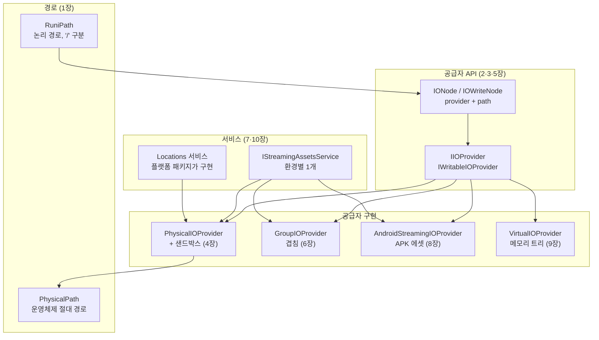

# IO 시스템 작동 원리

> 기준 커밋: `b3e1a343`. 코드 링크의 줄 번호는 이 커밋 기준입니다. [← core 문서 목차](../README.md) · 기존 개요: [`Runtime/IO/README.md`](../../Runtime/IO/README.md)

`io.github.rumi727.runios.core`의 `RuniOS.IO`가 파일과 디렉터리를 **어디에 있든 같은 API로** 읽고 쓰게 하는 구조를 코드를 따라가며 설명합니다. 디스크 폴더, APK 안의 에셋, 여러 폴더를 겹친 가상 폴더, 메모리 속 트리가 모두 `IIOProvider` 하나로 보입니다.

C#과 Unity를 아는 독자를 기준으로 썼습니다. 각 장은 앞쪽에 계약과 사용법을, 뒤쪽에 내부 동작을 둡니다.

## 한 장으로 보기

**핵심 아이디어 세 가지**

1. **경로를 둘로 나눕니다.** 공급자 API는 루트 기준 논리 경로 `RuniPath`만 받고, `..`이나 대소문자 같은 운영체제 규칙은 해석하지 않습니다. 디스크 공급자만 `RuniPath`를 `PhysicalPath`로 바꾸고, 그 순간 운영체제 규칙이 적용됩니다. → [1장](01-paths.md)
2. **저장소마다 공급자 하나, 사용하는 쪽은 노드 하나.** 공급자는 `GetEntry`·`EnumerateEntries`·`OpenRead` 세 개만 구현하면 나머지가 기본 구현으로 따라옵니다. 사용하는 쪽은 `IONode`로 공급자 종류를 모른 채 같은 코드를 씁니다. 환경마다 다른 저장소(플레이어 폴더, APK, 에디터의 프로젝트+패키지)는 서비스가 골라 줍니다. → [2장](02-providers-and-nodes.md), [7장](07-streaming-assets.md)
3. **디스크는 샌드박스 안에서만.** 디스크 공급자는 모든 경로를 해석한 뒤 루트 밖으로 나가거나 링크를 지나는지 조각마다 검사합니다. 남이 만든 리소스 팩 폴더를 열어도 루트 밖 파일에 닿지 않습니다. → [4장](04-physical-and-sandbox.md)

## 읽는 순서

| 장 | 내용 | 깊이 |
| --- | --- | --- |
| [1. 경로](01-paths.md) | `RuniPath` 정규화·결합·상위 판정, 확장자 규칙, `PhysicalPath`, 직렬화 | **줄 단위** |
| [2. 공급자와 노드](02-providers-and-nodes.md) | `IIOProvider` 계약과 기본 구현, `IONode`, `IOEntry`·`FileMetaData`, 빈 공급자, 체크섬 | 핵심 줄 단위 |
| [3. 열거와 매처](03-enumeration-and-matchers.md) | 열거 API, 매처, `EnumerateOnThreadPool`, 공급자별 차이 | 핵심 줄 단위 |
| [4. Physical과 샌드박스](04-physical-and-sandbox.md) | `ResolveFullPath`, `ValidateSandboxPolicy`, 열거와 링크, 동기 읽기·쓰기 | **줄 단위** |
| [5. 쓰기·복사·이동](05-write-operations.md) | `OpenWrite`/`CreateFile`, 기본 복사·이동 알고리즘과 실패 시 상태, 재정의 | 핵심 줄 단위 |
| [6. `GroupIOProvider`](06-group-provider.md) | 겹침 우선순위, 읽기·존재 확인·열거 규칙, `leaveOpen` | **줄 단위** |
| [7. StreamingAssets](07-streaming-assets.md) | 환경별 서비스, 에디터의 프로젝트+패키지 겹침, 빌드 복사, EditorStreamingAssets | 핵심 줄 단위 |
| [8. Android 에셋](08-android-assets.md) | `AssetManager` JNI 호출, 디렉터리 판정, 너비 우선 열거, 스트림 | **줄 단위** |
| [9. 가상 파일 시스템](09-virtual-fs.md) | 노드 트리와 상태, 경로 캐시, 버퍼·바로가기 파일 | 핵심 줄 단위 |
| [10. Locations](10-locations.md) | 운영체제 위치 서비스 계약과 데이터 | 요약 |
| [11. 사용처](11-consumers.md) | 리소스 팩, 레지스트리, 텍스처·FMOD 로더, 파일 브라우저 | 요약 |
| [12. 공급자 차이와 기존 문서](12-differences.md) | 공급자 차이표, 기존 README·XML 주석과 다른 곳, 사용처 없는 멤버 | 표 |

## 용어집

| 용어 | 뜻 |
| --- | --- |
| **공급자(provider)** | 저장소 하나의 루트. `IIOProvider` 구현 |
| **노드** | `IONode(provider, path)`. 공급자 위의 한 위치. 상태를 갖지 않음 |
| **엔트리** | `IOEntry(path, metaData, isDirectory)`. `GetEntry`·열거가 돌려주는 스냅샷 |
| **루트 기준 경로** | 공급자 루트에서 잰 `RuniPath`. 열거 결과의 경로도 이것 |
| **논리 경로 / 물리 경로** | `RuniPath` / `PhysicalPath` |
| **샌드박스** | `PhysicalIOProvider`가 루트 밖·링크 경유 접근을 막는 검사. `SandboxPolicy`로 정함 |
| **재분석 지점(reparse point)** | 심볼릭 링크, 정션, 클라우드 자리 표시자 등 파일 시스템이 특별히 처리하는 항목 |
| **겹침(overlay)** | `GroupIOProvider`가 여러 공급자를 우선순위대로 하나처럼 보여 주는 것 |
| **리비전** | `FileMetaData.IsSameRevision`이 판정하는 "같은 내용으로 볼 수 있는 상태" |
| **바로가기(shortcut)** | 다른 공급자의 노드를 가리키는 `VirtualFile` |

## 파일 지도 (`Runtime/IO`)

| 영역 | 파일 |
| --- | --- |
| 경로 | `RuniPath`, `PhysicalPath`, `FileExtension`, (`Runtime/Utility/RuniPathUtility`) |
| 계약 | `IIOProvider`, `IWritableIOProvider`, `IPhysicalBackedIOProvider`, `IPrecalculatedIOChecksum`, `IStreamingAssetsService` |
| 노드·엔트리 | `IONode`(.File / .Directory / .Checksum), `IOWriteNode`(.File / .Directory / .Checksum), `IOEntry`, `FileMetaData` |
| 공급자 | `PhysicalIOProvider`, `SandboxPolicy`, `GroupIOProvider`, `EmptyIOProvider` |
| 매처 | `IPatternMatcher`, `ExtensionMatcher`, `NotPatternMatcher`, `AllPatternMatcher`, `RegexMatcher`, `PatternMatcherSet`(`1) |
| StreamingAssets | `StreamingAssets/Player/PlayerStreamingAssetsService`, `StreamingAssets/Android/AndroidStreamingAssetsService`, `AndroidStreamingIOProvider` |
| 가상 | `Virtual/`: `VirtualIOProvider`, `VirtualNode`, `VirtualDirectoryBase`, `VirtualDirectory`, `VirtualFileBase`, `VirtualFile`, `VirtualFileBuffer`, `VirtualFileBufferStream` |
| 위치 | `Locations/`: 서비스 인터페이스 9개, `FileLocation`, `DeviceLocation`, `NetworkLocation`, `Mount`, `KnownDirectory`(Type), `Bookmark`, `StorageSpaceInfo`, `MountSpaceInfo` |
| JSON | `Runtime/Json/Converters/IO/`: `RuniPathConverter`, `PhysicalPathConverter`, `FileExtensionConverter` |
| 스레드 풀 열거 | `Runtime/Utility/UniTaskLinqExtras` |
| 에디터 (`Editor/`) | `EditorStreamingAssetsService`, `PackageIOProvider`, `PackageStreamingAssetsBuildProcessor` |

## 그림 목록

| 그림 | 장 |
| --- | --- |
| [경로가 디스크에 닿기까지](images/path-pipeline.svg) | 1 |
| [GroupIOProvider 겹침 규칙](images/group-overlay.svg) | 6 |
