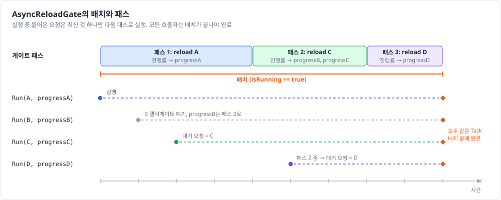
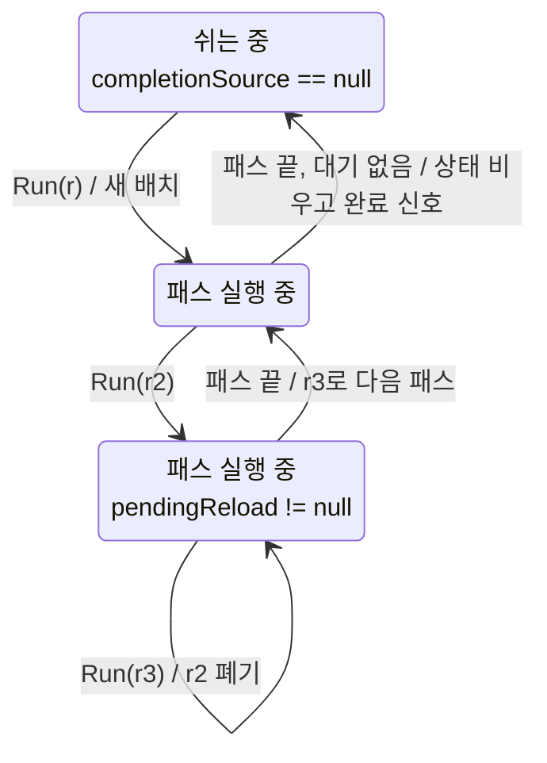

# 3. `AsyncReloadGate`: 겹친 리로드 요청 합치기

> 기준 커밋: `7e5d710f`. [← 목차](README.md) · 이전: [2. 리소스 팩](02-resource-packs.md) · 다음: [4. 리로드 파이프라인](04-reload-pipeline.md)

리로드는 여러 곳에서 동시에 요청됩니다. 에디터에서 파일을 저장하면 에셋 임포트가, 도메인 리로드가, 사용자의 버튼이 각각 `ResourceManager.Reload()`를 부를 수 있습니다. 리로드 도중 다시 리로드하면 두 작업이 같은 레지스트리를 동시에 고치게 되고, 그렇다고 첫 리로드를 취소하면 반쯤 끝난 상태가 남습니다.

[`AsyncReloadGate`](../../Runtime/Tasks/AsyncReloadGate.cs#L10)(`RuniOS.Tasks`)는 이 문제를 **합치기**로 풉니다. 실행 중인 리로드는 끝까지 두고, 그동안 들어온 요청들은 하나로 합쳐 끝난 뒤에 처음부터 한 번 더 실행합니다. 리소스 시스템의 리로드 진입점(`ResourceManager`, `ResourcePack`, `ResourcePack.ReloadAll`, `SimpleAssetRegistry`, `LanguageAssetRegistry`)과 다른 패키지의 리로드 객체들이 모두 이 게이트를 하나씩 가집니다.

- [3.1 용어: 배치와 패스](#31-용어-배치와-패스)
- [3.2 `Run`](#32-run)
- [3.3 `RunLoop`](#33-runloop)
- [3.4 진행률](#34-진행률)
- [3.5 계약 정리](#35-계약-정리)
- [3.6 사용 패턴](#36-사용-패턴)

## 3.1 용어: 배치와 패스

- **패스(pass):** 리로드 함수를 처음부터 끝까지 한 번 실행하는 것.
- **배치(batch):** 게이트가 쉬고 있을 때 첫 요청을 받은 순간부터, 대기 요청까지 모두 처리하고 다시 쉴 때까지. 패스가 하나 이상 들어 있습니다.



게이트의 상태는 필드 셋이 전부입니다.

```csharp
// Runtime/Tasks/AsyncReloadGate.cs
12  Func<IProgress<float>?, UniTask>? pendingReload;                 // 다음 패스에서 실행할 리로드 (최신 요청 하나)
13  readonly List<IProgress<float>> pendingProgresses = [];          // 다음 패스에 참가할 진행률들
14  UniTaskCompletionSource? completionSource;                       // 현재 배치의 완료 신호. null이면 쉬는 중
…
20  public bool isRunning => completionSource != null;
```

잠금이 없으므로 여러 스레드에서 동시에 `Run`을 부르는 것은 안전하지 않습니다. 현재 사용처는 모두 메인 스레드에서 부릅니다.

## 3.2 `Run`

```csharp
// Runtime/Tasks/AsyncReloadGate.cs
42  public UniTask Run
    (
44      Func<IProgress<float>?, UniTask> reload,
45      IProgress<float>? progress = null
    )
    {
48      ArgumentNullException.ThrowIfNull(reload);
50      pendingReload = reload;                       // ① 최신 요청이 이전 대기 요청을 덮음
51      AddPendingProgress(progress);                 // ② 진행률은 덮지 않고 모음
53      if (completionSource != null)
54          return completionSource.Task;             // ③ 배치가 진행 중이면 같은 Task에 합류
56      UniTaskCompletionSource source = new();
57      completionSource = source;
59      RunLoop(source).Forget();                     // ④ 새 배치 시작
60      return source.Task;
    }
…
79  public UniTask Run(Func<UniTask> reload)
    {
81      ArgumentNullException.ThrowIfNull(reload);
82      return Run(_ => reload());                    // 진행률이 없는 리로드용
    }
```

- ① 대기 중인 요청은 **가장 최근 것 하나만** 남습니다. 리로드는 현재 상태 전체를 처음부터 다시 읽는 작업이므로, 마지막 요청 하나만 실행해도 그 전 요청들이 기다리던 상태가 반영됩니다. 요청마다 리로드를 한 번씩 돌리는 큐는 없습니다.
- ② 진행률 객체는 덮지 않습니다. 함수가 덮인 요청을 보낸 쪽도 다음 패스의 진행 상황을 받습니다([3.4절](#34-진행률)).
- ③ 배치가 진행 중이면 새 배치를 만들지 않고 현재 배치의 Task를 돌려줍니다. 그래서 **모든 호출자는 배치 전체가 끝나야 깨어납니다.** 그때가 되어야 자기 요청이 반영된 패스가 끝났다는 것이 보장됩니다.
- ④ `RunLoop`는 `Forget()`으로 시작하고, 결과는 `source`로만 전달합니다.

## 3.3 `RunLoop`

```csharp
// Runtime/Tasks/AsyncReloadGate.cs
96  async UniTask RunLoop(UniTaskCompletionSource source)
    {
98      List<Exception>? exceptions = null;
100     try
        {
102         do
            {
104             Func<IProgress<float>?, UniTask> reload = pendingReload!;
105             pendingReload = null;                                        // ① 이번 패스가 가져감
107             IProgress<float>[] progresses = pendingProgresses.ToArray();
108             pendingProgresses.Clear();                                   // ② 이번 패스의 진행률 스냅샷
110             IProgress<float>? combinedProgress = CreateCombinedProgress(progresses);
112             try
                {
114                 await reload.Invoke(combinedProgress);
                }
116             catch (Exception exception)
                {
118                 (exceptions ??= []).Add(exception);                       // ③ 실패해도 다음 패스는 계속
                }
            }
121         while (pendingReload != null);                                   // ④ 패스 도중 새 요청이 있었으면 한 번 더
        }
123     catch (Exception exception)
        {
125         (exceptions ??= []).Add(exception);
        }
127     finally
        {
129         pendingReload = null;
130         pendingProgresses.Clear();
131         completionSource = null;                                         // ⑤ 먼저 쉬는 상태로 되돌리고
        }
134     if (exceptions == null)
135         source.TrySetResult();                                           // ⑥ 그다음 호출자를 깨움
136     else if (exceptions.Count == 1)
137         source.TrySetException(exceptions[0]);
        else
139         source.TrySetException(new AggregateException(exceptions));
    }
```

- ④ 패스가 끝날 때 `pendingReload`가 다시 채워져 있으면 그 요청을 처음부터 실행합니다. 패스 도중에 요청이 몇 번 왔든 다음 패스는 하나입니다.
- ③ 한 패스가 예외를 던져도 대기 중인 다음 패스는 실행됩니다. 예외는 모아 두었다가 배치가 끝날 때 한꺼번에 알립니다. 하나면 그 예외, 여럿이면 `AggregateException`이고, **배치에 합류한 모든 호출자**가 같은 예외를 받습니다.
- ⑤⑥ 상태를 먼저 비운 뒤 완료를 알립니다. `TrySetResult`는 기다리던 호출자의 연속 실행을 그 자리에서 실행할 수 있으므로, 이 순서 덕분에 거기서 다시 `Run`을 불러도 새 배치가 정상적으로 시작됩니다.

**재진입하면 교착 상태가 됩니다.** 게이트가 실행하는 리로드 함수 안에서 같은 게이트의 `Run`을 `await`하면, 현재 패스는 배치가 끝나기를 기다리고 배치는 현재 패스가 끝나기를 기다립니다. `Run(...).Forget()`처럼 기다리지 않으면 다음 패스가 예약될 뿐 교착되지는 않습니다.



## 3.4 진행률

진행률은 리로드 함수와 다르게 다룹니다.

```csharp
// Runtime/Tasks/AsyncReloadGate.cs
85  void AddPendingProgress(IProgress<float>? progress)
    {
87      if (progress == null)
88          return;
90      if (pendingProgresses.Any(pendingProgress => ReferenceEquals(pendingProgress, progress)))
91          return;                                           // 같은 객체는 한 번만
93      pendingProgresses.Add(progress);
    }
…
142 static IProgress<float>? CreateCombinedProgress(IProgress<float>[] progresses)
    {
144     return progresses.Length switch
        {
146         0 => null,
147         1 => progresses[0],
148         _ => new CombinedProgress(progresses)             // 여럿이면 한 번에 모두에게 보고
        };
    }
```

규칙은 이렇습니다.

| 진행률을 넘긴 시점 | 받는 보고 |
| --- | --- |
| 쉬는 중 (`Run(A, pA)`) | 패스 1의 0→1 |
| 패스 1 도중 (`Run(B, pB)`, `Run(C, pC)`) | 패스 2의 0→1. B 함수가 덮였어도 `pB`는 받음 |
| 패스 2 도중 (`Run(D, pD)`) | 패스 3의 0→1 |

진행률은 자기가 참가한 **한 패스**만 받습니다. 그래서 `pA`가 1을 받은 뒤에도 `Run(A)`의 Task는 배치가 끝날 때까지 완료되지 않을 수 있습니다. [`CombinedProgress`](../../Runtime/Tasks/AsyncReloadGate.cs#L152)는 각 대상에 `SafeReport`로 보고해, 한 진행률 객체의 예외가 다른 객체나 리로드에 퍼지지 않게 합니다.

## 3.5 계약 정리

| 항목 | 동작 |
| --- | --- |
| 실행 중 리로드 | 취소하지 않음 |
| 실행 중 들어온 요청 | 최신 리로드 함수 하나만 다음 패스로. 진행률은 모두 다음 패스로 |
| 호출자 완료 시점 | 배치 전체가 끝날 때. 같은 배치의 호출자는 같은 Task |
| 예외 | 패스마다 모아 배치 끝에 모든 호출자에게. 다음 패스는 계속 실행 |
| 재진입 `await` | 교착 상태 (`Forget()`은 다음 패스 예약) |
| 스레드 | 잠금 없음 (현재 사용처는 메인 스레드) |
| 취소 토큰 | 없음 |

## 3.6 사용 패턴

리로드 진입점은 공개 `Reload`가 게이트만 부르고, 실제 작업은 `ReloadCore`가 합니다.

```csharp
// Runtime/Resource/ResourcePack.cs
88  readonly AsyncReloadGate reloadGate = new();
90  public UniTask Reload() => reloadGate.Run(ReloadCore);
```

진행률이 있는 경우는 [`ResourceManager.Reload`](04-reload-pipeline.md#41-진입점)를 보세요.

리로드 함수에 넘기는 인자는 그 요청의 람다가 붙잡고, 덮이지 않은 최신 요청의 람다만 실행됩니다. 레지스트리 리로드는 인자로 받은 팩 목록을 다루는 방식이 둘로 나뉩니다.

| 리로드 | 팩 목록 |
| --- | --- |
| `SimpleAssetRegistry.Reload`, `LanguageAssetRegistry.Reload` | 받은 `IEnumerable`을 그대로 람다가 붙잡음 |
| `SoundAssetRegistry.Reload` (sound 패키지) | `ToArray()`로 복사한 뒤 붙잡음 |

`ResourceManager`는 레지스트리에 이미 배열([4.2절](04-reload-pipeline.md#42-한-패스의-흐름)의 스냅샷)을 넘기므로 현재는 두 방식의 결과가 같습니다.
