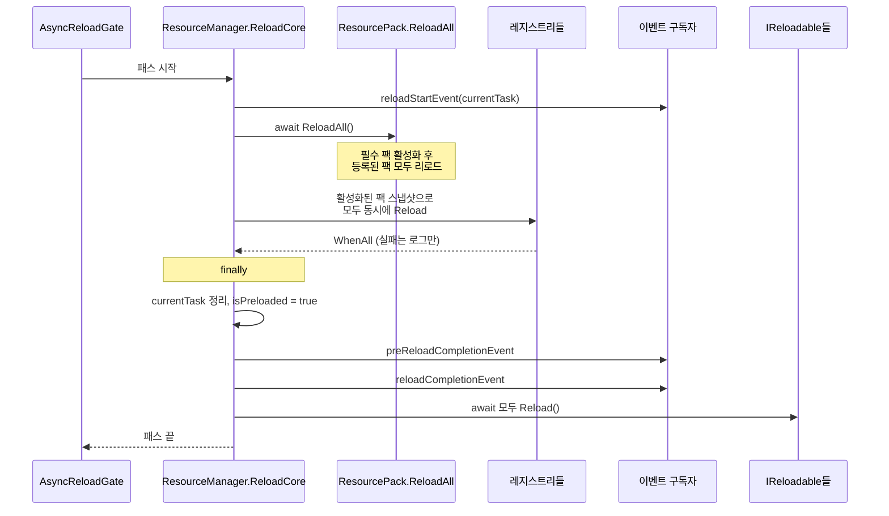

# 4. 리로드 파이프라인: `ResourceManager`

> 기준 커밋: `7e5d710f`. [← 목차](README.md) · 이전: [3. `AsyncReloadGate`](03-reload-gate.md) · 다음: [5. 레지스트리와 조회](05-registries.md)

[`ResourceManager`](../../Runtime/Resource/ResourceManager.cs#L13)는 리소스 시스템 전체를 다시 읽는 진입점입니다. 리로드 한 번(한 패스)은 네 단계로 이뤄집니다.

1. 팩을 다시 읽는다 (`ResourcePack.ReloadAll`)
2. 모든 레지스트리가 활성화된 팩을 훑어 인덱스를 다시 만든다
3. 완료 이벤트를 보낸다
4. 등록된 `IReloadable`이 새 에셋으로 갈아탄다

이 장은 그 순서와 이유, 그리고 리로드가 언제 시작되는지(부팅, 에디터)를 다룹니다.

- [4.1 진입점](#41-진입점)
- [4.2 한 패스의 흐름](#42-한-패스의-흐름)
- [4.3 레지스트리 리로드와 진행률](#43-레지스트리-리로드와-진행률)
- [4.4 완료 단계: 이벤트, 그다음 `IReloadable`](#44-완료-단계-이벤트-그다음-ireloadable)
- [4.5 누가 리로드를 시작하나](#45-누가-리로드를-시작하나)

## 4.1 진입점

```csharp
// Runtime/Resource/ResourceManager.cs
22  public static bool isPreloaded { get; private set; } = false;
28  public static bool isLoading => reloadGate.isRunning;              // 배치가 진행 중인가
34  public static AsyncTask? currentTask { get; private set; } = null;
40  public static event Action<AsyncTask>? reloadStartEvent;
46  public static event Action? preReloadCompletionEvent;
52  public static event Action? reloadCompletionEvent;
…
62  static readonly AsyncReloadGate reloadGate = new();
…
96  public static UniTask Reload(IProgress<float>? progress = null) => reloadGate.Run(ReloadCore, progress);
```

`Reload`는 [3장](03-reload-gate.md)의 게이트를 거칩니다. 리로드 중에 다시 부르면 지금 패스가 끝난 뒤 처음부터 한 번 더 돌고, 호출자는 모두 그 배치가 끝날 때 깨어납니다. `isLoading`은 패스가 아니라 **배치**가 진행 중인지를 뜻합니다.

## 4.2 한 패스의 흐름



```csharp
// Runtime/Resource/ResourceManager.cs
98  static async UniTask ReloadCore(IProgress<float>? progress)
    {
100     currentTask = new AsyncTask(Text.Local("runios:resource.loading.title"), Text.Local("runios:resource.loading.description"));
101     reloadStartEvent?.SafeInvoke(currentTask);                         // ① 진행 표시용 작업 객체를 알림
103     try
        {
105         progress.SafeReport(0);
107         await ResourcePack.ReloadAll();                                 // ② 팩 먼저
109         ReadOnlySet<IAssetRegistry> assetRegistries = AssetRegistryManager.GetAll();
111         UniTask[] uniTasks = new UniTask[assetRegistries.Count];
112         float[] assetRegistryProgresses = new float[assetRegistries.Count];
114         ResourcePack[] resourcePacks = ResourcePack.GetEnabledPacksSnapshot();   // ③ 이 패스에서 쓸 팩 목록 고정
            … 레지스트리마다 UniTask.Defer(RegistryReload) (4.3절) …
150         await UniTask.WhenAll(uniTasks);
        }
152     catch (Exception e)
        {
154         Debug.LogException(e);
        }
156     finally
        { … 4.4절 … }
    }
```

- ① [`AsyncTask`](../../Runtime/Tasks/AsyncTask.cs)는 이름·설명·진행률을 가진 작업 객체입니다. 에디터 툴바의 진행 표시가 `reloadStartEvent`로 이것을 받아 보여 줍니다.
- ② 팩이 먼저 끝나야 활성화 목록과 각 팩의 네임스페이스가 확정됩니다.
- ③ 활성화된 유효한 팩을 배열로 고정해 모든 레지스트리에 같은 목록을 넘깁니다. 리로드 도중 누가 팩을 켜거나 꺼도 이 패스의 레지스트리들은 같은 팩을 봅니다.

## 4.3 레지스트리 리로드와 진행률

```csharp
// Runtime/Resource/ResourceManager.cs
117 foreach (var assetRegistry in assetRegistries)
    {
119     int targetIndex = index;
121     uniTasks[index] = UniTask.Defer(() => RegistryReload(assetRegistry, targetIndex));   // ① 모두 만든 뒤 WhenAll로 동시에
122     index++;
124     async UniTask RegistryReload(IAssetRegistry assetRegistry, int targetIndex)
        {
126         try
            {
128             await assetRegistry.Reload
                (
130                 resourcePacks,
131                 Progress.Create<float>(x =>
                    {
133                     assetRegistryProgresses[targetIndex] = x;
135                     float value = assetRegistryProgresses.Sum() / assetRegistryProgresses.Length;   // ② 전체 = 레지스트리 진행률의 평균
136                     if (currentTask != null)
137                         currentTask.progress.Value = value;
139                     progress.SafeReport(value);
                    })
                );
            }
143         catch (Exception e)
            {
145             Debug.RuntimeLogError(…);                                    // ③ 한 레지스트리의 실패는 나머지를 막지 않음
            }
        }
    }
```

- ① 레지스트리들은 서로 기다리지 않습니다. 모두 UniTask이므로 "동시에"는 각자의 `await` 지점에서 번갈아 진행된다는 뜻이고, 레지스트리 사이의 순서는 정해져 있지 않습니다. 한 레지스트리가 다른 레지스트리의 결과에 기대면 안 됩니다. 파일 기반 레지스트리는 리로드 때 인덱스만 만들고 에셋은 나중에 스코프를 얻을 때 불러옵니다([7장](07-handles-and-scopes.md)).
- ③ 레지스트리 하나가 실패하면 로그를 남기고 나머지는 계속합니다. 실패한 레지스트리가 어떤 인덱스를 남기는지는 [5.2절](05-registries.md#52-추적-먼저-기록한-것이-이긴다)을 보세요.

> **관찰된 동작:** ② 진행률 콜백은 정적 필드 `currentTask`에 씁니다. 콜백이 늦게 불리면 다음 패스의 `currentTask`에 쓸 수 있습니다. 레지스트리 목록은 `AssetRegistryManager.GetAll()`의 실시간 뷰를 109행에서 받아 바로 열거합니다.

## 4.4 완료 단계: 이벤트, 그다음 `IReloadable`

```csharp
// Runtime/Resource/ResourceManager.cs
156 finally
    {
158     progress.SafeReport(1);
160     currentTask.progress.Value = 1;
162     currentTask.Dispose();
163     currentTask = null;
165     isPreloaded = true;                                     // ① 실패한 패스에서도
167     preReloadCompletionEvent.SafeInvoke();                  // ② 이벤트 먼저
168     reloadCompletionEvent.SafeInvoke();
170     static async UniTask ReloadSafe(IReloadable reloadable)
        {
172         try { await reloadable.Reload(); }
176         catch (Exception e) { Debug.LogException(e); }
        }
182     // 열거 도중 컬랙션 변경 가능성 있음
183     await UniTask.WhenAll(reloadables.ToArray().Select(ReloadSafe));   // ③ 그다음 IReloadable 모두
    }
```

**완료 단계는 리로드가 실패해도 진행하고, 이벤트가 `IReloadable`보다 먼저 옵니다.** 둘 다 의도된 순서입니다.

- **이벤트**(`preReloadCompletionEvent`, `reloadCompletionEvent`)는 에셋을 받아 쓰는 쪽이 아니라 "리로드가 끝났다"는 신호가 필요한 스크립트 후킹용입니다. 그런 후킹은 에셋을 다시 잡는 객체들보다 먼저 실행되어야 할 가능성이 높아 앞에 둡니다. 현재 core에서는 [`LocalizationUtility`](../../Runtime/Utility/LocalizationUtility.cs#L11)가 `preReloadCompletionEvent`로 번역 캐시를 비우고, 에디터의 언어 표시가 `reloadCompletionEvent`로 다시 그립니다. 같은 패스 안에서 `pre…`가 항상 먼저입니다.
- **[`IReloadable`](../../Runtime/Resource/IReloadable.cs#L5)**은 `AssetRef<T>`를 들고 그 에셋을 실제로 쓰는 객체(컴포넌트, 오디오 소스, UI 요소)를 위한 최종 리로드입니다. 레지스트리와 이벤트가 모두 끝난 뒤에 실행되므로 새 인덱스를 보고 새 핸들로 갈아탈 수 있습니다. `AttachReloadable`/`DetachReloadable`로 등록하며, 대표 구현은 [`AssetScopeBinder`](08-asset-ref-and-binders.md#83-assetscopebinder)입니다.
- ③ `IReloadable` 목록은 배열로 복사한 뒤 돌립니다. `Reload` 도중 객체가 자기를 해제하거나 새 객체가 등록돼도 열거가 깨지지 않습니다. `IReloadable`은 **패스 안에서** 기다리므로, 리로드 배치는 이것들까지 끝나야 완료됩니다.
- ① 실패한 패스도 `isPreloaded`를 `true`로 만듭니다. 이 값은 "한 번이라도 리로드 패스를 마쳤다"를 뜻합니다.

**`IReloadable.Reload()` 안에서 `ResourceManager.Reload()`를 `await`하면 교착 상태가 됩니다**([3.3절](03-reload-gate.md#33-runloop)). 그 `IReloadable`은 패스 안에서 기다려지고 있고, 패스는 그것이 끝나기를 기다립니다.

## 4.5 누가 리로드를 시작하나

| 환경 | 진입점 | 시점 |
| --- | --- | --- |
| 플레이어·Play 모드 | [`BootLoader.Boot`](../../Runtime/Booting/BootLoader.cs#L21) | `[RuntimeInitializeOnLoadMethod(BeforeSceneLoad)]` |
| 에디터 | [`ResourceReloadPostprocessor`](../../Editor/ResourceReloadPostprocessor.cs#L9) | 도메인 리로드 직후, 그리고 경로에 `StreamingAssets`가 들어간 에셋이 임포트·삭제·이동될 때 |
| 어디서든 | `ResourceManager.Reload()` 직접 호출 | 에디터 개발 패널의 버튼 등 |

```csharp
// Runtime/Booting/BootLoader.cs
18  [RuntimeInitializeOnLoadMethod(RuntimeInitializeLoadType.BeforeSceneLoad)]
21  static async UniTaskVoid Boot()
    {
33      Debug.RuntimeLog("Loading the resource registry");
35      await ResourceManager.Reload();
38      Debug.RuntimeLog("On Resources Ready Method Invoke");
39      await MilestoneDispatcher.Invoke<OnResourcesReadyAttribute>();     // 리소스가 준비된 뒤 실행할 메서드들
41      Debug.RuntimeLog("Exit bootloader");
    }
```

부팅은 `UniTaskVoid`로 시작하고 기다리는 쪽이 없습니다. 첫 `await`에서 Unity로 돌아가므로 **첫 씬은 리소스 로드가 끝나기 전에 로드됩니다.** 그래서 씬의 `Awake`/`Start` 시점에는 인덱스가 아직 비어 있을 수 있고, `IReloadable`·`AssetScopeBinder`는 리로드가 끝난 뒤 다시 잡으므로 이 경우에도 에셋을 받게 됩니다. `[OnResourcesReady]` 메서드와 부팅 순서의 자세한 내용은 부팅·커널 문서에서 다룹니다.

```csharp
// Editor/ResourceReloadPostprocessor.cs
9   static void OnPostprocessAllAssets(string[] importedAssets, string[] deletedAssets, string[] movedAssets, string[] movedFromAssetPaths, bool didDomainReload)
    {
11      if (didDomainReload || importedAssets
12              .Concat(deletedAssets)
13              .Concat(movedAssets)
14              .Any(x => x.Contains("StreamingAssets", StringComparison.OrdinalIgnoreCase)))   // EditorStreamingAssets도 포함
15          ResourceManager.Reload().Forget();
    }
```

에디터에는 부팅이 없으므로 도메인 리로드(스크립트 컴파일, 에디터 시작)가 첫 리로드를 대신합니다. Play 모드에 들어가면 부팅이 한 번 더 리로드를 요청합니다.

> **관찰된 동작:** 에셋을 `StreamingAssets` **밖으로** 옮기는 경우는 `movedFromAssetPaths`를 보지 않으므로 리로드가 일어나지 않습니다. 경로에 `StreamingAssets`라는 글자만 들어가도(관계없는 폴더 이름) 리로드합니다.
