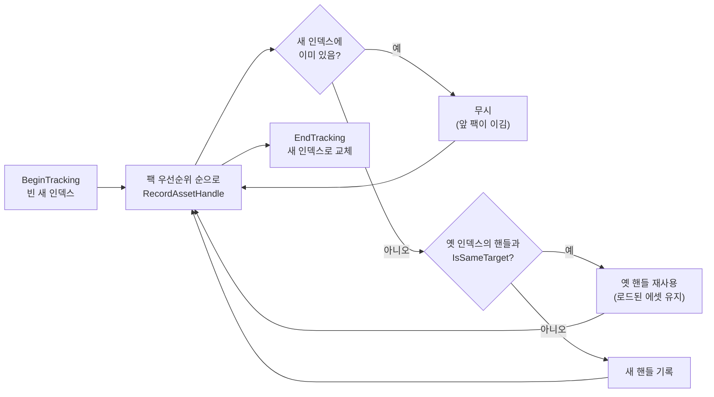

# 5. 레지스트리와 조회

> 기준 커밋: `7e5d710f`. [← 목차](README.md) · 이전: [4. 리로드 파이프라인](04-reload-pipeline.md) · 다음: [6. `SimpleAssetRegistry`](06-simple-asset-registry.md)

**에셋 레지스트리**는 "이 식별자의 에셋은 이 핸들로 얻는다"는 표(인덱스) 하나입니다. 텍스처 레지스트리, 언어 레지스트리처럼 에셋 종류마다 하나씩 있고, 리로드 때 활성화된 팩을 훑어 표를 다시 만듭니다.

레지스트리의 핵심 계약은 **식별자 하나가 에셋 하나를 가리킨다**는 것입니다. 그 에셋을 만들려고 어떤 파일을 읽는지, 여러 파일을 합치는지, 에셋을 미리 만드는지 나중에 만드는지는 레지스트리 구현이 정합니다. 같은 파일을 여러 레지스트리가 각자 해석할 수도 있습니다(예: 같은 `png`를 텍스처 레지스트리는 `Texture2D`로, 스프라이트 레지스트리는 `Sprite`로).

- [5.1 계약: `IAssetRegistry`](#51-계약-iassetregistry)
- [5.2 추적: 먼저 기록한 것이 이긴다](#52-추적-먼저-기록한-것이-이긴다)
- [5.3 조회 세 가지](#53-조회-세-가지)
- [5.4 등록과 해제: `AssetRegistryManager`](#54-등록과-해제-assetregistrymanager)

## 5.1 계약: `IAssetRegistry`

[`IAssetRegistry`](../../Runtime/Resource/IAssetRegistry.cs#L12)의 멤버는 셋으로 나뉩니다.

| 종류 | 멤버 | 뜻 |
| --- | --- | --- |
| 정체 | `registryId` | 레지스트리 식별자(예: `runios:textures`). 전체에서 하나 |
| | `providedAssetType` | 핸들이 주는 에셋 타입(예: `Texture2D`) |
| | `priority` | 같은 `providedAssetType`의 레지스트리끼리 자동 조회 순서. 클수록 먼저. **같으면 순서 미정**, 등록 후 바꾸지 않음 |
| 조회 | `this[id]`, `TryGetHandle`, `ContainsKey`, `keys`, `handles`, `count` | 현재 인덱스 |
| 리로드 | `Reload(packs, progress)`, `isLoading` | 팩 목록으로 인덱스 재구성 |

제네릭 [`IAssetRegistry<THandle>`](../../Runtime/Resource/IAssetRegistry%601.cs#L14)는 핸들 타입을 정해 박싱 없는 조회를 주고, 비제네릭 멤버를 기본 인터페이스 멤버로 이어 줍니다.

## 5.2 추적: 먼저 기록한 것이 이긴다

[`AssetRegistry<THandle>`](../../Runtime/Resource/AssetRegistry.cs#L15)는 인덱스를 가진 추상 기반 클래스입니다. 파생 클래스는 `Reload`에서 아래 세 메서드로 새 인덱스를 만듭니다.

```csharp
// Runtime/Resource/AssetRegistry.cs
76  Dictionary<Identifier, THandle> assetHandles = new();                // 지금 조회에 쓰는 인덱스
77  Dictionary<Identifier, THandle>? trackedHandles = null;              // 리로드 중 만드는 새 인덱스
…
90  protected void BeginTracking()
    {
92      if (isTracking)
93          throw new InvalidOperationException("Tracking is already started.");
95      trackedHandles = new Dictionary<Identifier, THandle>();          // ① 빈 새 인덱스
    }
…
158 protected void RecordAssetHandle(Identifier identifier, THandle assetHandle)
    {
        …
169     if (IsTracked(identifier))
170         return;                                                       // ② 이미 기록된 식별자면 무시 = 먼저 기록한 것이 이김
173     if (assetHandles.TryGetValue(identifier, out THandle? value) && value.IsSameTarget(assetHandle))
174         assetHandle = value;                                          // ③ 같은 대상이면 기존 핸들 재사용
176     trackedHandles[identifier] = assetHandle;
    }
…
109 protected void EndTracking()
    {
111     if (!isTracking)
112         throw new InvalidOperationException(…);
114     assetHandles = trackedHandles;                                   // ④ 한 번에 교체
115     trackedHandles = null;
    }
```



- ② 레지스트리는 팩을 [우선순위 순서](02-resource-packs.md#24-활성화-순서와-우선순위)(0번부터)로 훑으므로, **먼저 기록된 것 = 우선순위가 높은 팩의 것**입니다. 이것이 리소스 팩 덮어쓰기의 원리입니다.
- ③ 리로드할 때마다 핸들을 새로 만들면 이미 불러온 에셋을 모두 다시 불러와야 합니다. 같은 파일(공급자 대상·경로·[리비전](../IO/02-providers-and-nodes.md#25-ioentry와-filemetadata)이 같음)이면 옛 핸들을 그대로 쓰므로, 바뀌지 않은 에셋은 리로드해도 다시 읽지 않습니다. 같은지 판정은 핸들의 `IsSameTarget`입니다([7.5절](07-handles-and-scopes.md#75-issametarget-언제-옛-핸들을-재사용하나)).
- ④ 새 인덱스를 따로 만든 뒤 참조 하나로 바꿔치기하므로, 리로드 도중 조회하는 쪽은 언제나 완성된 옛 인덱스나 완성된 새 인덱스 중 하나를 봅니다. 새 인덱스에 기록되지 않은 식별자(파일이 지워짐)는 교체와 함께 사라집니다.

**옛 핸들은 버려지지 않습니다.** 교체되거나 빠진 핸들도 그것을 들고 있는 쪽은 계속 쓸 수 있고 새 스코프도 만들 수 있습니다. 쓰던 쪽이 리로드 뒤 새 핸들로 갈아타는 것은 그쪽의 몫입니다([8장](08-asset-ref-and-binders.md)). 옛 핸들은 마지막 스코프가 반환되면 스스로 언로드됩니다([7장](07-handles-and-scopes.md)).

> **관찰된 동작:** `EndTracking`은 파생 클래스의 `finally`에서 불립니다(`SimpleAssetRegistry`의 경우 [163행](../../Runtime/Resource/SimpleAssetRegistry.cs#L163)). 리로드가 중간에 예외로 끝나면 그때까지 기록된 부분 인덱스가 옛 인덱스를 대체합니다.

## 5.3 조회 세 가지

| 방법 | 코드 | 규칙 |
| --- | --- | --- |
| 레지스트리 지정 | [`ResourceManager.GetHandle(ResourceKey)`](../../Runtime/Resource/ResourceManager.cs#L219) | `registryId`의 레지스트리에서만 찾음. 대체 없음 |
| 에셋 타입으로 자동 | [`ResourceManager.GetHandle<T>(Identifier)`](../../Runtime/Resource/ResourceManager.cs#L237) → [`AssetRegistryManager.GetHandle`](../../Runtime/Resource/AssetRegistryManager.cs#L162) | `providedAssetType == typeof(T)`인 레지스트리를 `priority` 높은 순으로, 처음 찾은 것 |
| 레지스트리 직접 | `AssetRegistryManager.Get<TRegistry>()?[id]` | 타입으로 레지스트리를 꺼내 인덱서 |

```csharp
// Runtime/Resource/ResourceManager.cs
219 public static IAssetHandle? GetHandle(ResourceKey key) => AssetRegistryManager.Get(key.registryId)?[key.assetId];
…
255 public static UniTask<IAssetScope<T>?> LoadScopeAsync<T>(Identifier identifier) where T : notnull => GetHandle<T>(identifier)?.GetScope() ?? UniTask.FromResult<IAssetScope<T>?>(null);
```

```csharp
// Runtime/Resource/AssetRegistryManager.cs
162 public static IAssetHandle? GetHandle(Type providedAssetType, Identifier assetId)
    {
164     if (!orderedRegistriesByProvidedAssetType.TryGetValue(providedAssetType, out IAssetRegistry[]? candidates))
165         return null;                                         // ① 정확히 그 타입을 주는 레지스트리만 (상속 무시)
167     foreach (IAssetRegistry registry in candidates)          // ② priority 내림차순으로 미리 정렬된 배열
        {
169         if (registry.TryGetHandle(assetId, out IAssetHandle? handle))
170             return handle;
        }
173     return null;
    }
```

자동 조회는 `AssetRef`의 `automatic` 모드가 씁니다([8장](08-asset-ref-and-binders.md)). 같은 식별자가 여러 레지스트리에 있을 수 있을 때(텍스처와 스프라이트) 어느 쪽을 쓸지는 요청한 에셋 타입이 정합니다.

> **관찰된 동작:** [`AssetRegistry`의 인덱서](../../Runtime/Resource/AssetRegistry.cs#L56)는 없는 키에 `default(THandle)`을 돌려줍니다. 핸들이 클래스면 `null`이지만, `InstanceAssetHandle<T>`처럼 구조체면 박싱되어 `null`이 아닌 빈 핸들이 됩니다. 그래서 그런 레지스트리(언어 레지스트리, sound 패키지의 Sound 레지스트리)에 `ResourceManager.GetHandle(ResourceKey)`로 없는 에셋을 물으면 에셋이 `null`인 핸들이 돌아옵니다.

> **관찰된 동작:** `AssetRegistryManager.GetHandle<TAsset>`([#L140](../../Runtime/Resource/AssetRegistryManager.cs#L140))은 찾은 핸들을 `IAssetHandle<TAsset>`로 변환하므로, 우선순위가 높은 레지스트리가 다른 핸들 타입을 돌려주면 다음 레지스트리를 보지 않고 `null`입니다.

## 5.4 등록과 해제: `AssetRegistryManager`

```csharp
// Runtime/Resource/AssetRegistryManager.cs
30  public static void Register<T>() where T : IAssetRegistry, new()
    {
32      T registry = new T();                                                // ① 타입당 인스턴스 하나를 매니저가 만듦
33      if (!registriesById.TryAdd(registry.registryId, registry))
34          throw new InvalidOperationException($"Registry ID conflict: {registry.registryId}");
36      registries.Add(registry);
37      registriesByClassType[registry.GetType()] = registry;
        …
43      orderedRegistriesByProvidedAssetType[registry.providedAssetType] = [..registrySet.OrderByDescending(x => x.priority)];   // ② 자동 조회 순서를 미리 계산
    }
```

레지스트리는 자기 어셈블리가 로드될 때 등록합니다. core의 언어 레지스트리는 이렇게 합니다.

```csharp
// Runtime/Resource/Languages/LanguageAssetRegistry.cs
24  [OnCodeLoaded]
25  static void OnCodeLoaded() => AssetRegistryManager.Register<LanguageAssetRegistry>();
27  [OnCodeUnloading]
28  static void OnCodeUnloading() => AssetRegistryManager.Unregister<LanguageAssetRegistry>();
```

② 조회마다 정렬하지 않도록 `priority` 순서 배열을 등록·해제 때 다시 만듭니다. `priority`를 등록 후 바꾸면 안 되는 이유입니다. 같은 `priority`끼리의 순서는 `HashSet` 열거 순서이고, 계약상 정해져 있지 않습니다.

> **관찰된 동작:** `Unregister`는 진행 중인 리로드를 기다리지 않고, 그 레지스트리의 핸들을 정리하지도 않습니다.
