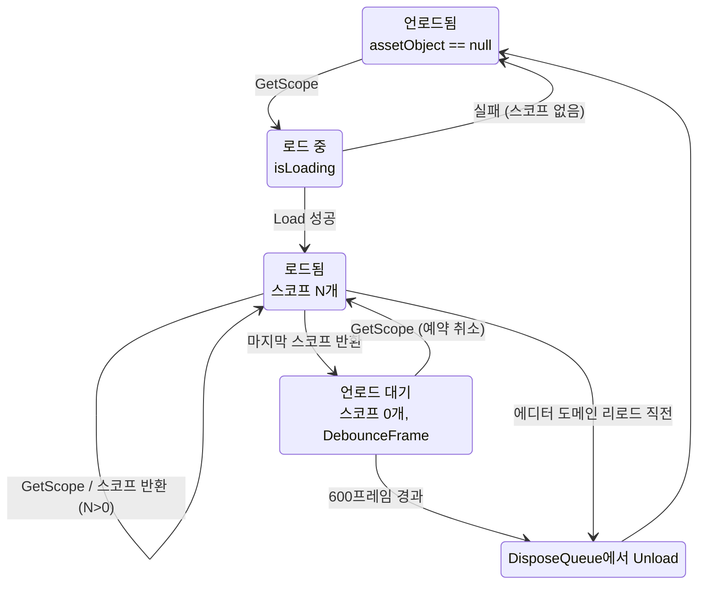

# 7. 핸들과 스코프

> 기준 커밋: `7e5d710f`. [← 목차](README.md) · 이전: [6. `SimpleAssetRegistry`](06-simple-asset-registry.md) · 다음: [8. `AssetRef`와 바인더](08-asset-ref-and-binders.md)

레지스트리가 주는 것은 에셋이 아니라 **핸들**입니다. 핸들은 "이 에셋을 얻는 방법"이고, 에셋을 실제로 쓰려면 핸들에서 **스코프**를 받습니다. 스코프는 "지금 이 에셋을 쓰고 있다"는 표시이자 `IDisposable`이고, 마지막 스코프가 반환되면 핸들이 에셋을 내립니다.

```csharp
using IAssetScope<Texture2D>? scope = await ResourceManager.LoadScopeAsync<Texture2D>("runios:ui/close");
if (scope != null)
    material.mainTexture = scope.asset;
// 쓰는 동안 scope를 들고 있다가, 다 쓰면 Dispose
```

이렇게 나눈 덕분에 에셋을 아무도 쓰지 않으면 메모리에서 내리고, 다시 필요하면 같은 핸들에서 다시 불러올 수 있습니다. 이 장은 파일 기반 핸들 [`AssetHandle<TAsset>`](../../Runtime/Resource/AssetHandle%601.cs#L16)의 로드·참조·언로드와, 이미 만들어진 객체를 감싸는 `InstanceAssetHandle`을 다룹니다.

- [7.1 계약: `IAssetHandle`, `IAssetScope`](#71-계약-iassethandle-iassetscope)
- [7.2 `GetScope`: 지연 로드](#72-getscope-지연-로드)
- [7.3 `ReturnScope`: 참조 세기와 지연 언로드](#73-returnscope-참조-세기와-지연-언로드)
- [7.4 `DisposeQueue`](#74-disposequeue)
- [7.5 `IsSameTarget`: 언제 옛 핸들을 재사용하나](#75-issametarget-언제-옛-핸들을-재사용하나)
- [7.6 리로드 뒤의 옛 핸들과 `Seal`](#76-리로드-뒤의-옛-핸들과-seal)
- [7.7 `InstanceAssetHandle`](#77-instanceassethandle)

## 7.1 계약: `IAssetHandle`, `IAssetScope`

| 멤버 | 뜻 |
| --- | --- |
| `IAssetHandle.assetObject` | 지금 불러와 있는 에셋. 없으면 `null` |
| `isLoading` | 로드 중인가 |
| `GetScope()` | 에셋을 (필요하면 불러와서) 스코프로 줌. 못 주면 `null` |
| `IsSameTarget(other)` | 같은 에셋 원본을 가리키는 핸들인가 ([7.5절](#75-issametarget-언제-옛-핸들을-재사용하나)) |
| `isSealed`, `Seal()` | 봉인된 핸들은 새 스코프를 주지 않음 ([7.6절](#76-리로드-뒤의-옛-핸들과-seal)) |
| `IAssetScope.handle`, `asset` | 스코프를 준 핸들과 에셋 |

파생 클래스는 두 메서드만 구현합니다.

```csharp
// Runtime/Resource/AssetHandle`1.cs
16  public abstract class AssetHandle<TAsset>(IONode node, FileMetaData fileMetaData, int unloadDelayFrame = 600) : IAssetHandle<TAsset> where TAsset : notnull
…
183 protected abstract UniTask<TAsset?> Load();                   // 파일에서 에셋 만들기
194 protected abstract void Unload(TAsset unloadedAsset);         // 에셋 정리 (예: DestroyImmediate)
…
224 protected virtual bool IsDefaultAsset([NotNullWhen(false)] TAsset? asset) => asset == null;
226 protected virtual TAsset? GetDefaultAsset() => default;       // 로드 실패 시 대신 쓸 에셋
```

## 7.2 `GetScope`: 지연 로드

```csharp
// Runtime/Resource/AssetHandle`1.cs
55  public async UniTask<IAssetScope<TAsset>?> GetScope()
    {
57      if (isSealed)
        {
59          Debug.RuntimeLogWarning(…);
60          return null;                                                       // ① 봉인됨
        }
63      // 중복 로딩 방지 (경합 조건 방지)
64      while (isLoading)
65          await UniTask.Yield();                                             // ② 다른 호출이 로드 중이면 기다림
67      if ((assetObject == null || IsDefaultAsset(assetObject)) && await node.file.GetEntry() is { } entry)
        {
69          isLoading = true;
71          try
            {
73              fileMetaData = entry.metaData;                                 // ③ 지금 읽는 파일의 리비전으로 갱신
74              assetObject = await Load();
            }
76          catch (Exception e)
            {
78              Debug.RuntimeLogError(…);
79              assetObject = GetDefaultAsset();                               // ④ 실패하면 기본 에셋
            }
81          finally
            {
83              isLoading = false;
            }
        }
87      if (assetObject != null && !IsDefaultAsset(assetObject))
        {
89  #if UNITY_EDITOR
90          UnityEditor.AssemblyReloadEvents.beforeAssemblyReload += ExecuteUnload;   // ⑤ 도메인 리로드 전에 내림
91  #endif
93          AssetScope<TAsset> scope = new AssetScope<TAsset>(this, assetObject);
94          assetScopes.Add(new WeakReference<AssetScope<TAsset>>(scope));     // ⑥ 살아 있는 스코프 목록
96          CancelUnloadWatch();                                               // ⑦ 언로드 예약 취소
97          return scope;
        }
100     return null;                                                           // ⑧ 파일이 없거나 로드 실패
    }
```

- 처음 스코프를 요청할 때 비로소 `Load()`가 불립니다. 레지스트리 리로드는 핸들만 만들므로([6.3절](06-simple-asset-registry.md#63-리로드-2단계-핸들-만들기)), 쓰이지 않는 에셋은 불러오지 않습니다.
- 67행: 이미 불러온 에셋이 있으면 다시 읽지 않고 스코프만 새로 줍니다. 파일이 사라졌으면(`GetEntry`가 `null`) 로드하지 않습니다.
- ④⑧ 로드에 실패하면 `GetDefaultAsset()`(기본 `null`)을 넣고, 그것이 "기본 에셋"이면 스코프를 주지 않습니다. 다음 `GetScope`가 다시 로드를 시도합니다.
- ⑤ 에디터에서는 어셈블리를 다시 로드하기 직전(`beforeAssemblyReload`)에 스코프가 남아 있어도 `ExecuteUnload`를 부릅니다. 이 언로드도 [`DisposeQueue`](#74-disposequeue)를 거치는데, 어셈블리 리로드 전에 큐가 비워지는지는 확인하지 않았습니다.

> **관찰된 동작:** ② 대기 검사와 69행의 `isLoading = true` 사이에 `await node.file.GetEntry()`가 있습니다. `GetEntry`가 동기로 끝나는 공급자(Physical)에서는 문제가 없지만, 실제로 비동기인 공급자(Android)에서는 처음 `GetScope` 두 번이 모두 `Load()`를 부를 수 있고 먼저 만든 에셋은 언로드되지 않습니다.

> **관찰된 동작:** ⑤의 구독은 `GetScope`마다 더해지고, 해제는 언로드할 때 한 번만 합니다([199행](../../Runtime/Resource/AssetHandle%601.cs#L199)).

## 7.3 `ReturnScope`: 참조 세기와 지연 언로드

스코프를 `Dispose`하면 핸들에 돌려줍니다.

```csharp
// Runtime/Resource/AssetScope`1.cs
30  public void Dispose()
    {
32      handle.ReturnScope(this);
33      GC.SuppressFinalize(this);
    }
39  ~AssetScope() => Debug.RuntimeLogError(…);         // Dispose 없이 GC되면 누수 경고
```

```csharp
// Runtime/Resource/AssetHandle`1.cs
108 internal void ReturnScope(AssetScope<TAsset> assetScope)
    {
110     bool scopeFound = false;
111     for (int i = assetScopes.Count - 1; i >= 0; i--)
        {
113         WeakReference<AssetScope<TAsset>> weakRef = assetScopes[i];
115         if (weakRef.TryGetTarget(out AssetScope<TAsset>? outAssetScope))
            {
118             if (assetScope == outAssetScope)
                {
120                 assetScopes.RemoveAt(i);                    // ① 돌려받은 스코프 제거
121                 scopeFound = true;
123                 break;
                }
            }
            else
130             assetScopes.RemoveAt(i);                        // ② GC된 스코프 정리
        }
134     if (!scopeFound)
        {
136         Debug.RuntimeLogWarning(…);                         // ③ 두 번 Dispose 등
143         return;
        }
146     if (assetScopes.Count <= 0)
        {
148         StartUnloadWatch();
149         _unloadTrigger.OnNext(Unit.Default);                // ④ 마지막 스코프 → 언로드 예약
        }
    }
…
156 void StartUnloadWatch()
    {
159     if (_unloadSubscription != null)
160         return;
162     _unloadSubscription = _unloadTrigger
163         .DebounceFrame(unloadDelayFrame)                    // ⑤ 600프레임 동안 조용하면
164         .Subscribe(_ => ExecuteUnload());                   //    언로드
    }
```

**참조 수는 살아 있는 스코프의 수입니다.** 따로 정수를 세지 않고 스코프를 약한 참조 목록으로 들고 있습니다.

- ④⑤ 마지막 스코프가 돌아와도 바로 내리지 않고 R3의 `DebounceFrame`으로 `unloadDelayFrame`(기본 600) 프레임을 기다립니다. 그 사이 누가 `GetScope`를 부르면 ⑦(7.2절)에서 예약이 취소되고 에셋은 그대로 재사용됩니다. 화면 전환처럼 잠깐 놓았다가 다시 잡는 경우에 다시 읽지 않게 됩니다.
- ② 약한 참조라서, `Dispose`하지 않고 버린 스코프도 GC되면 목록 정리 때 빠집니다.



> **관찰된 동작:** `Dispose`하지 않은 스코프는 GC될 때까지 목록에 남고, GC된 뒤에도 `ReturnScope`가 다시 불리기 전에는 목록 정리가 일어나지 않습니다. 그동안 에셋은 언로드되지 않습니다. 파이널라이저의 경고 로그는 파이널라이저 스레드에서 실행됩니다.

언로드 자체는 [`ExecuteUnload`](../../Runtime/Resource/AssetHandle%601.cs#L196)가 합니다.

```csharp
// Runtime/Resource/AssetHandle`1.cs
196 internal void ExecuteUnload()
    {
        …
202     TAsset? assetObject = this.assetObject;
203     if (assetObject != null && !IsDefaultAsset(assetObject))
        {
205         DisposeQueue.Enqueue(() =>                                  // ① 바로 파괴하지 않고 큐로
            {
                try { Unload(assetObject); } catch (Exception e) { … }
            });
        }
220     this.assetObject = default;                                    // ② 핸들은 즉시 "언로드됨"
221     CancelUnloadWatch();
    }
```

② 핸들의 상태는 즉시 비우고, 실제 정리는 ①의 큐가 나중에 합니다. 그 사이 다시 `GetScope`를 부르면 새로 불러옵니다.

## 7.4 `DisposeQueue`

[`DisposeQueue`](../../Runtime/Resource/DisposeQueue.cs#L12)는 **메인 스레드가 한 프레임에 많은 정리 작업을 몰아서 해 프레임이 끊기는 것**을 막는 큐입니다. 씬 전환처럼 스코프 수백 개가 한꺼번에 반환되면 텍스처 수백 장을 같은 프레임에 파괴하게 되는데, 이것을 여러 프레임에 나눕니다.

```csharp
// Runtime/Resource/DisposeQueue.cs
14  public const int allottedTime = 10;                         // 프레임당 10 ms
…
56  static void Update()
    {
58      stopwatch.Restart();
65      while (stopwatch.Elapsed.TotalMilliseconds < allottedTime && scheduledTasks.TryDequeue(out var disposable))   // ① 시간 검사가 먼저
        { … disposable.Invoke(); … }
    }
…
101 public static void Enqueue(Action action)
    {
103     if (!UnityThread.isMainThread)
        {
107         action.Invoke();                                    // ② 메인 스레드가 아니면 바로 실행
114         return;
        }
117     int executed = 0;
118     void DisposeOnce()
        {
121         if (Interlocked.Exchange(ref executed, 1) != 0)
122             return;                                         // ③ 한 번만 실행
124         action.Invoke();
        }
127     scheduledTasks.Enqueue(DisposeOnce);
129     if (shutdownStarted)
        { … DisposeOnce(); … }                                  // ④ 종료 중이면 큐에 넣고 바로 실행
    }
```

- ① 큐에서 꺼낸 뒤 시간을 검사하면, 시간이 넘었을 때 꺼낸 작업이 실행되지 않고 사라집니다. 그래서 시간 검사를 꺼내기보다 먼저 합니다(60~63행 주석).
- ② 메인 스레드가 아니면 프레임이 끊길 걱정이 없으므로 기다리지 않고 바로 실행합니다.
- ③④ 종료가 시작되면 Play 모드 종료·에디터 종료 때 남은 작업을 모두 실행합니다([`ForceScheduledTasksExecute`](../../Runtime/Resource/DisposeQueue.cs#L78)). 종료 이후 들어온 작업은 큐에 넣으면서 바로 실행하고, ③이 두 번 실행되지 않게 막습니다.
- 큐는 Play 모드에서는 `RuniPlayerLoop.onPostLateUpdate`, 에디터 모드에서는 `EditorApplication.update`에서 비웁니다(22~47행).

## 7.5 `IsSameTarget`: 언제 옛 핸들을 재사용하나

리로드 때 레지스트리는 새 핸들을 만들고, 옛 인덱스의 핸들과 [`IsSameTarget`](../../Runtime/Resource/AssetHandle%601.cs#L229)이면 옛 핸들을 그대로 씁니다([5.2절](05-registries.md#52-추적-먼저-기록한-것이-이긴다)).

```csharp
// Runtime/Resource/AssetHandle`1.cs
229 public virtual bool IsSameTarget(IAssetHandle other)
    {
231     if (isSealed || other is not AssetHandle<TAsset> otherHandle)
232         return false;
234     if (GetType() != other.GetType()                                   // ① 같은 핸들 타입
            || !node.IsSameTarget(otherHandle.node)                        // ② 같은 공급자 대상·경로
            || !fileMetaData.IsSameRevision(otherHandle.fileMetaData))     // ③ 같은 리비전
235         return false;
237     return this is not IAssetSidecarHandle sidecarHandle
            || sidecarHandle.sidecar.IsSameTarget(((IAssetSidecarHandle)other).sidecar);   // ④ 사이드카도 같아야
    }
```

- ③ [`IsSameRevision`](../IO/02-providers-and-nodes.md#25-ioentry와-filemetadata)은 수정 시간이 같아야 합니다. 파일을 고치면 수정 시간이 바뀌어 새 핸들이 되고, 쓰던 쪽은 갈아타면서 새 내용을 읽습니다.
- ④ 사이드카(로드 설정)만 바뀌어도 다른 대상입니다([9장](09-sidecars.md)).

> **관찰된 동작:** 옛 핸들의 `fileMetaData`는 로드할 때 [73행](../../Runtime/Resource/AssetHandle%601.cs#L73)에서 그 순간의 엔트리로 덮입니다. 그래서 비교는 "등록할 때의 리비전"이 아니라 "마지막으로 불러온 리비전"과 합니다.

## 7.6 리로드 뒤의 옛 핸들과 `Seal`

리로드로 교체되거나 인덱스에서 빠진 옛 핸들은 **그대로 살아 있습니다.** 이것은 의도입니다.

- 옛 핸들에서 받은 스코프는 계속 유효하고, 옛 핸들에서 새 스코프를 받을 수도 있습니다.
- 에셋을 쓰던 쪽은 리로드가 끝난 뒤 스스로 새 핸들로 갈아탑니다. 그 장치가 [`IReloadable`](04-reload-pipeline.md#44-완료-단계-이벤트-그다음-ireloadable)과 [`AssetScopeBinder`](08-asset-ref-and-binders.md#83-assetscopebinder)입니다.
- 갈아탄 뒤 옛 스코프가 모두 반환되면 옛 핸들은 [7.3절](#73-returnscope-참조-세기와-지연-언로드)의 규칙대로 스스로 에셋을 내립니다.

[`Seal()`](../../Runtime/Resource/AssetHandle%601.cs#L241)은 핸들을 봉인해 새 스코프를 주지 않고(`GetScope`가 `null`) `IsSameTarget`이 항상 `false`가 되게 하는 선택 기능입니다. 현재 core에는 `Seal`을 부르는 코드가 없습니다.

## 7.7 `InstanceAssetHandle`

[`InstanceAssetHandle<TAsset>`](../../Runtime/Resource/InstanceAssetHandle.cs#L6)는 이미 만들어진 객체를 감싸는 `readonly record struct` 핸들입니다. 파일도, 로드도, 참조 세기도 없습니다.

```csharp
// Runtime/Resource/InstanceAssetHandle.cs
6   public readonly record struct InstanceAssetHandle<TAsset>(TAsset assetObject) : IAssetHandle<TAsset> where TAsset : notnull
…
24  public InstanceAssetScope<TAsset>? GetScope() => new InstanceAssetScope<TAsset>(this, assetObject);   // 항상 스코프, Dispose는 아무것도 안 함
30  public bool IsSameTarget(IAssetHandle other)
    {
32      if (other is not InstanceAssetHandle<TAsset> otherHandle)
33          return false;
35      return EqualityComparer<TAsset>.Default.Equals(assetObject, otherHandle.assetObject);   // 같은 객체(또는 같은 값)
    }
39  void IAssetHandle.Seal() { }                                                                  // 봉인 개념 없음
```

쓰이는 곳은 두 가지입니다.

- **리로드 때 에셋을 미리 만드는 레지스트리:** 언어 레지스트리는 번역 파일을 리로드 때 합쳐 `LocalizationData`를 만들고 이것으로 감쌉니다([10장](10-languages-and-json.md)).
- **`AssetRef`의 `direct` 모드:** 인스펙터에서 에셋을 직접 지정한 경우([8장](08-asset-ref-and-binders.md)).

`InstanceAssetScope<TAsset>`도 구조체이지만, `IAssetScope`로 다룰 때는 박싱됩니다.
