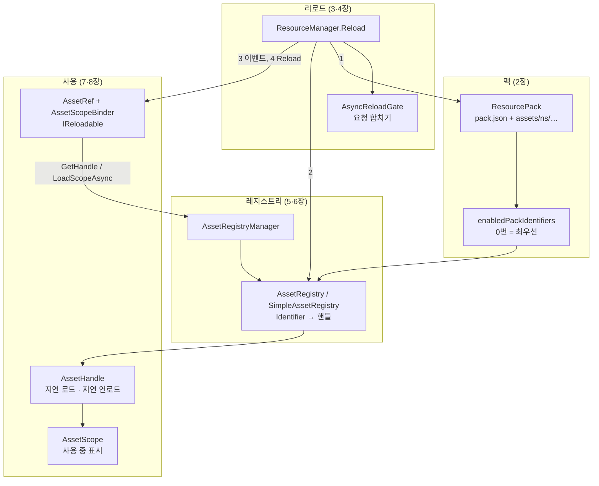

# 리소스 시스템 작동 원리

> 기준 커밋: `7e5d710f`. 코드 링크의 줄 번호는 이 커밋 기준입니다. [← core 문서 목차](../README.md) · 기존 개요: [`Runtime/Resource/README.md`](../../Runtime/Resource/README.md)
>
> 선행: [IO 시스템](../IO/README.md)

`io.github.rumi727.runios.core`의 `RuniOS.Resource`가 리소스 팩에서 에셋을 찾아, 필요할 때 불러오고, 아무도 쓰지 않으면 내리고, 팩이 바뀌면 쓰던 쪽이 새 에셋으로 갈아타게 하는 구조를 코드를 따라가며 설명합니다. C#과 Unity를 아는 독자를 기준으로 썼습니다.

## 한 장으로 보기

**핵심 아이디어 세 가지**

1. **인덱스는 리로드 때, 에셋은 쓸 때.** 레지스트리는 리로드 때 활성화된 팩을 우선순위 순으로 훑어 `식별자 → 핸들` 표만 다시 만듭니다. 먼저 기록한 팩이 이기므로 위 팩이 아래 팩을 덮어씁니다. 에셋은 누군가 스코프를 요청할 때 불러옵니다. → [5장](05-registries.md), [6장](06-simple-asset-registry.md)
2. **스코프가 곧 참조 수.** 핸들은 살아 있는 스코프를 세다가 마지막 스코프가 반환되면 600프레임 뒤 에셋을 내리고, 실제 파괴는 프레임당 10 ms로 나눠 합니다. 리로드 때 파일이 그대로인 핸들은 재사용되어 이미 불러온 에셋을 다시 읽지 않습니다. → [7장](07-handles-and-scopes.md)
3. **리로드는 합쳐서 한 번 더, 갈아타기는 쓰는 쪽이.** 리로드 중 들어온 요청은 끝난 뒤 한 번으로 합쳐 다시 돌립니다. 옛 핸들은 버리지 않고, 에셋을 쓰는 객체가 `IReloadable`로 리로드 끝에 새 핸들로 갈아탑니다. → [3장](03-reload-gate.md), [4장](04-reload-pipeline.md), [8장](08-asset-ref-and-binders.md)

## 읽는 순서

| 장 | 내용 | 깊이 |
| --- | --- | --- |
| [1. 식별자](01-identifiers.md) | `Identifier` 규칙·파싱, 파일 경로→식별자, `ResourceKey`, `PackIdentifier` | 핵심 줄 단위 |
| [2. 리소스 팩](02-resource-packs.md) | 폴더 구조, 생성·등록, `pack.json`, 활성화 순서, vanilla·editor 팩, `leaveOpen` | 핵심 줄 단위 |
| [3. `AsyncReloadGate`](03-reload-gate.md) | 배치와 패스, `Run`·`RunLoop`, 진행률, 예외, 재진입 | **줄 단위** |
| [4. 리로드 파이프라인](04-reload-pipeline.md) | `ReloadCore` 단계, 진행률, 완료 이벤트와 `IReloadable` 순서, 부팅·에디터 진입점 | **줄 단위** |
| [5. 레지스트리와 조회](05-registries.md) | `IAssetRegistry` 계약, 추적·재사용·교체, 조회 세 가지, 등록 | **줄 단위** |
| [6. `SimpleAssetRegistry`](06-simple-asset-registry.md) | 두 단계 리로드, `TextureAssetRegistry` 예제 | 핵심 줄 단위 |
| [7. 핸들과 스코프](07-handles-and-scopes.md) | 지연 로드, 참조 세기·지연 언로드, `DisposeQueue`, `IsSameTarget`, 옛 핸들, `InstanceAssetHandle` | **줄 단위** |
| [8. `AssetRef`와 바인더](08-asset-ref-and-binders.md) | 세 모드, 같은 대상 판정, `AssetScopeBinder` | 핵심 줄 단위 |
| [9. 사이드카](09-sidecars.md) | 형식, 있음·없음·모름, 리비전 비교 | 핵심 줄 단위 |
| [10. 언어·로컬라이제이션·JSON](10-languages-and-json.md) | `LanguageAssetRegistry`, `LocalizationUtility`, 컨버터 | 요약 |
| [11. 다른 패키지의 레지스트리](11-package-registries.md) | texture·fmod·sound·nbs·uielements 레지스트리 표 | 요약 |
| [12. 차이와 기존 문서](12-differences.md) | 기존 README·XML과 다른 곳, 관찰된 동작 목록, 사용처 없는 멤버 | 표 |

## 용어집

| 용어 | 뜻 |
| --- | --- |
| **식별자** | `namespace:path`. 에셋·레지스트리·팩·번역 키의 이름 |
| **리소스 팩** | `pack.json`과 `assets/{네임스페이스}/…`를 가진 폴더 하나 |
| **등록 / 활성화** | 팩이 알려져 리로드되는 상태 / 레지스트리가 에셋을 찾는 대상인 상태 |
| **레지스트리** | 에셋 종류 하나의 `식별자 → 핸들` 표 |
| **핸들** | 에셋을 얻는 방법. 파일 노드와 리비전, 불러온 에셋을 가짐 |
| **스코프** | 핸들에서 받은 "사용 중" 표시. `Dispose`로 반환 |
| **배치 / 패스** | 리로드 요청이 합쳐진 한 묶음 / 리로드 함수 한 번 실행 |
| **추적** | 리로드 중 새 인덱스를 따로 만들고 끝에 교체하는 것 |
| **사이드카** | 에셋 파일 옆의 `<파일>.json`. 레지스트리별 로드 설정 |
| **바인더** | `AssetRef`를 들고 리로드 때 새 에셋으로 갈아타는 컴포넌트 |

## 파일 지도 (`Runtime/Resource`)

| 영역 | 파일 |
| --- | --- |
| 식별자 | `Identifier`, `InvalidIdentifierException`, `IdentifierJsonContext`, `ResourceKey`, `PackIdentifier` |
| 팩 | `ResourcePack`(.Static), `PackMetaData`, `RequiredPackSort` |
| 리로드 | `ResourceManager`, `IReloadable`, (`Runtime/Tasks/AsyncReloadGate`, `AsyncTask`) |
| 레지스트리 | `IAssetRegistry`(`1), `AssetRegistry`, `SimpleAssetRegistry`, `AssetRegistryManager`, `Languages/LanguageAssetRegistry` |
| 핸들·스코프 | `IAssetHandle`(`1), `AssetHandle`, `InstanceAssetHandle`, `IAssetScope`(`1), `AssetScope`, `InstanceAssetScope`, `DisposeQueue` |
| 참조·바인더 | `IAssetRef`, `AssetRef`, `AssetRefMode`, `AssetScopeBinder` |
| 사이드카 | `AssetSidecar`, `AssetSidecarPresence`, `IAssetSidecarHandle` |
| 그 밖 | `Runtime/Localizations/LocalizationData`, `Runtime/Utility/LocalizationUtility`, `Runtime/Json/Converters/Resource/*` |
| 에디터 (`Editor/`) | `EditorResourcePack`, `ResourceReloadPostprocessor` |

## 그림 목록

| 그림 | 장 |
| --- | --- |
| [AsyncReloadGate의 배치와 패스](images/reload-gate-batch.svg) | 3 |
