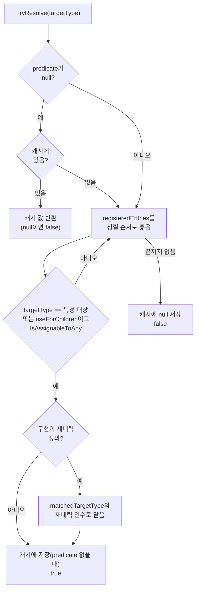

# 1. 타입 레지스트리

> 기준 커밋: `571e2110`. [← 목차](README.md) · 다음: [2. 레지스트리 소스 생성기·분석기](02-registry-generators.md)

타입 레지스트리는 "어떤 타입을 처리하는 구현 타입이 무엇인가"를 런타임에 찾는 표입니다. 리치 텍스트 렌더러, 컬렉션 핸들러, 인스펙터 드로어처럼 **처리할 대상 타입마다 구현 클래스를 하나씩 두는 시스템**이 이 표를 씁니다. 구현 클래스는 특성 하나만 붙이면 되고, 소스 생성기가 어셈블리 로드 때 표에 넣어 줍니다([2장](02-registry-generators.md)). 이 장은 런타임 쪽인 `RuniOS.Reflection` 네임스페이스의 타입을 다룹니다.

- [1.1 두 가지 레지스트리](#11-두-가지-레지스트리)
- [1.2 `TypeRegistry` 계약](#12-typeregistry-계약)
- [1.3 등록 특성 `TypeRegistrationAttribute`](#13-등록-특성-typeregistrationattribute)
- [1.4 `AttributedTypeRegistry`의 저장 구조와 등록](#14-attributedtyperegistry의-저장-구조와-등록)
- [1.5 등록 항목의 정렬](#15-등록-항목의-정렬)
- [1.6 `TryResolve`: 대상 타입에서 구현 타입 찾기](#16-tryresolve-대상-타입에서-구현-타입-찾기)
- [1.7 `AssignableTypeRegistry`](#17-assignabletyperegistry)

## 1.1 두 가지 레지스트리

| | [`AttributedTypeRegistry<TAttribute>`](../../Runtime/Reflection/AttributedTypeRegistry.cs#L17) | [`AssignableTypeRegistry`](../../Runtime/Reflection/AssignableTypeRegistry.cs#L7) |
| --- | --- | --- |
| 저장하는 것 | (구현 타입, 특성 인스턴스) 쌍 | 구현 타입 목록 |
| 묻는 것 | "대상 타입 X를 처리하는 구현은?" (`Resolve`) | "기본 타입을 상속한 타입은 모두?" (`registeredTypes`) |
| 등록 조건 | 구현 타입이 `baseType`에 할당 가능 | 구현 타입이 모든 `baseTypes`에 할당 가능 |
| 생성기 특성 | `[GenerateAttributedTypeRegistry]` | `[GenerateAssignableTypeRegistry]` |

core와 core.editor에서 레지스트리를 선언한 곳은 다음과 같습니다.

| 레지스트리 | 종류 | 등록 특성 |
| --- | --- | --- |
| [`RichTextRenderer.registry`](../../Runtime/Texts/Builders/RichTexts/RichTextRenderer.cs#L32) | Attributed | `TextRendererAttribute` |
| [`CollectionHandlerBase.collectionRegistry`](../../Runtime/Collections/Handlers/CollectionHandlerBase.cs#L11), `ListHandlerBase.listRegistry`, `DictionaryHandlerBase.dictionaryRegistry` | Attributed | `CollectionHandlerAttribute` |
| [`EntryHandler.registry`](../../Runtime/Collections/Handlers/Entrys/EntryHandler.cs#L9) | Attributed | `EntryHandlerAttribute` |
| `IMGUIInspectorDrawer.registry`, `IMGUIInspectorAttributeDrawer.registry` (core.editor) | Attributed | `InspectorDrawerAttribute` |
| `PropertyConverter.registry` (core.editor) | Attributed | `PropertyConverterAttribute` |
| `PackInspectorSystem.registry`, `ControlPanel.panelTypes` (core.editor) | Assignable | 없음 |

선언은 항상 `public static partial` 속성 하나입니다. 본문은 생성기가 채웁니다.

```csharp
// Runtime/Texts/Builders/RichTexts/RichTextRenderer.cs
31  [GenerateAttributedTypeRegistry]
32  public static partial AttributedTypeRegistry<TextRendererAttribute> registry { get; }
```

## 1.2 `TypeRegistry` 계약

[`TypeRegistry`](../../Runtime/Reflection/TypeRegistry.cs#L10)는 두 레지스트리의 공통 기본 클래스입니다. 멤버는 변경 이벤트 하나와 등록·해제 메서드뿐입니다.

```csharp
// Runtime/Reflection/TypeRegistry.cs
16  public abstract event Action? onChanged;
27  public abstract void Register(Type type);
29  public abstract void RegisterRange(IEnumerable<Type> types);
30  public abstract void RegisterRange(params ReadOnlySpan<Type> types);
41  public abstract void Unregister(Type type);
43  public abstract void UnregisterRange(IEnumerable<Type> types);
44  public abstract void UnregisterRange(params ReadOnlySpan<Type> types);
```

- `onChanged`는 내용이 바뀐 **뒤** 발생합니다. 결과를 캐시하는 쪽이 이 이벤트로 캐시를 비웁니다. 예: `RichTextRenderer`의 정적 생성자 `registry.onChanged += cache.Clear`([28행](../../Runtime/Texts/Builders/RichTexts/RichTextRenderer.cs#L28)).
- 지금 생성 코드가 부르는 것은 `Unregister(Type)`와, [1.4절](#14-attributedtyperegistry의-저장-구조와-등록)·[1.7절](#17-assignabletyperegistry)의 생성기 전용 등록 메서드입니다([2.4절](02-registry-generators.md#24-생성되는-등록-코드)). 26행 주석은 생성 코드가 `Register(Type)`을 부른다고 적고 있지만, 지금은 그렇지 않습니다([8장](08-differences.md)).
- 잠금이 없습니다. 등록·해제·조회를 여러 스레드에서 동시에 해도 되는지에 대한 보장은 코드에 없습니다.
- **같은 타입을 두 번 등록해도 막지 않습니다.** 중복을 피하는 것은 부르는 쪽의 몫입니다.

## 1.3 등록 특성 `TypeRegistrationAttribute`

`AttributedTypeRegistry`의 특성은 [`TypeRegistrationAttribute`](../../Runtime/Reflection/TypeRegistrationAttribute.cs#L17)를 상속합니다.

```csharp
// Runtime/Reflection/TypeRegistrationAttribute.cs
14  [AttributeUsage(AttributeTargets.Class, Inherited = false, AllowMultiple = true)]
17  public abstract class TypeRegistrationAttribute(Type targetType) : Attribute
    {
24      public Type targetType { get; } = targetType;     // ① 처리할 대상 타입
31      public int priority { get; init; }                // ② 정렬의 마지막 키
38      public bool useForChildren { get; init; }         // ③ 하위 타입에도 적용
    }
```

① 대상 타입은 열린 제네릭(`typeof(ValueText<>)`)이나 인터페이스여도 됩니다.
② `priority`는 정렬의 **마지막** 키입니다. 대상 타입의 구체성이 먼저 비교되므로, `priority`는 구체성이 같은 항목 사이에서만 효과가 있습니다([1.5절](#15-등록-항목의-정렬)).
③ `false`면 대상 타입과 **정확히 같은** 타입에만 맞습니다. 그래서 열린 제네릭·인터페이스·추상 타입을 대상으로 하면서 `false`로 두면 실제 런타임 타입과 맞을 일이 거의 없습니다. 분석기가 이 경우 ROS0020 경고를 냅니다([2.6절](02-registry-generators.md#26-진단-목록)).

`AllowMultiple = true`라 구현 하나가 대상 타입 여러 개를 맡을 수 있습니다. 사용 예:

```csharp
// Runtime/Texts/Builders/RichTexts/ValueRichTextRenderer.cs
18  [TextRenderer(typeof(ValueText<>), useForChildren = true)]
19  public class ValueRichTextRenderer<T> : FormattableRichTextRenderer
```

## 1.4 `AttributedTypeRegistry`의 저장 구조와 등록

```csharp
// Runtime/Reflection/AttributedTypeRegistry.cs
25  public Type baseType { get; }
35  public AttributedTypeRegistry(Type baseType) => this.baseType = baseType;

37  readonly Dictionary<Type, List<TAttribute>> registrationsByImplementationType = [];   // ① 원본
38  Dictionary<Type, TypeResolution?> resolutionCache = new();                          // ② 조회 캐시
    …
57  ImmutableArray<RegistrationEntry<TAttribute>> entriesSnapshot;                       // ③ 정렬된 스냅숏
```

① 진짜 상태는 "구현 타입 → 그 타입의 특성 목록" 사전 하나입니다. 해제가 구현 타입 단위이므로 이 모양이 맞습니다.
② `TryResolve` 결과 캐시입니다. 못 찾은 결과도 `null`로 저장합니다.
③ ①을 펼쳐 정렬한 배열입니다. 처음 읽을 때 만들고(`default`일 때만), 내용이 바뀌면 `default`로 되돌립니다.

내용을 바꾸는 메서드는 모두 끝에서 `entriesSnapshot = default`와 `resolutionCache = []`를 하고 `onChanged`를 부릅니다. 캐시를 비우는 대신 **새 사전으로 바꿉니다**. `TryResolve`는 시작할 때 사전을 지역 변수로 잡으므로([201행](../../Runtime/Reflection/AttributedTypeRegistry.cs#L201)), 진행 중인 조회가 결과를 넣는 곳은 바꾸기 전의 사전입니다.

등록 메서드는 네 가지이고 하는 일이 조금씩 다릅니다.

| 메서드 | 할당 가능 검사 | 특성 읽기 | 잘못된 타입 | `onChanged` |
| --- | --- | --- | --- | --- |
| [`Register(Type)`](../../Runtime/Reflection/AttributedTypeRegistry.cs#L62) | 함 | 리플렉션(`GetCustomAttributes<TAttribute>`) | `ArgumentException` | 1번 |
| [`RegisterRange(IEnumerable<Type>)`](../../Runtime/Reflection/AttributedTypeRegistry.cs#L81) | 함 | 리플렉션 | `ArgumentException` | 1번 |
| [`RegisterRange(ReadOnlySpan<Type>)`](../../Runtime/Reflection/AttributedTypeRegistry.cs#L103) | 함 | 리플렉션 | 조용히 `return` | 잘못된 타입이 있으면 0번 |
| [`DirectRegisterRange`](../../Runtime/Reflection/AttributedTypeRegistry.cs#L140) | 안 함 | 안 함(항목에 특성이 들어 있음) | 해당 없음 | 1번 |

- 할당 가능 검사는 `baseType`이 구현 타입에 할당 가능한지, 그리고 추상 `baseType` 자신이 아닌지입니다([64행](../../Runtime/Reflection/AttributedTypeRegistry.cs#L64)). 특성이 없는 타입을 등록하면 빈 목록이 생길 뿐 오류는 아닙니다.
- `DirectRegisterRange`는 `[Obsolete]`·`[EditorBrowsable(Never)]`인 **생성기 전용** 메서드입니다. 생성기가 컴파일 때 검사와 특성 재구성을 끝냈으므로 런타임 리플렉션을 건너뜁니다. 항목 타입은 [`RegistrationEntry<TAttribute>`](../../Runtime/Reflection/RegistrationEntry%601.cs#L21)(구현 타입, 특성) 레코드 구조체입니다.
- 해제는 구현 타입의 항목을 통째로 지웁니다. `Unregister(Type)`은 없는 타입이면 `onChanged`를 부르지 않고([161–162행](../../Runtime/Reflection/AttributedTypeRegistry.cs#L161)), `UnregisterRange`는 항상 부릅니다.

> **관찰된 동작:** `RegisterRange(ReadOnlySpan<Type>)`는 할당할 수 없는 타입을 만나면 `continue`가 아니라 `return`합니다([107–108행](../../Runtime/Reflection/AttributedTypeRegistry.cs#L107)). 그 앞의 타입은 등록된 채 남고 스냅숏과 캐시도 비워졌지만, `onChanged`는 불리지 않습니다. 같은 일을 하는 `IEnumerable` 오버로드는 예외를 던집니다(86행). 생성 코드는 이 메서드를 부르지 않습니다.

## 1.5 등록 항목의 정렬

[`registeredEntries`](../../Runtime/Reflection/AttributedTypeRegistry.cs#L40)는 모든 (구현, 특성) 쌍을 펼쳐 [`OrderByTypes`](../../Runtime/Reflection/ReflectionUtility.cs#L108)로 정렬합니다. 정렬 기준은 특성의 `targetType`과 `priority`입니다.

```csharp
// Runtime/Reflection/AttributedTypeRegistry.cs
49  ..registrationsByImplementationType.SelectMany(pair => pair.Value.Select(attribute => new RegistrationEntry<TAttribute>(pair.Key, attribute)))
50      .OrderByTypes(x => x.attribute.targetType, x => x.attribute.priority)
```

`OrderByTypes`는 튜플 하나를 키로 `OrderByDescending`합니다. 앞 요소부터 비교하고, 값이 큰 쪽이 앞입니다.

```csharp
// Runtime/Reflection/ReflectionUtility.cs
141  return
     (
144      targetType != typeof(void),
145      targetType != typeof(object),
146      targetType != typeof(ValueType),
148      isNotInterface,
150      depthWeight,
151      prioritySelector?.Invoke(x) ?? 0
     );
```

| 순서 | 키 | 결과 |
| --- | --- | --- |
| 1–3 | `void`·`object`·`ValueType`이 아님 | 이 셋을 대상으로 한 항목은 맨 뒤. 셋 사이에서는 `ValueType`, `object`, `void` 순 |
| 4 | 인터페이스가 아님 | 클래스·구조체 대상이 **모든** 인터페이스 대상보다 앞 |
| 5 | 깊이 | 클래스·구조체는 `GetHierarchy().Count()`(기본 타입 사슬 길이), 인터페이스는 상속한 인터페이스 수. 클수록 앞 |
| 6 | `priority` | 클수록 앞 |

**목표는 "가장 구체적인 대상 타입을 가진 항목이 먼저 오는 것"입니다.** `TryResolve`는 이 순서로 훑다가 처음 맞는 항목을 쓰기 때문입니다. 예를 들어 `List<int>`에는 `IList` 핸들러와 `IList<>` 핸들러가 둘 다 맞는데, `IList<>`는 상속한 인터페이스가 3개(`ICollection<T>`, `IEnumerable<T>`, `IEnumerable`)이고 `IList`는 2개라 `IList<>` 핸들러가 먼저 옵니다. 클래스 대상은 깊이와 상관없이 인터페이스 대상보다 먼저입니다.

모든 키가 같은 항목끼리의 순서는 **정해지지 않았습니다.** 키를 더 두지 않으며, 원본이 `Dictionary`라 등록 순서도 보장되지 않습니다. 순서를 정하고 싶으면 `priority`를 다르게 줍니다.

## 1.6 `TryResolve`: 대상 타입에서 구현 타입 찾기

```csharp
// Runtime/Reflection/AttributedTypeRegistry.cs
193  public Type? Resolve(Type targetType, Func<RegistrationEntry<TAttribute>, bool>? predicate = null)
199  public bool TryResolve(Type targetType, [NotNullWhen(true)] out Type? matchedTargetType, [NotNullWhen(true)] out Type? implementationType, Func<RegistrationEntry<TAttribute>, bool>? predicate = null)
```

- 반환: 맞는 항목이 있으면 `true`. `matchedTargetType`은 등록 대상에 맞춰 찾은 타입(제네릭이면 닫힌 타입), `implementationType`은 쓸 구현 타입입니다.
- `predicate`로 후보를 거를 수 있습니다. 거르는 조회는 캐시를 읽지도 쓰지도 않습니다. 지금 저장소에서 `predicate`를 넘기는 곳은 없습니다.
- 못 찾으면 `false`이고 예외는 없습니다. 예외는 제네릭 구현을 닫을 수 없을 때만 납니다.



맞는 항목을 고르는 줄:

```csharp
// Runtime/Reflection/AttributedTypeRegistry.cs
228  matchedTargetType = targetType;
230  if (targetType == registration.attribute.targetType || (registration.attribute.useForChildren && targetType.IsAssignableToAny(registration.attribute.targetType, out matchedTargetType)))
```

[`IsAssignableToAny`](../../Runtime/Utility/TypeUtility.cs#L335)는 열린 제네릭 대상도 다룹니다. 대상이 `typeof(IList<>)`이고 조회 타입이 `List<int>`이면 `IList<int>`를 찾아 `matchedTargetType`에 넣습니다([3.1절](03-reflection-helpers.md#31-isassignabletoany)).

구현이 `ValueRichTextRenderer<T>`처럼 제네릭 정의이면 `matchedTargetType`의 제네릭 인수로 닫습니다.

```csharp
// Runtime/Reflection/AttributedTypeRegistry.cs
234  if (implementationType.IsGenericTypeDefinition)
     {
236      Type[] genericArguments = matchedTargetType.GenericTypeArguments;
237      int implementationTypeGenericParametersLength = implementationType.GetGenericArguments().Length;
239      if (genericArguments.Length != implementationTypeGenericParametersLength)
             throw new InvalidOperationException(…);                                          // ①
250      implementationType = implementationType.MakeGenericType(genericArguments);          // ②
```

① 대상의 제네릭 인수 개수와 구현의 제네릭 매개변수 개수가 다르면 `InvalidOperationException`입니다. 컴파일 때 분석기가 ROS0021로 미리 경고합니다.
② 제약 조건을 만족하지 못해 `MakeGenericType`이 `ArgumentException`을 내면 `InvalidOperationException`으로 감싸 다시 던집니다(252–254행). 분석기의 ROS0022에 대응합니다.

예: `ValueText<int>`를 조회하면 `[TextRenderer(typeof(ValueText<>), useForChildren = true)]`가 맞고, `matchedTargetType = ValueText<int>`, 구현은 `ValueRichTextRenderer<int>`가 됩니다.

> 결과 캐시는 조회한 `targetType`을 키로 합니다. 그래서 같은 타입을 다시 조회하면 정렬된 목록을 훑지 않습니다. `RichTextRenderer`는 이 위에 "텍스트 타입 → 렌더러 인스턴스" 캐시를 하나 더 둡니다. 컬렉션 핸들러는 찾을 때마다 새 인스턴스를 만듭니다.

## 1.7 `AssignableTypeRegistry`

[`AssignableTypeRegistry`](../../Runtime/Reflection/AssignableTypeRegistry.cs#L7)는 조회 없이 목록만 가집니다.

```csharp
// Runtime/Reflection/AssignableTypeRegistry.cs
9   public AssignableTypeRegistry(bool requireDefaultConstructor, params ImmutableArray<Type> baseTypes)
21  public bool requireDefaultConstructor { get; }
22  public ImmutableArray<Type> baseTypes { get; } = [];
23  public ImmutableArray<Type> registeredTypes { get; private set; } = [];
```

- `Register`·`RegisterRange`는 구현 타입이 **모든** `baseTypes`에 할당 가능한지(29행), `requireDefaultConstructor`면 공개 매개변수 없는 생성자가 있는지(31행) 검사하고 어기면 `ArgumentException`을 던집니다.
- 생성기는 검사 없는 [`RegisterRangeUnchecked`](../../Runtime/Reflection/AssignableTypeRegistry.cs#L68)를 부릅니다. 생성기 전용(`[Obsolete]`) 메서드입니다.
- `registeredTypes`는 `ImmutableArray`라 바뀔 때마다 새 배열이 됩니다. 읽는 쪽은 받은 배열을 그대로 써도 됩니다.
- 중복을 막지 않고, 해제(`Remove`)는 같은 값 하나를 지웁니다.

**생성기는 기본 타입을 상속하기만 하면 추상 클래스, 인터페이스, 열린 제네릭, 기본 타입 자신까지 모두 등록합니다.** 이것은 의도입니다. 무엇을 쓸지는 쓰는 쪽이 고릅니다. 예를 들어 core.editor의 `PackInspectorSystem.drawers`는 `!x.IsAbstract && !x.IsConstructedGenericType && x.IsSubclassOf(typeof(PackDrawer))`로 걸러서 인스턴스를 만듭니다.
