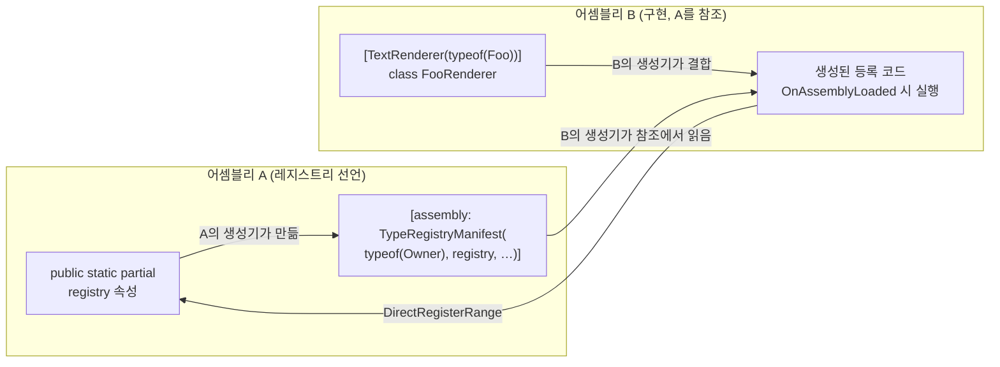

# 2. 레지스트리 소스 생성기·분석기

> 기준 커밋: `571e2110`. [← 목차](README.md) · 이전: [1. 타입 레지스트리](01-type-registry.md) · 다음: [3. 리플렉션 도우미](03-reflection-helpers.md)
>
> 선행: [부팅 3장 마일스톤](../Boot/03-milestones.md)(같은 생성기 프로젝트, `[ModuleInitializer]`)

[1장](01-type-registry.md)의 레지스트리 속성은 `partial` 선언만 있고 본문이 없습니다. 본문과 등록 코드는 [`RuniOS.CodeAnalysis`](../../../../RuniOS.CodeAnalysis/README.md)의 증분 생성기가 만듭니다. 그 결과 **구현 클래스는 특성 하나만 붙이면 되고, 어느 어셈블리에 있든 그 어셈블리가 로드될 때 자기 자신을 등록합니다.** 이 장은 생성기가 무엇을 요구하고 무엇을 만드는지, 어셈블리 경계를 어떻게 넘는지, 어떤 진단을 내는지를 다룹니다.

- [2.1 사용자가 쓰는 것](#21-사용자가-쓰는-것)
- [2.2 레지스트리 속성의 조건](#22-레지스트리-속성의-조건)
- [2.3 생성되는 속성](#23-생성되는-속성)
- [2.4 생성되는 등록 코드](#24-생성되는-등록-코드)
- [2.5 후보 찾기와 어셈블리 경계](#25-후보-찾기와-어셈블리-경계)
- [2.6 진단 목록](#26-진단-목록)

생성기 파일은 [`Generators/TypeRegistry/`](../../../../RuniOS.CodeAnalysis/Generators/TypeRegistry)에 있습니다. 공통 파이프라인은 추상 클래스 [`TypeRegistrySourceGenerator`](../../../../RuniOS.CodeAnalysis/Generators/TypeRegistry/TypeRegistrySourceGenerator.cs)에 있고, [`AttributedTypeRegistrySourceGenerator`](../../../../RuniOS.CodeAnalysis/Generators/TypeRegistry/AttributedTypeRegistrySourceGenerator.cs)와 [`AssignableTypeRegistrySourceGenerator`](../../../../RuniOS.CodeAnalysis/Generators/TypeRegistry/AssignableTypeRegistrySourceGenerator.cs)가 레지스트리 종류별 부분을 채웁니다.

## 2.1 사용자가 쓰는 것

레지스트리를 선언하는 쪽은 표식 특성을 붙인 속성 하나를 씁니다.

```csharp
// 특성 기반: 기본 타입을 생략하면 속성을 선언한 타입이 기본 타입
[GenerateAttributedTypeRegistry]
public static partial AttributedTypeRegistry<TextRendererAttribute> registry { get; }

// 할당 기반: 기본 타입 여러 개, 앞의 bool은 requireDefaultConstructor
[GenerateAssignableTypeRegistry(true, typeof(IControlPanel), typeof(ScriptableObject))]
public static partial AssignableTypeRegistry panelTypes { get; }
```

주석을 빼면 위 두 선언은 `RichTextRenderer.cs` 31–32행과 core.editor `ControlPanel.cs` 11–12행 그대로입니다.

구현하는 쪽은 특성 기반이면 등록 특성을 붙이고, 할당 기반이면 기본 타입을 상속하기만 합니다.

표식 특성은 런타임 어셈블리에 있지 않습니다. 생성기가 `RegisterPostInitializationOutput`으로 **컴파일마다 `internal` 특성을 직접 넣습니다**(`[Microsoft.CodeAnalysis.Embedded]`).

| 특성 | 정의 | 생성자 |
| --- | --- | --- |
| `GenerateTypeRegistryAttribute` | [`GenerateTypeRegistryAttributeSourceGenerator.cs`](../../../../RuniOS.CodeAnalysis/Generators/TypeRegistry/GenerateTypeRegistryAttributeSourceGenerator.cs#L26) | 추상 기본. 속성에만, 한 번 |
| `GenerateAttributedTypeRegistryAttribute` | [`…AttributeSourceGenerator.cs`](../../../../RuniOS.CodeAnalysis/Generators/TypeRegistry/GenerateAttributedTypeRegistryAttributeSourceGenerator.cs#L25) | `()`, `(Type baseType)` |
| `GenerateAssignableTypeRegistryAttribute` | [`…AttributeSourceGenerator.cs`](../../../../RuniOS.CodeAnalysis/Generators/TypeRegistry/GenerateAssignableTypeRegistryAttributeSourceGenerator.cs#L25) | `(params Type[] baseTypes)`, `(bool requireDefaultConstructor, params Type[] baseTypes)` |
| `TypeRegistryManifestAttribute` | [`TypeRegistryManifestAttributeSourceGenerator.cs`](../../../../RuniOS.CodeAnalysis/Generators/TypeRegistry/TypeRegistryManifestAttributeSourceGenerator.cs#L28) | 어셈블리 특성. 생성 코드만 씀([2.5절](#25-후보-찾기와-어셈블리-경계)) |

그래서 분석기 DLL은 런타임 어셈블리를 참조하지 않고, 생성기는 특성을 타입 심볼이 아니라 **메타데이터 이름**으로 찾습니다. 어셈블리마다 자기 사본을 가지므로, 다른 어셈블리의 같은 이름 특성도 이름으로 비교합니다.

## 2.2 레지스트리 속성의 조건

어기면 그 레지스트리는 생성되지 않고 진단이 납니다. 다른 레지스트리는 영향을 받지 않습니다.

| 조건 | 진단 | 코드 |
| --- | --- | --- |
| 표식이 속성에 붙음 | ROS0002 | |
| C# 13 이상(`partial` 속성) | ROS0017 | [`TypeRegistrySourceGenerator.cs` 369행](../../../../RuniOS.CodeAnalysis/Generators/TypeRegistry/TypeRegistrySourceGenerator.cs#L369) |
| `public static partial`, `get` 하나뿐, 인덱서 아님 | ROS0003 | [595행](../../../../RuniOS.CodeAnalysis/Generators/TypeRegistry/TypeRegistrySourceGenerator.cs#L595) |
| 직접 쓴 본문이 없음, 생성할 필드 이름이 비어 있음 | ROS0008 | 467행 |
| 소유 타입과 감싸는 모든 타입이 `public`·`partial`이고, 소유 타입이 클래스나 구조체 | ROS0004 | [493행](../../../../RuniOS.CodeAnalysis/Generators/TypeRegistry/TypeRegistrySourceGenerator.cs#L493) |
| 속성 타입이 `TypeRegistry`를 상속한 구체 타입이고 그 생성기가 지원하는 종류 | ROS0005, ROS0006 | |
| 레지스트리 생성자에 접근 가능 | ROS0007 | |
| 특성 기반이면 `TAttribute`가 `TypeRegistrationAttribute` 파생 | ROS0013 | |

**소유 타입과 속성이 끝까지 `public`이어야 하는 이유**는 등록 코드가 다른 어셈블리에서 이 속성을 부르기 때문입니다([2.5절](#25-후보-찾기와-어셈블리-경계)).

## 2.3 생성되는 속성

속성 본문은 정적 읽기 전용 필드 하나를 돌려줍니다.

```csharp
// RuniOS.CodeAnalysis/Generators/TypeRegistry/TypeRegistryEmitter.cs
136  writer.AppendLine("[global::System.Runtime.CompilerServices.CompilerGenerated]");
137  writer.AppendLine($"static readonly {registryType} {GetBackingFieldName(registry)} = {initializer};");
140  writer.AppendLine($"public static partial {registryType} {GeneratorUtils.EscapeIdentifier(registry.property.Name)} => {GetBackingFieldName(registry)};");
```

필드 이름은 `__typeRegistry_<속성 이름>_<해시>`입니다. 초기화 식은 종류마다 다릅니다.

| 종류 | 초기화 식 | 코드 |
| --- | --- | --- |
| 특성 기반 | `new AttributedTypeRegistry<T>(typeof(기본 타입))` | [`AttributedTypeRegistrySourceGenerator.cs` 107–108행](../../../../RuniOS.CodeAnalysis/Generators/TypeRegistry/AttributedTypeRegistrySourceGenerator.cs#L107) |
| 할당 기반 | `new AssignableTypeRegistry(true/false, ImmutableArray.Create<Type>(typeof(…), …))` | [`AssignableTypeRegistrySourceGenerator.cs` 66–67행](../../../../RuniOS.CodeAnalysis/Generators/TypeRegistry/AssignableTypeRegistrySourceGenerator.cs#L66) |

특성 기반에서 기본 타입을 생략하면 속성을 선언한 타입이 기본 타입입니다([`AttributedTypeRegistrySourceGenerator.cs` 66–70행](../../../../RuniOS.CodeAnalysis/Generators/TypeRegistry/AttributedTypeRegistrySourceGenerator.cs#L66)). 그래서 `RichTextRenderer.registry`에는 `RichTextRenderer`를 상속한 타입만 들어갑니다.

선언한 어셈블리는 속성 본문과 함께 매니페스트 특성도 하나 내보냅니다([2.5절](#25-후보-찾기와-어셈블리-경계)).

## 2.4 생성되는 등록 코드

등록 코드는 생성기마다, 어셈블리마다 파일 하나입니다. 그 어셈블리에서 찾은 모든 레지스트리의 등록을 한 클래스에 모읍니다.

```csharp
// RuniOS.CodeAnalysis/Generators/TypeRegistry/TypeRegistrySourceGenerator.cs
823  writer.AppendLine("[global::System.Runtime.CompilerServices.CompilerGenerated]");
824  writer.AppendLine("[global::System.Runtime.CompilerServices.ModuleInitializer]");      // ①
825  writer.AppendLine("internal static void Initialize()");
     …
828  writer.AppendLine($"var assembly = typeof({registrationTypeName}).Assembly;");
829  writer.AppendLine("global::Unity.Scripting.LifecycleManagement.CodeGen.LifecycleMethodRegistration.Register(");
831  writer.AppendLine("typeof(global::Unity.Scripting.LifecycleManagement.OnAssemblyLoadedAttribute), assembly,");   // ②
     …
835  foreach (RegistryRegistrationGroup group in groups)
836      EmitRegisterStatements(writer, group.registry, group.registrations);
     …
842  writer.AppendLine("typeof(global::Unity.Scripting.LifecycleManagement.OnAssemblyUnloadingAttribute), assembly,");  // ③
     …
846  foreach (RegistryRegistrationGroup group in groups)
847      EmitUnregisterStatements(writer, group.registry, group.registrations);
```

① `[ModuleInitializer]` 메서드는 등록을 직접 하지 않습니다. Unity의 `LifecycleMethodRegistration.Register`에 람다를 맡길 뿐입니다.
② 실제 등록은 **이 코드가 들어 있는 어셈블리**(구현 타입이 있는 어셈블리)의 `OnAssemblyLoaded` 시점에 돌아갑니다.
③ 같은 어셈블리의 `OnAssemblyUnloading`에서 해제합니다. 해제는 구현 타입마다 `Unregister(typeof(…))` 한 줄입니다.

`[ModuleInitializer]`가 실행되는 시점, `OnAssemblyLoaded`가 무엇이고 빌드에서 언제 불리는지는 부팅 문서에 정리했습니다. [1.1절](../Boot/01-lifecycle-hooks.md#11-훅의-뜻)과 [3.4절](../Boot/03-milestones.md#34-언제-등록되나)을 보세요. 마일스톤 생성기는 `[ModuleInitializer]` 안에서 바로 등록하지만, 이 생성기는 `OnAssemblyLoaded`로 미룬다는 점이 다릅니다.

레지스트리 종류마다 등록 문장이 다릅니다.

- 특성 기반: `DirectRegisterRange`에 (구현 타입, 특성 인스턴스) 항목을 넘깁니다([`AttributedTypeRegistrySourceGenerator.cs` 359–379행](../../../../RuniOS.CodeAnalysis/Generators/TypeRegistry/AttributedTypeRegistrySourceGenerator.cs#L359)). 구현 타입에 맞는 특성이 여러 개면 항목도 여러 개입니다.
- 할당 기반: `RegisterRangeUnchecked(typeof(A), typeof(B), …)`([`AssignableTypeRegistrySourceGenerator.cs` 166–179행](../../../../RuniOS.CodeAnalysis/Generators/TypeRegistry/AssignableTypeRegistrySourceGenerator.cs#L166)).
- 제네릭 구현은 `typeof(X<>)`처럼 열린 정의로 넘깁니다. 닫는 일은 런타임 `TryResolve`가 합니다([1.6절](01-type-registry.md#16-tryresolve-대상-타입에서-구현-타입-찾기)).

둘 다 런타임 검사와 리플렉션을 건너뛰는 생성기 전용(`[Obsolete]`) 메서드입니다. 생성 파일은 `#pragma warning disable CS0618`로 그 경고를 끕니다.

**생성되는 코드**

위 템플릿을 `FooRenderer`(`[TextRenderer(typeof(Foo), priority = 1)]`가 붙은 클래스) 하나에 적용하면 다음과 같습니다. 이 예시는 템플릿 문자열에서 재구성한 것이고, 네임스페이스와 `global::` 일부를 생략했습니다.

```csharp
internal static class __AttributedTypeRegistryRegistration
{
    [CompilerGenerated]
    [ModuleInitializer]
    internal static void Initialize()
    {
        var assembly = typeof(__AttributedTypeRegistryRegistration).Assembly;
        LifecycleMethodRegistration.Register(
            typeof(OnAssemblyLoadedAttribute), assembly,
            "RuniOS.Generated.__AttributedTypeRegistryRegistration.Initialize", static () =>
            {
                RichTextRenderer.registry.DirectRegisterRange(
                    new RegistrationEntry<TextRendererAttribute>(
                        typeof(FooRenderer),
                        new TextRendererAttribute(typeof(Foo)) { priority = 1 }));
            });
        LifecycleMethodRegistration.Register(
            typeof(OnAssemblyUnloadingAttribute), assembly,
            "RuniOS.Generated.__AttributedTypeRegistryRegistration.Initialize", static () =>
            {
                RichTextRenderer.registry.Unregister(typeof(FooRenderer));
            });
    }
}
```

등록할 후보가 하나도 없으면 이 클래스는 만들어지지 않습니다.

**특성 인스턴스 재구성.** 특성 기반 생성기는 구현 타입에 붙은 특성을 `new 특성(생성자 인수) { 이름 = 값, … }` 식으로 다시 씁니다([`AttributeLiteralEmitter.TryRender`](../../../../RuniOS.CodeAnalysis/Generators/TypeRegistry/AttributeLiteralEmitter.cs#L40)). 쓸 수 있는 값은 `null`, `typeof`, 열거형(이름이 있으면 이름, 플래그 조합, 아니면 숫자 캐스트), 1차원 배열, 기본 숫자·`bool`·`char`·`string`입니다. 다시 쓸 수 없는 값(다차원 배열, 해석되지 않는 타입 등)이나 접근할 수 없는 생성자·속성이 있으면 ROS0014·ROS0015를 내고, **그 구현 타입을 이 레지스트리에서 통째로 뺍니다.** 값을 추측해서 만들지 않습니다.

## 2.5 후보 찾기와 어셈블리 경계



1. **선언 어셈블리 A**의 생성기는 속성 본문과 함께 `[assembly: TypeRegistryManifestAttribute(...)]`를 만듭니다([`TypeRegistryEmitter.cs` 169–183행](../../../../RuniOS.CodeAnalysis/Generators/TypeRegistry/TypeRegistryEmitter.cs#L169)). 소유 타입, 속성 이름, 기본 타입이 들어갑니다.
2. **구현 어셈블리 B**의 생성기는 참조한 어셈블리를 전이적으로 훑어([`EnumerateReferencedAssemblies`](../../../../RuniOS.CodeAnalysis/Generators/TypeRegistry/TypeRegistrySourceGenerator.cs#L992)) 매니페스트를 이름으로 찾고, 그 속성 심볼을 다시 검증해 레지스트리 정의를 만듭니다([`DiscoverManifestRegistries`](../../../../RuniOS.CodeAnalysis/Generators/TypeRegistry/TypeRegistrySourceGenerator.cs#L892)). 매니페스트가 있으므로 참조한 어셈블리의 타입을 모두 뒤지지 않아도 됩니다. 매니페스트가 가리키는 속성이 사라지는 등 복원할 수 없으면 ROS0010 경고를 냅니다.
3. B의 생성기는 **B의 소스에 있는** 클래스만 후보로 봅니다. 특성 기반은 클래스·레코드 선언 전부(상속받은 특성도 `AttributeUsage.Inherited` 규칙대로 셉니다), 할당 기반은 타입 선언 전부입니다.
4. 결합한 등록 코드는 B에 생기고, A의 공개 속성을 부릅니다. 그래서 각 어셈블리는 **자기 타입만** 등록합니다. 생성기가 실행되지 않는 어셈블리의 타입은 등록되지 않습니다.

어셈블리 사이의 등록 순서는 계산하지 않습니다. Unity가 어셈블리를 로드·언로드하는 순서를 그대로 따릅니다.

**결합 조건(특성 기반)**, 검사 순서대로([`AttributedTypeRegistrySourceGenerator.cs` 265–333행](../../../../RuniOS.CodeAnalysis/Generators/TypeRegistry/AttributedTypeRegistrySourceGenerator.cs#L265)):

1. `TAttribute` 또는 그 파생 특성이 붙어 있음. 없으면 조용히 넘어갑니다.
2. 기본 타입과 같거나 파생. 아니면 조용히 넘어갑니다.
3. 추상 타입이 아님. 추상이면 건너뛰고 ROS0016 경고.
4. 생성 코드에서 접근 가능. 아니면 ROS0015 **오류**.
5. Unity 수명 주기 API(`OnAssemblyLoadedAttribute`, `OnAssemblyUnloadingAttribute`, `LifecycleMethodRegistration`)가 참조에 있음. 아니면 ROS0009.
6. 특성을 다시 쓸 수 있음. 아니면 ROS0014·ROS0015.

**결합 조건(할당 기반)**은 모든 기본 타입과 같거나 파생일 것, `requireDefaultConstructor`면 공개 매개변수 없는 생성자가 있을 것(없으면 조용히 건너뜀), 그리고 4·5번입니다. 추상·인터페이스·열린 제네릭을 거르지 않는 것은 의도입니다([1.7절](01-type-registry.md#17-assignabletyperegistry)).

**접근성**([`TypeRegistrySymbolHelpers.IsAccessibleFromGeneratedCode`](../../../../RuniOS.CodeAnalysis/Generators/TypeRegistry/TypeRegistrySymbolHelpers.cs#L96)): 타입과 감싸는 모든 타입이 `public`이거나, 같은 어셈블리 안에서 `internal`·`protected internal`이어야 합니다. 등록 코드가 구현 타입과 같은 어셈블리에 생기므로 `internal` 구현은 괜찮습니다. `private`·`protected` 중첩 타입은 오류입니다. 리플렉션으로 우회하는 경로는 없습니다.

**제네릭 소유 타입**: 레지스트리를 선언한 타입이 제네릭이면 등록 코드를 만들지 않고 ROS0012를 냅니다(783–800행). 어느 닫힌 타입의 정적 속성에 넣을지 정할 수 없기 때문입니다.

## 2.6 진단 목록

생성기 진단은 [`TypeRegistryDiagnostics`](../../../../RuniOS.CodeAnalysis/Diagnostics/TypeRegistryDiagnostics.cs)에, 한국어 메시지는 `TypeRegistryDiagnostics.ko.resx`에 있습니다. ROS0018 이후는 별도 분석기 세 개([`TypeRegistrationAttributeAnalyzer`](../../../../RuniOS.CodeAnalysis/Analyzers/TypeRegistrationAttributeAnalyzer.cs), [`AssignableTypeRegistryAnalyzer`](../../../../RuniOS.CodeAnalysis/Analyzers/AssignableTypeRegistryAnalyzer.cs), [`TypeRegistryManifestAttributeAnalyzer`](../../../../RuniOS.CodeAnalysis/Analyzers/TypeRegistryManifestAttributeAnalyzer.cs))가 냅니다.

| ID | 심각도 | 제목 | 언제 |
| --- | --- | --- | --- |
| ROS0002 | Error | GenerateTypeRegistry 대상은 속성이어야 함 | 표식이 속성이 아닌 곳에 붙음 |
| ROS0003 | Error | 생성된 레지스트리 속성이 잘못됨 | 표식 인수를 읽을 수 없거나 속성 조건 위반 |
| ROS0004 | Error | 레지스트리 포함 타입이 잘못됨 | 소유·감싸는 타입이 `public partial`이 아님, 또는 클래스·구조체가 아님 |
| ROS0005 | Error | 레지스트리 타입이 잘못됨 | 속성 타입이 `TypeRegistry` 파생 구체 타입이 아님 |
| ROS0006 | Error | 지원되지 않는 레지스트리 타입 | 표식과 레지스트리 종류가 맞지 않음 |
| ROS0007 | Error | 레지스트리를 초기화할 수 없음 | 필요한 생성자에 접근 불가 |
| ROS0008 | Error | 생성된 레지스트리 멤버가 기존 멤버와 충돌함 | 직접 쓴 본문, 또는 백킹 필드 이름 충돌 |
| ROS0009 | Error | 레지스트리 수명 주기 API를 사용할 수 없음 | Unity 수명 주기 API가 참조에 없음 |
| ROS0010 | Warning | 타입 레지스트리 매니페스트가 잘못됨 | 참조 어셈블리의 매니페스트를 복원할 수 없음 |
| ROS0011 | Error | 생성된 힌트 이름 충돌 | 서로 다른 레지스트리가 같은 생성 파일 이름을 씀 |
| ROS0012 | Error | 제네릭 레지스트리 소유자는 자동 등록을 받을 수 없음 | 소유 타입이 제네릭 |
| ROS0013 | Error | 특성 기반 레지스트리 특성 타입이 잘못됨 | `TAttribute`가 `TypeRegistrationAttribute` 파생이 아님 |
| ROS0014 | Error | 특성 인수를 생성할 수 없음 | 특성 값을 C#으로 다시 쓸 수 없음 |
| ROS0015 | Error | 특성을 생성 코드에서 사용할 수 없음 | 특성·생성자·명명 인수, 또는 구현 타입에 접근 불가 |
| ROS0016 | Warning | 추상 등록 후보를 건너뜀 | 특성 기반 후보가 추상 |
| ROS0017 | Error | 타입 레지스트리에는 C# 13 이상이 필요함 | 언어 버전이 13 미만 |
| ROS0018 | Warning | TypeRegistryManifestAttribute는 소스 생성기 전용임 | 매니페스트를 손으로 씀 |
| ROS0019 | Warning | 타입 등록에 일치하는 레지스트리가 없음 | 등록 특성을 붙였지만 맞는 레지스트리가 없음 |
| ROS0020 | Warning | 등록 대상에 하위 타입 매칭이 필요함 | 열린 제네릭·인터페이스·봉인되지 않은 추상 대상에 `useForChildren = false` |
| ROS0021 | Warning | 제네릭 등록 매개 변수 개수가 일치하지 않음 | 대상 제네릭 인수 수 ≠ 구현 제네릭 매개변수 수 |
| ROS0022 | Warning | 제네릭 등록 제약 조건이 호환되지 않음 | 대상 인수가 구현의 제약을 만족하지 못함 |
| ROS0023 | Info | 제네릭 구현 타입 고려 가능 | 열린 제네릭 대상에 제네릭이 아닌 구현 |
| ROS0024 | Warning | 할당 가능한 레지스트리 후보에 기본 생성자가 필요함 | `requireDefaultConstructor` 레지스트리 후보에 공개 기본 생성자가 없음 |

ROS0021·ROS0022는 런타임 `TryResolve`가 던질 `InvalidOperationException`([1.6절](01-type-registry.md#16-tryresolve-대상-타입에서-구현-타입-찾기))을 컴파일 때 미리 알려 주는 경고입니다. 분석기 동작 중 코드를 읽고 의심스러운 곳은 [8장](08-differences.md)에 모았습니다.
