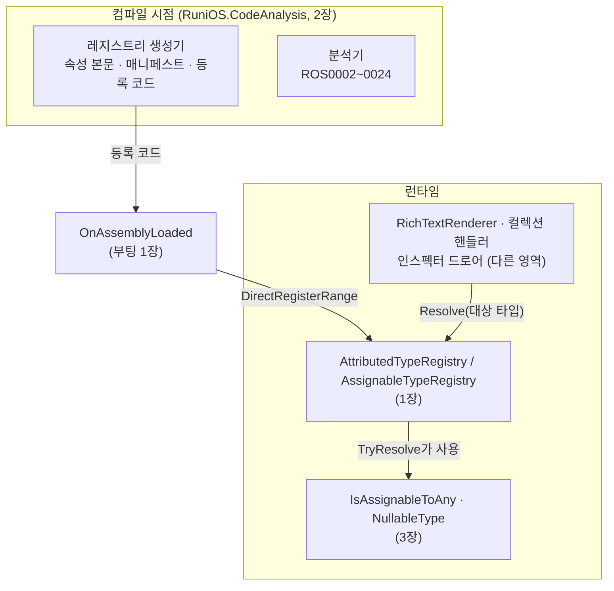

# 유틸리티 작동 원리

> 기준 커밋: `571e2110`. 코드 링크의 줄 번호는 이 커밋 기준입니다. [← core 문서 목차](../README.md)
>
> 함께 보기: [부팅 1장 수명 주기 훅](../Boot/01-lifecycle-hooks.md), [부팅 3장 마일스톤](../Boot/03-milestones.md)

`io.github.rumi727.runios.core`에서 다른 영역이 기대는 바탕 코드를 설명합니다. 대상 타입마다 구현 클래스를 찾는 **타입 레지스트리와 그 소스 생성기**가 중심입니다. 그 밖에 리플렉션 도우미, PlayerLoop·스레드·작업 도우미, 로그와 무한 루프 감지, Unity와 JSON에 함께 쓰는 직렬화 구조체, 정적 함수 모음을 다룹니다. C#과 Unity를 아는 독자를 기준으로 썼습니다.

텍스트(`Text`, 리치 텍스트 빌더)와 인스펙터 모델(컬렉션 핸들러, Undo, `Utility/Attributes`의 필드 특성 포함)은 각자 영역 문서(예정)에서 다룹니다. 두 영역 모두 이 문서의 타입 레지스트리를 씁니다.

## 한 장으로 보기

**핵심 아이디어 세 가지**

1. **구현은 특성 하나로 자기를 등록한다.** 레지스트리를 선언한 어셈블리는 매니페스트를 내보내고, 구현이 있는 어셈블리의 생성기가 그것을 읽어 자기 타입을 등록하는 코드를 만듭니다. 런타임 리플렉션 검색이 없습니다. → [2장](02-registry-generators.md)
2. **가장 구체적인 대상이 이긴다.** 레지스트리는 대상 타입의 구체성(클래스 > 인터페이스, 깊이)으로 정렬하고, 열린 제네릭 대상은 맞은 닫힌 타입의 인수로 구현을 닫습니다. `priority`는 마지막 키이고, 모든 키가 같으면 순서는 정해지지 않습니다. → [1장](01-type-registry.md), [3장](03-reflection-helpers.md)
3. **같은 값을 Unity 에셋과 JSON에 쓴다.** `SerializableNullable<T>`, `SerializableType`, `Version`, `HexColor`는 Unity 직렬화 필드와 `[JsonConverter]`를 함께 가집니다. → [6장](06-serializable-structs.md)

## 읽는 순서

| 장 | 내용 | 깊이 |
| --- | --- | --- |
| [1. 타입 레지스트리](01-type-registry.md) | `TypeRegistry` 계약, 등록 특성, 저장 구조, 정렬, `TryResolve`, `AssignableTypeRegistry` | **줄 단위** |
| [2. 레지스트리 소스 생성기·분석기](02-registry-generators.md) | 표식 특성, 속성 조건, 생성 코드, 매니페스트와 어셈블리 경계, 진단 표 | 핵심 줄 단위 |
| [3. 리플렉션 도우미](03-reflection-helpers.md) | `IsAssignableToAny`, `NullableType`, `Nullability`, 그 밖의 확장 | 핵심 줄 단위 |
| [4. 실행 도우미](04-execution-helpers.md) | `UnityThread`, `RuniPlayerLoop`, `AsyncTask`, `SafeInvoke` | 핵심 줄 단위 |
| [5. 진단](05-diagnostics.md) | `Debug`, `InfiniteLoopDetector`, `HarmonyUtility`, `DrivenPropertyManager` | 요약 |
| [6. 직렬화 구조체와 JSON 변환기](06-serializable-structs.md) | `SerializableNullable<T>`, `SerializableType`, `Version`, `HexColor`, 그 밖의 구조체, 변환기 표 | 핵심 줄 단위 |
| [7. 함수 모음](07-function-collections.md) | `MathUtility`, Easing, 컬렉션·LINQ, 문자열·시간, Unity·IO, 작은 타입 | 표 |
| [8. 차이와 기존 문서](08-differences.md) | 주석과 다른 곳, 관찰된 동작, 생성기·분석기 불일치, 사용처 없는 멤버 | 표 |

## 용어집

| 용어 | 뜻 |
| --- | --- |
| **대상 타입** | 등록 특성의 `targetType`. 구현이 처리하는 타입 |
| **구현 타입** | 특성이 붙은 클래스. 레지스트리가 돌려주는 타입 |
| **기본 타입** | 레지스트리에 들어갈 구현이 상속해야 하는 타입(`baseType`, `baseTypes`) |
| **표식 특성** | `[GenerateAttributedTypeRegistry]`처럼 레지스트리 속성에 붙여 생성기를 부르는 특성 |
| **매니페스트** | 선언 어셈블리가 내보내는 `[assembly: TypeRegistryManifestAttribute]`. 다른 어셈블리의 생성기가 레지스트리를 찾는 단서 |
| **와일드카드 칸** | `Version`의 비어 있는(`*`) 칸. 비교할 때 어떤 값과도 맞음 |

## 파일 지도

| 영역 | 파일 |
| --- | --- |
| 레지스트리 | `Runtime/Reflection/TypeRegistry`, `AttributedTypeRegistry`, `AssignableTypeRegistry`, `TypeRegistrationAttribute`, `RegistrationEntry` |
| 생성기·분석기 | `RuniOS.CodeAnalysis/Generators/TypeRegistry/`, `Analyzers/TypeRegistrationAttributeAnalyzer`, `AssignableTypeRegistryAnalyzer`, `TypeRegistryManifestAttributeAnalyzer`, `Diagnostics/TypeRegistryDiagnostics` |
| 리플렉션 | `Runtime/Reflection/ReflectionUtility`, `Nullability`, `NullState`, `Runtime/Utility/TypeUtility`, `Runtime/NullableType` |
| 실행 | `Runtime/Threading/UnityThread`, `Runtime/LowLevel/RuniPlayerLoop`, `Runtime/Tasks/AsyncTask`, `ProgressTask`, `Runtime/Utility/EventUtility`, `ProgressUtility` |
| 진단 | `Runtime/Debug`, `Runtime/InfiniteLoopDetector`, `Runtime/DrivenPropertyManager`, `Modding/Runtime/HarmonyUtility` |
| 구조체·JSON | `Runtime/Structs/`, `Runtime/Json/Converters/` |
| 함수 모음 | `Runtime/Utility/`, `Runtime/Spans/`, `Runtime/DecimalMath`, `Runtime/EasingFunctions`, `Runtime/StringBuilderCache`, `Runtime/Overridable`, `Runtime/ConditionalUniObjectTable`, `Unsafe/` |
| 설정 | `Runtime/GenericGlobalUsing`, `Runtime/AssemblyInfo`, `linkmerge.xml` |
