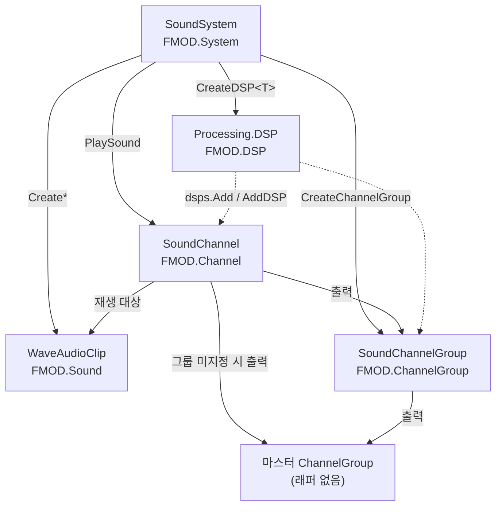
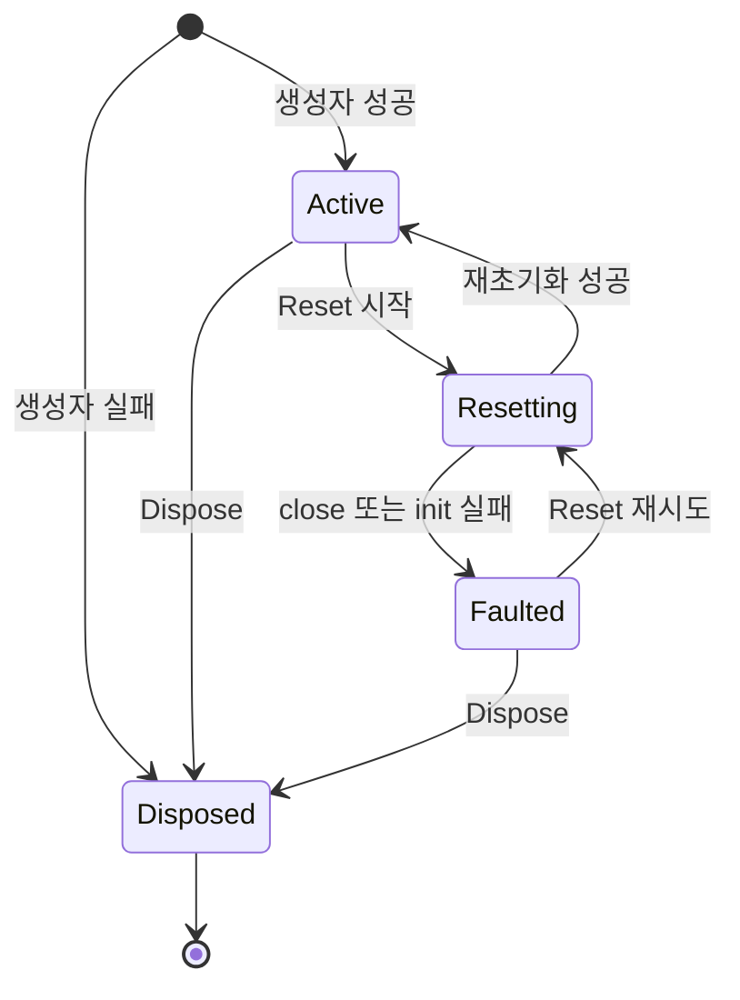
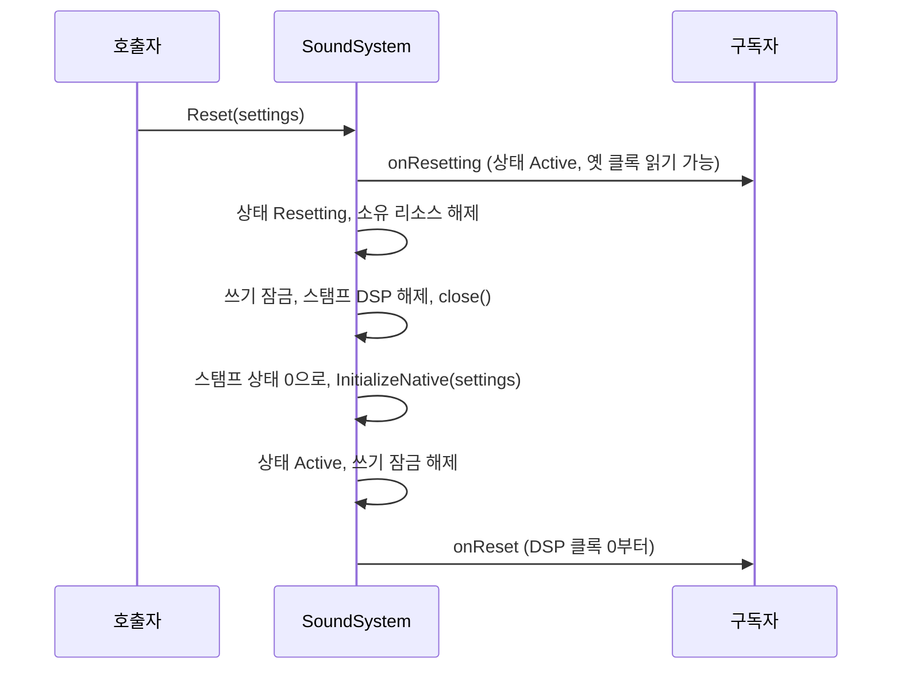

# 1. 시스템 수명: `SoundSystem`

> 기준 커밋: `3a2b24b9`. [← 목차](README.md) · 다음: [2. 리소스 소유권](02-resource-ownership.md)

[`SoundSystem`](../Runtime/Sounds/SoundSystem.cs#L9)은 FMOD Core의 `FMOD.System` 하나를 감싸는 클래스입니다. 이 패키지의 다른 모든 타입(클립, 채널, 그룹, DSP)은 어느 한 `SoundSystem`에 속합니다.
이 장은 시스템 하나가 만들어지고, 다시 초기화되고(`Reset`), 사라지는(`Dispose`) 과정을 다룹니다. 시스템이 가진 리소스를 어떻게 추적하고 정리하는지는 [2장](02-resource-ownership.md)에, 잠금과 스레드는 [3장](03-threads-and-locks.md)에 있습니다.

- [1.1 FMOD Core의 개념과 래퍼](#11-fmod-core의-개념과-래퍼)
- [1.2 정적 생성자와 `main`](#12-정적-생성자와-main)
- [1.3 생성자](#13-생성자)
- [1.4 `InitializeNative`와 설정](#14-initializenative와-설정)
- [1.5 수명 상태](#15-수명-상태)
- [1.6 `Reset`](#16-reset)
- [1.7 `Dispose`](#17-dispose)

---

## 1.1 FMOD Core의 개념과 래퍼

FMOD Core API는 다섯 가지 객체로 소리를 냅니다. 이 패키지는 각 객체에 래퍼를 하나씩 둡니다.

| FMOD 객체 | 하는 일 | 래퍼 | 장 |
| --- | --- | --- | --- |
| `System` | 출력 장치, 믹서 스레드, 모든 객체의 생성 | `SoundSystem` | 1, 3 |
| `Sound` | 디코딩된(또는 압축·스트림) 오디오 데이터 | `WaveAudioClip` | [4](04-clip-creation.md) |
| `Channel` | `Sound` 하나를 한 번 재생하는 세션 | `SoundChannel` | [5](05-channel.md) |
| `ChannelGroup` | 채널과 다른 그룹을 섞는 서브믹스 | `SoundChannelGroup` | [5](05-channel.md#510-soundchannelgroup) |
| `DSP` | 신호를 바꾸거나 관찰하는 처리 단위 | `Processing.DSP` 파생 클래스 | [7](07-dsp-wrappers.md) |

FMOD는 `System`이 소리를 **블록 단위로 미리 계산(믹스)**해 출력 버퍼에 쌓습니다. 이 시간 모델은 [6장](06-dsp-clock-and-mix-stamp.md)에서 다룹니다.



## 1.2 정적 생성자와 `main`

```csharp
// Runtime/Sounds/SoundSystem.cs
23  static SoundSystem()
    {
25  #if UNITY_EDITOR_LINUX || UNITY_STANDALONE_LINUX
26      const uint stackSize = 1024 * 1024;
28      FMOD.Thread.SetAttributes(THREAD_TYPE.NONBLOCKING, …, (THREAD_STACK_SIZE)stackSize).ThrowIfNotOk();   // ①
29      FMOD.Thread.SetAttributes(THREAD_TYPE.FILE, …, (THREAD_STACK_SIZE)stackSize).ThrowIfNotOk();
30      FMOD.Thread.SetAttributes(THREAD_TYPE.STREAM, …, (THREAD_STACK_SIZE)stackSize).ThrowIfNotOk();
31  #endif
33      main = new SoundSystem(new SoundSystemSettings                                                   // ②
        {
35          softwareChannels = 1023,
36          initFlags = INITFLAGS.VOL0_BECOMES_VIRTUAL
        });
    }
44  public static SoundSystem main { get; }
```

1. ① Linux에서만 FMOD 내부 스레드 세 종류(비동기 열기, 파일 읽기, 스트림 디코딩)의 스택을 1 MiB로 정합니다. 스트림의 [파일 콜백](04-clip-creation.md#45-soundfilestream-파일-콜백)처럼 관리 코드가 이 스레드들에서 실행되기도 합니다. 스레드 속성은 그 스레드가 만들어지기 전에 정해야 하므로, 첫 시스템을 만들기 전인 정적 생성자에 둡니다.
2. ② 프로세스 전체가 쓰는 기본 시스템입니다. 소프트웨어 믹싱 채널은 1023개이고, `VOL0_BECOMES_VIRTUAL`로 볼륨이 0인 채널은 가상 채널(믹스하지 않고 위치만 진행)이 됩니다. `maxChannels`는 지정하지 않았으므로 4095입니다([§1.4](#14-initializenative와-설정)).

`main`의 갱신과 해제는 [`SoundSystemManager`](../Runtime/Sounds/SoundSystemManager.cs#L7)가 맡습니다([3장](03-threads-and-locks.md#32-업데이트-스레드-soundsystemmanager)). 직접 만든 시스템은 소유자가 `Update()`와 `Dispose()`를 불러야 합니다.

## 1.3 생성자

```csharp
// Runtime/Sounds/SoundSystem.cs
62  public SoundSystem(SoundSystemSettings settings = default)
    {
64      listeners = new Listeners(this);
66      lock (systemLifetimeLock)                                            // ①
67          Factory.System_Create(out native).ThrowIfNotOk();
69      AllocateMixStampState();                                             // ②
71      try
        {
73          InitializeNative(settings);                                      // ③
        }
75      catch
        {
77          RESULT result = RESULT.OK;
79          lock (systemLifetimeLock)
            {
81              if (native.hasHandle())
82                  result = native.release().LogErrorIfNotOk();            // ④
84              native.clearHandle();
            }
87          // A system that failed to release may still be mixing into the stamp, so it is left allocated.
88          if (result == RESULT.OK)
89              FreeMixStampState();                                         // ⑤
91          lifecycleState = LifecycleState.Disposed;                        // ⑥
92          throw;
        }
    }
```

1. ① [`systemLifetimeLock`](../Runtime/Sounds/SoundSystem.cs#L21)은 **정적** 잠금입니다. 모든 시스템의 `System_Create`와 `System::release`를 한 줄로 세웁니다. FMOD는 이 두 함수를 스레드 안전 보장 밖에 두기 때문에, 시스템이 여러 개일 때 생성과 해제가 겹치지 않게 합니다.
2. ② 믹스 스탬프가 쓸 네이티브 메모리를 시스템당 한 번 할당합니다([6장](06-dsp-clock-and-mix-stamp.md#63-믹스-스탬프-무엇을-왜)). `Reset`해도 다시 할당하지 않습니다.
3. ③ 설정 적용, `init`, 값 캐시, 믹스 스탬프 DSP 생성을 합니다([§1.4](#14-initializenative와-설정)).
4. ④ 초기화에 실패하면 네이티브 시스템을 곧바로 해제합니다. 여기서도 정적 잠금을 잡습니다.
5. ⑤ 해제에 **성공했을 때만** 스탬프 메모리를 반납합니다. 해제에 실패한 시스템은 믹서 스레드가 아직 그 메모리에 쓰고 있을 수 있기 때문입니다. 이때는 메모리를 일부러 새게 둡니다.
6. ⑥ 실패한 인스턴스는 `Disposed` 상태로 남기고 예외를 다시 던집니다. 생성자가 던졌으므로 호출자는 이 인스턴스를 받지 못합니다.

## 1.4 `InitializeNative`와 설정

```csharp
// Runtime/Sounds/SoundSystem.cs
343 void InitializeNative(SoundSystemSettings settings)
    {
345     if (settings.softwareChannels is { } softwareChannels)                                        // ①
346         native.setSoftwareChannels(softwareChannels).ThrowIfNotOk();
348     if (settings.softwareFormat is { } softwareFormat)
349         native.setSoftwareFormat(softwareFormat.sampleRate, softwareFormat.speakerMode, softwareFormat.rawSpeakerCount).ThrowIfNotOk();
351     if (settings.dspBuffer is { } dspBuffer)
352         native.setDSPBufferSize(dspBuffer.length, dspBuffer.count).ThrowIfNotOk();
354     int maxChannels = settings.maxChannels ?? 4095;                                              // ②
355     native.init(maxChannels, settings.initFlags ?? INITFLAGS.NORMAL, IntPtr.Zero).ThrowIfNotOk();
356     nativeInitialized = true;
357     Volatile.Write(ref _maxChannels, maxChannels);                                               // ③
359     native.getSoftwareChannels(out int softwareChannelCount).ThrowIfNotOk();
360     Volatile.Write(ref _softwareChannelCount, softwareChannelCount);
362     native.getSoftwareFormat(out int sampleRate, out _, out _).ThrowIfNotOk();
363     Volatile.Write(ref _outputSampleRate, sampleRate);
365     CreateMixStampDSPUnsafe();                                                                   // ④
    }
```

1. ① `setSoftwareChannels`, `setSoftwareFormat`, `setDSPBufferSize`는 FMOD가 **`init` 전에만** 받는 설정입니다. 값이 `null`인 필드는 부르지 않으므로 FMOD `System` 객체에 남아 있는 값(처음이면 FMOD 기본값)이 쓰입니다.
2. ② `init`의 두 인자는 매번 넘겨야 하므로, `null`이면 이 코드의 기본값(4095, `NORMAL`)을 씁니다.
3. ③ 실제로 적용된 값을 FMOD에서 다시 읽어 필드에 둡니다. [`outputSampleRate`](../Runtime/Sounds/SoundSystem.cs#L115), [`maxChannels`](../Runtime/Sounds/SoundSystem.cs#L122), [`softwareChannelCount`](../Runtime/Sounds/SoundSystem.cs#L129) 속성은 이 필드를 `Volatile.Read`로 읽기만 하므로 잠금 없이 어느 스레드에서나 읽을 수 있습니다.
4. ④ 마스터 그룹에 믹스 스탬프 DSP를 붙입니다([6장](06-dsp-clock-and-mix-stamp.md#63-믹스-스탬프-무엇을-왜)). `init`할 때마다 새로 만들어야 하므로 `Reset`에서도 이 메서드를 거칩니다.

설정 타입은 모든 필드가 nullable인 레코드입니다.

```csharp
// Runtime/Sounds/SoundSystemSettings.cs
17  public readonly record struct SoundSystemSettings
    {
23      public int? maxChannels { get; init; }
29      public INITFLAGS? initFlags { get; init; }
35      public int? softwareChannels { get; init; }
41      public SoundSystemSoftwareFormat? softwareFormat { get; init; }
47      public SoundSystemDSPBuffer? dspBuffer { get; init; }
    }
66  public readonly record struct SoundSystemSoftwareFormat(int sampleRate, SPEAKERMODE speakerMode, int rawSpeakerCount = 0);
80  public readonly record struct SoundSystemDSPBuffer(uint length, int count);
```

`dspBuffer`는 블록 길이와 블록 수입니다. 이 두 값이 출력 지연을 정합니다([6장](06-dsp-clock-and-mix-stamp.md#61-dsp-클록과-믹스-블록)).

## 1.5 수명 상태

시스템의 상태는 [`LifecycleState`](../Runtime/Sounds/SoundSystem.cs#L11) 네 값 중 하나입니다. 필드 [`lifecycleState`](../Runtime/Sounds/SoundSystem.cs#L109)는 `volatile`이고, 바꾸는 곳은 모두 `nativeLock` 쓰기 잠금 안이나 생성자입니다.



| 상태 | 일반 API (`UseNative`, `PlaySound`, `Create*` …) | `Execute` | `Register` / `Dispose(resource)` / `QueueDispose` |
| --- | --- | --- | --- |
| `Active` | 동작 | 콜백 실행, `true` | 동작 |
| `Resetting` | `InvalidOperationException` | `false` | `Register`는 예외, 나머지는 아무것도 안 함 |
| `Faulted` | `InvalidOperationException` | `false` | 위와 같음 |
| `Disposed` | `ObjectDisposedException` | `false` | 위와 같음 (`Register`는 `ObjectDisposedException`) |

일반 API가 던지는 예외는 [`ThrowIfUnavailableUnsafe`](../Runtime/Sounds/SoundSystem.ThrowMethods.cs#L6)가 정합니다. 상태 전이 자체를 막는 검사는 [`ThrowIfLifecycleChangeUnavailable`](../Runtime/Sounds/SoundSystem.cs#L389)입니다. `Disposed`와 `Resetting`에서만 던지므로 **`Faulted`에서는 다시 `Reset`하거나 `Dispose`할 수 있습니다.**

## 1.6 `Reset`

`Reset(settings)`은 같은 `FMOD.System` 객체를 `close()`한 뒤 새 설정으로 다시 `init`합니다. 시스템이 가진 리소스는 모두 해제되며, 다시 만들어 주지 않습니다.

```csharp
// Runtime/Sounds/SoundSystem.Reset.cs
60  public void Reset(SoundSystemSettings settings = default)
    {
62      ThrowIfSystemLockHeld();                                                     // ①
64      lock (lifecycleLock)                                                         // ②
        {
66          if (invokingResettingHandlers)                                           // ③
67              throw new InvalidOperationException("The FMOD sound system lifecycle cannot be changed from an onResetting handler.");
69          ThrowIfLifecycleChangeUnavailable();
70          InvokeResettingHandlers();                                               // ④
71          List<ISoundSystemResource> resources = BeginResourceRelease(LifecycleState.Resetting);   // ⑤
72          ReleaseOwnedResources(resources);
74          nativeLock.EnterWriteLock();                                            // ⑥
76          try
            {
78              if (nativeInitialized)
                {
80                  ReleaseMixStampDSPUnsafe().ThrowIfNotOk();                      // ⑦
81                  native.close().ThrowIfNotOk();
82                  nativeInitialized = false;
                }
85              // No mixer runs now, and the new clock starts again from zero.
86              ClearMixStampStateUnsafe();                                         // ⑧
87              InitializeNative(settings);                                         // ⑨
88              queuedDisposals = [];
89              lifecycleState = LifecycleState.Active;
            }
91          catch
            {
93              lifecycleState = LifecycleState.Faulted;                            // ⑩
94              throw;
            }
96          finally
            {
98              nativeLock.ExitWriteLock();
            }
101         onReset.SafeInvoke(this);                                                // ⑪
        }
    }
```

1. ① 현재 스레드가 이 시스템의 `nativeLock`을 어떤 형태로든 들고 있으면 바로 `InvalidOperationException`을 던집니다. `ReaderWriterLockSlim`은 읽기 잠금을 쓰기 잠금으로 올릴 수 없어서, `Execute`나 `onUpdate` 안에서 `Reset`을 부르면 첫 쓰기 잠금(⑤의 `BeginResourceRelease`)에서 예외가 나거나 멈춥니다. 그 전에 분명한 오류로 막습니다.
2. ② [`lifecycleLock`](../Runtime/Sounds/SoundSystem.cs#L98)은 `Reset`과 `Dispose` 전체를 한 줄로 세웁니다. 두 작업이 동시에 리소스를 해제하지 않습니다.
3. ③ `onResetting` 처리기 안에서 다시 `Reset`이나 `Dispose`를 부르는 것을 막습니다. `System.Threading.Lock`은 같은 스레드의 재진입을 허용하므로 ②만으로는 막히지 않습니다.
4. ④ **상태를 바꾸기 전에** `onResetting`을 부릅니다. 처리기는 아직 `Active`인 시스템에서 옛 DSP 클록을 읽거나, 자기 리소스를 먼저 정리할 수 있습니다.
5. ⑤ 상태를 `Resetting`으로 바꾸고 소유 리소스 목록을 넘겨받은 뒤, 잠금 밖에서 하나씩 해제합니다([2장](02-resource-ownership.md#25-시스템이-리소스를-한꺼번에-해제하는-경로)).
6. ⑥ 쓰기 잠금은 다른 스레드의 모든 FMOD 호출(읽기 잠금)이 끝날 때까지 기다립니다. 이후에는 아무도 `native`를 만지지 않습니다.
7. ⑦ 믹스 스탬프 DSP를 마스터 그룹에서 떼고 해제한 뒤 `close()`합니다.
8. ⑧ `close()` 뒤에는 믹서가 돌지 않으므로 스탬프 메모리를 0으로 지워도 경쟁이 없습니다. 새 시스템의 DSP 클록은 0부터 다시 셉니다. 첫 블록이 믹스되기 전까지 `TryGetMixStamp`는 `false`입니다.
9. ⑨ [§1.4](#14-initializenative와-설정)와 같은 초기화입니다. 해제 큐도 새로 만듭니다(⑤에서 `null`로 바꿔 두었습니다).
10. ⑩ ⑦~⑨ 어디서든 실패하면 `Faulted`로 두고 예외를 다시 던집니다. 일반 API는 막히고, `Reset`을 다시 부를 수 있습니다. 그때 `nativeInitialized`가 `false`면 `close()`를 건너뛰고 바로 `init`합니다.
11. ⑪ 쓰기 잠금을 푼 뒤 `onReset`을 부릅니다. 처리기는 새 시스템에 리소스를 다시 만들 수 있습니다. 처리기 예외는 `SafeInvoke`가 기록만 합니다.



`Reset`이 받는 `settings`는 **저장된 설정과 합쳐지지 않습니다.** `init` 전 설정 세 개는 `null`이면 FMOD 객체에 남은 값이 유지되지만, `maxChannels`와 `initFlags`는 `null`이면 4095와 `NORMAL`이 됩니다.

> **관찰된 동작:** `SoundSystem.main.Reset()`을 기본 설정으로 부르면 `initFlags`가 `NORMAL`이 되어, 정적 생성자에서 준 `VOL0_BECOMES_VIRTUAL`([`SoundSystem.cs#L36`](../Runtime/Sounds/SoundSystem.cs#L36))이 빠집니다([`SoundSystem.cs#L355`](../Runtime/Sounds/SoundSystem.cs#L355)).

## 1.7 `Dispose`

```csharp
// Runtime/Sounds/SoundSystem.cs
299 public void Dispose()
    {
301     ThrowIfSystemLockHeld();                                                     // ①
303     lock (lifecycleLock)
        {
305         if (invokingResettingHandlers)
306             throw new InvalidOperationException("The FMOD sound system lifecycle cannot be changed from an onResetting handler.");
308         if (lifecycleState == LifecycleState.Disposed)                           // ②
309             return;
311         List<ISoundSystemResource> resources = BeginResourceRelease(LifecycleState.Disposed);   // ③
312         ReleaseOwnedResources(resources);
314         nativeLock.EnterWriteLock();
316         try
            {
318             if (nativeInitialized)
319                 ReleaseMixStampDSPUnsafe().LogErrorIfNotOk();                    // ④
321             RESULT result;
322             lock (systemLifetimeLock)
323                 result = native.release().LogErrorIfNotOk();                     // ⑤
325             nativeInitialized = false;
326             native.clearHandle();
328             // A system that failed to release may still be mixing into the stamp, so it is left allocated.
329             if (result == RESULT.OK)
330                 FreeMixStampState();                                             // ⑥
            }
332         finally
            {
334             nativeLock.ExitWriteLock();
            }
        }
338     GC.SuppressFinalize(this);
    }
341 ~SoundSystem() => Debug.RuntimeLogError("The FMOD system was removed from managed memory without a Dispose call! …");   // ⑦
```

1. ① `Reset`의 ①과 같은 이유입니다.
2. ② 두 번째 호출부터는 아무것도 하지 않습니다.
3. ③ 상태를 `Disposed`로 바꾸고 리소스를 해제합니다. 이 순간부터 새 리소스 등록과 일반 API 호출이 막힙니다. 리소스 해제 실패는 기록만 하고 계속합니다.
4. ④ `Reset`과 달리 실패해도 **기록만 하고 계속**합니다. 종료 경로는 끝까지 가야 하기 때문입니다.
5. ⑤ 네이티브 시스템 해제도 정적 잠금 아래에서 합니다([§1.3](#13-생성자) ①).
6. ⑥ 생성자 ⑤와 같은 이유로, 해제에 성공했을 때만 스탬프 메모리를 반납합니다.
7. ⑦ 종료자는 오류만 기록하고 **FMOD를 해제하지 않습니다.** 종료자 스레드에서 다른 스레드가 쓰는 네이티브 시스템을 해제하면 더 큰 문제가 생길 수 있어서, 정상 경로는 명시적 `Dispose()` 하나뿐입니다.

`Dispose`는 `Faulted` 상태에서도 동작합니다. `Resetting`은 `lifecycleLock` 안에서만 보이는 상태이므로, 다른 스레드의 `Dispose`는 진행 중인 `Reset`이 끝날 때까지 303줄의 `lock (lifecycleLock)`에서 기다립니다.
