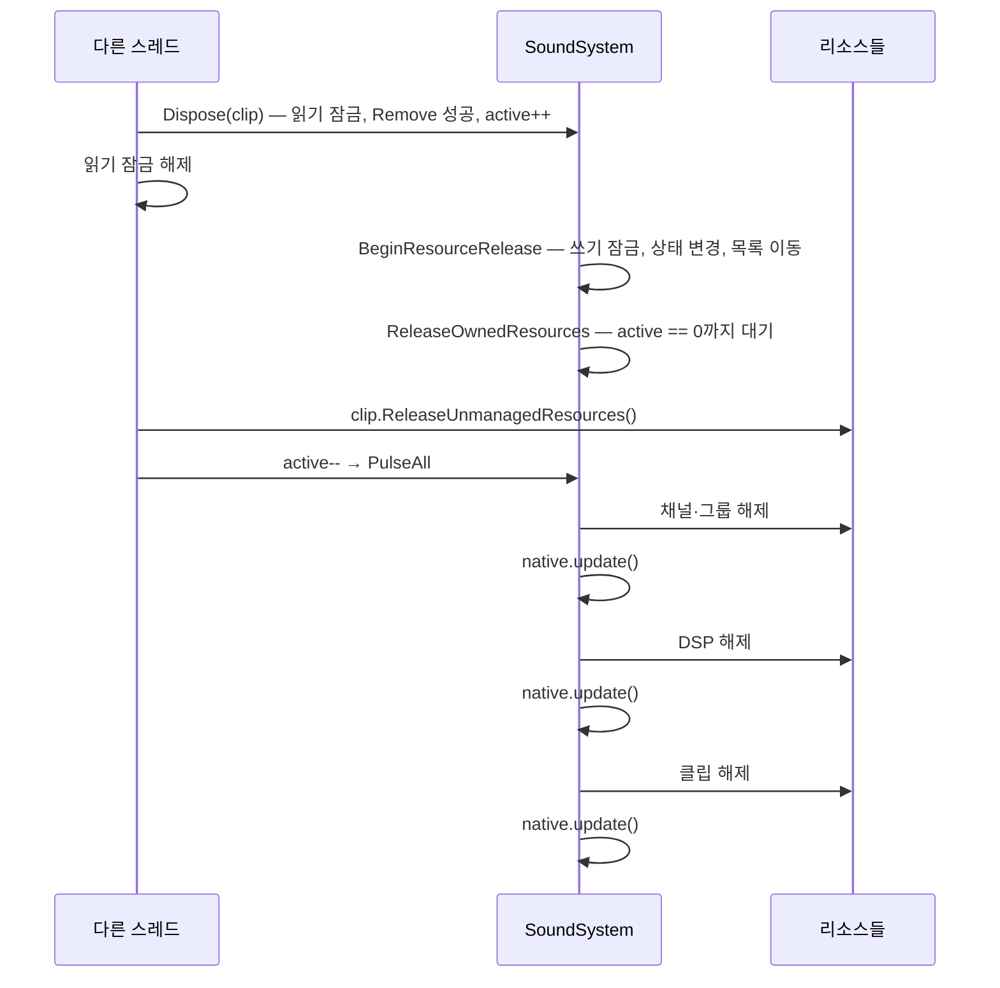

# 2. 리소스 소유권

> 기준 커밋: `3a2b24b9`. [← 목차](README.md) · 이전: [1. 시스템 수명](01-system-lifecycle.md) · 다음: [3. 스레드와 잠금](03-threads-and-locks.md)

`SoundSystem`이 만든 클립, 채널, 그룹, DSP는 모두 그 시스템에 **등록**됩니다. 시스템은 등록된 리소스만 알고, 종료할 때 그것들을 정리한 뒤 자신을 해제합니다.
이 장의 핵심은 **해제권**입니다. 같은 리소스를 여러 경로(직접 `Dispose`, 채널 종료 콜백, 시스템 종료)가 동시에 해제하려 해도, 소유 목록에서 그 리소스를 먼저 꺼낸 호출 하나만 실제 네이티브 해제를 합니다.

- [2.1 `ISoundSystemResource` 계약](#21-isoundsystemresource-계약)
- [2.2 등록: `Register`](#22-등록-register)
- [2.3 직접 해제: `Dispose(resource)`](#23-직접-해제-disposeresource)
- [2.4 미룬 해제: `QueueDispose`](#24-미룬-해제-queuedispose)
- [2.5 시스템이 리소스를 한꺼번에 해제하는 경로](#25-시스템이-리소스를-한꺼번에-해제하는-경로)
- [2.6 리소스 종류별 구현](#26-리소스-종류별-구현)
- [2.7 리소스 쪽 잠금: `UseNative`와 `Execute`](#27-리소스-쪽-잠금-usenative와-execute)

---

## 2.1 `ISoundSystemResource` 계약

```csharp
// Runtime/Sounds/ISoundSystemResource.cs
8   public interface ISoundSystemResource
    {
14      SoundSystem system { get; }
33      protected internal void ReleaseUnmanagedResources();
    }
```

`ReleaseUnmanagedResources`는 `protected internal`이라 패키지 밖에서는 부를 수 없습니다. 사용자는 리소스의 `Dispose()`를 부르고, 그 `Dispose()`는 시스템의 `Dispose(resource)`로 갑니다. 구현이 지킬 계약(XML 주석)은 다음과 같습니다.

- 반복 호출을 허용하고 네이티브 정리는 최대 한 번만 합니다.
- 시스템 해제가 시작된 뒤에 불릴 수 있습니다. 그때 실패는 기록만 되고 시스템 해제를 멈추지 않습니다.
- 실행 중에 소유 시스템을 동기적으로 해제하거나 자신을 다시 등록하지 않습니다.

## 2.2 등록: `Register`

```csharp
// Runtime/Sounds/SoundSystem.cs
102 readonly ConditionalWeakTable<ISoundSystemResource, object> ownedResources = [];   // ①

177 public void Register(ISoundSystemResource resource)
    {
179     if (resource.system != this)
180         throw new InvalidOperationException();
182     nativeLock.EnterReadLock();
184     try
        {
186         ThrowIfUnavailableUnsafe();                                                  // ②
187         ownedResources.AddOrUpdate(resource, resourceMarker);                        // ③
        }
189     finally
        {
191         nativeLock.ExitReadLock();
        }
    }
```

1. ① 소유 목록은 **약한 참조** 표입니다. 사용자가 `Dispose()` 없이 래퍼를 버리면 GC가 래퍼를 회수할 수 있습니다. 그때 각 래퍼의 종료자는 [`LogUndisposedResource`](../Runtime/Sounds/SoundSystem.LogUndisposedResource.cs#L5)로 오류만 기록하고 네이티브 리소스는 해제하지 않습니다. `UNITY_ENABLE_CHECKS`가 켜져 있으면 생성자의 스택 추적도 함께 기록합니다.
2. ② 시스템이 `Active`가 아니면 등록이 실패합니다. `Reset`이나 `Dispose`가 이미 소유 목록을 넘겨받은 뒤에 새 리소스가 끼어들지 못합니다.
3. ③ 값은 의미 없는 표시 객체입니다. 표를 집합처럼 씁니다.

각 래퍼의 생성자가 `Register`를 부릅니다. 사용자가 직접 부를 일은 없습니다.

## 2.3 직접 해제: `Dispose(resource)`

```csharp
// Runtime/Sounds/SoundSystem.cs
211 public void Dispose(ISoundSystemResource resource)
    {
213     if (resource.system != this)
214         throw new InvalidOperationException();
216     nativeLock.EnterReadLock();
218     try
        {
220         if (lifecycleState != LifecycleState.Active || !ownedResources.Remove(resource))   // ①
221             return;
223         lock (resourceDisposalLock)
224             activeResourceDisposals++;                                                  // ②
        }
226     finally
        {
228         nativeLock.ExitReadLock();                                                      // ③
        }
231     try
        {
233         // 네이티브 잠금은 소유권 확보만 보호하며 구현 코드는 잠그지 않습니다.
234         resource.ReleaseUnmanagedResources();                                           // ④
237         GC.SuppressFinalize(resource);
        }
239     catch
        {
241         // 일반 해제 실패는 소유권을 복구해 호출자가 원인을 정리한 뒤 재시도할 수 있게 합니다.
242         ownedResources.AddOrUpdate(resource, resourceMarker);                           // ⑤
243         throw;
        }
245     finally
        {
247         lock (resourceDisposalLock)
            {
249             activeResourceDisposals--;
251             if (activeResourceDisposals == 0)
252                 Monitor.PulseAll(resourceDisposalLock);                                 // ⑥
            }
        }
    }
```

1. ① **해제권 확보.** `Remove`가 `true`인 호출 하나만 계속 진행합니다. 이미 해제됐거나, 다른 스레드가 먼저 꺼냈거나, 시스템이 `Active`가 아니면(시스템 쪽 정리가 맡음) 조용히 돌아갑니다.
2. ② "지금 잠금 밖에서 해제 중인 리소스 수"를 늘립니다. 시스템 종료는 이 수가 0이 될 때까지 기다립니다([§2.5](#25-시스템이-리소스를-한꺼번에-해제하는-경로)).
3. ③ 리소스 구현을 부르기 **전에** 시스템 잠금을 풉니다. 구현이 오래 걸리거나 다른 잠금을 잡아도 시스템 쓰기 잠금(`Reset`/`Dispose`)과 교착하지 않습니다.
4. ④ 실제 네이티브 해제입니다.
5. ⑤ 해제가 예외로 실패하면 소유권을 되돌리고 예외를 다시 던집니다. 호출자는 원인을 정리한 뒤 다시 `Dispose()`할 수 있고, 그러지 않더라도 시스템 종료가 이 리소스를 다시 맡습니다.
6. ⑥ 마지막 해제가 끝나면 기다리는 시스템 종료를 깨웁니다.

`activeResourceDisposals`가 막는 경합은 이것입니다. ①에서 리소스를 꺼낸 직후 다른 스레드가 `Dispose()`를 하면, 시스템의 소유 목록에는 이 리소스가 없습니다. 기다리지 않으면 시스템이 `native.release()`를 먼저 해 버리고, ④가 이미 사라진 FMOD 핸들을 만지게 됩니다.

## 2.4 미룬 해제: `QueueDispose`

```csharp
// Runtime/Sounds/SoundSystem.cs
275 public void QueueDispose(ISoundSystemResource resource)
    {
277     if (resource.system != this)
278         throw new InvalidOperationException();
280     if (lifecycleState != LifecycleState.Active)
281         return;
283     ConcurrentQueue<ISoundSystemResource>? disposalQueue = Volatile.Read(ref queuedDisposals);
284     disposalQueue?.Enqueue(resource);
    }
```

리소스를 큐에 넣기만 하고, 다음 [`Update()`](../Runtime/Sounds/SoundSystem.Update.cs#L10)가 [`DisposeQueuedResources`](../Runtime/Sounds/SoundSystem.Update.cs#L29)에서 꺼내 `Dispose(resource)`로 해제합니다. 해제 예외는 기록만 합니다. 잠금을 잡을 수 없는 문맥(예: 네이티브 콜백)에서 해제를 업데이트 스레드로 미루는 공개 API입니다. **현재 패키지 안에는 이 메서드를 부르는 곳이 없습니다.** 채널 종료 콜백은 `Dispose(channel)`을 직접 부릅니다([5장](05-channel.md#53-종료-콜백과-onstop)).

`Reset`/`Dispose`는 시작할 때 큐를 `null`로 바꿉니다. 그 직후 옛 큐에 들어간 항목은 꺼내지지 않을 수 있지만, 그 리소스는 이미 시스템이 넘겨받은 목록에 있으므로 해제가 빠지지 않습니다.

## 2.5 시스템이 리소스를 한꺼번에 해제하는 경로

`Reset`과 `Dispose`는 두 메서드로 리소스를 정리합니다. 둘 다 `lifecycleLock` 안에서 불립니다.

```csharp
// Runtime/Sounds/SoundSystem.cs
368 List<ISoundSystemResource> BeginResourceRelease(LifecycleState nextState)
    {
370     nativeLock.EnterWriteLock();                                                 // ①
372     try
        {
374         ThrowIfLifecycleChangeUnavailable();
376         lifecycleState = nextState;                                              // ②
377         Interlocked.Exchange(ref queuedDisposals, null);
379         List<ISoundSystemResource> resources = new(ownedResources.Select(x => x.Key));   // ③
380         ownedResources.Clear();
381         return resources;
        }
383     finally
        {
385         nativeLock.ExitWriteLock();
        }
    }

398 void ReleaseOwnedResources(List<ISoundSystemResource> resources)
    {
400     lock (resourceDisposalLock)
        {
402         while (activeResourceDisposals != 0)                                     // ④
403             Monitor.Wait(resourceDisposalLock);
        }
406     // 진행 중이던 즉시 해제가 실패해 되돌린 소유권까지 현재 lifecycle 작업으로 넘깁니다.
407     resources.AddRange(ownedResources.Select(x => x.Key));                       // ⑤
408     ownedResources.Clear();
409     resources.Sort((left, right) => GetReleaseOrder(left).CompareTo(GetReleaseOrder(right)));   // ⑥
411     int previousOrder = 0;
412     bool hasPreviousOrder = false;
414     foreach (ISoundSystemResource resource in resources)
        {
416         int currentOrder = GetReleaseOrder(resource);
418         if (nativeInitialized && hasPreviousOrder && previousOrder < currentOrder)
419             native.update().LogErrorIfNotOk();                                   // ⑦
421         try
            {
423             resource.ReleaseUnmanagedResources();                                // ⑧
            }
425         catch (Exception exception)
            {
427             Debug.LogException(exception);
            }
431         GC.SuppressFinalize(resource);
433         previousOrder = currentOrder;
434         hasPreviousOrder = true;
        }
437     if (nativeInitialized)
438         native.update().LogErrorIfNotOk();                                       // ⑨
    }

441 static int GetReleaseOrder(ISoundSystemResource resource) => resource switch
    {
443     SoundChannel => -1,
444     SoundChannelGroup => -1,
445     Processing.DSP => 1,
446     WaveAudioClip => 2,
447     _ => 0
    };
```

1. ① 쓰기 잠금이므로 다른 스레드의 FMOD 호출과 [§2.3](#23-직접-해제-disposeresource)의 해제권 확보(읽기 잠금)가 모두 끝난 뒤에 들어옵니다.
2. ② 상태를 바꾸면 이후 `Register`는 실패하고 `Dispose(resource)`는 아무것도 하지 않습니다. 소유권 이동이 한 번에 일어납니다.
3. ③ 소유 목록을 일반 리스트로 옮기고 비웁니다. 약한 참조 표가 종료된 래퍼를 계속 들고 있지 않게 하고, 외부 구현을 부르기 전에 시스템의 소유 상태를 정리합니다. (리스트와 LINQ 할당은 드물게 일어나는 종료 경로라 허용됩니다.)
4. ④ 잠금 밖에서 진행 중인 직접 해제가 모두 끝날 때까지 기다립니다.
5. ⑤ 그 해제 중 실패해 [§2.3](#23-직접-해제-disposeresource) ⑤에서 소유권이 되돌아온 리소스도 이번 작업이 맡습니다.
6. ⑥ 종류별 순서로 정렬합니다. **채널·그룹 → 기타 → DSP → 클립** 순입니다. 같은 순서 값끼리의 순서는 정하지 않습니다.
7. ⑦ 순서 값이 커질 때마다 `native.update()`를 한 번 부릅니다. 앞 단계(예: 채널 정지)의 변경을 FMOD가 `update`에서 반영하게 한 뒤에, 그 단계가 쓰던 것(채널에 붙어 있던 DSP, 채널이 재생하던 Sound)을 해제하려는 순서입니다.
8. ⑧ 실패는 기록만 하고 계속합니다. 남은 리소스와 시스템 해제가 멈추면 안 되기 때문입니다.
9. ⑨ 마지막 단계의 해제도 FMOD가 처리하게 합니다.



## 2.6 리소스 종류별 구현

| 래퍼 | 사용자 진입점 | `ReleaseUnmanagedResources` | 자기 잠금 | 비고 |
| --- | --- | --- | --- | --- |
| [`WaveAudioClip`](../Runtime/Sounds/WaveAudioClip.cs#L98) | `Dispose()` | 쓰기 잠금 → `Sound.release()` → 잠금 밖에서 `nativeLifetime.Dispose()` | `nativeLock` (재귀) | `ERR_INVALID_HANDLE`은 성공으로 봄 |
| [`SoundChannelGroup`](../Runtime/Sounds/SoundChannelGroup.cs#L71) | `Dispose()` | 쓰기 잠금 → `ChannelGroup.release()` → 핸들 비움 | `nativeLock` (재귀) | 입력 채널·그룹 래퍼는 해제하지 않음 |
| [`Processing.DSP`](../Runtime/Sounds/Processing/DSP.cs#L161) | `Dispose()` | 쓰기 잠금 → 관리 표에서 제거 → `DSP.release()` → `OnNativeReleaseAccepted()` | `nativeLock` (재귀) | [7장](07-dsp-wrappers.md) |
| [`SoundChannel`](../Runtime/Sounds/SoundChannel.cs#L106) | `Stop()` | `Stop()` | 없음 | `Dispose()`가 없음. FMOD 종료 콜백이 등록을 풂([5장](05-channel.md#53-종료-콜백과-onstop)) |

세 클래스(클립, 그룹, DSP)는 같은 모양입니다. 해제 직전에 **자기 쓰기 잠금**을 잡고 `_isDisposed`를 세웁니다. 쓰기 잠금은 진행 중인 `UseNative` 콜백(읽기 잠금)이 모두 끝나기를 기다리므로, 콜백이 쓰고 있는 핸들을 해제하는 일이 없습니다.

`SoundChannel`은 다릅니다. 채널 핸들은 FMOD가 재생이 끝나거나 채널을 다른 소리에 빼앗기면(stolen) 스스로 무효로 만듭니다. 그래서 채널 래퍼는 잠금 대신 FMOD의 핸들 검사에 맡기고, 무효 핸들 오류를 `ObjectDisposedException`으로 바꿉니다([5장](05-channel.md#54-잠금)).

## 2.7 리소스 쪽 잠금: `UseNative`와 `Execute`

클립·그룹·DSP는 시스템과 같은 형태의 API 두 벌을 가집니다.

```csharp
// Runtime/Sounds/WaveAudioClip.UseNative.cs
8   public void UseNative(Action<Sound> action)
    {
10      nativeLock.EnterReadLock();
12      try
        {
14          ThrowIfDisposedUnsafe();                // 해제됐으면 ObjectDisposedException
15          action.Invoke(native);
        }
17      finally
        {
19          nativeLock.ExitReadLock();
        }
    }

// Runtime/Sounds/WaveAudioClip.Execute.cs
6   public bool Execute(Action<WaveAudioClip> action)
    {
8       nativeLock.EnterReadLock();
10      try
        {
12          if (_isDisposed)                        // 해제됐으면 false
13              return false;
15          action.Invoke(this);
16          return true;
        }
18      finally
        {
20          nativeLock.ExitReadLock();
        }
    }
```

| API | 해제된 뒤 | 콜백이 받는 것 | 쓰임 |
| --- | --- | --- | --- |
| `UseNative` | 예외 | 네이티브 핸들 | 래핑되지 않은 FMOD 함수 호출. 핸들을 콜백 밖에 저장하면 안 됨 |
| `Execute` | `false` | 래퍼 자신 | 여러 속성 접근을 "해제되지 않은 동안"으로 묶음 |

클립의 속성 대부분([`WaveAudioClip.Properties.cs`](../Runtime/Sounds/WaveAudioClip.Properties.cs#L12))은 `UseNative` 한 번으로 구현됩니다. 그래서 속성 하나는 원자적이지만, 여러 속성을 함께 읽을 때 그 사이에 해제되지 않으려면 `Execute`로 감쌉니다.

두 리소스를 함께 잠가야 하는 호출(그룹 안에 그룹 넣기, DSP 입력 연결)은 **핸들 주소 순서**로 잠급니다.

```csharp
// Runtime/Sounds/SoundChannelGroup.UseNative.cs
108 static void UseNativePair(SoundChannelGroup first, SoundChannelGroup second, Action<ChannelGroup, ChannelGroup> action)
    {
110     if (ReferenceEquals(first, second))
        {
112         first.UseNative(channelGroup => action.Invoke(channelGroup, channelGroup));
113         return;
        }
116     SoundChannelGroup lower = first.nativeHandle.ToInt64() < second.nativeHandle.ToInt64() ? first : second;
117     SoundChannelGroup higher = ReferenceEquals(lower, first) ? second : first;
119     // 두 그룹을 함께 사용하는 호출만 handle 순서로 잠가 반대 방향 호출의 교착을 막습니다.
120     lower.nativeLock.EnterReadLock();
121     higher.nativeLock.EnterReadLock();
        …
    }
```

`A.AddGroup(B)`와 `B.AddGroup(A)`가 동시에 일어나도 두 호출이 같은 순서로 잠그므로, 한쪽이 A를 잡고 B를, 다른 쪽이 B를 잡고 A를 기다리는 교착이 생기지 않습니다. 읽기 잠금끼리는 서로 막지 않지만, `ReaderWriterLockSlim`은 쓰기 잠금을 기다리는 스레드가 있으면 새 읽기 잠금을 막습니다. 그래서 두 리소스에 해제(쓰기 잠금) 대기가 끼면 순서 없는 잠금은 교착할 수 있습니다. [`DSP.UseNativePair`](../Runtime/Sounds/Processing/DSP.UseNative.cs#L106)도 같은 방식입니다.
