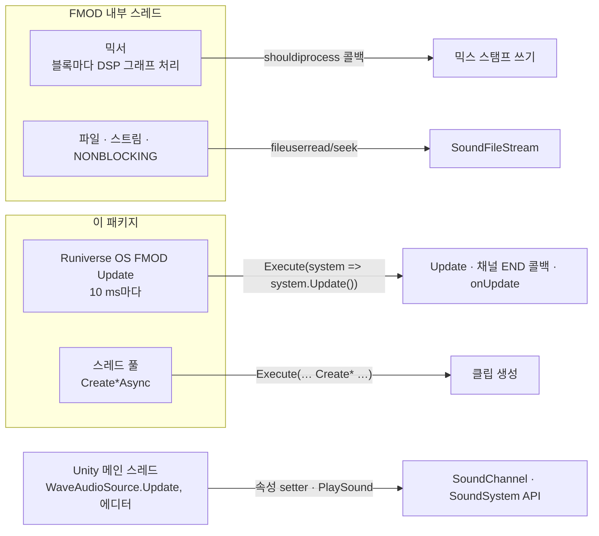

# 3. 스레드와 잠금

> 기준 커밋: `3a2b24b9`. [← 목차](README.md) · 이전: [2. 리소스 소유권](02-resource-ownership.md) · 다음: [4. 클립 생성과 데이터](04-clip-creation.md)

이 패키지의 코드는 여러 스레드에서 동시에 실행됩니다. FMOD 믹서와 파일 스레드, 이 패키지의 업데이트 스레드, Unity 메인 스레드, 스레드 풀입니다.
이 장은 어느 코드가 어느 스레드에서 도는지, 그리고 시스템의 `nativeLock`이 그 사이에서 무엇을 보장하는지를 정리합니다. **`onUpdate` 처리기와 FMOD 채널 콜백은 시스템의 읽기 잠금을 든 채 실행된다**는 점이 이 장에서 가장 중요합니다.

- [3.1 스레드 지도](#31-스레드-지도)
- [3.2 업데이트 스레드: `SoundSystemManager`](#32-업데이트-스레드-soundsystemmanager)
- [3.3 `Update`와 `onUpdate`](#33-update와-onupdate)
- [3.4 `Execute`와 `UseNative`](#34-execute와-usenative)
- [3.5 비동기 API와 잠금 검사](#35-비동기-api와-잠금-검사)
- [3.6 잠금 표](#36-잠금-표)

---

## 3.1 스레드 지도



| 스레드 | 이 패키지에서 실행되는 코드 | 시스템 `nativeLock` |
| --- | --- | --- |
| FMOD 믹서 | [믹스 스탬프 콜백](06-dsp-clock-and-mix-stamp.md#64-쓰기-쪽-믹서-스레드-콜백) | 잡지 않음. 잠금 없는 seqlock으로만 씀 |
| FMOD 파일·스트림 | [`SoundFileStream`](04-clip-creation.md#45-soundfilestream-파일-콜백)의 읽기·탐색 콜백 | 잡지 않음. 자기 `streamLock`만 |
| 업데이트 스레드 | `Update`, 채널 `END` 콜백과 `onStop`, `onUpdate` 처리기 | **읽기 잠금 보유 중** |
| 스레드 풀 | `Create*Async`의 실제 생성 | `Execute` 안에서 읽기 잠금 |
| 메인·임의 스레드 | 일반 API 호출 | 호출마다 짧은 읽기 잠금. `SoundChannel`은 잡지 않음 |

## 3.2 업데이트 스레드: `SoundSystemManager`

```csharp
// Runtime/Sounds/SoundSystemManager.cs
9   const int updateIntervalMilliseconds = 10;
11  static readonly AutoResetEvent updateWake = new(false);
13  static Thread? thread;
14  static volatile bool stop;

16  [OnCodeLoaded]
17  static void OnCodeLoaded()
    {
19      thread = new Thread(UpdateLoop)
        {
21          IsBackground = true,                                         // ①
22          Name = "Runiverse OS FMOD Update"
        };
24      thread.Start();
    }

27  static void UpdateLoop()
    {
29      while (!stop)
        {
31          try
            {
33              SoundSystem.main.Execute(system => system.Update());     // ②
            }
35          catch (Exception exception)
            {
37              Debug.LogException(exception);                            // ③
            }
40          updateWake.WaitOne(updateIntervalMilliseconds);               // ④
        }
    }

44  [OnCodeUnloading]
45  static void OnCodeUnloading()
    {
47      stop = true;
48      updateWake.Set();                                                 // ⑤
50      if (thread != null && thread != Thread.CurrentThread)
51          thread.Join();
53      SoundSystem.main.Dispose();                                       // ⑥
    }
```

1. ① 백그라운드 스레드라서 프로세스 종료를 막지 않습니다.
2. ② `Execute`로 감쌉니다. 시스템이 `Reset` 중이거나 `Faulted`이면 `Update`를 건너뛰고(`false`), 예외 없이 다음 주기를 기다립니다. 그리고 **이 줄에서 잡은 읽기 잠금은 `Update`가 끝날 때까지 유지됩니다.**
3. ③ 한 주기의 예외가 스레드를 죽이지 않습니다.
4. ④ 10 ms를 기다립니다. 블록 하나(1024 샘플, 48 kHz에서 약 21 ms)보다 짧아서 블록마다 적어도 한 번은 돕니다.
5. ⑤ 대기 중인 스레드를 바로 깨워 종료를 기다리는 시간을 줄입니다.
6. ⑥ 스레드가 끝난 뒤 `main`을 해제합니다. 코드 언로드(도메인 리로드, 종료)마다 FMOD가 정리됩니다.

## 3.3 `Update`와 `onUpdate`

```csharp
// Runtime/Sounds/SoundSystem.Update.cs
24  public void Update()
    {
26      nativeLock.EnterReadLock();
28      try
        {
30          ThrowIfUnavailableUnsafe();
31          native.update().LogErrorIfNotOk();                  // ①
        }
33      finally
        {
35          nativeLock.ExitReadLock();
        }
38      SoundChannel.RetryPendingTimeSamples(this);             // ②
39      DisposeQueuedResources();                               // ③
41      lock (onUpdateLock)
42          _onUpdate?.SafeInvoke();                            // ④
    }
```

1. ① FMOD의 주기 작업입니다. 채널 콜백(재생 끝 `END`)은 FMOD가 이 호출 안에서 부릅니다. 그래서 [`SoundChannel.onStop`](05-channel.md#53-종료-콜백과-onstop)은 자연 종료일 때 업데이트 스레드에서 실행됩니다.
2. ② FMOD가 `ERR_NOTREADY`로 미뤘던 위치 지정을 다시 시도합니다([5장](05-channel.md#55-위치-timesample과-time)).
3. ③ [`QueueDispose`](02-resource-ownership.md#24-미룬-해제-queuedispose)로 미룬 해제를 처리합니다.
4. ④ 구독자를 부릅니다. `SafeInvoke`는 처리기마다 예외를 잡아 기록하므로 한 처리기의 예외가 다른 처리기를 막지 않습니다. 호출하는 동안 `onUpdateLock`을 들고 있으므로, 다른 스레드의 구독·해지는 처리기가 끝날 때까지 기다립니다.

`Update` 자신의 읽기 잠금은 ①에서 풀리지만, `main`의 경우 [§3.2](#32-업데이트-스레드-soundsystemmanager) ②의 `Execute`가 바깥에서 읽기 잠금을 들고 있습니다. 그러므로 `main`에서는 다음이 성립합니다.

- `onUpdate` 처리기와 채널 `END` 콜백은 **시스템 읽기 잠금을 보유한 채** 실행됩니다.
- 그 안에서 `Reset`/`Dispose`를 부르면 [`ThrowIfSystemLockHeld`](../Runtime/Sounds/SoundSystem.ThrowMethods.cs#L21)가 예외를 던집니다.
- 다른 스레드가 `Reset`을 시작해 쓰기 잠금을 기다리면, 처리기가 끝날 때까지 `Reset`이 기다립니다. 처리기 안에서 "그 `Reset`을 부른 스레드가 쥔 잠금"을 기다리면 교착합니다. 처리기는 다른 잠금을 오래 기다리지 말고 시도만(`TryEnter…(0)`) 하는 편이 안전합니다.

## 3.4 `Execute`와 `UseNative`

시스템에는 콜백을 받는 API가 두 벌 있습니다. 둘 다 읽기 잠금 아래에서 콜백을 동기적으로 부릅니다.

```csharp
// Runtime/Sounds/SoundSystem.Execute.cs
8   public bool Execute(Action<SoundSystem> action)
    {
10      nativeLock.EnterReadLock();
12      try
        {
14          if (lifecycleState != LifecycleState.Active)
15              return false;                                   // 예외 대신 false
17          action.Invoke(this);
18          return true;
        }
20      finally
        {
22          nativeLock.ExitReadLock();
        }
    }

// Runtime/Sounds/SoundSystem.UseNative.cs
6   public void UseNative(Action<FMOD.System> action)
    {
8       nativeLock.EnterReadLock();
10      try
        {
12          ThrowIfUnavailableUnsafe();                         // 예외
13          action.Invoke(native);
        }
15      finally
        {
17          nativeLock.ExitReadLock();
        }
    }
```

| | `Execute` | `UseNative` |
| --- | --- | --- |
| 콜백이 받는 것 | `SoundSystem` | `FMOD.System` 핸들 |
| 시스템이 `Active`가 아닐 때 | `false` (결과는 `default`) | `ObjectDisposedException` / `InvalidOperationException` |
| 쓰임 | 여러 API 호출을 "시스템이 살아 있는 동안"으로 묶기 | 래핑되지 않은 FMOD 함수 호출 |
| 오버로드 | 상태 인자 0~2개, `Action`/`Func` | 상태 인자 0~1개, `Action`/`Func` |

읽기 잠금은 재귀를 허용하므로 콜백 안에서 같은 시스템의 다른 API를 불러도 됩니다. 반대로 콜백 안에서 **`await`하거나 다른 스레드의 작업을 동기로 기다리면 안 됩니다.** `ReaderWriterLockSlim`은 잡은 스레드가 풀어야 하고, 기다리는 동안 `Reset`의 쓰기 잠금 대기가 끼면 새 읽기 잠금이 막혀 교착합니다.

상태 인자 오버로드(`Execute<T>(Action<SoundSystem, T>, T)` 등)는 람다가 지역 변수를 캡처하지 않게 해서 클로저 할당을 피하는 용도입니다.

[`ExecuteOnThreadPool`](../Runtime/Sounds/SoundSystem.Execute.cs#L125)은 `Execute`를 `UniTask.RunOnThreadPool`로 감싼 편의 API입니다. [§3.5](#35-비동기-api와-잠금-검사)의 잠금 검사는 하지 않습니다.

## 3.5 비동기 API와 잠금 검사

`Create*Async`는 모두 이런 모양입니다.

```csharp
// Runtime/Sounds/SoundSystem.CreateSoundAsync.cs
41  public UniTask<WaveAudioClip?> CreateSoundAsync(byte[] data, bool keepCompressed = false)
    {
43      ThrowIfSystemLockHeld();                                    // ①
44      return UniTask.RunOnThreadPool(() =>
        {
46          Execute(system => system.CreateSound(data, keepCompressed), out WaveAudioClip? clip);   // ②
47          return clip;
        });
    }
```

1. ① 호출 스레드가 이미 이 시스템의 잠금을 들고 있으면 바로 예외를 던집니다. `Execute` 콜백 안에서 비동기 생성을 시작하고 그 결과를 동기로 기다리는 실수를 일찍 잡습니다.
2. ② 실제 생성은 스레드 풀에서 `Execute`로 합니다. 시스템이 `Active`가 아니면 콜백이 돌지 않아 결과가 **`null`**입니다. 그래서 반환 타입이 `WaveAudioClip?`입니다. 생성 중 예외(파일 형식 오류 등)는 그대로 await 지점으로 전달됩니다.

`Reset`과 `Dispose`도 시작할 때 같은 검사를 합니다([1장](01-system-lifecycle.md#16-reset) ①).

## 3.6 잠금 표

| 잠금 | 종류 | 보호하는 것 | 잡는 곳 |
| --- | --- | --- | --- |
| [`systemLifetimeLock`](../Runtime/Sounds/SoundSystem.cs#L21) | 정적 `Lock` | 모든 시스템의 `System_Create`/`release` | 생성자, `Dispose` |
| [`lifecycleLock`](../Runtime/Sounds/SoundSystem.cs#L98) | `Lock` | `Reset`/`Dispose` 전체 | `Reset`, `Dispose` |
| [`nativeLock`](../Runtime/Sounds/SoundSystem.cs#L97) | `ReaderWriterLockSlim` (재귀) | 상태와 `native` 핸들 | 일반 API(읽기), 상태 전이·네이티브 해제(쓰기) |
| [`resourceDisposalLock`](../Runtime/Sounds/SoundSystem.cs#L106) | `Monitor` | `activeResourceDisposals` | [2장 §2.3](02-resource-ownership.md#23-직접-해제-disposeresource), [§2.5](02-resource-ownership.md#25-시스템이-리소스를-한꺼번에-해제하는-경로) |
| [`onUpdateLock`](../Runtime/Sounds/SoundSystem.Update.cs#L22) | `Lock` | `onUpdate` 구독과 호출 | `Update` |
| [`resetEventLock`](../Runtime/Sounds/SoundSystem.Reset.cs#L57) | `Lock` | `onResetting`/`onReset` 구독 | 구독, 처리기 목록 복사 |
| 클립·그룹·DSP `nativeLock` | `ReaderWriterLockSlim` (재귀) | 자기 핸들과 `_isDisposed` | [2장 §2.7](02-resource-ownership.md#27-리소스-쪽-잠금-usenative와-execute) |
| 채널 `playbackLock` 등 | `ReaderWriterLockSlim` (재귀 없음) | 여러 FMOD 호출로 된 읽기-수정-쓰기 | [5장 §5.4](05-channel.md#54-잠금) |
| `SoundFileStream.streamLock` | `Lock` | 관리 `Stream`의 위치 | [4장 §4.5](04-clip-creation.md#45-soundfilestream-파일-콜백) |
| 믹스 스탬프 `sequence` | 잠금 없음(seqlock) | 스탬프 세 필드의 일관성 | [6장](06-dsp-clock-and-mix-stamp.md#64-쓰기-쪽-믹서-스레드-콜백) |

잡는 순서는 바깥에서 안쪽으로 `lifecycleLock` → 시스템 `nativeLock` → 리소스 `nativeLock`입니다. `PlaySound`(시스템 읽기 → 클립 읽기)와 그룹 재생(그룹 읽기 → 시스템 읽기 → 클립 읽기)처럼 순서가 섞이는 호출도 있지만 모두 **읽기** 잠금이라 서로 막지 않습니다. 리소스의 쓰기 잠금은 그 리소스를 해제할 때만 잡고, 그때는 시스템 잠금을 들고 있지 않습니다([2장 §2.3](02-resource-ownership.md#23-직접-해제-disposeresource) ③).
