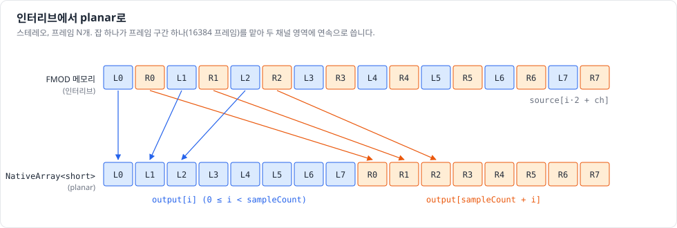

# 4. 클립 생성과 데이터: `WaveAudioClip`

> 기준 커밋: `3a2b24b9`. [← 목차](README.md) · 이전: [3. 스레드와 잠금](03-threads-and-locks.md) · 다음: [5. SoundChannel과 그룹](05-channel.md)

[`WaveAudioClip`](../Runtime/Sounds/WaveAudioClip.cs#L7)은 FMOD `Sound` 하나의 래퍼이고, Sound 패키지의 `IAudioClip`을 구현합니다. 클립은 소리 데이터일 뿐이고 재생은 [채널](05-channel.md)이 합니다.
이 장은 클립을 만드는 다섯 경로, 스트림을 관리 `Stream`에서 읽게 하는 파일 콜백, 그리고 파형 표시에 쓰는 PCM 데이터 읽기를 다룹니다.

- [4. 클립 생성과 데이터: `WaveAudioClip`](#4-클립-생성과-데이터-waveaudioclip)
  - [4.1 생성 경로 한눈에](#41-생성-경로-한눈에)
  - [4.2 `CreateSound`와 `CreatePCM`](#42-createsound와-createpcm)
  - [4.3 `CreateStream`: NONBLOCKING으로 열고 기다리기](#43-createstream-nonblocking으로-열고-기다리기)
  - [4.4 비동기 생성](#44-비동기-생성)
  - [4.5 `SoundFileStream`: 파일 콜백](#45-soundfilestream-파일-콜백)
  - [4.6 생성자와 속성](#46-생성자와-속성)
  - [4.7 해제](#47-해제)
  - [4.8 PCM 데이터 읽기](#48-pcm-데이터-읽기)
  - [4.9 `CreatePlanarSamples`: 파형용 planar 변환](#49-createplanarsamples-파형용-planar-변환)

---

## 4.1 생성 경로 한눈에

| API | 입력 | FMOD 모드 | 메모리에 남는 것 |
| --- | --- | --- | --- |
| [`CreateSound(PhysicalPath, keepCompressed)`](../Runtime/Sounds/SoundSystem.CreateSound.cs#L11) | 파일 경로 | `CREATESAMPLE` 또는 `CREATECOMPRESSEDSAMPLE` | 디코딩된 PCM 또는 압축 데이터 |
| [`CreateSound(byte[], keepCompressed)`](../Runtime/Sounds/SoundSystem.CreateSound.cs#L26) | 인코딩된 바이트 | 위 + `OPENMEMORY` | 위와 같음 (FMOD가 복사) |
| [`CreateSound(Stream, keepCompressed)`](../Runtime/Sounds/SoundSystem.CreateSound.cs#L41) | `Stream` | 끝까지 읽어 `byte[]` 경로로 | 위와 같음 |
| [`CreatePCM(byte[], channel, frequency, format)`](../Runtime/Sounds/SoundSystem.CreatePCM.cs#L9) | raw PCM | `OPENMEMORY` · `OPENRAW` · `CREATESAMPLE` | PCM |
| [`CreateStream(PhysicalPath)`](../Runtime/Sounds/SoundSystem.CreateStream.cs#L12) | 파일 경로 | `CREATESTREAM` · `NONBLOCKING` | 디코딩 버퍼만. 재생하면서 파일을 읽음 |
| [`CreateStream(Stream, leaveOpen)`](../Runtime/Sounds/SoundSystem.CreateStream.cs#L66) | 탐색 가능한 `Stream` | 위 + 사용자 파일 콜백 | 위와 같음 |

모든 경로가 `MODE._3D`를 붙입니다. 3D 속성을 쓸 수 있게 열어 두고, 실제로 얼마나 3D로 들리게 할지는 채널의 `spatialBlend`가 정합니다([5장](05-channel.md#51-playsound)에서 새 채널은 0, 즉 2D로 시작합니다).

모든 동기 API는 시스템 읽기 잠금을 잡고 `Active`인지 확인한 뒤, 이름이 `…Unsafe`인 내부 메서드를 부릅니다. `…Unsafe`는 **호출자가 시스템 읽기 잠금을 들고 상태를 확인했다**는 전제로 동작합니다.

## 4.2 `CreateSound`와 `CreatePCM`

```csharp
// Runtime/Sounds/SoundSystem.CreateSound.cs
64  WaveAudioClip CreateSoundUnsafe(byte[] data, bool keepCompressed)
    {
66      CREATESOUNDEXINFO exInfo = new()
        {
68          cbsize = Marshal.SizeOf<CREATESOUNDEXINFO>(),
69          length = checked((uint)data.Length)                             // ①
        };
72      MODE mode = MODE.OPENMEMORY | (keepCompressed ? MODE.CREATECOMPRESSEDSAMPLE : MODE.CREATESAMPLE);   // ②
73      native.createSound(data, mode | MODE._3D, ref exInfo, out Sound sound).ThrowIfNotOk();
75      return WaveAudioClip.Unsafe.CreateInstance(this, sound);           // ③
    }
```

1. ① FMOD의 길이 필드는 32비트이므로 4 GiB를 넘는 배열은 `OverflowException`이 됩니다.
2. ② `keepCompressed`이면 FMOD가 압축된 채로 들고 있다가 재생할 때 디코딩합니다. 메모리는 줄지만 [§4.8](#48-pcm-데이터-읽기)의 PCM 읽기를 할 수 없습니다.
3. ③ 래퍼를 만들면 시스템에 등록됩니다([2장](02-resource-ownership.md#22-등록-register)).

`CreateSound(Stream)`은 시스템 읽기 잠금을 든 채 `stream.ReadToEnd()`로 전부 읽습니다. 읽기가 오래 걸리면 그동안 `Reset`/`Dispose`가 기다리므로, 비동기 경로([§4.4](#44-비동기-생성))는 잠금 밖에서 먼저 다 읽습니다.

`CreatePCM`은 `OPENRAW`로 헤더 없는 PCM을 받습니다. 채널 수와 주파수가 0 이하이면 잠금 전에 `ArgumentOutOfRangeException`을 던집니다([`ThrowIfInvalidPCMFormat`](../Runtime/Sounds/SoundSystem.CreatePCM.cs#L25)). `PCMFormat`은 FMOD `SOUND_FORMAT`의 PCM 값 다섯 개(`PCM8`, `PCM16`, `PCM24`, `PCM32`, `Float`)만 담은 열거형입니다([`PCMFormat.cs`](../Runtime/Sounds/PCMFormat.cs#L10)).

## 4.3 `CreateStream`: NONBLOCKING으로 열고 기다리기

```csharp
// Runtime/Sounds/SoundSystem.CreateStream.cs
83  WaveAudioClip CreateStreamUnsafe(string path)
    {
85      Sound sound = default;
87      try
        {
89          native.createStream(path, MODE._3D | MODE.NONBLOCKING, out sound).ThrowIfNotOk();   // ①
91          while (true)
            {
93              sound.getOpenState(out OPENSTATE state, out _, out _, out _).ThrowIfNotOk();
95              if (state == OPENSTATE.READY)
96                  return WaveAudioClip.Unsafe.CreateInstance(this, sound);                    // ②
98              if (state == OPENSTATE.ERROR)
99                  throw new InvalidOperationException("FMOD failed to open the stream.");
101             Thread.Sleep(1);                                                                // ③
            }
        }
104     catch
        {
106         if (sound.hasHandle())
107             sound.release().LogErrorIfNotOk();                                              // ④
109         throw;
        }
    }
```

1. ① `NONBLOCKING`으로 엽니다. FMOD는 바로 돌아오고 실제 열기는 FMOD의 비동기 스레드가 합니다.
2. ② 그런데 이 메서드는 `READY`가 될 때까지 기다린 뒤에 래퍼를 만듭니다. 즉 **API 자체는 동기**입니다. NONBLOCKING을 쓰는 이유는 열기가 아니라 그 뒤의 탐색 때문입니다. FMOD 문서는 스트림에서 위치를 바꾸면 버퍼를 다시 채우느라 멈출 수 있고, NONBLOCKING으로 만든 스트림은 그 대신 `SETPOSITION` 상태로 가며 그동안 Sound 명령이 `ERR_NOTREADY`를 돌려준다고 설명합니다([Channel::setPosition](https://www.fmod.com/docs/2.03/api/core-api-channel.html#channel_setposition)). 그래서 이 래퍼의 채널은 `ERR_NOTREADY`를 받으면 위치 지정을 미뤄 두고 다시 시도합니다([5장](05-channel.md#55-위치-timesample과-time)).
3. ③ 1 ms씩 기다리며 폴링합니다. 시스템 읽기 잠금을 든 채 기다리므로, 이 동안 `Reset`/`Dispose`는 기다립니다.
4. ④ 실패하면 만들다 만 Sound를 해제합니다.

`CreateStreamUnsafe(SoundFileStream)`([`#L113`](../Runtime/Sounds/SoundSystem.CreateStream.cs#L113))는 같은 흐름에, 이름 대신 `"stream"`과 [§4.5](#45-soundfilestream-파일-콜백)의 콜백이 든 `CREATESOUNDEXINFO`를 넘기고, 래퍼에 `streamFile`을 `nativeLifetime`으로 줍니다.

```csharp
// Runtime/Sounds/SoundSystem.CreateStream.cs
66  public WaveAudioClip CreateStream(Stream stream, bool leaveOpen = false)
    {
68      SoundFileStream streamFile = new(stream, leaveOpen);
69      nativeLock.EnterReadLock();
71      try
        {
73          ThrowIfUnavailableUnsafe();
74          return CreateStreamUnsafe(streamFile);
        }
76      finally
        {
78          nativeLock.ExitReadLock();
79          streamFile.Dispose();
        }
    }
```

## 4.4 비동기 생성

| API | 잠금 밖에서 하는 일 | 스레드 풀에서 부르는 동기 API |
| --- | --- | --- |
| `CreateSoundAsync(PhysicalPath)` | 없음 | `CreateSound(path)` |
| `CreateSoundAsync(IONode)` | 물리 경로가 있으면 위로, 없으면 `ReadAllBytes` | `CreateSound(path)` / `CreateSound(byte[])` |
| `CreateSoundAsync(Stream)` | `ReadToEndAsync` | `CreateSound(byte[])` |
| `CreateSoundAsync(byte[])` | 없음 | `CreateSound(byte[])` |
| `CreatePCMAsync` | 인자 검사 | `CreatePCM` |
| `CreateStreamAsync(PhysicalPath)` | 없음 | `CreateStream(path)` |
| `CreateStreamAsync(IONode)` | 물리 경로가 있으면 위로, 없으면 `OpenRead` | `CreateStream(path)` / `CreateStream(stream)` |
| `CreateStreamAsync(Stream, leaveOpen)` | 없음 | `CreateStream(stream, leaveOpen)` |

```csharp
// Runtime/Sounds/SoundSystem.CreateSoundAsync.cs
20  public async UniTask<WaveAudioClip?> CreateSoundAsync(IONode node, bool keepCompressed = false)
    {
22      ThrowIfSystemLockHeld();
24      if (node.provider is IPhysicalBackedIOProvider physicalProvider)                        // ①
25          return await CreateSoundAsync(physicalProvider.GetPhysicalPath(node.path), keepCompressed);
        else
        {
28          byte[] data = await node.file.ReadAllBytes();                                        // ②
29          return await CreateSoundAsync(data, keepCompressed);
        }
    }
```

1. ① 실제 디스크 파일이 뒤에 있는 IO 공급자면 경로를 FMOD에 그대로 줍니다. FMOD가 직접 파일을 읽으므로 관리 메모리에 사본을 만들지 않습니다.
2. ② 아니면(팩 안의 항목 등) 바이트를 먼저 비동기로 다 읽은 뒤 메모리에서 만듭니다. 이 읽기는 시스템 잠금 밖에서 일어납니다.

공통 계약은 [3장 §3.5](03-threads-and-locks.md#35-비동기-api와-잠금-검사)에 있습니다. 시스템이 `Active`가 아니면 결과가 `null`입니다.

## 4.5 `SoundFileStream`: 파일 콜백

[`SoundFileStream`](../Runtime/Sounds/Streams/SoundFileStream.cs#L9)은 FMOD가 관리 `Stream`을 파일처럼 읽게 하는 내부 어댑터입니다.

```csharp
// Runtime/Sounds/Streams/SoundFileStream.cs
11  static readonly FILE_OPEN_CALLBACK openCallback = Open;                    // ①
12  static readonly FILE_CLOSE_CALLBACK closeCallback = Close;
13  static readonly FILE_READ_CALLBACK readCallback = Read;
14  static readonly FILE_SEEK_CALLBACK seekCallback = Seek;

25  public SoundFileStream(Stream stream, bool leaveOpen)
    {
        …                                                                       // ② 읽기·탐색 가능, 남은 길이 ≤ uint.MaxValue 검사
35      long offset = stream.Position;
36      long length = stream.Length - offset;
        …
45      handle = GCHandle.Alloc(this);                                          // ③
    }

48  public CREATESOUNDEXINFO CreateExInfo() => new()
    {
        …
55      fileuserdata = GCHandle.ToIntPtr(handle)
    };

125 RESULT Open(ref uint fileSize, ref IntPtr fileHandle)
    {
127     lock (streamLock)
        {
129         ThrowIfDisposed();
130         stream.Position = offset;                                           // ④
131         fileSize = length;
132         fileHandle = GCHandle.ToIntPtr(handle);
133         return RESULT.OK;
        }
    }

138 RESULT Read(IntPtr buffer, uint sizeBytes, ref uint bytesRead)
    {
        …
143     lock (streamLock)
        {
145         ThrowIfDisposed();
147         int requested = (int)sizeBytes;
148         byte[] bytes = ArrayPool<byte>.Shared.Rent(requested);              // ⑤
150         try
            {
152             int totalBytesRead = stream.ReadAtLeast(bytes.AsSpan(0, requested), requested, throwOnEndOfStream: false);
154             if (totalBytesRead > 0)
155                 Marshal.Copy(bytes, 0, buffer, totalBytesRead);
157             bytesRead = (uint)totalBytesRead;
158             return totalBytesRead == requested ? RESULT.OK : RESULT.ERR_FILE_EOF;   // ⑥
            }
            …
        }
    }
```

1. ① 델리게이트를 정적 필드에 두어 네이티브 썽크가 GC되지 않게 합니다.
2. ② FMOD는 탐색을 하고 32비트 파일 크기를 받으므로 그 조건을 생성 시점에 확인합니다.
3. ③ `GCHandle`로 자신을 고정 참조하고 그 포인터를 `fileuserdata`와 `fileHandle`로 씁니다. 정적 콜백은 이 포인터로 인스턴스를 찾습니다([`Get`](../Runtime/Sounds/Streams/SoundFileStream.cs#L116)).
4. ④ 생성 시점의 위치를 파일의 0바이트로 봅니다. 스트림 중간부터 시작하는 오디오도 읽을 수 있습니다.
5. ⑤ FMOD가 넘긴 포인터에 쓰기 전에 풀링된 배열에 읽습니다. 블록마다 할당하지 않습니다.
6. ⑥ 요청보다 적게 읽혔으면 `ERR_FILE_EOF`입니다. FMOD가 파일 끝을 알게 됩니다.

정적 콜백([`#L75`](../Runtime/Sounds/Streams/SoundFileStream.cs#L75)~)은 모든 예외를 잡아 FMOD 오류 코드로 바꿉니다. 네이티브 스레드로 관리 예외가 새면 프로세스가 죽기 때문입니다. `Close` 콜백은 아무것도 하지 않습니다. 실제 정리는 `Dispose()`가 하며, `GCHandle`을 풀고 `leaveOpen == false`면 `stream`을 닫습니다. 이 콜백들은 FMOD의 파일·스트림 스레드에서 불리므로 관리 `Stream`의 위치를 `streamLock`으로 보호합니다.

## 4.6 생성자와 속성

```csharp
// Runtime/Sounds/WaveAudioClip.cs
14  WaveAudioClip(SoundSystem system, Sound sound, IDisposable? nativeLifetime = null)
    {
16      this.system = system;
18      native = sound;
19      this.nativeLifetime = nativeLifetime;                               // ①
21      system.Register(this);
23      sound.getName(out string name, 1024).ThrowIfNotOk();               // ②
24      this.name = name;
26      sound.getDefaults(out float frequency, out _).ThrowIfNotOk();
27      this.frequency = frequency;
29      sound.getFormat(out SOUND_TYPE type, out SOUND_FORMAT format, out int channel, out int bits).ThrowIfNotOk();
30      this.type = (SoundType)type;
31      this.channel = channel;
32      this.bits = bits;
33      pcmFormat = format.ToPCMFormat();                                   // ③
35      sound.getMode(out MODE mode).ThrowIfNotOk();
36      isStream = mode.HasFlag(MODE.CREATESTREAM);
38      keepCompressed = format == SOUND_FORMAT.BITSTREAM;                  // ④
40      sound.getLength(out uint samples, TIMEUNIT.PCM).ThrowIfNotOk();
41      this.samples = samples;
43      length = samples / frequency;
        …
    }
```

1. ① 클립과 함께 끝나야 하는 다른 객체(스트림 어댑터)를 맡깁니다. 해제할 때 함께 정리합니다([§4.7](#47-해제)).
2. ② 바뀌지 않는 정보는 생성 시 한 번 읽어 필드에 둡니다. 이 속성들은 잠금 없이 읽힙니다.
3. ③ PCM이 아닌 형식(압축 비트스트림 등)이면 `null`입니다.
4. ④ `CREATECOMPRESSEDSAMPLE`로 만든 Sound는 형식이 `BITSTREAM`으로 보고됩니다.

바뀔 수 있는 속성(`priority`, 3D 최소·최대 거리, 원뿔, `loopCount`, 루프 지점, `userData`, 트래커 음악 속성, `openStates`)은 모두 `UseNative` 한 번으로 FMOD를 읽고 씁니다([`WaveAudioClip.Properties.cs`](../Runtime/Sounds/WaveAudioClip.Properties.cs#L12), [`WaveAudioClip.Music.cs`](../Runtime/Sounds/WaveAudioClip.Music.cs#L6)). 두 값을 한 쌍으로 설정하는 FMOD 함수(최소·최대 거리 등)는 다른 값을 먼저 읽어 그대로 넘깁니다. 이 속성들은 클립의 **기본값**입니다. 이미 재생 중인 채널에는 영향을 주지 않을 수 있습니다.

## 4.7 해제

```csharp
// Runtime/Sounds/WaveAudioClip.cs
94  public void Dispose() => system.Dispose(this);

98  void ISoundSystemResource.ReleaseUnmanagedResources()
    {
100     nativeLock.EnterWriteLock();                                        // ①
101     IDisposable? lifetime;
103     try
        {
105         if (_isDisposed)
106             return;
108         RESULT result = native.release();
110         if (result != RESULT.OK && result != RESULT.ERR_INVALID_HANDLE)  // ②
111             result.ThrowIfNotOk();
113         _isDisposed = true;
115         lifetime = nativeLifetime;
116         nativeLifetime = null;
        }
118     finally
        {
120         nativeLock.ExitWriteLock();
        }
123     try
        {
125         lifetime?.Dispose();                                            // ③
        }
127     catch (Exception exception)
        {
129         Debug.LogException(exception);
        }
    }
```

1. ① 진행 중인 `UseNative`가 끝나기를 기다립니다([2장 §2.6](02-resource-ownership.md#26-리소스-종류별-구현)).
2. ② 핸들이 이미 무효면 해제된 것으로 봅니다. 다른 오류면 `_isDisposed`를 세우지 않고 던지므로, [2장 §2.3](02-resource-ownership.md#23-직접-해제-disposeresource) ⑤의 소유권 복구와 함께 다시 시도할 수 있습니다.
3. ③ `Sound`를 놓은 **뒤에** 스트림을 닫습니다. FMOD가 더 이상 파일 콜백을 부르지 않는 시점입니다.

## 4.8 PCM 데이터 읽기

[`GetData`](../Runtime/Sounds/WaveAudioClip.Data.cs#L32)와 [`GetRawData`](../Runtime/Sounds/WaveAudioClip.Data.cs#L84)는 `Sound::lock`으로 FMOD가 가진 샘플 메모리를 잠깐 빌려 콜백에 넘깁니다.

```csharp
// Runtime/Sounds/WaveAudioClip.Data.cs
32  public void GetData(uint offset, uint length, GetDataAction action)
    {
        …
36      if (isStream)                                                       // ①
37          throw new InvalidOperationException("FMOD stream sound data cannot be locked.");
39      if (keepCompressed)
40          throw new InvalidOperationException("Compressed FMOD sound data cannot be converted to PCM samples.");
        …
45      ulong totalSampleCount = (ulong)samples * (uint)channel;           // ②
46      if ((ulong)offset + length > totalSampleCount)
47          throw new ArgumentOutOfRangeException(nameof(length), length, "The requested sample range exceeds the clip data.");
49      nativeLock.EnterReadLock();
        try
        {
52          ThrowIfDisposedUnsafe();
            …
60          int bytesPerSample = bits / 8;
61          uint byteOffset = checked(offset * (uint)bytesPerSample);
62          uint byteLength = checked(length * (uint)bytesPerSample);
64          native.@lock(byteOffset, byteLength, out IntPtr ptr1, out IntPtr ptr2, out uint len1, out uint len2).ThrowIfNotOk();
65          try
            {
                …
69                  ReadOnlySpan<byte> source = new(ptr1.ToPointer(), checked((int)len1));
70                  action.Invoke(new PCMDoubleView(source, pcmFormat!.Value), channel);   // ③
            }
73          finally
            {
75              native.unlock(ptr1, ptr2, len1, len2).ThrowIfNotOk();
            }
        }
        …
    }
```

1. ① 스트림은 메모리에 전체 데이터가 없고, 압축 샘플은 PCM이 아니므로 잠글 수 없습니다.
2. ② `offset`과 `length`의 단위는 **인터리브된 개별 샘플**(프레임 × 채널)입니다.
3. ③ 콜백은 FMOD 메모리를 직접 봅니다. `ReadOnlySpan`과 `ref struct`라서 콜백 밖으로 가지고 나갈 수 없고, 콜백이 끝나면 `unlock`합니다.

[`PCMDoubleView`](../Runtime/Sounds/PCMDoubleView.cs#L6)는 바이트를 포맷에 맞게 해석해 `double`로 돌려주는 `ref struct`입니다.

| 포맷 | 해석 | 나누는 값 |
| --- | --- | --- |
| `PCM8` | 부호 있는 8비트 | 128 |
| `PCM16` | 리틀 엔디언 16비트 | 32768 |
| `PCM24` | 리틀 엔디언 24비트, 부호 확장 | 8388608 |
| `PCM32` | 리틀 엔디언 32비트 | 2147483648 |
| `Float` | `float` 그대로 (나누지 않음) | — |

`ReadData`/`SeekData`([`#L136`](../Runtime/Sounds/WaveAudioClip.Data.cs#L136))는 `Sound::readData`의 얇은 래퍼입니다.

## 4.9 `CreatePlanarSamples`: 파형용 planar 변환

Sound 패키지의 파형(`Waveform`)은 채널마다 연속으로 놓인 `short` 배열(planar)을 받습니다. FMOD 데이터는 채널이 번갈아 놓인 인터리브 형식이므로 전치가 필요합니다.



```csharp
// Runtime/Sounds/WaveAudioClip.PlanarSamples.cs
17  public unsafe NativeArray<short> CreatePlanarSamples(Allocator allocator)
    {
19      int sampleCount = checked((int)samples);
20      NativeArray<short> output = new NativeArray<short>(checked(sampleCount * channel), allocator, NativeArrayOptions.UninitializedMemory);
22      try
        {
24          GetRawData(0, (uint)output.Length, (source, channelCount) =>
            {
                …                                                                   // ① 채널 수와 바이트 길이 검사
37              fixed (byte* pointer = source)
                {
39                  int chunkCount = ((sampleCount + planarChunkSize) - 1) / planarChunkSize;   // ②
40                  JobHandle handle = pcmFormat!.Value switch
                    {
43                      PCMFormat.PCM8 => new PCM8PlanarJob { … }.Schedule(chunkCount, 1),
44                      PCMFormat.PCM16 => new PCM16PlanarJob { … }.Schedule(chunkCount, 1),
                        …
48                      _ => throw new InvalidOperationException($"FMOD returned unsupported sample format {pcmFormat}.")
                    };
52                  // FMOD lock이 풀리기 전에 원본 포인터 사용을 끝내야 합니다.
53                  handle.Complete();                                              // ③
                }
            });
        }
57      catch
        {
59          output.Dispose();
60          throw;
        }
63      return output;
    }
```

1. ① 잡이 원본을 포인터로 읽으므로, FMOD가 돌려준 메모리가 출력 전체를 채울 만큼인지 스케줄 전에 확인합니다.
2. ② 프레임 16384개를 한 묶음으로 병렬 처리합니다.
3. ③ `GetRawData` 콜백이 끝나면 FMOD 잠금이 풀리므로, 그 전에 잡을 끝까지 기다립니다.

다섯 포맷의 잡은 같은 구조입니다. 파일의 주석([`#L66`](../Runtime/Sounds/WaveAudioClip.PlanarSamples.cs#L66))이 Burst 벡터화를 위한 선택을 설명합니다.

- 잡의 `Execute` 하나가 프레임 구간 하나를 맡고, 샘플 루프는 잡 코드 안에 둡니다. 그래야 Burst가 그 루프를 벡터화합니다.
- 채널을 바깥 루프에 두어 쓰기를 연속으로 만듭니다.
- 스테레오는 읽기 간격이 상수 2인 경로를 따로 둡니다. 런타임 간격으로는 벡터화되지 않기 때문입니다. 인덱스 곱 대신 포인터를 전진시켜 32비트 곱셈 오버플로 가능성 때문에 연속 접근 증명이 실패하는 일을 피합니다.

| 포맷 | `short` 변환 |
| --- | --- |
| `PCM8` | `(sbyte)v << 8` |
| `PCM16` | 그대로 |
| `PCM24` | 상위 2바이트 (`b[1] \| b[2] << 8`) |
| `PCM32` | `v >> 16` |
| `Float` | `v × 32768`을 `short` 범위로 자름 |
