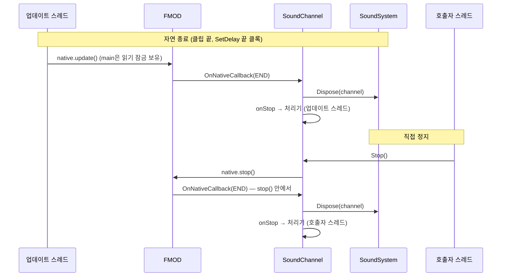

# 5. `SoundChannel`과 그룹

> 기준 커밋: `3a2b24b9`. [← 목차](README.md) · 이전: [4. 클립 생성과 데이터](04-clip-creation.md) · 다음: [6. DSP 클록과 믹스 스탬프](06-dsp-clock-and-mix-stamp.md)

[`SoundChannel`](../Runtime/Sounds/SoundChannel.cs#L20)은 클립을 **한 번** 재생하는 세션입니다. Unity의 `AudioSource`처럼 다시 쓰는 객체가 아닙니다. 재생이 끝나거나 멈추면 그 채널은 끝나고, 다시 재생하려면 `PlaySound`로 새 채널을 만듭니다.
이 장은 채널이 만들어지는 순서, 끝날 때의 콜백, 위치와 루프, 그리고 채널을 묶는 [`SoundChannelGroup`](../Runtime/Sounds/SoundChannelGroup.cs#L15)을 다룹니다. DSP 클록으로 시작·정지를 예약하는 `SetDelay`는 [6장](06-dsp-clock-and-mix-stamp.md#62-setdelay-클록으로-시작정지-예약)에 있습니다.

- [5.1 `PlaySound`](#51-playsound)
- [5.2 생성자](#52-생성자)
- [5.3 종료 콜백과 `onStop`](#53-종료-콜백과-onstop)
- [5.4 잠금](#54-잠금)
- [5.5 위치: `timeSample`과 `time`](#55-위치-timesample과-time)
- [5.6 위치 정규화와 루프](#56-위치-정규화와-루프)
- [5.7 클록과 페이드 포인트](#57-클록과-페이드-포인트)
- [5.8 믹싱과 3D 속성](#58-믹싱과-3d-속성)
- [5.9 채널의 DSP 체인](#59-채널의-dsp-체인)
- [5.10 `SoundChannelGroup`](#510-soundchannelgroup)

---

## 5.1 `PlaySound`

```csharp
// Runtime/Sounds/SoundSystem.Play.cs
36  public SoundChannel PlaySound(WaveAudioClip clip, bool paused = false)
    {
38      ValidatePlayableClip(clip);                                              // ①
39      return PlaySoundUnsafe(clip, default, paused);
    }

74  public SoundChannel PlaySound(WaveAudioClip clip, SoundChannelGroup group, bool paused = false)
    {
76      ValidatePlayableClip(clip);
78      ArgumentNullException.ThrowIfNull(group);
80      return group.UseNative(channelGroup => PlaySoundUnsafe(clip, channelGroup, paused));   // ②
    }

91  SoundChannel PlaySoundUnsafe(WaveAudioClip clip, ChannelGroup channelGroup, bool paused)
    {
93      nativeLock.EnterReadLock();
95      try
        {
97          ThrowIfUnavailableUnsafe();
98          return clip.UseNative(sound =>                                          // ③
            {
100             native.playSound(sound, channelGroup, true, out Channel channel).ThrowIfNotOk();   // ④
102             SoundChannel? soundChannel = null;
104             try
                {
106                 soundChannel = new SoundChannel(this, channel, clip) { spatialBlend = 0 };    // ⑤
107                 if (!paused)
108                     channel.setPaused(false).ThrowIfNotOkOfChannel();                       // ⑥
110                 return soundChannel;
                }
112             catch
                {
114                 if (soundChannel != null)
                    {
116                     try
                        {
118                         soundChannel.Stop();                                                // ⑦
                        }
120                     catch (Exception e)
                        {
122                         Debug.LogException(e);
                        }
                    }
                    else
                    {
127                     channel.stop().LogErrorIfNotOk();
128                     channel.clearHandle();
                    }
131                 throw;
                }
            });
        }
135     finally
        {
137         nativeLock.ExitReadLock();
        }
    }
```

1. ① 클립이 `null`이거나 다른 시스템의 것이면 바로 예외입니다. 한 시스템의 Sound는 다른 시스템에서 재생할 수 없습니다.
2. ② 그룹을 줬으면 그룹의 읽기 잠금 아래에서 진행합니다. 재생 중에 그룹이 해제되지 않습니다. `default`(그룹 없음)는 FMOD가 마스터 그룹으로 보냅니다.
3. ③ 클립의 읽기 잠금을 잡아 재생하는 동안 클립이 해제되지 않게 합니다.
4. ④ `paused` 인자와 관계없이 **항상 일시 정지 상태로** 채널을 만듭니다. 래퍼를 만들고 속성을 정하는 동안 소리가 새어 나가지 않습니다.
5. ⑤ 래퍼를 만들고 `spatialBlend`를 0(2D)으로 둡니다. 클립은 `_3D` 모드로 만들어지므로([4장](04-clip-creation.md#41-생성-경로-한눈에)), 3D로 들리게 하려면 호출자가 값을 올립니다.
6. ⑥ 일시 정지로 요청하지 않았을 때만 재개합니다. `paused: true`로 받아 위치·속도·`SetDelay`를 정한 뒤 `UnPause()`하는 것이 샘플 정확 재생의 기본 순서입니다([6장](06-dsp-clock-and-mix-stamp.md#62-setdelay-클록으로-시작정지-예약)).
7. ⑦ 래퍼 생성 뒤에 실패하면 래퍼로 정지해 종료 콜백과 등록 해제가 정상 경로를 타게 합니다. 래퍼 생성 전에 실패했으면 네이티브 채널만 멈춥니다.

## 5.2 생성자

```csharp
// Runtime/Sounds/SoundChannel.cs
22  static readonly ConcurrentDictionary<IntPtr, SoundChannel> channelLists = [];
23  static readonly CHANNELCONTROL_CALLBACK nativeCallback = OnNativeCallback;          // ①

25  internal SoundChannel(SoundSystem system, Channel channel, WaveAudioClip clip)
    {
27      this.system = system;
28      this.clip = clip;
30      native = channel;
32      dsps = new DSP(this);
33      reverbWetLevel = new ReverbWetLevel(this);
35      RESULT callbackResult = channel.setCallback(nativeCallback);
36      if (callbackResult == RESULT.ERR_INVALID_HANDLE)                                 // ②
        {
38          _isDisposed = 1;
39          native = default;
40          return;
        }
43      callbackResult.ThrowIfNotOk();
45      channelLists[native.handle] = this;                                              // ③
46      system.Register(this);
    }
```

1. ① 콜백 델리게이트는 모든 채널이 공유하는 정적 필드입니다. 네이티브 썽크가 GC되지 않습니다.
2. ② 콜백을 거는 시점에 이미 채널 핸들이 무효인 경우입니다. 등록하지 않고 해제된 래퍼로 남깁니다. 이 래퍼의 속성 접근은 `ObjectDisposedException`이 됩니다.
3. ③ 네이티브 핸들 → 래퍼 표입니다. FMOD 콜백은 핸들만 넘겨주므로 이 표로 래퍼를 찾습니다([`GetManaged`](../Runtime/Sounds/SoundChannel.cs#L104)).

`native`는 공개 속성입니다. 래핑되지 않은 `FMOD.Channel` 기능은 이 핸들로 직접 부릅니다. 채널은 `UseNative`를 두지 않습니다([§5.4](#54-잠금)).

## 5.3 종료 콜백과 `onStop`

```csharp
// Runtime/Sounds/SoundChannel.cs
106 void ISoundSystemResource.ReleaseUnmanagedResources() => Stop();

109 static RESULT OnNativeCallback(IntPtr channelControl, CHANNELCONTROL_TYPE controlType, CHANNELCONTROL_CALLBACK_TYPE callbackType, IntPtr commandData1, IntPtr commandData2)
    {
118     if (controlType != CHANNELCONTROL_TYPE.CHANNEL || callbackType != CHANNELCONTROL_CALLBACK_TYPE.END)   // ①
119         return RESULT.OK;
121     SoundChannel? channel = GetManaged(channelControl);
122     if (channel == null)
123         return RESULT.OK;
125     channelLists.TryRemove(channel.native.handle, out _);                           // ②
126     pendingTimeSampleChannels.TryRemove(channel, out _);
128     if (Interlocked.CompareExchange(ref channel._isDisposed, 1, 0) != 0)            // ③
129         return RESULT.OK;
131     channel.system.Dispose(channel);                                                // ④
133     Action<SoundChannel>? handlers;
134     lock (channel.onStopLock)
135         handlers = channel._onStop;
137     handlers.SafeInvoke(channel);                                                   // ⑤
138     return RESULT.OK;
    }

713 public void Stop()
    {
715     RESULT result = native.stop();                                                   // ⑥
716     if (result == RESULT.ERR_INVALID_HANDLE || result == RESULT.ERR_CHANNEL_STOLEN)
717         return;
719     result.LogErrorIfNotOk();
    }
```

1. ① 재생이 끝났다는(`END`) 채널 콜백만 처리합니다. 가상 채널 전환 등 다른 콜백은 무시합니다.
2. ② 핸들 표와 [§5.5](#55-위치-timesample과-time)의 보류 목록에서 지웁니다.
3. ③ `_isDisposed`를 0 → 1로 바꾼 호출 하나만 계속합니다. 같은 채널의 `END`가 두 번 오더라도 `onStop`은 한 번입니다.
4. ④ 시스템 소유 목록에서 뺍니다. 이 호출의 `ReleaseUnmanagedResources`는 `Stop()`이고, 이미 끝난 채널이라 `native.stop()`은 무효 핸들로 조용히 돌아옵니다. 시스템이 `Reset`/`Dispose` 중이면 ④는 아무것도 하지 않습니다(시스템이 이미 목록을 넘겨받음).
5. ⑤ `onStop` 처리기를 부릅니다. 처리기마다 예외를 잡아 기록합니다.
6. ⑥ `Stop()`은 네이티브 정지만 합니다. FMOD는 정지한 채널의 `END` 콜백을 `stop()` 안에서 부르므로 **①~⑤가 `Stop()`을 부른 스레드에서 즉시 실행됩니다.** 이미 끝났거나 빼앗긴 채널이면 아무것도 하지 않습니다.

`onStop`이 어느 스레드에서 오는지는 끝난 방식에 따라 다릅니다.



그래서 `onStop` 처리기는 호출 스레드를 가정하지 않아야 합니다. 직접 `Stop()`하는 쪽이 자기 처리기를 원하지 않으면 정지 **전에** 구독을 끊습니다. [`WaveAudioSource.StopChannel`](08-wave-audio-source.md#86-채널-정지와-상실)이 그렇게 합니다.

`SoundChannel`에는 `Dispose()`가 없습니다. 채널을 끝내는 공개 방법은 `Stop()`이고, 시스템 등록 해제는 종료 콜백이 합니다.

## 5.4 잠금

채널의 잠금은 **여러 FMOD 호출을 묶어야 하는 읽기-수정-쓰기**만 보호합니다. FMOD 호출 하나로 끝나는 속성은 잠그지 않고 FMOD에 맡깁니다. 시스템 `nativeLock`도 잡지 않습니다. 채널 핸들이 무효가 되면(재생 끝, 빼앗김, 시스템 해제) FMOD가 `ERR_INVALID_HANDLE`/`ERR_CHANNEL_STOLEN`을 돌려주고, [`ThrowIfNotOkOfChannel`](../Runtime/Sounds/SoundUtility.cs#L15)이 이를 `ObjectDisposedException`으로 바꿉니다.

| 잠금 | 보호하는 멤버 |
| --- | --- |
| [`playbackLock`](../Runtime/Sounds/SoundChannel.Playback.cs#L12) | `frequency`, `timeSample`, `time`, 보류 위치, `loop`, `loopCount`, 루프 지점 속성들, 페이드 포인트 |
| [`modeLock`](../Runtime/Sounds/SoundChannel.cs#L70) | `MODE` 플래그 읽기·쓰기 (`loop`, `rolloffMode`, 위치 정규화) |
| [`spatialLock`](../Runtime/Sounds/SoundChannel.Spatial.cs#L11) | 최소·최대 거리, `rolloffMode` |
| [`mixingLock`](../Runtime/Sounds/SoundChannel.Mixing.cs#L9) | 믹스 행렬 |
| [`dsps` 의 `dspLock`](../Runtime/Sounds/SoundChannel.DSP.cs#L14) | DSP 체인 조회·추가·제거 |
| [`onStopLock`](../Runtime/Sounds/SoundChannel.cs#L102) | `onStop` 구독 |
| 없음 | `volume`, `pitch`, `mute`, `isPaused`, `priority`, `spatialState`, `spatialBlend`, `GetDSPClock`, `SetDelay` 등 단일 호출 |

이 잠금들은 재귀를 허용하지 않는 `ReaderWriterLockSlim`입니다. 잡는 순서는 `playbackLock` → `modeLock`, `spatialLock` → `modeLock`입니다.

## 5.5 위치: `timeSample`과 `time`

```csharp
// Runtime/Sounds/SoundChannel.Playback.cs
178 public double time
    {
        get
        {
182         playbackLock.EnterReadLock();
184         try
            {
186             native.getPosition(out uint sample, TIMEUNIT.PCM).ThrowIfNotOkOfChannel();
187             return sample / GetTimeFrequencyUnsafe().Abs();                         // ①
            }
            …
        }
        set
        {
196         playbackLock.EnterWriteLock();
198         try
            {
200             SetTimeSampleUnsafe(value * GetTimeFrequencyUnsafe().Abs());
            }
            …
        }
    }

209 float GetTimeFrequencyUnsafe()
    {
211     if (clip != null)
212         return clip.frequency;                                                     // ②
214     native.getFrequency(out float frequency).ThrowIfNotOkOfChannel();
215     return frequency;
    }
```

1. ① 위치의 단위는 **클립의 PCM 샘플**입니다. 초로 바꿀 때도 클립 기준입니다.
2. ② 채널의 현재 재생 주파수(`frequency`, 속도를 바꾸면 달라짐)가 아니라 클립의 원래 주파수로 나눕니다. 그래서 2배속으로 재생해도 `time`은 "클립 안에서의 초"입니다.

위치 쓰기는 FMOD가 거절할 수 있습니다.

```csharp
// Runtime/Sounds/SoundChannel.Playback.cs
218 void SetTimeSampleUnsafe(double value)
    {
220     if (!TryNormalizeTimeSampleUnsafe(ref value))                     // ①
221         return;
223     uint sample = value.RoundToUInt();
224     RESULT result = native.setPosition(sample, TIMEUNIT.PCM);
225     if (result == RESULT.ERR_NOTREADY)                                 // ②
        {
227         pendingTimeSample = sample;                                    // ③
228         pendingTimeSampleChannels.TryAdd(this, 0);
230         if (Volatile.Read(ref _isDisposed) != 0)                       // ④
231             pendingTimeSampleChannels.TryRemove(this, out _);
233         return;
        }
236     pendingTimeSample = null;                                          // ⑤
237     pendingTimeSampleChannels.TryRemove(this, out _);
238     result.ThrowIfNotOkOfChannel();
    }

241 void RetryPendingTimeSample()
    {
243     playbackLock.EnterWriteLock();
245     try
        {
247         if (!pendingTimeSample.HasValue)
            {
249             pendingTimeSampleChannels.TryRemove(this, out _);
250             return;
            }
253         RESULT result = native.setPosition(pendingTimeSample.Value, TIMEUNIT.PCM);
254         if (result == RESULT.ERR_NOTREADY)
255             return;                                                    // ⑥
257         pendingTimeSample = null;
258         pendingTimeSampleChannels.TryRemove(this, out _);
260         result.ThrowIfNotOkOfChannel();
        }
        …
    }
```

1. ① 루프 여부에 따라 값을 범위 안으로 옮깁니다([§5.6](#56-위치-정규화와-루프)). 길이가 0이면 아무것도 하지 않습니다.
2. ② NONBLOCKING 스트림([4장 §4.3](04-clip-creation.md#43-createstream-nonblocking으로-열고-기다리기))은 앞선 위치 변경을 처리하는 동안(`SETPOSITION` 상태) Sound 명령에 `ERR_NOTREADY`를 돌려줍니다. 빠르게 탐색을 반복하면 자주 나옵니다.
3. ③ 오류를 던지는 대신 **마지막 요청 값**을 기억하고 전역 보류 목록에 넣습니다. 그 사이 다시 탐색하면 값만 덮어씁니다.
4. ④ 등록 직후 종료 콜백이 먼저 돌았으면 목록에 남지 않게 지웁니다. 콜백은 ③보다 먼저 목록에서 지웠을 수 있으므로 여기서 한 번 더 확인합니다.
5. ⑤ 성공(또는 다른 오류)이면 이전 보류를 버립니다. 새 위치가 이겼기 때문입니다.
6. ⑥ 재시도는 [`SoundSystem.Update`](03-threads-and-locks.md#33-update와-onupdate)가 매번 [`RetryPendingTimeSamples`](../Runtime/Sounds/SoundChannel.Playback.cs#L268)로 부릅니다. 아직 준비되지 않았으면 다음 업데이트에서 다시 시도합니다.

보류 목록은 정적(모든 시스템 공용)이고, `RetryPendingTimeSamples(system)`는 그 시스템의 채널만 골라 재시도합니다.

## 5.6 위치 정규화와 루프

```csharp
// Runtime/Sounds/SoundChannel.Playback.cs
289 bool TryNormalizeTimeSampleUnsafe(ref double value)
    {
291     uint samples = this.samples;
292     if (samples == 0)
293         return false;
295     modeLock.EnterReadLock();
296     bool loop;
298     try
        {
300         native.getMode(out MODE mode).ThrowIfNotOkOfChannel();
301         loop = mode.HasFlag(MODE.LOOP_NORMAL) || mode.HasFlag(MODE.LOOP_BIDI);
        }
        …
308     if (loop)
        {
310         native.getLoopPoints(out uint start, TIMEUNIT.PCM, out uint end, TIMEUNIT.PCM).ThrowIfNotOkOfChannel();
311         if (value >= end)
312             value = value.Repeat(start, end);                                // ①
313         else if (value < 0)
314             value = value.Repeat(0, end);                                    // ②
        }
        else
317         value = value.Clamp(0, samples - 1);                                 // ③
319     return true;
    }
```

1. ① 루프 끝을 넘은 값은 루프 구간 `[start, end)` 안으로 감습니다. 루프가 한 바퀴 이상 돈 위치로 해석합니다.
2. ② 음수는 `[0, end)`로 감습니다.
3. ③ 루프가 아니면 마지막 샘플까지로 자릅니다.

> **관찰된 동작:** 루프 채널에서 `end` 이상은 `[loopStart, loopEnd)`로, 음수는 `[0, loopEnd)`로 감깁니다([`#L311-L314`](../Runtime/Sounds/SoundChannel.Playback.cs#L311-L314)). 두 경우의 구간 시작이 다릅니다.

루프 속성은 다음과 같습니다.

| 멤버 | 동작 |
| --- | --- |
| [`loop`](../Runtime/Sounds/SoundChannel.Playback.cs#L345) | `MODE`의 루프 플래그를 `LOOP_NORMAL`/`LOOP_OFF`로 바꾸고 `loopCount`를 `-1`(무한)/`0`으로 함께 설정 |
| [`loopSampleRange`](../Runtime/Sounds/SoundChannel.Playback.cs#L442) | `start ∈ [0, samples−2]`, `end ∈ [start+1, samples−1]`로 맞춰 설정. 샘플이 1개 이하면 무시 |
| `loopStartSample` / `loopEndSample` | 한쪽만 바꾸고 다른 쪽과 겹치지 않게 자름 |
| `loopRange` / `loopStart` / `loopEnd` | 초 단위. 클립 주파수로 샘플로 바꿔 위와 같은 규칙 |

## 5.7 클록과 페이드 포인트

| 멤버 | FMOD 함수 | 비고 |
| --- | --- | --- |
| [`GetDSPClock()`](../Runtime/Sounds/SoundChannel.Playback.cs#L730) | `getDSPClock` | `(채널 클록, 부모 클록)`. 예약에는 부모(마스터) 클록을 씀 |
| [`SetDelay` / `GetDelay`](../Runtime/Sounds/SoundChannel.Playback.cs#L752) | `setDelay` / `getDelay` | [6장 §6.2](06-dsp-clock-and-mix-stamp.md#62-setdelay-클록으로-시작정지-예약) |
| [`AddFadePoint`](../Runtime/Sounds/SoundChannel.Playback.cs#L781) | `addFadePoint` | 부모 DSP 클록 위치의 볼륨 점. 점 사이는 선형 보간 |
| [`SetFadePointRamp`](../Runtime/Sounds/SoundChannel.Playback.cs#L807) | `setFadePointRamp` | 현재 볼륨에서 지정 클록까지 램프 |
| [`RemoveFadePoints`](../Runtime/Sounds/SoundChannel.Playback.cs#L833) | `removeFadePoints` | 구간의 점 제거 |
| [`GetFadePoints`](../Runtime/Sounds/SoundChannel.Playback.cs#L855) | `getFadePoints` | 개수를 먼저 읽고 배열을 할당해 다시 읽음 |

## 5.8 믹싱과 3D 속성

대부분 FMOD 함수 하나의 얇은 래퍼입니다. 값을 바꾸는 곳만 적습니다.

| 멤버 | 범위 처리 |
| --- | --- |
| `priority` | `[0, 256]`으로 자름 |
| `volume`, `pitch`, `mute`, `volumeRamp`, `lowPassGain`, `audibility`(읽기) | 그대로 |
| `panStereo` | 쓰기 전용 (`setPan`) |
| `reverbWetLevel[instance]` | 리버브 인스턴스별 wet 레벨 |
| `SetInputMixLevels`, `SetOutputMixLevels`, `SetMixMatrix`/`GetMixMatrix` | 그대로 |
| [`spatialState`](../Runtime/Sounds/SoundChannel.Spatial.cs#L17) | 위치·속도. 성분이 0 또는 정규 `float`가 아니면(NaN, 무한대, 비정규 수) `ArgumentException` |
| `minMaxDistance`, `minDistance`, `maxDistance` | 최대 ≥ 최소가 되게 자름 |
| `rolloffMode` | `MODE`의 감쇠 플래그를 바꿈. `SoundRolloffMode` 4종 |
| `spatialBlend` | `[0, 1]` |
| `dopplerLevel` | `[0, 5]` |
| `spread` | `[0, 360]` |
| `SetOcclusion` | 두 값 모두 `[0, 1]` |
| `SetConeSettings`, `coneOrientation` | 그대로 |

시스템의 리스너는 [`SoundSystem.listeners`](../Runtime/Sounds/SoundSystem.Listeners.cs#L9)로 설정합니다. 인덱스마다 `AudioSpatialState`를 읽고 쓰며, 같은 벡터 검사를 합니다. 에디터에서 리스너를 맞추는 코드는 [9장](09-resources-and-editor.md#93-에디터-리스너-동기화)에 있습니다.

## 5.9 채널의 DSP 체인

[`dsps`](../Runtime/Sounds/SoundChannel.DSP.cs#L9)는 채널에 붙은 DSP 목록입니다.

- `Add(dsp, index)` / `Remove(dsp)` / `IndexOf(dsp)`: 다른 시스템의 DSP면 `ArgumentException`. `index`는 [`DSPIndex`](../Runtime/Sounds/Processing/DSPIndex.cs#L5)의 `head`/`fader`/`tail`입니다.
- `this[index]`: FMOD에서 그 위치의 DSP를 읽어 관리 래퍼를 찾습니다. FMOD 내장 페이더처럼 **래퍼가 없는 DSP**면 `InvalidOperationException`입니다.
- DSP를 채널에서 떼어도 DSP는 해제되지 않습니다. DSP의 수명은 [7장](07-dsp-wrappers.md)대로 따로 관리합니다.

## 5.10 `SoundChannelGroup`

`SoundChannelGroup`은 FMOD `ChannelGroup`의 수명만 보호하는 얇은 래퍼입니다.

| 멤버 | 동작 |
| --- | --- |
| [`SoundSystem.CreateChannelGroup(name)`](../Runtime/Sounds/SoundSystem.CreateChannelGroup.cs#L24) | 그룹을 만들어 등록. 래퍼 생성이 실패하면 네이티브 그룹을 해제 |
| [`PlaySound(clip, group, paused)`](../Runtime/Sounds/SoundSystem.Play.cs#L74) | 그 그룹으로 출력되는 채널 생성 |
| [`SoundChannel.SetChannelGroup(group)`](../Runtime/Sounds/SoundChannel.Group.cs#L26) | 재생 중인 채널을 다른 그룹으로 옮김 |
| [`AddGroup(child, propagateDSPClock)`](../Runtime/Sounds/SoundChannelGroup.Hierarchy.cs#L30) | 자식 그룹 연결. 두 그룹을 핸들 순서로 잠금([2장 §2.7](02-resource-ownership.md#27-리소스-쪽-잠금-usenative와-execute)) |
| [`AddDSP` / `RemoveDSP`](../Runtime/Sounds/SoundChannelGroup.DSP.cs#L24) | 그룹 DSP 체인 |
| `UseNative`, `Execute` | [2장 §2.7](02-resource-ownership.md#27-리소스-쪽-잠금-usenative와-execute) |
| `Dispose()` | 그룹만 해제. FMOD는 그 그룹에 들어오던 채널과 그룹을 마스터 그룹으로 옮기며, 그 래퍼들은 해제하지 않음 |

래퍼는 부모·자식 관계, 순환, 재부모화를 관리 코드에서 추적하지 않습니다. 잘못된 계층 요청의 결과는 FMOD가 돌려주는 오류를 따릅니다. 볼륨 같은 그룹 속성은 아직 래핑되어 있지 않으므로 `UseNative`로 부릅니다.
