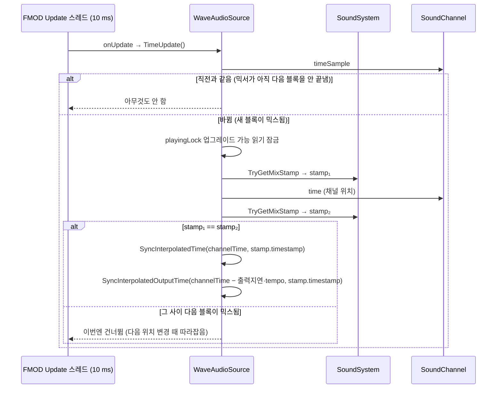
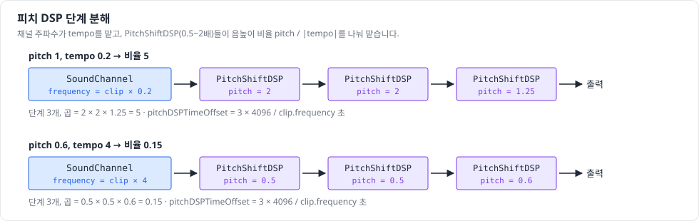

# 8. `WaveAudioSource`

> 기준 커밋: `3a2b24b9`. [← 목차](README.md) · 이전: [7. DSP 래퍼](07-dsp-wrappers.md) · 다음: [9. 리소스와 에디터](09-resources-and-editor.md)
>
> 선행: [Sound — 재생 상태와 명령](../../io.github.rumi727.runios.sound/Documentation~/02-playback-state.md), [Sound — 시간 보간](../../io.github.rumi727.runios.sound/Documentation~/03-time-interpolation.md)

[`WaveAudioSource`](../Runtime/Sounds/WaveAudioSource.cs#L16)는 Sound 패키지의 `RuniAudioSource`를 상속한 `MonoBehaviour`입니다. 리소스 팩의 `WaveAudioClip` 하나를 `SoundChannel` 하나로 재생합니다.
재생 상태(`isPlaying`, `isPaused`), 설정 값(`volume`, `tempo`, `loop` …), 보간 시간(`time`, `outputTime`)은 기반 클래스가 가집니다. 이 클래스는 그 상태를 **FMOD 채널에 반영**하고, 채널이 알려 주는 위치로 **보간 기준점을 다시 잡는** 일을 합니다.
**채널의 재생 위치가 기준값**이고, `time`·`outputTime`은 그 위치를 [믹스 스탬프](06-dsp-clock-and-mix-stamp.md)와 짝지어 보간합니다.

- [8.1 상태와 잠금](#81-상태와-잠금)
- [8.2 클립 로드: `Reload`](#82-클립-로드-reload)
- [8.3 채널 맞추기: `UnsafeSyncChannel`](#83-채널-맞추기-unsafesyncchannel)
- [8.4 새 블록마다 기준점 다시 잡기](#84-새-블록마다-기준점-다시-잡기)
- [8.5 피치 DSP 단계](#85-피치-dsp-단계)
- [8.6 채널 정지와 상실](#86-채널-정지와-상실)
- [8.7 속성 반영](#87-속성-반영)
- [8.8 `time`과 `timeSample`](#88-time과-timesample)
- [8.9 3D 위치](#89-3d-위치)

---

## 8.1 상태와 잠금

```csharp
// Runtime/Sounds/WaveAudioSource.cs
31  [SerializeField] AssetRef<WaveAudioClip> _clipRef;
32  IAssetScope<WaveAudioClip>? scope;                               // ① 지금 쥔 클립

291 SoundChannel? channel;                                           // ② 지금 재생 중인 채널 (없으면 null)
294 readonly ReaderWriterLockSlim channelLock = new();
297 readonly List<PitchShiftDSP> pitchDSPList = [];                  // ③
298 const float pitchDSPFFTSize = 4096;
299 volatile int pitchDSPCount;
300 readonly Lock pitchDSPListLock = new();

316 volatile uint lastTimeSamples = uint.MaxValue;                  // ④
```

1. ① 리소스 시스템에서 받은 스코프입니다. 스코프가 살아 있는 동안 클립이 언로드되지 않습니다. `Reload`에서만 바꿉니다.
2. ② 채널은 **재생 중일 때만** 있습니다. 정지하면 버리고, 다시 재생하면 새로 만듭니다.
3. ③ `tempo`와 `pitch`를 따로 바꾸기 위해 채널에 붙인 피치 시프트 DSP들입니다([§8.5](#85-피치-dsp-단계)).
4. ④ 마지막으로 본 채널 위치입니다. 바뀌면 새 블록이 믹스됐다는 뜻입니다([§8.4](#84-새-블록마다-기준점-다시-잡기)).

| 잠금 | 출처 | 보호하는 것 |
| --- | --- | --- |
| `playingLock` | `RuniAudioSource` | 재생 상태와 보간 기준점. 명령 훅(`OnPlay` …)은 쓰기 잠금 아래에서 불림 |
| `channelLock` | 이 클래스 | `channel` 필드의 교체와 채널 조작 |
| `pitchDSPListLock` | 이 클래스 | `pitchDSPList` |

잡는 순서는 `playingLock` → `channelLock` → `pitchDSPListLock`입니다.

## 8.2 클립 로드: `Reload`

```csharp
// Runtime/Sounds/WaveAudioSource.cs
335 protected override void OnEnable()
    {
337     base.OnEnable();
        …
348     Reload().Forget();                                               // ①
349     ResourceManager.AttachReloadable(this);                          // ②
351     SoundSystem.main.onUpdate += TimeUpdate;                         // ③
    }

549 public UniTask Reload() => reloadGate.Run(ReloadCore);              // ④

558 async UniTask ReloadCore()
    {
560     if (this == null || !isActiveAndEnabled)
561         return;
564     if (clipRef.IsSameTarget(scope))                                 // ⑤
565         return;
567     IAssetScope<WaveAudioClip>? newScope = await clipRef.LoadScopeAsync();   // ⑥
568     if (this == null || !isActiveAndEnabled)
        {
570         DisposeQueue.Enqueue(newScope);
571         return;
        }
575     playingLock.EnterWriteLock();                                    // ⑦
577     try
        {
579         StopChannel();
581         DisposeQueue.Enqueue(scope);
582         scope = newScope;
584         Volatile.Write(ref clipLength, scope?.asset.length ?? 0);    // ⑧
585         clipSamples = scope?.asset.samples ?? 0;
586         clipFrequency = scope?.asset.frequency ?? 0;
588         UnsafeSyncChannel();                                         // ⑨
        }
590     finally
        {
592         playingLock.ExitWriteLock();
        }
    }
```

1. ① 클립을 비동기로 불러옵니다.
2. ② 리소스 팩이 다시 로드되면 리소스 매니저가 이 컴포넌트의 `Reload`를 부릅니다.
3. ③ 업데이트 스레드의 `onUpdate`에 구독합니다([§8.4](#84-새-블록마다-기준점-다시-잡기)). `OnDisable`에서 해지합니다.
4. ④ [`AsyncReloadGate`](../Runtime/Sounds/WaveAudioSource.cs#L532)는 리로드가 겹치지 않게 순서대로 실행합니다.
5. ⑤ 이미 같은 대상을 쥐고 있으면 아무것도 하지 않습니다. 언로드된 클립은 같은 대상으로 보지 않습니다([9장 §9.1](09-resources-and-editor.md#91-waveaudioassetregistry)).
6. ⑥ 비동기 로드는 잠금 **밖**에서 끝냅니다. 기다리는 동안 컴포넌트가 꺼졌으면 받은 스코프를 버립니다.
7. ⑦ 스코프 교체와 채널 재동기화만 한 번의 쓰기 잠금 구간에서 합니다.
8. ⑧ 클립 정보를 필드에 복사합니다. `length`/`samples`/`frequency` 속성은 이 필드를 읽으므로 잠금 없이 읽힙니다.
9. ⑨ 재생 중이었다면 새 클립으로 채널을 다시 만듭니다. `time`은 기반 클래스가 유지하므로 같은 위치에서 이어집니다.

`OnDisable`([`#L505`](../Runtime/Sounds/WaveAudioSource.cs#L505))은 기반 클래스의 정지 처리를 한 뒤 스코프를 비우고, 스코프 해제는 [`DisposeQueue`](../Runtime/Sounds/WaveAudioSource.cs#L528)로 미룬 뒤 `onUpdate` 구독을 해지합니다.

## 8.3 채널 맞추기: `UnsafeSyncChannel`

재생 상태와 채널을 맞추는 중심 메서드입니다. **호출자가 `playingLock`의 업그레이드 가능 읽기 잠금이나 쓰기 잠금을 들고 있어야** 합니다. 명령 훅 `OnPlay`·`OnStop`([`#L653`](../Runtime/Sounds/WaveAudioSource.cs#L653)), `ReloadCore`, `TimeUpdate`가 부릅니다.

```csharp
// Runtime/Sounds/WaveAudioSource.cs
690 void UnsafeSyncChannel(bool mixerAdvanced = false)
    {
        …
698     SoundChannel? lostChannel = null;
699     channelLock.EnterUpgradeableReadLock();
701     try
        {
703         double currentTime = time + pitchDSPTimeOffset;                              // ①
704         if
            (
706             scope == null || !isPlaying || !double.IsFinite(currentTime) ||
707             (!loop && (currentTime < 0 || currentTime > scope.asset.length))
            )
            {
710             StopChannel();                                                           // ②
711             return;
            }
714         if (channel != null)
            {
716             if (!mixerAdvanced)                                                      // ③
                {
718                 double setTime = channel.time;
719                 SyncInterpolatedTime(setTime);
720                 SyncOutputTimeToLatestMixStamp(channel, setTime);
                }
722             else if (TryGetChannelTimeAtMixStamp(channel, out double channelTime, out SoundMixStamp stamp))   // ④
                {
724                 SyncInterpolatedTime(channelTime, stamp.timestamp);
725                 SyncOutputTimeToMixStamp(channelTime, stamp, channel.system.outputSampleRate);
                }
            }
            else
            {
730             if (scope.asset.system.Execute(system => system.PlaySound(scope.asset, true), out SoundChannel? newChannel) && newChannel != null)   // ⑤
                {
732                 channelLock.EnterWriteLock();
734                 try
                    {
736                     channel = newChannel;
737                     channel.onStop += HandleChannelLost;                             // ⑥
739                     channel.time = currentTime;                                      // ⑦
741                     UnsafeUpdateChannelProperty(channel);                            // ⑧
                    }
743                 finally
                    {
745                     channelLock.ExitWriteLock();
                    }
748                 SyncOutputTimeToLatestMixStamp(newChannel, currentTime);
                }
            }
        }
752     catch (ObjectDisposedException) when (channel != null)                          // ⑨
        {
754         lostChannel = channel;
        }
756     finally
        {
758         channelLock.ExitUpgradeableReadLock();
        }
761     if (lostChannel != null)
762         HandleChannelLost(lostChannel);
    }
```

1. ① 기반 클래스의 `time`은 노출 시간(피치 DSP 지연을 뺀 값)입니다. 채널에는 지연을 더한 위치가 들어가야 합니다([§8.5](#85-피치-dsp-단계)).
2. ② 클립이 없거나, 재생 중이 아니거나, 위치가 이상하거나, 루프가 아닌데 범위를 벗어났으면 채널을 정리합니다. 이 메서드 하나가 "재생해야 하면 채널을 만들고, 아니면 없앤다"를 모두 맡습니다.
3. ③ **명령에서 온 동기화**(재생 시작, 리로드). 지금 채널 위치를 "지금" 기준점으로 잡고, 출력 시간은 가장 최근 스탬프의 지연으로 보정합니다.
4. ④ **믹서 진행에서 온 동기화**([§8.4](#84-새-블록마다-기준점-다시-잡기)). 스탬프와 짝이 맞는 위치를 얻었을 때만 기준점을 다시 잡습니다.
5. ⑤ 채널이 없으면 **일시 정지 상태로** 만듭니다. 시스템이 `Active`가 아니면 `Execute`가 `false`라 아무것도 하지 않습니다.
6. ⑥ 채널이 스스로 끝나면(클립 끝, 시스템 리셋) [`HandleChannelLost`](#86-채널-정지와-상실)가 필드를 비웁니다.
7. ⑦ 위치를 정합니다. 스트림이면 [보류](05-channel.md#55-위치-timesample과-time)될 수 있습니다.
8. ⑧ 모든 속성을 채널에 반영합니다. 마지막 항목이 `isPaused`라서, 일시 정지 중이 아니면 여기서 소리가 나기 시작합니다([§8.7](#87-속성-반영)).
9. ⑨ 채널 조작 중 채널이 무효가 됐으면 상실 처리로 넘깁니다. `channel == null`일 때의 `ObjectDisposedException`은 정상 경로가 아니므로 잡지 않습니다.

## 8.4 새 블록마다 기준점 다시 잡기



```csharp
// Runtime/Sounds/WaveAudioSource.cs
354 void TimeUpdate()
    {
356     uint timeSample = this.timeSample;                          // ①
357     if (lastTimeSamples != timeSample)                          // ②
        {
359         lastTimeSamples = timeSample;
361         playingLock.EnterUpgradeableReadLock();                 // ③
363         try
            {
365             UnsafeSyncChannel(mixerAdvanced: true);
            }
367         finally
            {
369             playingLock.ExitUpgradeableReadLock();
            }
        }
    }

397 static bool TryGetChannelTimeAtMixStamp(SoundChannel channel, out double time, out SoundMixStamp stamp)
    {
399     SoundSystem system = channel.system;
400     time = 0;
402     if (!system.TryGetMixStamp(out stamp))                       // ④
403         return false;
405     time = channel.time;                                        // ⑤
406     return system.TryGetMixStamp(out SoundMixStamp after) && stamp == after;   // ⑥
    }

428 void SyncOutputTimeToMixStamp(double channelTime, SoundMixStamp stamp, int sampleRate)
    {
430     double outputDelay = (stamp.dspClock - stamp.outputClock) / (double)sampleRate;   // ⑦
431     SyncInterpolatedOutputTime(channelTime - (outputDelay * tempo), stamp.timestamp);
    }
```

1. ① 채널의 PCM 위치입니다. FMOD는 이 값을 블록마다 한 번 바꿉니다.
2. ② 바뀐 순간이 "믹서가 방금 한 블록을 끝냈다"는 신호입니다. 바뀌지 않았으면 잠금도 잡지 않습니다. 업데이트는 10 ms마다, 블록은 약 21 ms마다이므로 대부분의 호출이 여기서 끝납니다.
3. ③ 업그레이드 가능 읽기 잠금은 다른 명령(쓰기 잠금)과 직렬화하면서도, 일반 `time` 읽기(읽기 잠금)는 막지 않습니다. `TimeUpdate`는 `main`의 업데이트 스레드에서 시스템 읽기 잠금을 든 채 실행됩니다([3장 §3.3](03-threads-and-locks.md#33-update와-onupdate)).
4. ④⑤⑥ 스탬프 → 위치 → 스탬프 순서로 읽고, 두 스탬프가 같으면 ⑤의 위치는 **그 스탬프 블록의 끝**에서의 위치가 확실합니다. 믹서는 블록 사이에서만 위치와 스탬프를 함께 바꾸기 때문입니다. 다르면 위치가 어느 블록 것인지 모르므로 버리고, 다음 블록에서 위치가 다시 바뀔 때 따라잡습니다.
5. ⑦ 스피커는 블록 끝보다 출력 지연만큼 뒤에 있습니다. 타임라인으로는 `지연 × tempo`만큼 뒤입니다.

[§8.3](#83-채널-맞추기-unsafesyncchannel) ④의 `SyncInterpolatedTime(channelTime, stamp.timestamp)`가 핵심입니다. 두 번째 인자로 **스탬프의 벽시계**를 넘기므로, 보간이 "업데이트가 위치를 발견한 시각"이 아니라 "믹서가 그 위치를 계산한 시각"부터 시작합니다. 업데이트 스레드가 늦게 돌아도 기울기가 틀어지지 않습니다. 기준점 메서드의 의미는 [Sound — 기준점을 잡는 메서드](../../io.github.rumi727.runios.sound/Documentation~/03-time-interpolation.md#36-기준점을-잡는-메서드)에 있습니다.

## 8.5 피치 DSP 단계

FMOD 채널의 `frequency`를 바꾸면 속도와 음높이가 함께 바뀝니다. 이 클래스는 `tempo`를 채널 주파수로 반영하고(`clip.frequency × tempo`), 음높이를 되돌리거나 따로 바꾸기 위해 `PitchShiftDSP`를 채널에 붙입니다. 필요한 음높이 비율은 `pitch / |tempo|`입니다.

FMOD의 피치 시프트 DSP 하나는 0.5~2배만 다루므로, 이 범위를 넘는 비율은 여러 단계로 나눕니다.



```csharp
// Runtime/Sounds/WaveAudioSource.cs
846 void UnsafeUpdateChannelPitch(SoundChannel channel)
    {
848     float pitch = this.pitch;
849     float tempo = this.tempo;
851     if (!float.IsNormal(pitch) || !float.IsNormal(tempo))                  // ①
        {
853         UnsafeReleasePitchDSPList(channel);
854         return;
        }
857     float value = pitch / tempo.Abs();                                     // ②
858     if (float.IsNaN(value))
859         value = 1;
861     value = value.Clamp(0.01f, 100);
862     if (value.Approximately(1))                                            // ③
        {
864         UnsafeReleasePitchDSPList(channel);
865         return;
        }
868     lock (pitchDSPListLock)
        {
870         int index = 0;
871         while (value < 0.5f)                                               // ④
            {
873             SetPitchDsp(index, 0.5f, channel);
875             index++;
876             value *= 2;
            }
879         while (value > 2)
            {
881             SetPitchDsp(index, 2, channel);
883             index++;
884             value *= 0.5f;
            }
887         SetPitchDsp(index, value, channel);                                // ⑤
888         index++;
890         for (int i = pitchDSPList.Count - 1; i >= index; i--)              // ⑥
            {
892             PitchShiftDSP dsp = pitchDSPList[i];
893             channel.dsps.Remove(dsp);
894             dsp.Dispose();
896             pitchDSPList.RemoveAt(i);
            }
899         void SetPitchDsp(int index, float value, SoundChannel channel)
            {
901             while (pitchDSPList.Count <= index)                            // ⑦
                {
903                 PitchShiftDSP pitchDsp = channel.system.CreateDSP<PitchShiftDSP>();
904                 pitchDsp.fftSize = pitchDSPFFTSize;
905                 pitchDSPList.Add(pitchDsp);
906                 channel.dsps.Add(pitchDsp);
                }
909             pitchDSPList[index].pitch = value;
            }
912         pitchDSPCount = pitchDSPList.Count;                                // ⑧
        }
    }
```

1. ① `pitch`나 `tempo`가 0·NaN·무한대·비정규 수면 피치 보정을 모두 뗍니다. `tempo`가 0이면 채널 주파수도 0이라 소리가 멈춥니다.
2. ② 역재생(`tempo < 0`)도 음높이 비율은 크기로만 봅니다. 결과를 `[0.01, 100]`으로 자릅니다.
3. ③ 비율이 1이면 DSP가 필요 없습니다. DSP는 지연과 처리 비용이 있으므로 모두 뗍니다.
4. ④ 0.5 미만이면 0.5 단계를, 2 초과면 2 단계를 필요한 만큼 앞에 둡니다.
5. ⑤ 남은 비율(0.5~2)을 마지막 단계에 줍니다.
6. ⑥ 이전에 더 많은 단계가 있었다면 남는 DSP를 떼고 해제합니다.
7. ⑦ 모자라면 새 DSP를 만들어 채널 `tail`에 붙입니다. 있던 DSP는 값만 바꿉니다.
8. ⑧ 단계 수를 `volatile` 필드로 공개합니다. 시간 보정([아래](#피치-dsp-지연-보정))이 잠금 없이 읽습니다.

### 피치 DSP 지연 보정

피치 시프트 DSP는 FFT 창만큼 소리를 늦춥니다. 그래서 채널 위치와 실제로 들리는 위치 사이에 단계 수만큼 지연이 생기고, 이 클래스는 그 값을 시간에서 빼고 더합니다.

```csharp
// Runtime/Sounds/WaveAudioSource.cs
302 double pitchDSPTimeOffset
    {
        get
        {
306         float frequency = clipFrequency;
307         float tempo = this.tempo;
308         if (frequency <= 0 || !float.IsNormal(tempo))
309             return 0;
311         double offset = pitchDSPCount * (pitchDSPFFTSize / frequency);   // DSP 하나당 4096 / 클립 주파수 초
312         return tempo < 0 ? -offset : offset;
        }
    }
```

- getter: [`time`](../Runtime/Sounds/WaveAudioSource.cs#L49)과 [`outputTime`](../Runtime/Sounds/WaveAudioSource.cs#L39)은 기반 클래스 값에서 이 지연을 뺍니다.
- setter와 채널 생성: 채널에는 이 지연을 더한 위치를 넣습니다([`#L58`](../Runtime/Sounds/WaveAudioSource.cs#L58), [§8.3](#83-채널-맞추기-unsafesyncchannel) ①).
- 역재생이면 타임라인 방향이 반대이므로 부호를 바꿉니다.

> **관찰된 동작:** 지연을 `4096 / 클립 주파수`(초)로 계산하고 `tempo`는 부호에만 씁니다([`#L311-L312`](../Runtime/Sounds/WaveAudioSource.cs#L311-L312)). DSP가 도는 믹서 샘플 레이트(`outputSampleRate`)나 채널 재생 속도(`clip.frequency × tempo`)는 이 식에 들어가지 않습니다.

## 8.6 채널 정지와 상실

채널이 사라지는 경로는 두 가지입니다. 이 클래스가 스스로 멈추는 경우와, 채널이 스스로 끝나는 경우입니다.

```csharp
// Runtime/Sounds/WaveAudioSource.cs
765 // 그냥 Stop 하면 onStop 이벤트가 즉시 호출되기 때문에 미리 해제해주어야합니다.
766 void StopChannel()
    {
        …                                                                 // channelLock을 들고 있으면 안 됨 (Assert)
774     channelLock.EnterWriteLock();
776     try
        {
778         if (channel == null)
779             return;
781         UnsafeReleasePitchDSPList(channel);                           // ①
783         channel.onStop -= HandleChannelLost;                          // ②
784         channel.Stop();
785         channel = null;
787         lastTimeSamples = uint.MaxValue;                              // ③
        }
        …
    }

795 void HandleChannelLost(SoundChannel lostChannel)
    {
797     channelLock.EnterWriteLock();
799     try
        {
801         // 채널이 새롭게 교채된 후에도 기존 채널이 onStop을 호출할 수 있기 때문에 확인해야합니다.
802         if (channel != lostChannel)                                   // ④
803             return;
805         UnsafeReleasePitchDSPList(channel);
807         channel.onStop -= HandleChannelLost;
808         channel = null;
810         lastTimeSamples = uint.MaxValue;
        }
        …
    }
```

1. ① 피치 DSP를 떼고 해제합니다. DSP는 채널마다 새로 만듭니다.
2. ② `Stop()`은 `onStop`을 **같은 스레드에서 즉시** 부릅니다([5장 §5.3](05-channel.md#53-종료-콜백과-onstop)). 쓰기 잠금을 든 채 `HandleChannelLost`가 불리면 재귀를 허용하지 않는 `channelLock`에서 예외가 나므로, 먼저 구독을 끊습니다.
3. ③ 다음 채널의 첫 위치를 반드시 "바뀜"으로 보게 합니다.
4. ④ 상실 알림이 늦게 오면 이미 새 채널로 바뀌었을 수 있습니다. 그때는 무시합니다.

`HandleChannelLost`는 자연 종료(업데이트 스레드의 `onStop`)와, 채널 조작 중 `ObjectDisposedException`을 만난 경우([`TryGetAliveChannel`](../Runtime/Sounds/WaveAudioSource.cs#L596), [§8.3](#83-채널-맞추기-unsafesyncchannel) ⑨)에서 불립니다. 채널만 비우고 기반 클래스의 재생 상태는 바꾸지 않습니다. 채널이 없으면 `timeSample`이 0이 되므로 다음 `TimeUpdate`가 "바뀜"으로 보고 `UnsafeSyncChannel`을 부릅니다. 그때 [§8.3](#83-채널-맞추기-unsafesyncchannel) ②의 조건대로, 루프가 아니고 `time + pitchDSPTimeOffset`이 `[0, length]` 밖이면 채널을 만들지 않고, 그 안이면 그 위치에서 채널을 다시 만듭니다.

## 8.7 속성 반영

설정 속성의 setter는 모두 같은 모양입니다. 기반 클래스 값을 바꾼 뒤, 채널이 있으면 그 값 하나만 채널에 씁니다.

```csharp
// Runtime/Sounds/WaveAudioSource.cs
123 public override float volume
    {
125     get => base.volume;
        set
        {
128         base.volume = value;
129         TryGetAliveChannel(UnsafeUpdateChannelVolume);
        }
    }
```

[`TryGetAliveChannel`](../Runtime/Sounds/WaveAudioSource.cs#L596)은 `channelLock` 읽기 잠금 아래에서 채널이 있을 때만 콜백을 부르고, `ObjectDisposedException`이면 상실 처리합니다.

| 기반 속성 | 채널에 쓰는 것 |
| --- | --- |
| `volume`, `panStereo`, `spatialBlend`, `dopplerLevel`, `spread` | 같은 이름의 채널 속성 |
| `minDistance`, `maxDistance` | `channel.minMaxDistance` |
| `rolloffMode` (이 클래스) | `channel.rolloffMode` |
| `loop`, `loopStart`, `loopEnd` | `channel.loop`, `channel.loopRange` |
| `tempo` | `channel.frequency = clip.frequency × tempo`, 그리고 피치 단계 |
| `pitch` | 피치 단계([§8.5](#85-피치-dsp-단계)) |
| `isPaused` (훅 `OnPause`/`OnUnPause`) | `channel.isPaused` |

새 채널을 만들 때는 [`UnsafeUpdateChannelProperty`](../Runtime/Sounds/WaveAudioSource.cs#L820)가 위 항목을 모두 순서대로 씁니다. 마지막이 `isPaused`라서, 앞의 설정이 모두 끝난 뒤에야 소리가 납니다.

## 8.8 `time`과 `timeSample`

```csharp
// Runtime/Sounds/WaveAudioSource.cs
49  public override double time
    {
51      get => base.time - pitchDSPTimeOffset;
        set
        {
54          playingLock.EnterWriteLock();
56          try
            {
58              double channelTime = value + (isPlaying ? pitchDSPTimeOffset : 0);
59              SyncInterpolatedTime(channelTime);
60              TryGetAliveChannel(channel => channel.time = channelTime);
            }
            …
        }
    }

80  public uint timeSample
    {
82      get => GetAliveChannelValue(channel => channel.timeSample, 0u);
        set
        {
85          playingLock.EnterWriteLock();
87          try
            {
89              if (frequency > 0)
90                  SyncInterpolatedTime(value / (double)frequency);
92              if (clipSamples <= 0)
93                  return;
95              TryGetAliveChannel(channel => channel.timeSample = value.Clamp(0, clipSamples - 1));
            }
            …
        }
    }
```

| | `time` | `timeSample` |
| --- | --- | --- |
| 단위 | 초, 보간됨 | 클립 PCM 샘플, 보간 안 됨 |
| 읽기 | 기반 보간 값 − 피치 DSP 지연 | **채널의 실제 PCM 위치**(블록마다 계단). 채널이 없으면 0 |
| 쓰기 | 재생 중이면 피치 DSP 지연을 더해 채널에 씀 | 값을 그대로 채널에 씀(마지막 샘플까지로 자름) |

`timeSample`은 채널이 가리키는 실제 PCM 위치를 그대로 노출하는 속성입니다. 그래서 피치 DSP 지연을 보정하지 않습니다. 에디터의 샘플 단위 표시([9장 §9.5](09-resources-and-editor.md#95-인스펙터와-시간-단위))가 이 값을 씁니다.

## 8.9 3D 위치

```csharp
// Runtime/Sounds/WaveAudioSource.cs
462 void Update()
    {
464     if (spatialBlend > 0)                                              // ①
        {
466         TryGetAliveChannel(channel =>
            {
469             if (rigidbody != null)
470                 channel.spatialState = new AudioSpatialState(transform.position, rigidbody.linearVelocity);   // ②
                …
478             if (nonRigidbodyVelocity)
                {
480                 Vector3 velocity = Vector3.zero;
481                 if (Kernel.deltaTime != 0)
                    {
483                     velocity = (transform.position - lastPosition) / Kernel.deltaTime;   // ③
484                     velocity = velocity.ClampMagnitude(20);
                    }
487                 channel.spatialState = new AudioSpatialState(transform.position, velocity);
                }
                else
490                 channel.spatialState = new AudioSpatialState(transform.position);
            });
        }
494     lastPosition = transform.position;
    }
```

1. ① 완전히 2D(`spatialBlend == 0`)면 3D 속성을 보내지 않습니다.
2. ② `Rigidbody`나 `Rigidbody2D`가 있으면 그 속도를 도플러에 씁니다. 물리 모듈이 없으면 이 분기는 컴파일되지 않습니다(`UNITY_PHYSICS_EXIST`, `UNITY_PHYSICS2D_EXIST`).
3. ③ 리지드바디가 없고 `nonRigidbodyVelocity`가 켜져 있으면 위치 차이로 속도를 추정합니다. 순간 이동이 큰 도플러로 들리지 않게 크기를 20으로 자릅니다.
