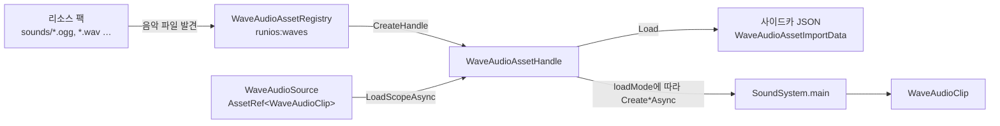

# 9. 리소스와 에디터

> 기준 커밋: `3a2b24b9`. [← 목차](README.md) · 이전: [8. WaveAudioSource](08-wave-audio-source.md)
>
> 선행: [Sound — 리소스와 생성](../../io.github.rumi727.runios.sound/Documentation~/07-resources.md), [Sound — 에디터](../../io.github.rumi727.runios.sound/Documentation~/08-editor.md)

이 장은 리소스 팩의 사운드 파일을 `WaveAudioClip`으로 불러오는 레지스트리와, 에디터에서 FMOD 소리를 듣고 보는 도구를 요약합니다. 에디터 코드는 어셈블리 `RuniOS.Editor.FMOD`에 있고, 런타임 어셈블리의 `internal` 멤버를 볼 수 있습니다([`AssemblyInfo.cs`](../Runtime/AssemblyInfo.cs#L3)).

- [9.1 `WaveAudioAssetRegistry`](#91-waveaudioassetregistry)
- [9.2 `AudioPreview`](#92-audiopreview)
- [9.3 에디터 리스너 동기화](#93-에디터-리스너-동기화)
- [9.4 `WaveAudioClipPackDrawer`](#94-waveaudioclippackdrawer)
- [9.5 인스펙터와 시간 단위](#95-인스펙터와-시간-단위)

---

## 9.1 `WaveAudioAssetRegistry`



[`WaveAudioAssetRegistry`](../Runtime/Resource/Sounds/WaveAudioAssetRegistry.cs#L9)는 코어 패키지의 `SimpleAssetRegistry`를 상속합니다.

| 멤버 | 값 |
| --- | --- |
| `registryId` | `runios:waves` |
| `registryName` | `sounds` (팩 안의 폴더) |
| `providedAssetType` | `WaveAudioClip` |
| `assetMatcher` / `auxiliaryMatcher` | 음악 파일 / JSON 사이드카 |
| 등록 | `[OnCodeLoaded]`에서 `AssetRegistryManager.Register`, `[OnCodeUnloading]`에서 해제 |

파일 하나마다 [`WaveAudioAssetHandle`](../Runtime/Resource/Sounds/WaveAudioAssetHandle.cs#L9)이 생깁니다.

```csharp
// Runtime/Resource/Sounds/WaveAudioAssetHandle.cs
13  protected override async UniTask<WaveAudioClip?> Load()
    {
15      await sidecar.Reload();
17      WaveAudioAssetImportData data = sidecar.GetValue<WaveAudioAssetImportData>(WaveAudioAssetRegistry.id) ?? default;   // ①
18      return data.loadMode switch
        {
20          WaveAudioAssetLoadMode.normal => await SoundSystem.main.CreateSoundAsync(node),           // ②
21          WaveAudioAssetLoadMode.keepCompressed => await SoundSystem.main.CreateSoundAsync(node, true),
22          WaveAudioAssetLoadMode.stream => await SoundSystem.main.CreateStreamAsync(node),
23          _ => null
        };
    }
27  protected override void Unload(WaveAudioClip unloadedAsset) => unloadedAsset.Dispose();
29  protected override bool IsDefaultAsset([NotNullWhen(false)] WaveAudioClip? asset) => asset == null || asset.isDisposed;   // ③
31  public override bool IsSameTarget(IAssetHandle other)
    {
33      if (!base.IsSameTarget(other))
34          return false;
36      return assetObject != null && !assetObject.isDisposed;                                    // ④
    }
```

1. ① 사이드카의 `runios:waves` 항목에서 불러오기 방식을 읽습니다. 없으면 기본값 `normal`입니다.
2. ② 방식마다 [4장](04-clip-creation.md#44-비동기-생성)의 비동기 생성 하나로 갑니다. 모두 `SoundSystem.main`에 만듭니다. 시스템이 `Active`가 아니면 결과가 `null`입니다.

   | `WaveAudioAssetLoadMode` | 생성 | 메모리 |
   | --- | --- | --- |
   | `normal` | `CreateSoundAsync(node)` | 디코딩된 PCM |
   | `keepCompressed` | `CreateSoundAsync(node, true)` | 압축 데이터. PCM 읽기 불가 |
   | `stream` | `CreateStreamAsync(node)` | 재생하며 읽음. 비물리 노드는 [`CreateStream(Stream)`](04-clip-creation.md#43-createstream-nonblocking으로-열고-기다리기) 경로를 탐 |

3. ③ 해제된 클립은 "없는 에셋"으로 봅니다. 코어의 `AssetHandle`은 쥔 에셋이 이 조건에 걸리면 다음 로드 요청 때 `Load()`를 다시 부르므로, `SoundSystem.Reset`이 클립을 해제한 뒤에는 새 클립을 만들어 돌려줍니다.
4. ④ 같은 파일이어도 지금 쥔 클립이 해제됐으면 다른 대상으로 봅니다. [`WaveAudioSource.ReloadCore`](08-wave-audio-source.md#82-클립-로드-reload) ⑤가 이 비교로 리셋 뒤 다시 불러옵니다.

## 9.2 `AudioPreview`

[`AudioPreview`](../Editor/Sounds/AudioPreview.cs#L11)는 씬 없이 오디오 파일을 들어 보는 에디터 전용 플레이어입니다. 리소스 팩 드로어([§9.4](#94-waveaudioclippackdrawer))가 씁니다.

| 정적 상태 | 역할 |
| --- | --- |
| `loadedClips: Dictionary<IONode, WaveAudioClip>` | 노드마다 한 번만 불러온 클립. 모든 미리보기가 공유 |
| `loadedWaveforms: Dictionary<IONode, Waveform>` | 같은 노드의 파형([4장 §4.9](04-clip-creation.md#49-createplanarsamples-파형용-planar-변환)의 planar 샘플로 만듦) |
| `previews: ConditionalWeakTable<AudioPreview, object>` | 살아 있는 미리보기 인스턴스 |
| `globalVolume`, `globalLoop`, `autoPlay` | 모든 플레이어에 공통 |

- `GetAudio(node)`는 캐시에 있으면 돌려주고, 없으면 비동기 로드를 시작하고 `null`을 돌려줍니다. 로드가 끝나면 `onLoadedAudio`로 알립니다.
- 인스턴스는 자기가 요청한 노드 집합(`requestedAudios`)을 가집니다. [`GarbageCleanup`](../Editor/Sounds/AudioPreview.cs#L122)은 해제되지 않은 어느 미리보기도 요청하지 않은 클립과 파형을 해제합니다. 드로어가 닫히면(`Dispose`) 그 노드들이 정리됩니다.
- 로드가 겹쳐 같은 노드가 두 번 불러와지면 늦게 끝난 쪽을 해제합니다.
- `Dispose` 없이 버려지면 종료자가 경고를 남기고 메인 스레드에서 정리를 시도합니다.

[`Player`](../Editor/Sounds/AudioPreview.Player.cs#L49)는 노드 하나의 재생 컨트롤이며 Sound 패키지의 `IPlayControl`, `IStoppable`, `ISeekable`을 구현합니다. 그래서 Sound 패키지의 재생 컨트롤 UI가 그대로 조작할 수 있습니다. `WaveAudioSource`와 달리 믹스 스탬프를 쓰지 않습니다.

| | `WaveAudioSource` | `AudioPreview.Player` |
| --- | --- | --- |
| 기준 위치 | 채널 위치 + 믹스 스탬프 짝 | 채널 위치 |
| 보간 기준 시각 | 스탬프 `timestamp`(Stopwatch) | 위치 변화를 처음 본 `EditorApplication.timeSinceStartup` |
| 출력 지연 보정 | 있음(`outputTime`) | 없음 |
| 결과 | 믹서가 위치를 계산한 순간 기준으로 정확 | 계단만 없앤 근사(`min(channelTime + 경과, length)`) |

`Player.isPlaying`은 채널이 있는지로 판단합니다. 채널이 끝나면 `onStop`이 업데이트 스레드에서 오므로, 필드 정리는 [`EditorThreadDispatcher`](../Editor/Sounds/AudioPreview.Player.cs#L208)로 메인 스레드에 넘깁니다.

## 9.3 에디터 리스너 동기화

플레이 모드가 아닐 때도 3D 소리가 들리려면 FMOD 리스너가 어딘가에 있어야 합니다. [`EditorSoundSystemManager`](../Editor/Sounds/EditorSoundSystemManager.cs#L12)가 `EditorApplication.update`마다 리스너를 맞춥니다.

| 조건 | 리스너 |
| --- | --- |
| 플레이 중이고 일시 정지가 아님 | 건드리지 않음 (런타임 코드가 맡음) |
| 포커스된 창이 게임 뷰 | 씬의 활성 `StudioListener`들의 Transform |
| 그 밖 | 선택된 탭인 씬 뷰들의 카메라. 속도는 위치 차이로 추정해 20으로 자름 |
| 아무것도 없음 | 원점의 기본 리스너 하나 |

`StudioListener` 목록은 코드 초기화 때와 씬 객체가 바뀔 때(`ObjectChangeEvents.changesPublished`)마다 다시 찾습니다. 리스너 쓰기는 `SoundSystem.main.Execute`로 묶어 리스너 수와 각 리스너를 한 번에 설정합니다([5장 §5.8](05-channel.md#58-믹싱과-3d-속성)의 `listeners`).

## 9.4 `WaveAudioClipPackDrawer`

[`WaveAudioClipPackDrawer`](../Editor/Resource/Sounds/WaveAudioClipPackDrawer.cs#L11)는 리소스 팩 브라우저에서 `sounds` 폴더의 음악 파일을 선택했을 때 보이는 드로어입니다. Sound 패키지의 `RuniAudioClipPackDrawer<T>`를 상속합니다.

- **정보:** 샘플 수, 주파수, 채널 수, 비트, PCM 포맷을 표시합니다.
- **파형:** `AudioPreview`의 파형을 Sound 패키지의 `WaveformRenderer`로 `RenderTexture`에 그립니다. 크기나 보이는 구간이 바뀔 때만 다시 그립니다.
- **확대·이동:** 휠로 마우스 아래 위치를 고정한 채 확대·축소하고, 가운데 버튼 드래그로 이동합니다. 보이는 구간은 노드마다 정적으로 기억해 다시 선택해도 유지됩니다.
- **재생:** 클릭·드래그로 탐색하고, 재생 중이면 커서와 시간을 표시합니다. 확대된 상태에서는 `FollowMode`(`None`, `Page`, `Center`)에 따라 보이는 구간이 커서를 따라갑니다.

## 9.5 인스펙터와 시간 단위

[`WaveAudioSourceEditor`](../Editor/Unity/Drawers/Sounds/WaveAudioSourceEditor.cs#L11)는 Sound 패키지의 `RuniAudioSourceEditor<T>`를 상속해 이 클래스만의 필드를 더합니다.

| 위치 | 추가 내용 |
| --- | --- |
| 소스 | `clipRef`(바뀌면 `Reload` 후 다시 그림), `nonRigidbodyVelocity` |
| 3D | `rolloffMode` |
| 정보 | `samples`, `frequency` |
| 재생 컨트롤 | 시간 단위 [`WaveAudioTimeUnit`](../Editor/IMGUI/Sounds/WaveAudioTimeUnit.cs#L6) |

`WaveAudioTimeUnit`은 재생 컨트롤의 시간 표시를 샘플 단위로 바꾸는 `ITimeUnit<WaveAudioSource>`입니다. 현재 값은 [`WaveAudioSource.timeSample`](08-wave-audio-source.md#88-time과-timesample)(채널의 실제 PCM 위치), 길이는 `samples`이고, 필드에 값을 넣으면 선택한 모든 소스의 `timeSample`에 씁니다.
