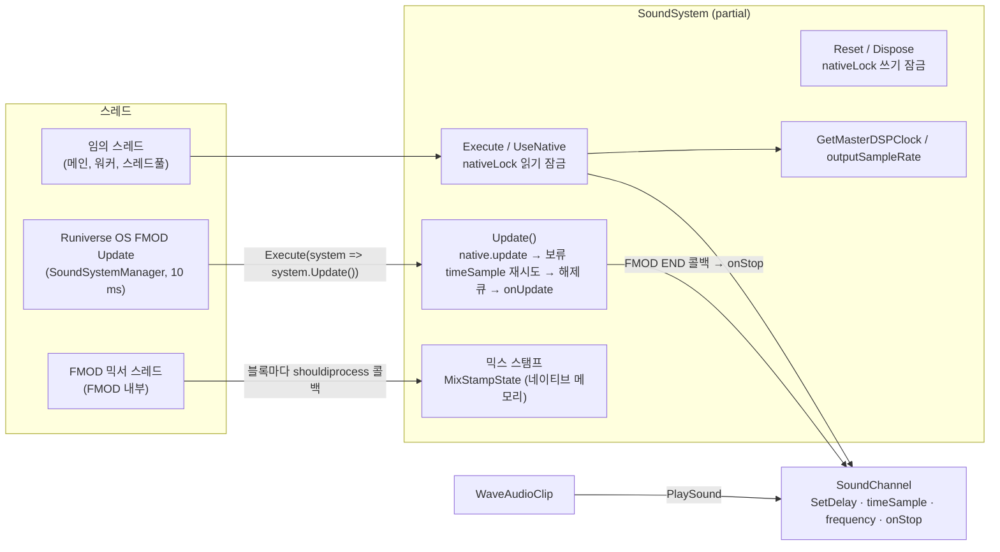
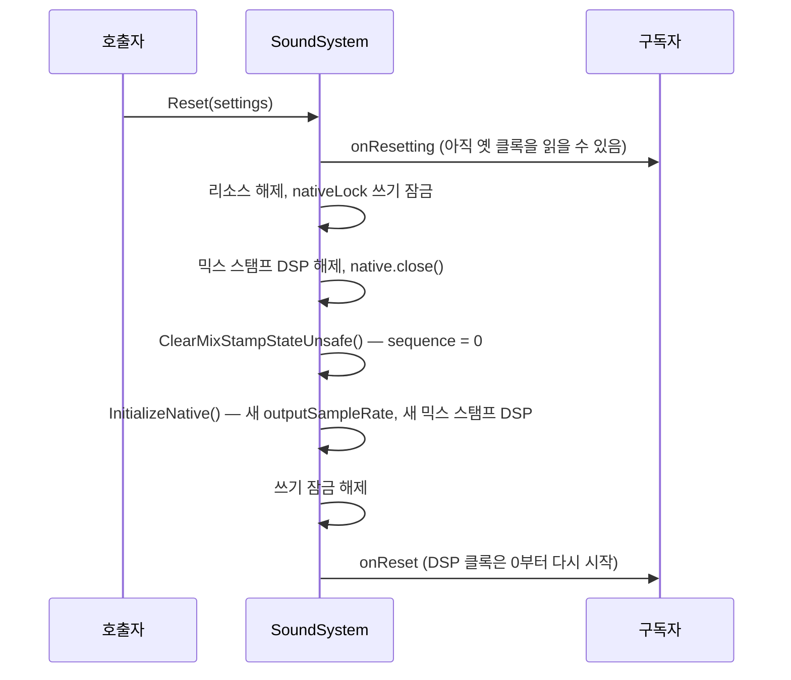

# FMOD 패키지 내부 구조 문서

> 기준 커밋: `440c549c`. 코드 링크의 줄 번호는 이 커밋 기준입니다.

`io.github.rumi727.runios.fmod`가 FMOD Core를 어떻게 감싸는지, 특히 **시간(DSP 클록)을 어떻게 다루는지**를 코드 수준에서 설명합니다.
리소스 소유권과 해제 순서는 [패키지 README](../README.md)에 정리되어 있으니 이 문서는 그 위에서 시작합니다.

| 문서 | 내용 |
| --- | --- |
| [dsp-clock-and-mix-stamp.md](dsp-clock-and-mix-stamp.md) | DSP 클록, 믹스 블록, `SetDelay`, `timeSample` 보류와 재시도, **믹스 스탬프 DSP와 seqlock** |
| [wave-audio-source.md](wave-audio-source.md) | `WaveAudioSource`가 채널 위치와 믹스 스탬프로 `time`·`outputTime`을 맞추는 방식, 에디터 `AudioPreview` |

선행 지식으로, `time`과 `outputTime`의 보간 규칙은 Sound 패키지 문서 [시간 보간](../../io.github.rumi727.runios.sound/Documentation~/time-interpolation.md)에 있습니다.

## 한 장으로 보는 구조

### 파일 지도 (`Runtime/Sounds`)

| 파일 | 책임 |
| --- | --- |
| [`SoundSystem.cs`](../Runtime/Sounds/SoundSystem.cs) | 생성자·`InitializeNative`·`Dispose`, `nativeLock`(재귀 RW), `outputSampleRate`, [`GetMasterDSPClock`](../Runtime/Sounds/SoundSystem.cs#L158) |
| [`SoundSystem.Execute.cs`](../Runtime/Sounds/SoundSystem.Execute.cs) | `Execute(...)`: 읽기 잠금 아래에서 시스템이 `Active`일 때만 콜백 실행, 아니면 `false` |
| [`SoundSystem.Update.cs`](../Runtime/Sounds/SoundSystem.Update.cs) | [`Update`](../Runtime/Sounds/SoundSystem.Update.cs#L24), `onUpdate` 이벤트 |
| [`SoundSystem.Reset.cs`](../Runtime/Sounds/SoundSystem.Reset.cs) | [`Reset`](../Runtime/Sounds/SoundSystem.Reset.cs#L87), `onResetting` / `onReset` |
| [`SoundSystem.MixStamp.cs`](../Runtime/Sounds/SoundSystem.MixStamp.cs) · [`.Callbacks.cs`](../Runtime/Sounds/SoundSystem.MixStamp.Callbacks.cs) | 믹스 스탬프 DSP 생성·해제, 쓰기(콜백)·읽기(`TryGetMixStamp`) |
| [`SoundMixStamp.cs`](../Runtime/Sounds/SoundMixStamp.cs) | `record struct SoundMixStamp(ulong dspClock, ulong outputClock, long timestamp)` |
| [`SoundSystemManager.cs`](../Runtime/Sounds/SoundSystemManager.cs) | `[OnCodeLoaded]`에서 업데이트 스레드 시작, `[OnCodeUnloading]`에서 정지 후 `SoundSystem.main.Dispose()` |
| [`SoundChannel.Playback.cs`](../Runtime/Sounds/SoundChannel.Playback.cs) | `frequency`, `timeSample`/`time`(보류·재시도 포함), `Pause`/`UnPause`/`Stop`, [`SetDelay`](../Runtime/Sounds/SoundChannel.Playback.cs#L752) |
| [`SoundChannel.cs`](../Runtime/Sounds/SoundChannel.cs) | 네이티브 콜백 `OnNativeCallback`(END) → 등록 해제 → `onStop` 1회 호출 |
| [`SoundSystem.Play.cs`](../Runtime/Sounds/SoundSystem.Play.cs) | `PlaySound(clip, paused)`: 항상 일시 정지 상태로 `playSound` 후 `paused == false`면 재개 |
| `Processing/*` | FMOD 내장 DSP 래퍼(Echo, Pitch Shift, FFT …)와 커스텀 DSP. 시간 처리와는 무관하므로 이 문서에서는 다루지 않습니다. |

## 스레드와 잠금 요약

| 대상 | 종류 | 누가 잡는가 |
| --- | --- | --- |
| `nativeLock` | `ReaderWriterLockSlim`(재귀 허용) | 일반 호출(`Execute`, `UseNative`, `GetMasterDSPClock`, `TryGetMixStamp`, `PlaySound`)은 **읽기**, `Reset`/`Dispose`/리소스 해제 시작은 **쓰기** |
| `lifecycleLock` | `Lock` | `Reset`/`Dispose` 전체 직렬화 |
| `onUpdateLock` | `Lock` | `onUpdate` 구독·호출 |
| 채널 `playbackLock` | `ReaderWriterLockSlim` | 채널 위치 읽기/쓰기 |

> **중요:** 업데이트 스레드는 `SoundSystem.main.Execute(system => system.Update())`로 `Update`를 부릅니다([`SoundSystemManager.cs#L33`](../Runtime/Sounds/SoundSystemManager.cs#L33)).
> 즉 **`onUpdate` 처리기는 `nativeLock` 읽기 잠금을 보유한 채 실행**됩니다. `Reset`은 쓰기 잠금이 필요하므로 처리기가 끝날 때까지 기다립니다.
> 처리기 안에서 다른 잠금을 "기다리면" 그 잠금을 잡은 쪽이 사운드 시스템을 기다리는 순간 교착 상태가 됩니다. 그래서 상위 패키지의 처리기는 보통 `TryEnter…(0)`로 잠금을 시도만 합니다.

FMOD 채널 콜백(재생 끝 `END`)은 FMOD가 `System::update()` 안에서 호출하므로, `SoundChannel.onStop`도 대개 **업데이트 스레드**에서 실행됩니다.

## Reset과 클록

`Reset(settings)`은 FMOD를 `close()` 후 다시 `init`합니다([`SoundSystem.Reset.cs#L87`](../Runtime/Sounds/SoundSystem.Reset.cs#L87)).

- 새 시스템의 DSP 클록은 **0부터 다시** 셉니다. 클록 값을 저장해 두었던 상위 코드는 `onReset`에서 새 클록 기준으로 다시 맞춰야 합니다.
- 스탬프 상태가 0으로 지워지므로 첫 블록이 믹스되기 전까지 `TryGetMixStamp`는 `false`를 돌려줍니다.
