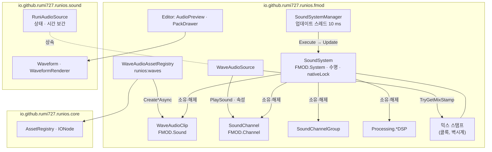

# FMOD 패키지 작동 원리

> 기준 커밋: `3a2b24b9`. 코드 링크의 줄 번호는 이 커밋 기준입니다. 패키지 개요와 사용 규칙은 [패키지 README](../README.md)에 있습니다.

`io.github.rumi727.runios.fmod`(어셈블리 `RuniOS.FMOD`, 에디터 `RuniOS.Editor.FMOD`)는 **FMOD Core API를 수명과 스레드가 안전한 C# 래퍼로 감싸고**, 그 위에 Sound 패키지의 재생 추상화를 구현한 `WaveAudioSource`를 제공합니다. FMOD Studio(이벤트, 뱅크)는 다루지 않습니다.
C#에 익숙하고 이 코드베이스와 FMOD는 처음인 독자를 기준으로 썼습니다. FMOD 개념은 [1장 §1.1](01-system-lifecycle.md#11-fmod-core의-개념과-래퍼)에서 짧게 소개합니다.

## 한 장으로 보기

**핵심 아이디어 세 가지**

1. **리소스는 시스템이 소유하고, 해제권은 하나뿐입니다.** 클립·채널·그룹·DSP는 만들어질 때 시스템의 약한 참조 표에 등록됩니다. 직접 `Dispose`, 채널 종료 콜백, 시스템 종료 중 그 표에서 리소스를 먼저 꺼낸 호출만 네이티브 해제를 합니다. 시스템은 `ReaderWriterLockSlim` 하나로 일반 호출(읽기)과 `Reset`/`Dispose`(쓰기)를 나누고, 리소스 구현은 잠금 밖에서 부릅니다. → [1장](01-system-lifecycle.md), [2장](02-resource-ownership.md), [3장](03-threads-and-locks.md)
2. **믹서가 블록을 끝낼 때마다 (클록, 벽시계) 짝을 찍습니다.** 마스터 그룹 HEAD에 소리를 바꾸지 않는 DSP를 붙여, 믹서 스레드가 블록마다 단일 writer seqlock으로 스탬프를 씁니다. 다른 스레드는 잠금 없이 최신 스탬프를 읽어 "그 위치가 계산된 시각"과 "지금 스피커 위치"를 압니다. → [6장](06-dsp-clock-and-mix-stamp.md)
3. **`WaveAudioSource`는 채널을 상태의 그림자로 다룹니다.** 재생 상태와 시간은 기반 클래스가 가지고, 채널은 재생 중일 때만 만들어 속성을 반영합니다. 채널 위치가 바뀔 때(새 블록)마다 스탬프와 짝을 맞춰 보간 기준점을 다시 잡고, `tempo`와 `pitch`의 분리는 피치 시프트 DSP 단계로 합니다. → [8장](08-wave-audio-source.md)

## 읽는 순서

| 장 | 내용 | 깊이 |
| --- | --- | --- |
| [1. 시스템 수명](01-system-lifecycle.md) | FMOD 개념, `main`, 생성자, 설정, 수명 상태, `Reset`, `Dispose` | **줄 단위** |
| [2. 리소스 소유권](02-resource-ownership.md) | `ISoundSystemResource`, 등록, 해제권, `QueueDispose`, 해제 순서, 리소스 쪽 잠금 | **줄 단위** |
| [3. 스레드와 잠금](03-threads-and-locks.md) | 스레드 지도, 업데이트 스레드, `onUpdate`, `Execute`/`UseNative`, 잠금 표 | 핵심만 |
| [4. 클립 생성과 데이터](04-clip-creation.md) | `Create*`, NONBLOCKING 스트림, 파일 콜백, 속성, PCM 읽기, planar 잡 | 핵심만 |
| [5. SoundChannel과 그룹](05-channel.md) | `PlaySound`, 종료 콜백, 잠금, 위치 보류와 재시도, 루프, 페이드, 그룹 | **줄 단위** |
| [6. DSP 클록과 믹스 스탬프](06-dsp-clock-and-mix-stamp.md) | 믹스 블록, `SetDelay`, 스탬프 DSP, seqlock 쓰기·읽기, 계산 | **줄 단위** |
| [7. DSP 래퍼](07-dsp-wrappers.md) | `CreateDSP`, 기반 클래스, 파라미터 접근자, 내장 DSP 목록 | 요약 |
| [8. WaveAudioSource](08-wave-audio-source.md) | 리로드, `UnsafeSyncChannel`, 블록마다 기준점, 피치 DSP 단계, 채널 상실 | **줄 단위** |
| [9. 리소스와 에디터](09-resources-and-editor.md) | `WaveAudioAssetRegistry`, `AudioPreview`, 리스너 동기화, 팩 드로어, 인스펙터 | 요약 |

**연관 패키지** (이 패키지가 의존하는 것)

| 패키지 | 문서 | 이 패키지에서 쓰는 부분 |
| --- | --- | --- |
| `io.github.rumi727.runios.sound` | [Sound 작동 원리](../../io.github.rumi727.runios.sound/Documentation~/README.md) | `RuniAudioSource`(상태, `playingLock`, [시간 보간](../../io.github.rumi727.runios.sound/Documentation~/03-time-interpolation.md)), 능력 인터페이스, `IAudioClip`, `AudioSpatialState`, `Waveform`/`WaveformRenderer`, 에디터 재생 컨트롤 |
| `io.github.rumi727.runios.core` | — | `AssetRegistry`·`AssetHandle`·`AssetRef`, `IONode`, `MathUtility`, `SafeInvoke`, 수명 주기 특성 |
| FMOD for Unity (`FMOD`, `FMODUnity`) | [FMOD Core API 문서](https://www.fmod.com/docs/2.03/api/core-api.html) | C# 바인딩, `StudioListener`, 벡터 변환 |

## 용어집

| 용어 | 뜻 |
| --- | --- |
| **시스템** | `SoundSystem` 하나 = FMOD `System` 하나. 기본은 `SoundSystem.main` |
| **리소스** | 시스템에 등록된 클립·채널·그룹·DSP (`ISoundSystemResource`) |
| **해제권** | 소유 표에서 리소스를 `Remove`하는 데 성공한 것. 그 호출만 네이티브 해제를 함 |
| **수명 상태** | `Active`, `Resetting`, `Faulted`, `Disposed` |
| **`…Unsafe` 메서드** | 호출자가 필요한 잠금을 들고 상태를 확인했다는 전제로 동작하는 내부 메서드 |
| **블록** | 믹서가 한 번에 계산하는 출력 샘플 묶음. 길이 `bufferLength`, 링 버퍼에 `bufferCount`개 |
| **DSP 클록** | 지금까지 믹스한 출력 샘플 수. 블록 단위로 오름 |
| **출력 지연** | `bufferLength × bufferCount` 샘플. 믹스 위치와 스피커 위치의 차이 |
| **믹스 스탬프** | `(dspClock, outputClock, timestamp)`: 블록 끝 클록, 그때의 스피커 클록, 그 순간의 `Stopwatch` 시각 |
| **seqlock** | 번호를 홀수(쓰는 중)·짝수(완료)로 바꾸며 잠금 없이 일관된 스냅샷을 읽게 하는 방식 |
| **보류 위치** | `ERR_NOTREADY`로 거절된 `setPosition` 값. 업데이트마다 재시도 |
| **가상 채널** | FMOD가 믹스하지 않고 위치만 진행시키는 채널 |
| **피치 DSP 단계** | `pitch / |tempo|` 비율을 0.5~2배 `PitchShiftDSP` 여러 개로 나눈 것 |
| **planar** | 채널마다 연속으로 놓은 샘플 배열 `[channel * sampleCount + sample]` |

## 파일 지도

| 영역 | 파일 |
| --- | --- |
| 시스템 (`Runtime/Sounds`) | `SoundSystem.cs`, `.Reset`, `.Update`, `.Execute`, `.UseNative`, `.ThrowMethods`, `.LogUndisposedResource`, `.Listeners`, `SoundSystemSettings.cs`, `SoundSystemManager.cs` |
| 리소스 계약 | `ISoundSystemResource.cs`, `FMODException.cs`, `SoundUtility.cs` |
| 생성 | `SoundSystem.CreateSound(Async)`, `.CreatePCM(Async)`, `.CreateStream(Async)`, `.CreateChannelGroup`, `.CreateDSP`, `.Play`, `Streams/SoundFileStream.cs` |
| 클립 | `WaveAudioClip.cs`, `.Properties`, `.Music`, `.Data`, `.Execute`, `.UseNative`, `.PlanarSamples`, `.PCM8/16/24/32PlanarJob`, `.FloatPlanarJob`, `PCMDoubleView.cs`, `PCMFormat.cs`, `SoundType.cs`, `SoundOpenState(s).cs` |
| 채널 | `SoundChannel.cs`, `.Playback`, `.Mixing`, `.Mixing.ReverbWetLevel`, `.Spatial`, `.DSP`, `.Group`, `SoundRolloffMode.cs` |
| 그룹 | `SoundChannelGroup.cs`, `.UseNative`, `.Execute`, `.Hierarchy`, `.DSP` |
| 믹스 스탬프 | `SoundSystem.MixStamp.cs`, `.MixStamp.Callbacks.cs`, `SoundMixStamp.cs` |
| DSP (`Runtime/Sounds/Processing`) | `DSP.cs`, `DSP.UseNative.cs`, `DSP.Parameter.*.cs`, `DSPIndex.cs`, `BuiltInDSPOptions.cs`, 내장 래퍼 33개, `Custom/*`(Obsolete) |
| 재생 컴포넌트 | `WaveAudioSource.cs` |
| 리소스 (`Runtime/Resource/Sounds`) | `WaveAudioAssetRegistry.cs`, `WaveAudioAssetHandle.cs`, `WaveAudioAssetImportData.cs`, `WaveAudioAssetLoadMode.cs` |
| 에디터 (`Editor`) | `Sounds/AudioPreview(.Player).cs`, `Sounds/EditorSoundSystemManager.cs`, `Resource/Sounds/WaveAudioClipPackDrawer.cs`, `Unity/Drawers/Sounds/WaveAudioSourceEditor.cs`, `IMGUI/Sounds/WaveAudioTimeUnit.cs` |

## 관찰된 동작

코드에서 관찰했지만 의도라고 확인되지 않은 동작입니다. 각 장에 같은 상자로 표시되어 있습니다.

| 동작 | 장 |
| --- | --- |
| `CreateStream(Stream, leaveOpen)`이 성공한 뒤에도 `SoundFileStream`을 해제함 | [4.3](04-clip-creation.md#43-createstream-nonblocking으로-열고-기다리기) |
| `Reset()`을 기본 설정으로 부르면 `main`의 `VOL0_BECOMES_VIRTUAL`이 빠짐 | [1.6](01-system-lifecycle.md#16-reset) |
| 루프 위치 정규화에서 `end` 이상과 음수의 구간 시작이 다름 | [5.6](05-channel.md#56-위치-정규화와-루프) |
| `dataParameters` getter가 잠금 해제 후에도 FMOD 메모리 `Span`을 돌려줌 | [7.3](07-dsp-wrappers.md#73-파라미터-접근자) |
| `pitchDSPTimeOffset`이 클립 주파수만으로 지연을 계산함 | [8.5](08-wave-audio-source.md#피치-dsp-지연-보정) |

## 그림 목록

| 그림 | 장 |
| --- | --- |
| [인터리브에서 planar로](images/planar-transpose.svg) | 4 |
| [FMOD 믹스 블록과 클록](images/mix-blocks.svg) | 6 |
| [피치 DSP 단계 분해](images/pitch-dsp-cascade.svg) | 8 |
