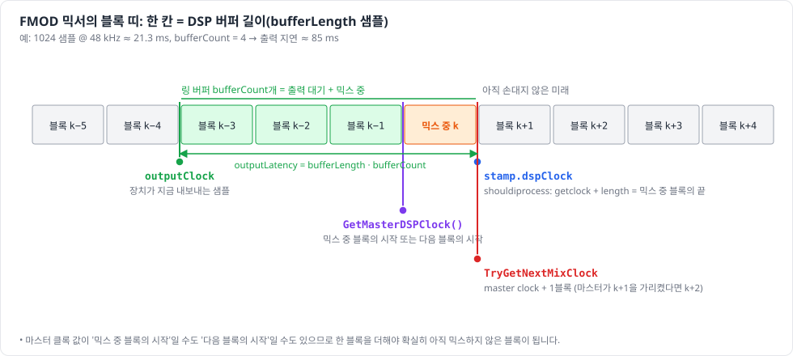
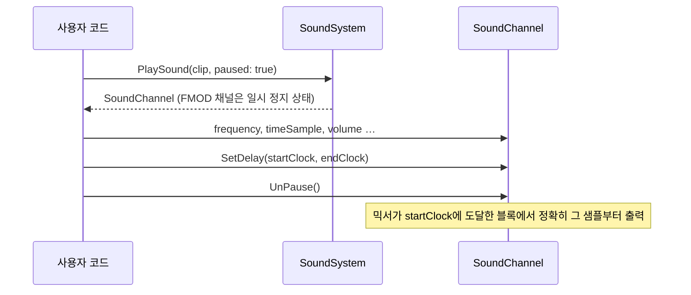
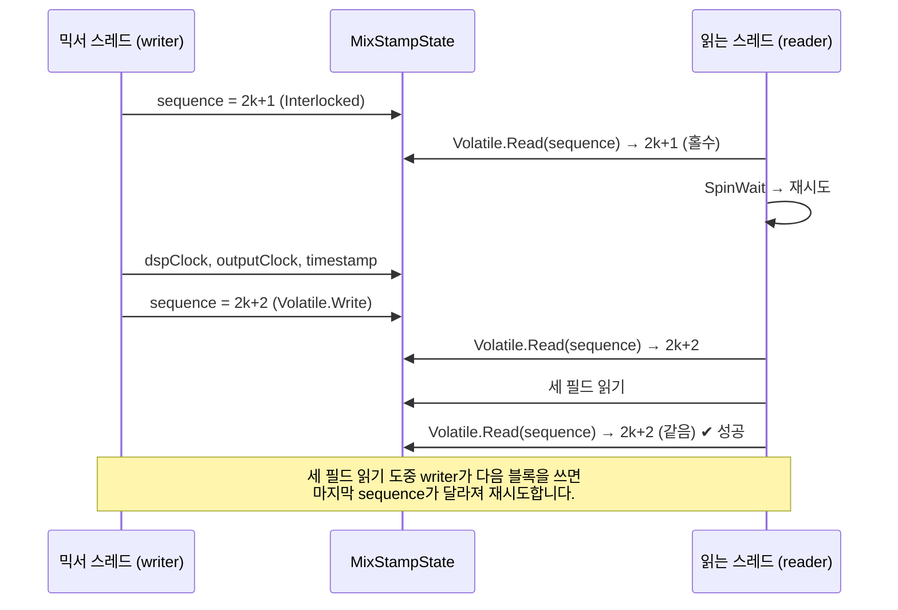

# DSP 클록과 믹스 스탬프

> 기준 커밋: `440c549c`. [← FMOD 문서 목차](README.md)

샘플 단위로 정확한 재생 예약과 "지금 스피커에서 나는 위치" 계산은 모두 이 장의 개념 위에 서 있습니다.

1. [DSP 클록과 믹스 블록](#1-dsp-클록과-믹스-블록)
2. [`SetDelay`: 클록으로 시작·정지 예약](#2-setdelay-클록으로-시작정지-예약)
3. [`timeSample`의 보류와 재시도](#3-timesample의-보류와-재시도)
4. [믹스 스탬프: 무엇을, 왜](#4-믹스-스탬프-무엇을-왜)
5. [쓰기 쪽: 믹서 스레드 콜백 (줄 단위)](#5-쓰기-쪽-믹서-스레드-콜백-줄-단위)
6. [읽기 쪽: `TryGetMixStamp` (줄 단위)](#6-읽기-쪽-trygetmixstamp-줄-단위)
7. [스탬프로 할 수 있는 계산](#7-스탬프로-할-수-있는-계산)

---

## 1. DSP 클록과 믹스 블록

FMOD 믹서는 출력 샘플을 **블록 단위**로 계산합니다. 블록 길이(`bufferLength`)와 블록 개수(`bufferCount`)는 `System::getDSPBufferSize`로 읽고, `SoundSystemSettings.dspBuffer`로 지정할 수 있습니다([`SoundSystem.cs#L351`](../Runtime/Sounds/SoundSystem.cs#L351)).

- **DSP 클록**: 지금까지 믹스한 출력 샘플 수입니다. 마스터 채널 그룹의 `getDSPClock`이 돌려주며, 이 패키지는 [`GetMasterDSPClock()`](../Runtime/Sounds/SoundSystem.cs#L158)으로 노출합니다. 단위는 **출력 샘플**(`outputSampleRate` 기준)입니다.
- 믹서는 블록 하나를 다 계산한 뒤 클록을 `bufferLength`만큼 올립니다. 그래서 클록은 매끄럽게 흐르지 않고 **블록 단위 계단**으로 움직입니다.
- 믹스된 블록은 곧바로 스피커로 가지 않고 `bufferCount`개짜리 링 버퍼에서 기다립니다. 믹서가 제때 따라가고 있으면 버퍼가 가득 차 있으므로, **실제로 스피커에서 나오는 샘플은 믹스 위치보다 `bufferLength · bufferCount` 샘플 뒤**에 있습니다.



| 용어 | 의미 | 코드 |
| --- | --- | --- |
| master DSP clock | FMOD가 알려 주는 현재 클록. **믹스 중인 블록의 시작**일 수도, **다음 블록의 시작**일 수도 있습니다. | `GetMasterDSPClock()` |
| 출력 지연 | 믹스 끝 위치와 스피커 위치의 차이 = `bufferLength · bufferCount` 샘플 | [`CreateMixStampDSPUnsafe`](../Runtime/Sounds/SoundSystem.MixStamp.cs#L124) |
| 다음 믹스 클록 | master clock + 한 블록. 믹서가 **아직 손대지 않았음이 확실한** 첫 클록 | 상위 패키지(예: NBS의 `NBSClockAnchor.TryGetNextMixClock`) |

> 한 블록을 더해야 하는 이유: 클록 값이 "믹스 중인 블록의 시작"이라면 그 블록은 이미 계산되고 있어서, 그 안의 샘플로 예약한 소리는 정확한 위치에서 시작하지 못합니다. 어느 경우든 한 블록 뒤는 아직 믹스 전입니다.

## 2. `SetDelay`: 클록으로 시작·정지 예약

```csharp
// SoundChannel.Playback.cs:752
public void SetDelay(ulong startDspClock = 0, ulong endDspClock = 0, bool stopChannel = true) =>
    native.setDelay(startDspClock, endDspClock, stopChannel).ThrowIfNotOkOfChannel();
```

FMOD `Channel::setDelay`의 얇은 래퍼입니다. 클록은 부모(마스터) DSP 클록 기준입니다.

- `startDspClock`: 이 클록의 **정확한 샘플**에서 소리가 나기 시작합니다. 0이면 즉시 시작합니다.
- `endDspClock`: 이 클록에서 멈춥니다. 0이면 정지 예약이 없습니다. `stopChannel == true`면 정지 시 채널이 끝나고(`END` 콜백 → `onStop`), `false`면 소리만 끊기고 채널은 남습니다.
- 믹서가 이미 지나간 클록을 넣으면 FMOD는 가능한 가장 빠른 시점에 처리합니다. 그래서 정확도가 필요한 쪽은 **다음 믹스 클록 이후**로만 예약합니다.

일반적인 "샘플 정확" 재생 순서는 다음과 같습니다. 일시 정지 상태로 만들어 두고, 모든 속성을 정한 뒤 재개합니다.



[`PlaySoundUnsafe`](../Runtime/Sounds/SoundSystem.Play.cs#L91)는 `paused` 인자와 관계없이 먼저 `playSound(…, paused: true, …)`로 채널을 만들고, 래퍼(`SoundChannel`)를 만든 뒤 `paused == false`일 때만 `setPaused(false)`를 호출합니다. 래퍼를 만드는 동안 소리가 새어 나가지 않게 하기 위해서입니다.

## 3. `timeSample`의 보류와 재시도

비동기로 열리는 사운드는 아직 준비되지 않았을 때 `setPosition`이 `ERR_NOTREADY`를 돌려줍니다. 래퍼는 이 값을 기억해 두었다가 나중에 다시 시도합니다.

```csharp
// SoundChannel.Playback.cs
218  void SetTimeSampleUnsafe(double value)
219  {
220      if (!TryNormalizeTimeSampleUnsafe(ref value))     // ① 루프 모드·샘플 수로 위치를 정규화, 길이 0이면 무시
221          return;
223      uint sample = value.RoundToUInt();
224      RESULT result = native.setPosition(sample, TIMEUNIT.PCM);
225      if (result == RESULT.ERR_NOTREADY)                // ② 아직 열리는 중
226      {
227          pendingTimeSample = sample;                   // ③ 값을 기억하고
228          pendingTimeSampleChannels.TryAdd(this, 0);    //    전역 보류 목록에 등록
230          if (Volatile.Read(ref _isDisposed) != 0)      // ④ 그 사이 해제됐다면 등록 취소
231              pendingTimeSampleChannels.TryRemove(this, out _);
233          return;
234      }
236      pendingTimeSample = null;                         // ⑤ 성공(또는 다른 오류): 보류 해제
237      pendingTimeSampleChannels.TryRemove(this, out _);
238      result.ThrowIfNotOkOfChannel();
239  }
```

- 재시도는 [`SoundSystem.Update()`](../Runtime/Sounds/SoundSystem.Update.cs#L24)가 매번 [`RetryPendingTimeSamples`](../Runtime/Sounds/SoundChannel.Playback.cs#L268)를 불러서 합니다. 같은 시스템의 채널만 골라 [`RetryPendingTimeSample`](../Runtime/Sounds/SoundChannel.Playback.cs#L241)이 다시 `setPosition`을 시도합니다.
- 채널이 끝나면 네이티브 콜백이 보류 목록에서 지웁니다([`SoundChannel.cs#L126`](../Runtime/Sounds/SoundChannel.cs#L126)).

## 4. 믹스 스탬프: 무엇을, 왜

DSP 클록은 블록마다 계단처럼 오르기 때문에, 클록만 보고는 **"이 클록이 벽시계로 언제였는가"**를 알 수 없습니다. 어떤 위치를 매끄럽게 보간하려면 클록과 벽시계 시각의 짝이 필요합니다.

`SoundMixStamp`가 바로 그 짝입니다.

```csharp
public readonly record struct SoundMixStamp(ulong dspClock, ulong outputClock, long timestamp);
```

| 필드 | 의미 |
| --- | --- |
| `dspClock` | 믹서가 **방금 끝낸 블록의 끝** 클록. 이 시점에 마스터 클록과 모든 채널 위치가 이 블록 끝을 가리킵니다. |
| `outputClock` | 같은 순간 스피커에서 나오고 있는 샘플의 클록 = `dspClock − bufferLength · bufferCount` (0 미만이면 0) |
| `timestamp` | 믹서가 이 지점을 지난 벽시계 시각 (`Stopwatch.GetTimestamp()`) |

스탬프는 믹서 스레드가 블록마다 한 번 씁니다. 다른 스레드가 언제든 `TryGetMixStamp`로 최신 스탬프를 읽을 수 있습니다.

### 어떻게 블록마다 끼어드는가

[`CreateMixStampDSPUnsafe`](../Runtime/Sounds/SoundSystem.MixStamp.cs#L124)는 `InitializeNative` 마지막에 호출되어([`SoundSystem.cs#L365`](../Runtime/Sounds/SoundSystem.cs#L365)), 소리를 바꾸지 않는 커스텀 DSP를 **마스터 채널 그룹의 HEAD**에 붙입니다.

```csharp
// SoundSystem.MixStamp.cs
127  native.getDSPBufferSize(out uint bufferLength, out int bufferCount).ThrowIfNotOk();
128  mixStampState->outputLatency = bufferLength * (ulong)bufferCount;   // ① 출력 지연을 한 번 계산해 공유 상태에 저장
130  DSP_DESCRIPTION description = new()
131  {
         …
137      read = mixStampReadCallback,                 // ② 신호를 그대로 복사하는 read (실제로는 거의 불리지 않음)
138      shouldiprocess = mixStampShouldProcessCallback,  // ③ 블록마다 호출되는 진짜 목적
139      userdata = (IntPtr)mixStampState             // ④ 콜백이 쓸 네이티브 메모리 주소
140  };
142  native.createDSP(ref description, out DSP dsp).ThrowIfNotOk();
     …
147  native.getMasterChannelGroup(out ChannelGroup masterGroup).ThrowIfNotOk();
148  masterGroup.addDSP(CHANNELCONTROL_DSP_INDEX.HEAD, dsp).ThrowIfNotOk();  // ⑤ 마스터 그래프 전체가 끝난 뒤 처리되는 위치
```

- ④ 스탬프 상태(`MixStampState`)는 GC가 옮기지 못하도록 `NativeMemory.AllocZeroed`로 할당한 **네이티브 메모리**입니다([`AllocateMixStampState`](../Runtime/Sounds/SoundSystem.MixStamp.cs#L107)). 시스템 하나에 한 번만 할당하며, Reset할 때는 지우기만 하고([`ClearMixStampStateUnsafe`](../Runtime/Sounds/SoundSystem.MixStamp.cs#L122)) 시스템을 해제할 때 반납합니다. 해제에 실패한 시스템은 아직 이 메모리에 쓰고 있을 수 있으므로 반납하지 않습니다([`SoundSystem.cs#L328`](../Runtime/Sounds/SoundSystem.cs#L328)).
- ⑤ HEAD는 마스터 그룹 DSP 체인의 출력 쪽 끝입니다. 모든 채널과 그룹을 섞은 뒤 처리되므로, 매 블록 **같은 지점**에서 스탬프를 찍습니다.
- 콜백 델리게이트는 `static readonly` 필드에 보관해서([`Callbacks.cs#L12`](../Runtime/Sounds/SoundSystem.MixStamp.Callbacks.cs#L12)) 네이티브 썽크가 GC되지 않게 합니다.

## 5. 쓰기 쪽: 믹서 스레드 콜백 (줄 단위)

```csharp
// SoundSystem.MixStamp.Callbacks.cs
29  static unsafe RESULT OnMixStampShouldProcess(ref DSP_STATE dspState, bool inputsIdle, uint length, …)
30  {
31      NativeDSPState* state = (NativeDSPState*)Unsafe.AsPointer(ref dspState);   // ① FMOD가 넘긴 DSP 상태를 포인터로
33      IntPtr userData;
34      RESULT result = state->functions->getuserdata(state, &userData);           // ② 등록할 때 넣은 MixStampState*
        …
38      ulong dspClock;
39      result = state->functions->getclock(state, &dspClock, null, null);         // ③ 이 블록의 시작 클록
        …
44      dspClock += length;                                                        // ④ 블록의 끝으로
46      long timestamp = Stopwatch.GetTimestamp();                                 // ⑤ 지금 벽시계
47      MixStampState* stamp = (MixStampState*)userData;
50      ulong outputLatency = stamp->outputLatency;
51      ulong outputClock = dspClock > outputLatency ? dspClock - outputLatency : 0;   // ⑥ 스피커 위치(언더플로 방지)
55      long sequence = Interlocked.Increment(ref stamp->sequence);   // ⑦ 홀수로 만든다 = "쓰는 중" (전체 펜스)
56      Volatile.Write(ref stamp->dspClock, dspClock);                // ⑧ 데이터
57      Volatile.Write(ref stamp->outputClock, outputClock);
58      Volatile.Write(ref stamp->timestamp, timestamp);
59      Volatile.Write(ref stamp->sequence, sequence + 1);            // ⑨ 짝수로 만든다 = "완료" (release)
62      return RESULT.ERR_DSP_DONTPROCESS;                            // ⑩ "처리할 것 없음" → 믹서가 입력을 그대로 통과
63  }
```

1. ①② FMOD의 `DSP_STATE`는 C# 바인딩에서 함수 테이블 접근이 불편해서, 같은 메모리 배치를 가진 `NativeDSPState`/`NativeDSPStateFunctions` 구조체([`Callbacks.cs#L98`](../Runtime/Sounds/SoundSystem.MixStamp.Callbacks.cs#L98) 이하)로 다시 해석해 함수 포인터 `getuserdata`·`getclock`을 직접 부릅니다.
2. ③④ `getclock`은 **지금 처리할 블록의 시작** 클록을 줍니다. 블록이 다 믹스되면 마스터 클록과 채널 위치는 그 끝에 있으므로 `length`를 더해 끝으로 맞춥니다. 이렇게 해야 같은 순간에 읽은 채널 위치와 짝이 맞습니다.
3. ⑤ 벽시계는 콜백 안에서 바로 찍습니다. "믹서가 이 지점을 지난 시각"에 가장 가깝습니다.
4. ⑦~⑨ **단일 writer seqlock**입니다. writer는 믹서 스레드 하나뿐이라 쓰기끼리 경쟁하지 않습니다.
   - `Interlocked.Increment`는 전체 메모리 펜스입니다. 그래서 데이터를 쓰기 **전에** 홀수 sequence가 다른 코어에 먼저 보입니다.
   - 마지막 `Volatile.Write`(release)로 짝수를 공개하면, 그 전에 쓴 데이터가 모두 보인 뒤에 짝수가 보입니다.
   - 처음에 sequence는 0이고, 첫 쓰기를 마치면 2가 됩니다. 0은 "아직 한 번도 안 씀"을 뜻합니다.
5. ⑩ `shouldiprocess`에서 `ERR_DSP_DONTPROCESS`를 돌려주면 FMOD는 `read`를 부르지 않고 입력을 출력으로 넘깁니다. 이 DSP는 소리에 아무 영향을 주지 않고 오디오 처리 비용도 거의 없습니다. `read`([`OnMixStampRead`](../Runtime/Sounds/SoundSystem.MixStamp.Callbacks.cs#L70))는 만일을 대비한 단순 복사입니다.

## 6. 읽기 쪽: `TryGetMixStamp` (줄 단위)

```csharp
// SoundSystem.MixStamp.cs
64  public unsafe bool TryGetMixStamp(out SoundMixStamp stamp)
65  {
66      nativeLock.EnterReadLock();                       // ① Reset/Dispose가 메모리를 지우거나 반납하는 중이 아님을 보장
        try
        {
            ThrowIfUnavailableUnsafe();                   // ② 해제·리셋 중이면 예외
            MixStampState* state = mixStampState;
            while (true)
            {
75              long sequence = Volatile.Read(ref state->sequence);   // ③ 시작 번호 (acquire)
76              if (sequence == 0)                                    // ④ 아직 한 블록도 안 믹스됨
                {
                    stamp = default;
                    return false;
                }
                if ((sequence & 1) != 0)                              // ⑤ 홀수: 믹서가 쓰는 중
                {
85                  System.Threading.Thread.SpinWait(1);              //    잠깐 돌고 다시
                    continue;
                }
89              ulong dspClock = Volatile.Read(ref state->dspClock);    // ⑥ 데이터 복사
90              ulong outputClock = Volatile.Read(ref state->outputClock);
91              long timestamp = Volatile.Read(ref state->timestamp);
93              if (Volatile.Read(ref state->sequence) == sequence)     // ⑦ 그 사이 번호가 안 바뀌었으면 일관된 스냅샷
                {
                    stamp = new SoundMixStamp(dspClock, outputClock, timestamp);
                    return true;
                }
            }                                                           // ⑧ 바뀌었으면 처음부터 다시
        }
        finally { nativeLock.ExitReadLock(); }
    }
```



- 잠금 없이 읽으므로 믹서 스레드를 절대 막지 않습니다. 믹서 쪽 쓰기는 몇 번의 저장뿐이라 홀수 상태는 아주 짧고, 회전도 짧게 끝납니다.
- **스탬프는 "최신 한 개"만 유지합니다.** 읽는 쪽이 늦으면 중간 블록 스탬프는 건너뜁니다. 대신 `dspClock`이 바뀌었는지로 "새 블록이 믹스됐는가"를 알 수 있습니다.

## 7. 스탬프로 할 수 있는 계산

스탬프 하나 `(dspClock, outputClock, timestamp)`와 샘플 레이트 `R`이 있으면 다음을 계산할 수 있습니다.

| 하고 싶은 것 | 계산 |
| --- | --- |
| 믹서가 클록 `c`(> `dspClock`)에 도달하는 벽시계 시각 | `timestamp + (c − dspClock) / R · Stopwatch.Frequency` |
| 스탬프 순간의 출력 지연(초) | `(dspClock − outputClock) / R` |
| 스탬프 순간 채널 위치 `p`의 "출력 위치" | `p − (dspClock − outputClock) / R · 재생 속도` |
| 새 블록이 믹스되었는가 | `stamp.dspClock != 마지막으로 본 dspClock` |

`SoundSystem.Update()`는 약 10 ms마다 돌고 블록은 약 21 ms(1024 샘플 @ 48 kHz)이므로, `onUpdate`에서 스탬프를 보면 대개 **블록당 한 번** 새 값을 만납니다. 이 값을 기준점으로 Sound 패키지의 [시간 보간](../../io.github.rumi727.runios.sound/Documentation~/time-interpolation.md)을 다시 잡는 것이 `WaveAudioSource`([wave-audio-source.md](wave-audio-source.md))가 하는 일입니다.
