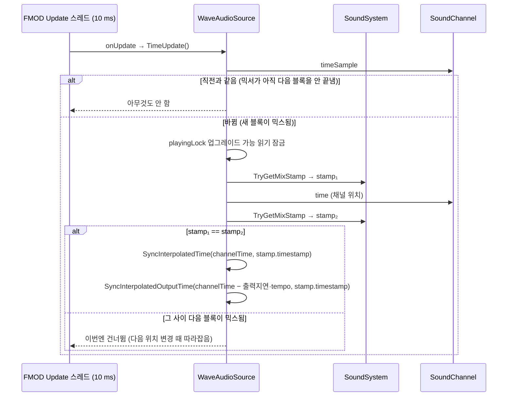

# WaveAudioSource의 시간 동기화

> 기준 커밋: `440c549c`. [← FMOD 문서 목차](README.md)

`WaveAudioSource`는 `RuniAudioSource`([Sound 패키지 문서](../../io.github.rumi727.runios.sound/Documentation~/README.md))를 상속하고, `WaveAudioClip` 하나를 `SoundChannel` 하나로 재생합니다.
**채널의 재생 위치가 기준값**이며, `time`·`outputTime`은 그 위치를 [믹스 스탬프](dsp-clock-and-mix-stamp.md)와 짝지어 보간합니다.

## 큰 그림



## 1. 새 블록 감지: `TimeUpdate`

```csharp
// WaveAudioSource.cs
351  SoundSystem.main.onUpdate += TimeUpdate;          // OnEnable에서 구독
…
354  void TimeUpdate()
355  {
356      uint timeSample = this.timeSample;            // ① 채널의 현재 PCM 위치
357      if (lastTimeSamples != timeSample)            // ② 블록 단위로만 바뀌므로 '바뀜' = 새 블록
358      {
359          lastTimeSamples = timeSample;
361          playingLock.EnterUpgradeableReadLock();   // ③ 다른 명령과 직렬화(필요하면 쓰기로 승격)
363          try { UnsafeSyncChannel(mixerAdvanced: true); }
             finally { playingLock.ExitUpgradeableReadLock(); }
371      }
372  }
```

- FMOD 채널 위치는 블록마다 한 번 갱신되므로, 위치가 바뀐 순간이 "믹서가 방금 한 블록을 끝냈다"는 신호입니다.
- `onUpdate`는 `nativeLock` 읽기 잠금 아래에서 호출됩니다([FMOD 문서 README](README.md#스레드와-잠금-요약)).

## 2. 위치와 스탬프를 짝짓기: `TryGetChannelTimeAtMixStamp`

```csharp
397  static bool TryGetChannelTimeAtMixStamp(SoundChannel channel, out double time, out SoundMixStamp stamp)
398  {
399      SoundSystem system = channel.system;
400      time = 0;
402      if (!system.TryGetMixStamp(out stamp))        // ① 블록 끝의 (클록, 벽시계)
403          return false;
405      time = channel.time;                          // ② 채널 위치
406      return system.TryGetMixStamp(out SoundMixStamp after) && stamp == after;   // ③ 그 사이 새 블록이 없었는가
407  }
```

①과 ③이 같다면 ②의 위치는 **그 스탬프 블록의 끝**에서의 위치가 확실합니다. 믹서는 블록 사이에서만 위치와 스탬프를 동시에 바꾸기 때문입니다. 다르면 위치가 어느 블록 것인지 모르므로 버립니다. 다음 블록에서 위치가 다시 바뀌면 그때 따라잡습니다.

## 3. 기준점 다시 잡기: `UnsafeSyncChannel`

[`UnsafeSyncChannel(mixerAdvanced)`](../Runtime/Sounds/WaveAudioSource.cs#L690)은 재생 상태와 채널을 맞추는 중심 메서드입니다. 시간과 관련된 부분만 보면 다음과 같습니다.

```csharp
703  double currentTime = time + pitchDSPTimeOffset;            // ① 노출 시간 → 채널 시간
704  if (scope == null || !isPlaying || !double.IsFinite(currentTime) ||
707      (!loop && (currentTime < 0 || currentTime > scope.asset.length)))
     {
710      StopChannel();                                          // ② 재생할 수 없으면 채널 정리
711      return;
     }
714  if (channel != null)
     {
716      if (!mixerAdvanced)                                     // ③ 명령(Play, 리로드, 속성 변경)에서 온 동기화
         {
718          double setTime = channel.time;
719          SyncInterpolatedTime(setTime);                      //    '지금' 기준으로 채널 위치에 맞춤
720          SyncOutputTimeToLatestMixStamp(channel, setTime);   //    출력 시간은 최신 스탬프의 지연으로 보정
         }
722      else if (TryGetChannelTimeAtMixStamp(channel, out double channelTime, out SoundMixStamp stamp))
         {
724          SyncInterpolatedTime(channelTime, stamp.timestamp); // ④ 믹서 진행에서 온 동기화: 스탬프 시각 기준
725          SyncOutputTimeToMixStamp(channelTime, stamp, channel.system.outputSampleRate);
         }
     }
     else
     {
730      // ⑤ 채널이 없으면 PlaySound(paused: true)로 만들고, onStop 구독, time 설정, 속성 적용 후
         //    SyncOutputTimeToLatestMixStamp(newChannel, currentTime)
     }
```

- ④가 핵심입니다. `SyncInterpolatedTime(time, timestamp)`의 두 번째 인자로 **스탬프의 벽시계**를 넘깁니다. 그래서 보간이 "이 업데이트가 위치를 발견한 시각"이 아니라 "믹서가 그 위치를 계산한 시각"부터 시작합니다. 업데이트 스레드가 늦게 돌아도 기울기가 틀어지지 않습니다.
- [`SyncOutputTimeToMixStamp`](../Runtime/Sounds/WaveAudioSource.cs#L428):

  ```csharp
  430  double outputDelay = (stamp.dspClock - stamp.outputClock) / (double)sampleRate;   // 출력 지연(초)
  431  SyncInterpolatedOutputTime(channelTime - (outputDelay * tempo), stamp.timestamp);
  ```

  스피커는 블록 끝보다 출력 지연만큼 뒤에 있습니다. 타임라인으로는 `지연 × tempo`만큼 뒤입니다.

## 4. `pitchDSPTimeOffset`

```csharp
302  double pitchDSPTimeOffset
     {
         get
         {
             float frequency = clipFrequency;
             float tempo = this.tempo;
             if (frequency <= 0 || !float.IsNormal(tempo))
                 return 0;
             double offset = pitchDSPCount * (pitchDSPFFTSize / frequency);   // FFT 4096 샘플짜리 PitchShift DSP 개수만큼의 지연
             return tempo < 0 ? -offset : offset;
         }
     }
```

`tempo`와 `pitch`를 따로 바꾸기 위해 채널에 `PitchShiftDSP`(FFT 크기 4096)를 붙이면, DSP마다 `4096 / frequency`초의 지연이 생깁니다. 그래서 다음과 같이 보정합니다.

- getter: `time`과 `outputTime`([`#L39`](../Runtime/Sounds/WaveAudioSource.cs#L39), [`#L49`](../Runtime/Sounds/WaveAudioSource.cs#L49))은 채널 기준 시간에서 이 지연을 뺍니다.
- setter: 채널에는 이 지연을 더한 위치를 넣습니다([`#L58`](../Runtime/Sounds/WaveAudioSource.cs#L58)).

## 5. 에디터 `AudioPreview`와의 차이

`Editor/Sounds/AudioPreview(.Player).cs`는 씬 없이 오디오 파일을 들어 보는 에디터 전용 플레이어입니다. 정확도보다 단순함을 택했습니다.

| | `WaveAudioSource` | `AudioPreview.Player` |
| --- | --- | --- |
| 기준 위치 | 채널 위치 + 믹스 스탬프 짝 | 채널 위치 |
| 보간 기준 시각 | 스탬프 `timestamp`(Stopwatch) | 위치 변화를 처음 본 `EditorApplication.timeSinceStartup` |
| 출력 지연 보정 | 있음(`outputTime`) | 없음 |
| 결과 | 믹서가 위치를 계산한 순간 기준으로 정확 | 계단만 없앤 근사(`min(channelTime + 경과, length)`) |

`AudioPreview`는 노드(`IONode`)마다 `WaveAudioClip`과 파형을 정적 캐시에 공유하고, `globalVolume`, `globalLoop`, `autoPlay`를 모든 플레이어에 적용합니다.
