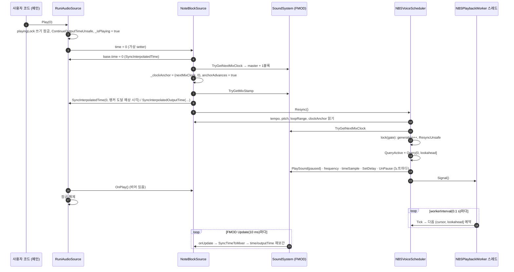

# 1. API 시작점과 호출 그래프

> 기준 커밋: `440c549c`. [← 목차](README.md) · 다음: [2. 데이터 모델](02-data-model.md)

## 1.1 가장 흔한 사용

```csharp
using RuniOS.NBS;

NoteBlockSource source = gameObject.AddComponent<NoteBlockSource>();
source.clip = myClipRef;          // AssetRef<NoteBlockClip>: 활성 상태면 즉시 Reload() 시작
source.loop = true;               // 반복 여부는 항상 loop가 정함
source.useFileLoopSettings = true;// (기본값) 헤더 반복이 켜져 있으면 범위만 파일 설정 사용
source.tempo = 1.5f;              // 타임라인 속도 (음수 = 역방향)
source.pitch = 1f;                // 소리 높이 (음수 = 소리 역재생)
source.Play();                    // 0초부터. Play(12.3)이면 그 위치부터
…
double seconds = source.time;     // 반복 구간으로 접힌 재생 위치 (믹서 기준)
double heard   = source.outputTime; // 스피커에서 지금 나는 위치
double tick    = source.tick;     // 템포 맵을 통한 NBS tick
source.tick = 64;                 // tick으로 seek
source.Pause(); source.UnPause(); source.Stop();
```

`NoteBlockSource`는 `RuniAudioSource`([Sound 패키지](../../io.github.rumi727.runios.sound/Documentation~/README.md))를 상속합니다. 재생 제어 인터페이스를 모두 구현하므로, 그 인터페이스를 받는 UI(`PlaybackController`, `NBSNoteGridView`)에 그대로 넘길 수 있습니다.

| 멤버 | 설명 |
| --- | --- |
| `clip` / `loadedClip` | 참조 / 실제로 로드된 클립(로드 전 `null`) |
| `scheduler` | 로드된 클립을 재생하는 `NBSVoiceScheduler<NoteBlockSource>`. 직접 조작하면 소스와 어긋납니다. |
| `clockAnchor` | 타임라인의 정의([3장](03-clock-anchor.md)) |
| `loopRange` | 실제로 쓰이는 반복 범위([3.7](03-clock-anchor.md#37-반복-구간-접기-nbslooprangefold)) |
| `reversePitchAlignment` | pitch < 0일 때 소리 배치([5.5](05-timeline-placement.md#55-nbsnoteplacement-8가지-경우)) |
| `directInstrumentNamespace` | 에셋을 직접 참조할 때 커스텀 악기를 찾을 네임스페이스(임시) |
| `rolloffMode`, `spatialBlend`, … | 3D 믹스([6.9](06-commands-lifecycle.md#69-믹스-속성)) |
| `Reload()` | 클립·악기를 다시 로드([6.10](06-commands-lifecycle.md#610-리로드와-생명주기-noteblocksource)) |

## 1.2 `Play()`를 따라가기



각 단계의 자세한 내용:

| 단계 | 장 |
| --- | --- |
| 4~8: 앵커와 보간 | [3. 클록 앵커](03-clock-anchor.md) |
| 9~13: Resync와 예약 | [4. 워커와 예약](04-worker-scheduling.md), [5. 타임라인과 배치](05-timeline-placement.md) |
| 반복 루프 | [4.5 Tick](04-worker-scheduling.md#45-tick-워커-한-번의-순회-줄-단위), [3.5 SyncTimeToMixer](03-clock-anchor.md#35-믹서를-따라가기-synctimetomixer) |
| 다른 명령 | [6. 명령과 생명주기](06-commands-lifecycle.md) |

> 클립이 아직 로드 중이면 `scheduler`가 `null`이라 9~13단계가 없습니다. 앵커는 그대로 진행하고, 로드가 끝나 새 스케줄러가 생기면 첫 `Tick`이 Resync하여 그 위치의 소리부터 재생합니다.

## 1.3 커스텀 트랜스포트

`NoteBlockSource` 없이도(예: 에디터 프리뷰, 자체 타임라인 엔진) 스케줄러를 쓸 수 있습니다. 트랜스포트가 다음 인터페이스를 모두 구현하면 됩니다.

```csharp
public sealed partial class NBSVoiceScheduler<TTransport> : IDisposable, NBSPlaybackWorker.IClient
    where TTransport : class, INBSTransport, ISeekable, ITempoControl, IPitchControl, ILoopControl, IPausable
```

```csharp
public interface INBSTransport
{
    NBSClockAnchor clockAnchor { get; }   // 일시 정지·정지 중에는 time이 유지 위치
    NBSLoopRange? loopRange { get; }      // null = 반복 안 함
}
```

스케줄러가 트랜스포트에서 읽는 것은 `isPlaying`, `isPaused`, `tempo`, `pitch`, `loopRange`, `clockAnchor`뿐입니다. 이 값들은 **워커 스레드에서** 읽히므로 스레드 안전해야 합니다.

**트랜스포트 주인의 의무**: 불연속이 생기면 먼저 앵커를 옮기고, 그다음 알맞은 명령을 부릅니다.

| 일어난 일 | 앵커 | 명령 |
| --- | --- | --- |
| seek, 재생 시작 | `(TryGetNextMixClock, 새 위치)` | `Resync()` |
| tempo 변경 | 옛 tempo로 다음 믹스 클록에서의 위치를 구해 `(그 클록, 그 위치)` | `OnRateChanged()` |
| pitch 변경 | 그대로 | `OnRateChanged()` |
| 일시 정지 / 재개 | 상태를 바꾸기 **전에** 위와 같이 이동 | `Pause()` / `UnPause()` |
| 반복 변경 | 옛 범위로 접은 위치로 이동 | `OnLoopChanged()` |
| 정지 | 위치 0 | `Stop()` |
| 사운드 시스템 리셋 | 리셋 전 위치를 새 클록에 | `Resync()` |

최소 구현 예는 [`NBSPreviewTransport`](08-editor-preview.md#84-nbspreviewtransport-줄-단위)입니다(약 200줄).

```csharp
var bank = await NBSInstrumentBank.LoadAsync(clip.map, "my_namespace");
var transport = new MyTransport(clip);                       // INBSTransport + 제어 인터페이스
var scheduler = new NBSVoiceScheduler<MyTransport>(clip, bank, transport);   // 생성하면 워커에 등록
transport.scheduler = scheduler;
transport.Play(0);                                           // 내부에서 앵커 → scheduler.Resync()
…
scheduler.Dispose();                                         // 먼저 스케줄러
bank.Dispose();                                              // 그다음 bank
```

## 1.4 전역 설정

[`NBSPlaybackSettings`](../Runtime/NBS/Playback/NBSPlaybackSettings.cs) (모든 스케줄러 공통, 스레드 안전):

| 속성 | 기본값 | 의미 |
| --- | --- | --- |
| `workerInterval` | 0.1 s | 워커 순회 주기 |
| `schedulingLookahead` | 0.2 s | 순회마다 벽시계로 얼마나 앞까지 예약하는가 |

자세한 의미는 [4.9](04-worker-scheduling.md#49-설정값의-의미)를 보세요. 에디터에서는 `NoteBlockSource` 인스펙터의 트랜스포트 영역에서 바꿀 수 있습니다.

`NBSPlaybackWorker.Signal()`은 워커를 즉시 깨웁니다. 명령들이 내부에서 이미 부르므로 직접 부를 일은 거의 없습니다.
