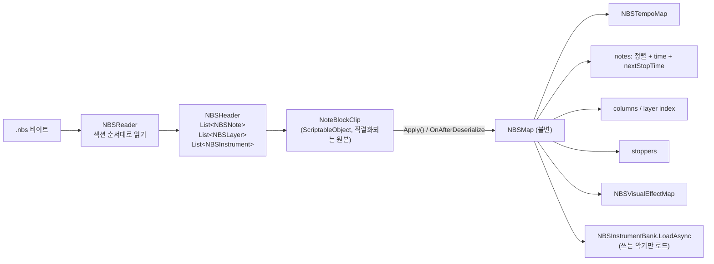
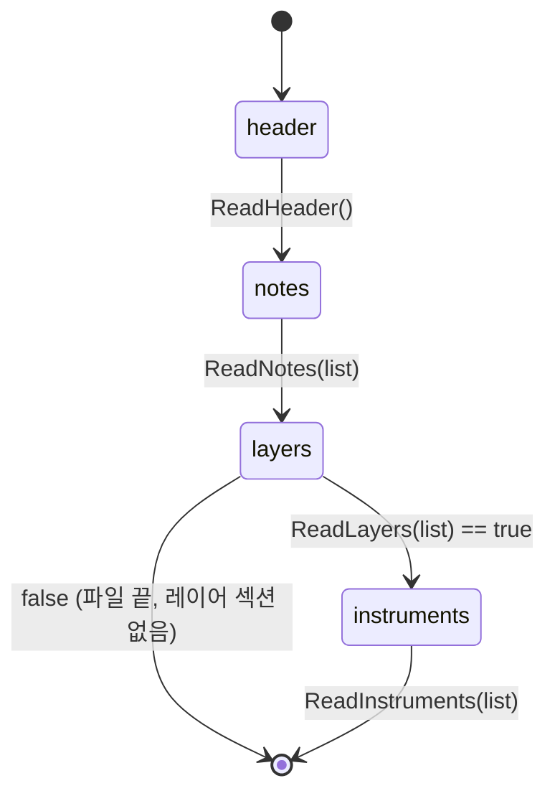
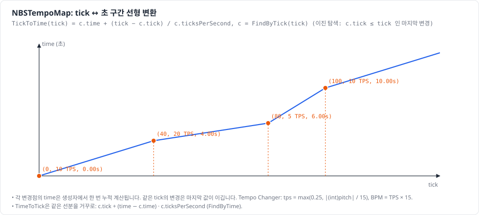

# 2. 데이터 모델: `.nbs` 파일에서 불변 맵까지

> 기준 커밋: `440c549c`. [← 목차](README.md) · 이전: [1. API 시작점](01-api-entry.md) · 다음: [3. 클록 앵커](03-clock-anchor.md)

재생 코드(3~6장)는 **불변 맵 `NBSMap`**만 읽습니다. 이 장은 파일이 그 맵이 되기까지의 과정을 다룹니다.



- [2.1 불러오는 세 경로](#21-불러오는-세-경로)
- [2.2 `NBSReader`](#22-nbsreader)
- [2.3 `NoteBlockClip`: 편집 가능한 원본 + 불변 맵](#23-noteblockclip-편집-가능한-원본--불변-맵)
- [2.4 `NBSMap` 빌드 (줄 단위)](#24-nbsmap-빌드-줄-단위)
- [2.5 `NBSTempoMap`](#25-nbstempomap)
- [2.6 조회 API](#26-조회-api)
- [2.7 기능성 악기, 레이어 잠금, 믹스](#27-기능성-악기-레이어-잠금-믹스)
- [2.8 `NBSVisualEffectMap`](#28-nbsvisualeffectmap)
- [2.9 `NBSInstrumentBank`](#29-nbsinstrumentbank)

---

## 2.1 불러오는 세 경로

| 경로 | 진입점 | 스레드 |
| --- | --- | --- |
| Unity 에셋 | `NoteBlockClipImporter`(`[ScriptedImporter(1, "nbs")]`) → `NoteBlockClip.Create(FileStream)` | 메인(임포트) |
| 리소스팩 | `NBSAssetRegistry`(`runios:nbs`, 폴더 `assets/{ns}/nbses`) → `NBSAssetHandle.Load` → `NoteBlockClip.LoadAsync(IONode)` | 읽기·빌드는 스레드풀, 생성은 메인 |
| 코드 | `NoteBlockClip.Create()`, `Create(header, notes, layers, instruments)`, `Create(Stream)`, `LoadAsync(IONode)` | 호출자 |

```csharp
// NBS/NoteBlockClip.cs
196  public static async UniTask<NoteBlockClip> LoadAsync(IONode node, CancellationToken cancellationToken = default)
     {
206      await using (Stream stream = await node.file.OpenRead(cancellationToken))
         {
208          await UniTask.SwitchToThreadPool();                   // ① 파싱은 스레드풀에서
209          Read(stream, out header, out notes, out layers, out instruments);
         }
212      cancellationToken.ThrowIfCancellationRequested();
213      NBSMap map = CreateMap(header, notes, layers, instruments);   // ② 맵 빌드도 스레드풀에서 (불변이라 안전)
215      await UniTask.SwitchToMainThread(cancellationToken);      // ③ ScriptableObject 생성은 메인 스레드
217      NoteBlockClip clip = Create(header, notes, layers, instruments, map);   //    이미 만든 맵을 그대로 넣음
218      clip.name = Path.GetFileNameWithoutExtension(node.name);
219      return clip;
     }
```

## 2.2 `NBSReader`

[`NBSReader`](../Runtime/NBS/NBSReader.cs)는 스트림을 **섹션 단위로 순서대로** 읽는 public 리더입니다. 파일 전체를 버퍼에 올리지 않습니다.



- 섹션 순서가 틀리면 `ExpectSection`([#L386](../Runtime/NBS/NBSReader.cs#L386))이 예외를 던집니다. 어느 섹션 뒤에서든 멈출 수 있어서, 헤더만 읽을 수도 있습니다.
- **헤더** ([`ReadHeader`](../Runtime/NBS/NBSReader.cs#L131))
  - 첫 `int16`이 0이면 신형 포맷입니다. 이어서 version(6 초과면 예외), 바닐라 악기 수, (v3+) 곡 길이를 읽습니다.
  - 0이 아니면 v0이고, 그 값이 곡 길이입니다.
  - 박자표는 2~8로, 작업 통계는 0 이상으로 제한합니다.
  - 반복 정보(loop, maxLoopCount, loopStartTick)는 v4+에만 있습니다.
- **노트** ([`ReadNotes`](../Runtime/NBS/NBSReader.cs#L208))
  - tick 점프와 layer 점프를 누적해 좌표를 만듭니다. 음수 점프이거나 `int` 범위를 넘으면 예외입니다.
  - velocity, panning, pitch는 v4+에만 있습니다. 없으면 기본값 100, 100, 0입니다.
  - key는 `min(key, 87)`로 제한합니다. velocity, panning, pitch는 제한하지 않습니다.
  - **커스텀 악기 인덱스 재배치**: 파일의 바닐라 악기 수가 20보다 적으면(옛 버전), 커스텀 악기 인덱스를 `20 − vanillaCount`만큼 밀어 **항상 "바닐라 20개 다음이 커스텀"** 배치로 맞춥니다([#L214](../Runtime/NBS/NBSReader.cs#L214)). v0 파일은 헤더에 바닐라 수가 없어 0으로 두고 오프셋도 0입니다. 즉 v0에서는 인덱스를 옮기지 않습니다(관찰된 동작).
- **레이어**: 섹션이 없을 수 있습니다(파일 끝이면 `false`). 이름, (v4+) lock, volume(≤100), (v2+) panning을 읽습니다.
- **악기**: 개수, 그리고 악기마다 이름, 사운드 파일, key, pressKey를 읽습니다.
- **문자열**: 엄격한 UTF-8로 읽고, 실패하면 Latin-1(바이트를 그대로 문자로)로 읽습니다.

## 2.3 `NoteBlockClip`: 편집 가능한 원본 + 불변 맵

```csharp
// NBS/NoteBlockClip.cs — 직렬화되는 원본 (Unity가 저장)
27   [field: SerializeField] public NBSHeader header { get; set; } = new NBSHeader();
33   [field: SerializeField] public List<NBSNote> notes { get; private set; } = [];
39   [field: SerializeField] public List<NBSLayer> layers { get; private set; } = [];
45   [field: SerializeField] public List<NBSInstrument> instruments { get; private set; } = [];
56   NBSMap _map = new NBSMap(new NBSHeader(), default, default, default);                 // 직렬화하지 않음, 처음엔 빈 맵

55   public NBSMap map => Volatile.Read(ref _map);                                         // 어느 스레드에서든 잠금 없이
68   public void Apply() => Volatile.Write(ref _map, CreateMap(header, notes, layers, instruments));   // Texture2D.Apply처럼
251  void ISerializationCallbackReceiver.OnAfterDeserialize() => Apply();                  // 로드 시 재빌드 (맵은 직렬화 안 함)
```

- 편집은 원본 리스트를 바꾸고 `Apply()`합니다. 맵은 **통째로 새로 만들어 참조를 교체**합니다. 기존 맵을 읽던 스레드(워커)는 옛 맵을 끝까지 안전하게 읽습니다. 그다음 순회에서 참조가 바뀐 것을 보고 새 타임라인으로 Resync합니다([4.5 ⑥](04-worker-scheduling.md#45-tick-워커-한-번의-순회-줄-단위)).
- 노트와 레이어는 서로 독립이며, 노트는 `(tick, layer)` 좌표만 가집니다. 레이어 행이 없는 노트도 있을 수 있습니다(2.7).

## 2.4 `NBSMap` 빌드 (줄 단위)

```csharp
// NBS/NBSMap.cs
40  public NBSMap(NBSHeader header, ReadOnlySpan<NBSNote> notes, ReadOnlySpan<NBSLayer> layers, ReadOnlySpan<NBSInstrument> instruments)
    {
42      this.header = header;
43      this.layers = [..layers];                                  // ① ImmutableArray로 복사
44      this.instruments = [..instruments];
46      functions = new NBSInstrumentFunction[instruments.Length]; // ② 커스텀 악기의 기능(이름으로 판정)을 미리 계산
48          functions[i] = instruments[i].function;
51          hasSolo |= layers[i].lockState == NBSLayerLock.solo;   // ③ 솔로 레이어가 하나라도 있는가
53      NBSMapNote[] sorted = new NBSMapNote[notes.Length];
55          sorted[i] = new NBSMapNote(notes[i], i, 0, double.PositiveInfinity);   // ④ 원본 인덱스 보존, time/stop은 나중에
57      SortByTickAndLayer(sorted);                                // ⑤ (tick, layer) 정렬
59      tempo = CreateTempoMap(header, sorted);                    // ⑥ 템포 맵
60      columns = AssignTimes(sorted, out var soundStoppers);      // ⑦ 노트 시각 + tick 열 + Stopper 수집
61      stoppers = soundStoppers;
62      AssignNextStopTimes(sorted, soundStoppers);                // ⑧ 노트별 '다음 Stopper' 시각
66          sourceToMap[sorted[i].sourceIndex] = i;                // ⑨ 원본 인덱스 → 맵 인덱스
68      CreateLayerIndex(sorted, out layerStarts, out layerNotes); // ⑩ 레이어별 인덱스 (CSR)
70      tickLength = sorted.Length > 0 ? sorted[^1].tick + 1 : 0;
71      length = tempo.TickToTime(tickLength);                     // ⑪ 곡 길이 = 마지막 tick + 1 (헤더의 songLength는 쓰지 않음)
73      this.notes = new NoteCollection(this, ImmutableCollectionsMarshal.AsImmutableArray(sorted));
74      visualEffects = new NBSVisualEffectMap(sorted, instruments);
    }
```

### ⑤ 적응형 정렬

```csharp
// NBS/NBSMap.Build.cs
27  static void SortByTickAndLayer(NBSMapNote[] notes)
    {
30      long budget = (long)notes.Length * (BitOperations.Log2((uint)Math.Max(notes.Length, 1)) + 1);   // ≈ n·log n
31      long moves = 0;
33      for (int i = 1; i < notes.Length; i++)                     // 삽입 정렬
        {
            NBSMapNote current = notes[i];
            int j = i - 1;
37          while (j >= 0 && comparer.Compare(notes[j], current) > 0)
                { notes[j + 1] = notes[j]; j--; moves++; }
44          notes[j + 1] = current;
45          if (moves > budget)                                    // 이동이 introsort 비용을 넘으면
            {
47              notes.AsSpan().Sort(comparer);                     // 나머지를 Span.Sort(introsort, 불안정)로
48              return;
            }
        }
    }
```

파일에서 읽은 노트는 이미 정렬되어 있고, 편집은 보통 몇 개만 옮깁니다. 그런 입력이면 삽입 정렬이 `O(n)`에 끝납니다. 많이 흐트러진 입력은 이동 수가 예산을 넘는 순간 introsort로 바꿉니다. 같은 `(tick, layer)`의 노트끼리는 순서를 정하지 않습니다.

### ⑥ 템포 맵 만들기

```csharp
54  NBSTempoMap CreateTempoMap(NBSHeader header, NBSMapNote[] sorted)
    {
57      for (…)
60          if (GetFunction(note.instrument) == NBSInstrumentFunction.tempoChanger)              // 레이어 잠금과 무관
61              changes.Add((note.tick, Math.Max(minimumTicksPerSecond, Math.Abs((int)note.pitch) / 15d)));   // TPS = max(0.25, |pitch|/15)
64      double initialTicksPerSecond = double.IsFinite(header.ticksPerSecond) ? Math.Max(minimumTicksPerSecond, header.ticksPerSecond) : minimumTicksPerSecond;   // 헤더 rawTempo/100
65      return new NBSTempoMap(initialTicksPerSecond, CollectionsMarshal.AsSpan(changes));
    }
```

Tempo Changer의 pitch 값이 BPM이라는 뜻입니다(`TPS = BPM/15`, NBS 한 박 = 4 tick).

### ⑦ `AssignTimes`: 시각과 열

```csharp
68  ImmutableArray<NBSMapColumn> AssignTimes(NBSMapNote[] sorted, out ImmutableArray<NBSSoundStopper> soundStoppers)
    {
74      int segment = 0;                                         // 템포 구간 커서 (앞으로만 이동)
75      int start = 0;
76      while (start < sorted.Length)                            // 같은 tick 묶음(열)마다
        {
78          int tick = sorted[start].tick;
79          while (segment + 1 < changes.Length && changes[segment + 1].tick <= tick)
80              segment++;                                       // 정렬돼 있으니 이진 탐색이 필요 없음
82          NBSTempoChange change = changes[segment];
83          double time = change.time + ((tick - change.tick) / change.ticksPerSecond);
86          while (end < sorted.Length && sorted[end].tick == tick)
            {
88              sorted[end] = sorted[end] with { time = time };
89              if (GetFunction(sorted[end].note.instrument) == NBSInstrumentFunction.soundStopper)
90                  stopperList.Add(NBSSoundStopper.FromNote(end, sorted[end].note, time));
92              end++;
            }
95          columnList.Add(new NBSMapColumn(tick, time, start, end - start));   // 노트가 있는 tick 열
96          start = end;
        }
    }
```

노트가 시각순으로 정렬되므로(tick순 + 템포가 단조 증가), 재생 코드는 `FindNoteAtOrAfter(time)` 이진 탐색을 쓸 수 있습니다.

### ⑧ `AssignNextStopTimes`: 역방향 스윕

```csharp
108 static void AssignNextStopTimes(NBSMapNote[] sorted, ImmutableArray<NBSSoundStopper> stoppers)
    {
117     double[] nextByLayer = new double[maximumLayer + 1];     // 레이어별 '앞쪽에서 가장 가까운 Stopper'
118     nextByLayer.AsSpan().Fill(double.PositiveInfinity);
119     double nextForAll = double.PositiveInfinity;             // 전체 레이어 Stopper
121     int stopperIndex = stoppers.Length - 1;
122     for (int i = sorted.Length - 1; i >= 0; i--)             // 곡 끝에서 앞으로
        {
124         if (stopperIndex >= 0 && stoppers[stopperIndex].mapIndex == i)   // 이 노트가 Stopper이면
            {
126             NBSSoundStopper stopper = stoppers[stopperIndex--];
127             if (stopper.startLayer == 0)
128                 nextForAll = stopper.time;                    //   전체
                else
131                 for (int layer = stopper.startLayer - 1; layer <= Math.Min(stopper.endLayer - 1, maximumLayer); layer++)
133                     nextByLayer[layer] = stopper.time;        //   범위 (1부터 세는 레이어 번호 → 0부터)
136             continue;                                         //   Stopper 자신은 +∞ 유지
            }
139         sorted[i] = sorted[i] with { nextStopTime = Math.Min(nextForAll, nextByLayer[sorted[i].layer]) };
        }
    }
```

- `O(노트 수 + Stopper 범위 합)`으로 모든 노트의 "나를 멈출 다음 Stopper"를 구합니다. 재생 중에는 `nextStopTime − time`만 보면 됩니다([5.4](05-timeline-placement.md#54-길이-d와-sound-stopper)).
- **같은 열의 규칙**: 같은 tick 안에서는 높은 레이어부터 거꾸로 훑습니다. 그래서 Stopper는 **자기 열의 낮은 레이어**에는 적용되고(`nextStopTime` = 자기 시각 → 길이 0 → 무음), 높은 레이어에는 적용되지 않습니다. Note Block Studio가 한 열을 낮은 레이어부터 처리하는 동작을 따른 것입니다(코드 주석 #L103).
- Stopper 레이어 범위([`NBSSoundStopper.FromNote`](../Runtime/NBS/NBSSoundStopper.cs#L54)):
  - `startLayer = max(0, (int)pitch)`
  - `endLayer = ((panning + 156) % 256) + ((velocity + 156) % 256) · 256`
  - 1부터 세며 양 끝을 포함합니다. `startLayer == 0`이면 전체 레이어입니다.
- 반복은 고려하지 않습니다.

### ⑩ 레이어 인덱스 (CSR)

```csharp
143 static void CreateLayerIndex(NBSMapNote[] sorted, out int[] starts, out int[] indexes)
    {
149     starts = new int[maximumLayer + 2];
151     for (…) starts[sorted[i].layer + 1]++;                  // 레이어별 개수
154     for (…) starts[layer] += starts[layer - 1];             // 누적합 → 각 레이어의 시작 위치
157     int[] next = starts.AsSpan(0, starts.Length - 1).ToArray();
159     for (…) indexes[next[sorted[i].layer]++] = i;           // 레이어별로 맵 인덱스를 tick순으로 배치
    }
```

`GetLayerNotes(layer)`는 `layerNotes[layerStarts[layer] .. layerStarts[layer+1])`를 할당 없이 열거합니다.

## 2.5 `NBSTempoMap`



- **데이터**: `NBSTempoChange(tick, ticksPerSecond, time)`의 불변 배열입니다. 0번은 `(0, 초기 TPS, 0)`입니다. 생성자([#L33](../Runtime/NBS/NBSTempoMap.cs#L33))가 각 변경점의 `time`을 앞에서부터 누적합니다. TPS가 유한한 양수가 아니거나 tick이 뒤로 가면 예외이고, 같은 tick이면 마지막 값이 이깁니다.
- **변환**: 구간 선형입니다. [`TickToTime`](../Runtime/NBS/NBSTempoMap.cs#L79)·[`TimeToTick`](../Runtime/NBS/NBSTempoMap.cs#L97)은 이진 탐색으로 구간을 찾고(`FindByTick`/`FindByTime`: 조건을 만족하는 마지막 원소) 직선 식 하나를 계산합니다.
- `GetChangeAtTick(tick)`: 그 tick의 TPS와 BPM(`TPS × 15`). 인스펙터 정보 표시에 씁니다.

## 2.6 조회 API

모두 **할당 없이** 동작합니다(값 열거자 또는 이진 탐색). 재생·UI의 매 프레임 코드에서 씁니다.

| API | 설명 |
| --- | --- |
| `notes[i]`, `notes[tick, layer]`, `IndexOf`, `TryGet` | 정렬된 노트 (`NBSMapNote`: note, sourceIndex, time, nextStopTime) |
| [`FindNoteAtOrAfter(time)`](../Runtime/NBS/NBSMap.Queries.cs#L293) | `time` 이상인 첫 노트 (lower bound) |
| [`FindColumnAtOrAfter(tick)`](../Runtime/NBS/NBSMap.Queries.cs#L173), `TryGetColumn`, `GetTickNotes(tick)` | tick 열 |
| `GetNotes(startTick, endTick, startLayer, endLayer)` | 사각형 범위 열거(그리드 뷰) |
| `GetLayerNotes(layer)` | 레이어 하나의 노트(CSR) |
| [`FindStopTimeAtOrAfter(layer, time)`](../Runtime/NBS/NBSMap.Queries.cs#L326) | 그 레이어를 멈추는, `time` 이상의 첫 Stopper 시각. 같은 시각의 Stopper도 포함하므로, ⑧의 "같은 열 높은 레이어는 제외" 규칙과는 다릅니다(관찰된 동작). |
| `sourceIndex`, `TryGetMapIndex`, `TryGetCustomInstrumentIndex`, `TryGetLayer` | 원본 데이터로 돌아가기 |

## 2.7 기능성 악기, 레이어 잠금, 믹스

```csharp
// NBS/NBSMap.Queries.cs
18  public NBSInstrumentFunction GetFunction(int instrument)
    {
20      int customIndex = instrument - NBSInstrument.vanillaCount;       // 커스텀 = 20번부터
21      return (uint)customIndex < (uint)functions.Length ? functions[customIndex] : NBSInstrumentFunction.none;   // 바닐라는 항상 none
    }

94  public bool IsLayerAudible(int layer)
    {
96      bool hasRow = TryGetLayer(layer, out NBSLayer row);
97      if (hasSolo)
98          return hasRow && row.lockState == NBSLayerLock.solo;         // 솔로가 있으면 솔로만
100     return !hasRow || row.lockState != NBSLayerLock.locked;          // 아니면 잠긴(1) 레이어만 무음
    }

119 public NBSNoteMix GetMix(in NBSNote note)
    {
121     if (!TryGetLayer(note.layer, out NBSLayer row))
122         return new NBSNoteMix(0.01f, -1, 0);                         // 레이어 행이 없는 노트: 음량 1%, 완전 왼쪽, 미세 피치 0 (OpenNBS와 같음)
124     float volume = (row.volume / 100f) * (note.velocity / 100f);
125     float panning = row.panning == 100 ? note.panning : (row.panning + note.panning) * 0.5f;   // 100 = 가운데
126     return new NBSNoteMix(volume, (panning - 100) / 100f, note.pitch);   // 팬 −1…+1, pitch = 미세 피치(센트)
    }
```

**기능성 악기** ([`NBSInstrument.function`](../Runtime/NBS/NBSInstrument.cs#L55)): 커스텀 악기의 **이름**으로 정합니다.

| 이름 | 기능 | 효과 |
| --- | --- | --- |
| `Tempo Changer` | `tempoChanger` | 템포 맵 (2.4 ⑥) |
| `Sound Stopper` | `soundStopper` | `nextStopTime` (2.4 ⑧) |
| `Toggle Rainbow` / `Toggle Background Accent` | 시각 효과 토글 | 2.8 |
| `Show Save Popup` | 저장 팝업 | 2.8 |
| `Change Color to #RRGGBB` | `changeColor` | 2.8. 접두사가 이름 어디든 **정확히 한 번**(대소문자 무시) 있으면 이 기능이 됩니다. 색은 [`TryGetColor`](../Runtime/NBS/NBSInstrument.cs#L82)가 **이름 맨 앞의 접두사 길이 뒤** 6글자를 16진수로 읽습니다. 접두사가 맨 앞이 아니면 색을 얻지 못할 수 있습니다(관찰된 동작). |

- 이름은 위 표 그대로 정확히 일치해야 합니다(Change Color 제외).
- 기능성 악기 노트는 **소리를 내지 않고**, 레이어 잠금·솔로와 **무관하게** 효과를 냅니다. 잠긴 레이어의 Tempo Changer도 템포를 바꿉니다. NBS의 동작을 따른 것입니다.

## 2.8 `NBSVisualEffectMap`

[`NBSVisualEffectMap`](../Runtime/NBS/NBSVisualEffectMap.cs)은 NBS 플레이어의 시각 효과를 재현하기 위한 맵입니다.

- 정렬된 노트를 앞에서부터 접으며 상태를 기록합니다.
  - `toggleRainbow`와 `toggleBackgroundAccent`는 bool을 뒤집습니다.
  - `changeColor`는 색 파싱에 성공했을 때만 색을 바꿉니다.
  - 상태가 바뀔 때마다 `NBSVisualEffectState(tick, rainbow, backgroundAccent, color?)`를 추가하고, 같은 tick의 변경은 하나로 합칩니다.
- `showSavePopup`은 따로 중복 없는 tick 목록(`savePopupTicks`)으로 모읍니다.
- [`GetState(tick)`](../Runtime/NBS/NBSVisualEffectMap.cs#L116): `tick` 이하의 마지막 상태입니다. 첫 상태 이전이면 기본값(모두 꺼짐)입니다.
- [`TryFindSavePopup(from, to)`](../Runtime/NBS/NBSVisualEffectMap.cs#L153): 정방향이면 `(from, to]`, 역방향이면 `[to, from)`에서 팝업 tick을 찾습니다.
- 시각 효과 악기가 하나도 없으면 두 배열 모두 비어 있습니다.

## 2.9 `NBSInstrumentBank`

맵이 쓰는 악기 소리(`WaveAudioClip`)를 리소스 시스템에서 불러와 **악기 인덱스별로** 붙잡아 둡니다.

```csharp
// NBS/Playback/NBSInstrumentBank.cs
95  public static async UniTask<NBSInstrumentBank> LoadAsync(NBSMap map, string nameSpace, CancellationToken cancellationToken = default)
    {
99      int count = NBSInstrument.vanillaCount + map.instruments.Length;          // 20 + 커스텀 수
        …
105     for (int i = 0; i < notes.Length; i++)                                    // ① 실제로 소리를 낼 악기만 표시
108         if ((uint)instrument < (uint)count && map.GetFunction(instrument) == NBSInstrumentFunction.none && map.IsLayerAudible(notes[i].layer))
109             used[instrument] = true;
113     try
        {
115         for (int instrument = 0; instrument < count; instrument++)
            {
117             if (!used[instrument] || !TryGetResourceKey(map, instrument, nameSpace, out ResourceKey key))
118                 continue;
120             keys[instrument] = key;                                           // ② 키는 소리가 없어도 보관
121             scopes[instrument] = await ResourceManager.LoadScopeAsync<WaveAudioClip>(key);   // ③ 하나씩 순서대로
122             cancellationToken.ThrowIfCancellationRequested();
            }
        }
125     catch { bank.Dispose(); throw; }
    }
```

- **리소스 키** ([`TryGetResourceKey`](../Runtime/NBS/Playback/NBSInstrumentBank.cs#L196))
  - 바닐라 0~19번은 `runios:block.note_block.<이름>`(harp, bass, …)입니다. `WaveAudioAssetRegistry`에서 찾습니다.
  - 커스텀 악기는 `<nameSpace>:<경로>`입니다. 경로는 [`TryGetCustomPath`](../Runtime/NBS/Playback/NBSInstrumentBank.cs#L231)가 사운드 파일 이름을 정리해 만듭니다.
    - `\`를 `/`로 바꿉니다.
    - 앞의 `sounds/`와 확장자를 제거합니다.
    - 절대 경로, `:`, 빈 경로 조각, `.`, `..`은 거부합니다.
- `vanillaKey = 45`([#L55](../Runtime/NBS/Playback/NBSInstrumentBank.cs#L55)): 바닐라 소리가 원래 높이로 나는 key(F#4)입니다. 5장 비율 공식에 쓰입니다.
- ① 그래서 **로드할 때 무음이던 레이어의 악기, 나중에 추가한 악기는 bank에 없습니다.** 이런 편집 뒤에는 `Reload()`가 필요합니다([6.10](06-commands-lifecycle.md#다시-reload가-필요한-편집)).
- ② [`IsSameTarget()`](../Runtime/NBS/Playback/NBSInstrumentBank.cs#L156)은 키마다 현재 레지스트리 핸들과 보관한 scope를 비교합니다. 다음 경우에 `false`가 됩니다.
  - 핸들이 새로 생겼는데 scope가 없는 경우(리소스팩이 나중에 로드됨)
  - scope는 있는데 핸들이 사라진 경우
  - 핸들의 대상이 달라진 경우

  `NoteBlockSource.ReloadCore`와 `NBSPreview.Reload`가 이 값으로 다시 로드할지 정합니다.
- `GetClip(instrument)`는 범위 밖이거나 로드되지 않았으면 `null`을 돌려주고, 해당 노트는 무음이 됩니다.
- 스트림으로 로드된 악기 소리는 역재생할 수 없습니다. 그래서 pitch < 0이면 무음으로 처리합니다([5장 `IsAudible`](05-timeline-placement.md#52-nbstimeline-생성-노트마다-한-번-계산하는-값)).
