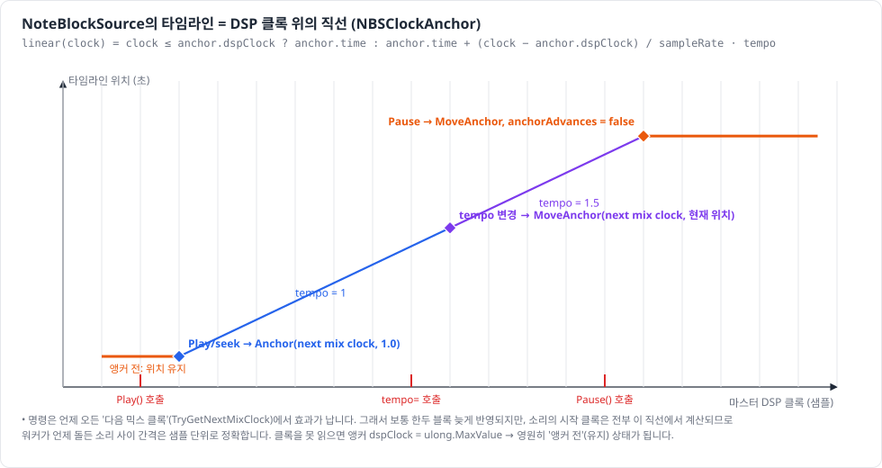
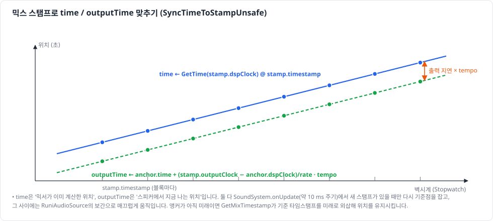

# 3. 클록 앵커: NoteBlockSource의 시간축

> 기준 커밋: `440c549c`. [← 목차](README.md) · 이전: [2. 데이터 모델](02-data-model.md) · 다음: [4. 워커와 예약](04-worker-scheduling.md)
>
> 선행: [Sound — 시간 보간](../../io.github.rumi727.runios.sound/Documentation~/03-time-interpolation.md), [FMOD — DSP 클록과 믹스 스탬프](../../io.github.rumi727.runios.fmod/Documentation~/dsp-clock-and-mix-stamp.md)

NBS 재생에서 **시간의 정의는 하나뿐**입니다. `NoteBlockSource`가 가진 `NBSClockAnchor`입니다.
소리의 예약 시각(스케줄러), 화면의 재생 위치(`time`), 스피커 위치(`outputTime`)가 모두 이 값 하나에서 계산됩니다.

- [3.1 `NBSClockAnchor`: DSP 클록 위의 직선](#31-nbsclockanchor-dsp-클록-위의-직선)
- [3.2 `TryGetNextMixClock`: 언제부터 효과가 나는가](#32-trygetnextmixclock-언제부터-효과가-나는가)
- [3.3 앵커를 정하는 세 메서드](#33-앵커를-정하는-세-메서드)
- [3.4 `time`과 `outputTime`을 앵커에 맞추기](#34-time과-outputtime을-앵커에-맞추기)
- [3.5 믹서를 따라가기: `SyncTimeToMixer`](#35-믹서를-따라가기-synctimetomixer)
- [3.6 공개 속성별 흐름](#36-공개-속성별-흐름)
- [3.7 반복 구간 접기: `NBSLoopRange.Fold`](#37-반복-구간-접기-nbslooprangefold)
- [3.8 사운드 시스템 리셋](#38-사운드-시스템-리셋)
- [3.9 `WaveAudioSource`와 비교](#39-waveaudiosource와-비교)

---

## 3.1 `NBSClockAnchor`: DSP 클록 위의 직선

```csharp
// Playback/NBSClockAnchor.cs
24  public readonly record struct NBSClockAnchor(ulong dspClock, double time)
46      public double GetTime(ulong clock, float tempo, int sampleRate) =>
            clock <= dspClock ? time : time + (((clock - dspClock) / (double)sampleRate) * tempo);
```

**"마스터 DSP 클록이 `dspClock`일 때 타임라인은 `time`(초)에 있다"**는 한 문장이 전부입니다.

- 재생 중에는 앵커 이후로 `tempo`의 기울기로 진행하고, **앵커 이전에는 `time`에서 멈춰 있습니다.**
- `time`은 반복 구간으로 접기 전의 **선형(linear)** 위치입니다. 접기는 읽는 쪽이 합니다(3.7).
- 진행 여부(재생 중인가)는 앵커에 들어 있지 않습니다. `NoteBlockSource`는 앵커를 정하는 순간의 재생 상태를 `anchorAdvances`에 따로 기록합니다([`Clock.cs#L39`](../Runtime/NBS/NoteBlockSource.Clock.cs#L39)).



위 그림처럼 Play, tempo 변경, Pause는 모두 **새 앵커를 찍는 일**입니다. 한 앵커 안에서는 위치가 순수한 산술식이므로, 스케줄러가 계산한 소리 시작 클록들은 서로 **샘플 단위로 정확한 간격**을 가집니다.

## 3.2 `TryGetNextMixClock`: 언제부터 효과가 나는가

```csharp
68  public static bool TryGetNextMixClock(SoundSystem system, out ulong clock)
    {
70      ArgumentNullException.ThrowIfNull(system);
72      return system.Execute(static soundSystem => soundSystem.GetMasterDSPClock() + soundSystem.UseNative(static native =>
        {
74          native.getDSPBufferSize(out uint blockLength, out _).ThrowIfNotOk();
75          return (ulong)blockLength;                         // ① master clock + 한 블록
76      }), out clock);                                        // ② 시스템이 Active가 아니면 false
    }
```

FMOD가 알려 주는 마스터 클록은 "믹스 중인 블록의 시작"일 수도 "다음 블록의 시작"일 수도 있습니다. 한 블록을 더하면 **믹서가 아직 손대지 않은 첫 클록**이 됩니다([FMOD 문서 그림](../../io.github.rumi727.runios.fmod/Documentation~/dsp-clock-and-mix-stamp.md#1-dsp-클록과-믹스-블록)).

모든 명령(seek, 재생, tempo·반복 변경, 일시 정지·재개)은 **이 클록에 앵커를 찍습니다.** 그래서

- 효과는 보통 **한두 블록 늦게**(기본 블록 약 21 ms 기준 21~43 ms) 시작합니다.
- 그 대신 그 클록 이후로 예약한 소리는 `SetDelay`로 **정확히 그 샘플에서** 시작할 수 있습니다.

## 3.3 앵커를 정하는 세 메서드

세 메서드 모두 이름 끝의 `Unsafe`대로 **호출자가 `playingLock` 쓰기 잠금을 보유**해야 합니다.

### `AnchorUnsafe(linearTime)` — 새 위치에 찍기 (seek, 재생)

```csharp
52  void AnchorUnsafe(double linearTime) =>
        SetAnchorUnsafe(NBSClockAnchor.TryGetNextMixClock(SoundSystem.main, out ulong clock) ? clock : ulong.MaxValue, linearTime);
```

클록을 읽지 못하면(사운드 시스템이 리셋 중이거나 비활성) `ulong.MaxValue`에 찍습니다. 어떤 클록도 이 값보다 작으므로 `GetTime`은 영원히 `time`을 돌려줍니다. 즉 **리셋이 끝나 다시 앵커를 찍을 때까지 멈춰 있습니다**(3.8).

### `MoveAnchorUnsafe()` — 위치는 그대로, 앵커만 옮기기 (tempo·반복 변경, 일시 정지·재개, 리로드)

```csharp
61  void MoveAnchorUnsafe()
62  {
63      bool hasClock = NBSClockAnchor.TryGetNextMixClock(SoundSystem.main, out ulong clock);
64      double linear = hasClock && anchorAdvances
            ? _clockAnchor.GetTime(clock, base.tempo, SoundSystem.main.outputSampleRate)   // ① 진행 중: 다음 믹스 클록에서의 위치
            : _clockAnchor.time;                                                           // ② 멈춤: 유지 중인 위치
65      SetAnchorUnsafe(hasClock ? clock : ulong.MaxValue, FoldTime(linear));              // ③ 반복 구간으로 먼저 접어서 저장
66  }
```

1. ① "지금"이 아니라 **새 앵커 클록에서의 위치**를 계산합니다. 옛 직선과 새 직선이 정확히 그 클록에서 만나므로 타임라인에 끊김이 없습니다.
2. ③ 먼저 접는 이유: `Fold`는 **진행 방향의 경계에서만** 접습니다(3.7). 예를 들어 tempo > 0인 상태로 `loop.end`를 지난 선형 위치를 그대로 두고 tempo를 음수로 바꾸면, 새 방향의 경계는 `loop.start`라서 그 위치가 영영 접히지 않습니다. 그래서 바꾸기 전 규칙으로 먼저 접어 둡니다.

### `SetAnchorUnsafe(clock, linearTime)` — 실제 저장

```csharp
68  void SetAnchorUnsafe(ulong clock, double linearTime)
69  {
71      _clockAnchor = new NBSClockAnchor(clock, linearTime);
72      anchorAdvances = isPlaying && !isPaused;        // 지금 상태로 '이 앵커부터 진행하는가'를 확정
73      SyncTimeToAnchorUnsafe();                        // 보간 시간을 새 앵커에 맞춤 (3.4)
74  }
```

`clockAnchor` 공개 getter([`#L17`](../Runtime/NBS/NoteBlockSource.Clock.cs#L17))는 `playingLock` 읽기 잠금으로 값을 복사해 돌려줍니다. 스케줄러(워커 스레드)는 이 getter로 앵커를 읽습니다.

## 3.4 `time`과 `outputTime`을 앵커에 맞추기

`NoteBlockSource`는 `RuniAudioSource`의 보간 기준점(`SyncInterpolatedTime`, `SyncInterpolatedOutputTime`)을 앵커와 믹스 스탬프로 계속 다시 잡습니다.



### `SyncTimeToAnchorUnsafe()`

```csharp
83  void SyncTimeToAnchorUnsafe()
84  {
85      if (!anchorAdvances)
86      {
87          SyncInterpolatedTime(_clockAnchor.time);            // ① 멈춘 타임라인: 그 위치로 고정
88          return;
89      }
91      if (SoundSystem.main.Execute(static system => (system.TryGetMixStamp(out SoundMixStamp stamp), stamp), out var mix) && mix.hasStamp)
92          SyncTimeToStampUnsafe(mix.stamp);                     // ② 최신 스탬프 기준으로 맞춤
93      else
94          SyncInterpolatedTime(_clockAnchor.time, long.MaxValue); // ③ 스탬프가 없음(첫 블록 전): 무기한 유지
95  }
```

`Execute`에 넘긴 람다는 `static`이고 결과를 튜플로 받습니다. 캡처하는 클로저를 만들지 않기 위해서입니다.

### `SyncTimeToStampUnsafe(stamp)` (핵심)

```csharp
108  void SyncTimeToStampUnsafe(SoundMixStamp stamp)
109  {
110      int sampleRate = SoundSystem.main.outputSampleRate;
111      double linearTime = _clockAnchor.GetTime(stamp.dspClock, base.tempo, sampleRate);               // ① 블록 끝에서의 위치
112      SyncInterpolatedTime(linearTime, GetMixTimestamp(stamp, _clockAnchor.dspClock, sampleRate));   // ② 기준 시각
115      if (_clockAnchor.dspClock == ulong.MaxValue)                                                 // ③ 도달 불가 앵커
116      {
117          SyncInterpolatedOutputTime(_clockAnchor.time, long.MaxValue);
118          return;
119      }
123      long outputOffset = (long)(stamp.outputClock - _clockAnchor.dspClock);                       // ④ 보통 음수
124      SyncInterpolatedOutputTime(_clockAnchor.time + ((outputOffset / (double)sampleRate) * base.tempo), stamp.timestamp);  // ⑤
125  }
```

1. ① **`time`은 "믹서가 방금 끝낸 블록의 끝"에서의 타임라인 위치**입니다. 스탬프 클록이 앵커 이전이면 `GetTime`이 `anchor.time`을 돌려줍니다.
2. ② 기준 시각은 `GetMixTimestamp`가 정합니다.

   ```csharp
   192  static long GetMixTimestamp(SoundMixStamp stamp, ulong clock, int sampleRate)
        {
   194      if (clock <= stamp.dspClock)
   195          return stamp.timestamp;                                      // 앵커에 이미 도달: 스탬프 시각 그대로
   197      double timestamp = stamp.timestamp + (((clock - stamp.dspClock) / (double)sampleRate) * Stopwatch.Frequency);
   198      return timestamp >= long.MaxValue ? long.MaxValue : (long)timestamp;  // 앵커가 미래: 믹서가 도달할 벽시계를 외삽(포화)
        }
   ```

   앵커가 아직 미래(보통 최신 스탬프보다 한두 블록 앞)이면, 믹서가 앵커에 도달할 **미래의 벽시계 시각**을 기준 시각으로 줍니다. [Sound 보간의 `Clamp(0)` 규칙](../../io.github.rumi727.runios.sound/Documentation~/03-time-interpolation.md#32-time-getter) 덕분에 `time`은 그때까지 `anchor.time`에 머물다가 그 순간부터 진행합니다. `ulong.MaxValue` 앵커는 `long.MaxValue`로 포화되어 무기한 유지됩니다.
3. ④⑤ **`outputTime`은 앵커에서 거꾸로 외삽**합니다.
   - `outputClock`은 믹서보다 출력 지연만큼 뒤에 있어서, 앵커를 막 찍은 직후에는 앵커보다 **앞(과거)**입니다. `ulong` 뺄셈 결과를 `long`으로 바꾸면 음수가 됩니다.
   - 따라서 `outputTime`은 `anchor.time`보다 조금 작은 값에서 시작해 진행하고, **앵커에서 나는 소리가 실제로 스피커에 도달하는 순간** `anchor.time`을 지납니다.
   - 일반 재생 중이면 `outputTime ≈ time − 출력 지연 × tempo`입니다.

> **관찰된 동작:** `SyncTimeToAnchorUnsafe`는 `anchorAdvances == false`일 때 `time`만 맞추고 `outputTime`은 건드리지 않습니다. 그래서 일시 정지 중에 seek하면 `outputTime`은 재개할 때까지 이전 값을 유지합니다. 재개 시 `MoveAnchorUnsafe` → `SyncTimeToStampUnsafe`가 다시 맞춥니다. 정지(`Stop`) 상태에서는 `RuniAudioSource.Stop`이 `outputTime`을 0으로 둡니다.

## 3.5 믹서를 따라가기: `SyncTimeToMixer`

`OnEnable`에서 `SoundSystem.main.onUpdate += SyncTimeToMixer`로 구독합니다([`Lifecycle.cs#L125`](../Runtime/NBS/NoteBlockSource.Lifecycle.cs#L125)). FMOD 업데이트 스레드가 약 10 ms마다 부릅니다.

```csharp
138  void SyncTimeToMixer()
139  {
140      if
141      (
142          !anchorAdvances ||                                                          // ① 멈춘 타임라인은 할 일 없음
143          !SoundSystem.main.Execute(static system => (system.TryGetMixStamp(out SoundMixStamp stamp), stamp), out var mix) ||
144          !mix.hasStamp ||
145          mix.stamp.dspClock == lastMixClock                                          // ② 새 블록이 아니면 건너뜀
146      )
147          return;
151      if (!playingLock.TryEnterWriteLock(0))                                          // ③ 기다리지 않고 시도만
152          return;
154      try
155      {
156          lastMixClock = mix.stamp.dspClock;
157          if (anchorAdvances)                                                         // ④ 잠금 안에서 다시 확인
158              SyncTimeToStampUnsafe(mix.stamp);
159      }
160      finally { playingLock.ExitWriteLock(); }
164  }
```

- ② 블록마다 **한 번만** 기준점을 다시 잡습니다. 그 사이에는 `RuniAudioSource`의 보간이 매끄럽게 이어 줍니다.
- ③ **기다리면 교착 상태가 됩니다.** 이 처리기는 `SoundSystem`의 `nativeLock` 읽기 잠금을 보유한 채 실행됩니다([FMOD 문서](../../io.github.rumi727.runios.fmod/Documentation~/README.md#스레드와-잠금-요약)).

  ```mermaid
  sequenceDiagram
      participant U as FMOD Update 스레드
      participant R as Reset 호출 스레드
      participant M as 메인 스레드 (예: tempo setter)
      M->>M: playingLock 쓰기 잠금 획득
      U->>U: nativeLock 읽기 잠금 보유 → onUpdate → SyncTimeToMixer
      R->>R: nativeLock 쓰기 잠금 대기 (U가 끝나길)
      M->>M: TryGetNextMixClock → nativeLock 읽기 대기 (대기 중인 writer R 뒤에 줄 섬)
      U->>U: playingLock을 '기다리면' → M을 기다림 → 교착
      Note over U: 그래서 TryEnterWriteLock(0): 실패하면 이번 블록은 건너뛰고 다음 블록에서 따라잡습니다.
  ```

- ④ `anchorAdvances`는 잠금 밖에서 한 번 읽었지만 그 사이 바뀔 수 있으므로 잠금 안에서 다시 확인합니다.

## 3.6 공개 속성별 흐름

모든 흐름은 `playingLock` 쓰기 잠금 안에서 일어나고, **앵커를 먼저 옮긴 뒤 스케줄러에 알립니다.** 스케줄러 쪽 동작은 [6장](06-commands-lifecycle.md)에 있습니다.

| 호출 | 소스 쪽 순서 | 스케줄러 알림 |
| --- | --- | --- |
| `time = v` ([#L146](../Runtime/NBS/NoteBlockSource.cs#L146)) | `base.time = v` → `AnchorUnsafe(v)` | `Resync()` |
| `Play(start)` | `RuniAudioSource.Play` → `_isPlaying = true` → `time = start`(위 행) → `OnPlay`(비어 있음) | `Resync()` (time setter 안) |
| `Stop()` | `RuniAudioSource.Stop` → `_isPlaying = false` → `time = 0`(Resync: 재생 중이 아니라 전부 정지) → `OnStop` | `Stop()` |
| `tempo = v` ([#L193](../Runtime/NBS/NoteBlockSource.cs#L193)) | `MoveAnchorUnsafe()`(옛 tempo로) → `base.tempo = v` → `SyncTimeToAnchorUnsafe()` | `OnRateChanged()` |
| `pitch = v` ([#L218](../Runtime/NBS/NoteBlockSource.cs#L218)) | `base.pitch = v` (타임라인과 무관하므로 앵커 그대로) | `OnRateChanged()` |
| `Pause()` | `RuniAudioSource.Pause` → `_isPaused = true` → `OnPause`: `MoveAnchorUnsafe()` | `Pause()` |
| `UnPause()` | `RuniAudioSource.UnPause` → `_isPaused = false` → `OnUnPause`: `MoveAnchorUnsafe()` | `UnPause()` |
| `loop`·`loopStart`·`loopEnd`·`useFileLoopSettings` | `ChangeLoop`([#L361](../Runtime/NBS/NoteBlockSource.cs#L361)): `MoveAnchorUnsafe()`(옛 범위로 접기) → 값 변경 | `OnLoopChanged()` |
| `volume`·`panStereo`·3D 속성 | base 값 변경 → `scheduler?.X = v` | (믹스만, [6장](06-commands-lifecycle.md#69-믹스-속성)) |

`tempo` setter가 `SyncTimeToAnchorUnsafe()`를 **두 번** 부르는 이유(`MoveAnchorUnsafe` 안에서 한 번, 끝에서 한 번):

- `base.tempo` setter는 `SyncInterpolatedTime(time)`으로 보간을 **지금** 시작합니다.
- 하지만 새 tempo의 효과는 다음 믹스 클록(앵커)부터 나야 합니다.
- 그래서 바꾼 뒤 다시 앵커에 맞춰 **앵커에 도달할 때까지 유지**하도록 되돌리고, `outputTime`의 외삽 기울기도 새 tempo로 다시 계산합니다.

일시 정지에서의 위치: `OnPause`의 `MoveAnchorUnsafe`는 아직 `anchorAdvances == true`인 옛 앵커로 **다음 믹스 클록에서의 위치**를 계산합니다. 그 위치에 앵커를 찍고 `anchorAdvances = false`로 둡니다. 그래서 일시 정지 후의 `time`은 "소리가 실제로 멈추는 블록"의 위치를 보여 줍니다.

## 3.7 반복 구간 접기: `NBSLoopRange.Fold`

```csharp
// Playback/NBSLoopRange.cs
44  public static NBSLoopRange? Create(bool enabled, double start, double end) =>
        enabled && double.IsFinite(start) && double.IsFinite(end) && end > start ? new NBSLoopRange(start, end) : null;

65  public double Fold(double time, float tempo)
    {
        if (tempo > 0 && time >= end)
            return start + ((time - start) % range);   // 정방향: end를 넘으면 start부터 다시
        if (tempo < 0 && time <= start)
            return end - ((start - time) % range);     // 역방향: start 아래로 가면 end부터 다시
        return time;                                   // 그 밖(반복 전 intro 포함)은 그대로
    }
```

- 접기는 **진행 방향의 경계에서만** 일어납니다. 정방향 재생이 `start` 이전(intro)에 있으면 그대로 진행해 반복 구간에 들어옵니다.
- `NoteBlockSource`는 앵커에 선형 위치를 저장하고 **읽을 때 접습니다.** `time` getter([#L146](../Runtime/NBS/NoteBlockSource.cs#L146)), `outputTime`([#L136](../Runtime/NBS/NoteBlockSource.cs#L136)), `FoldTime`([Clock.cs#L127](../Runtime/NBS/NoteBlockSource.Clock.cs#L127)), 스케줄러의 `TryTakeClockSnapshot`이 그렇게 합니다.
- 반복 범위는 [`loopRange`](../Runtime/NBS/NoteBlockSource.cs#L345)가 정합니다.
  - `loop`가 꺼져 있으면 `null`입니다.
  - `useFileLoopSettings`가 켜져 있고 NBS 헤더 반복이 켜져 있으면 `[TickToTime(header.loopStartTick), clip.length]`입니다.
  - 그 밖에는 `loopStart`·`loopEnd`를 곡 길이로 제한한 범위입니다.
  - 클립이 없으면 값을 제한하지 않고 그대로 씁니다.

## 3.8 사운드 시스템 리셋

```csharp
201  void OnSoundSystemReset(SoundSystem system)
     {
203      playingLock.EnterWriteLock();
         try
         {
208          lastMixClock = 0;                 // 새 클록은 0부터 → 이전 값과 비교하면 안 됨
209          AnchorUnsafe(base.time);          // 보간된 현재 위치를 새 클록의 다음 믹스 클록에 찍기
210          scheduler?.Resync();              // 새 클록 기준으로 소리 전부 다시 예약
         }
         finally { playingLock.ExitWriteLock(); }
     }
```

리셋 중에 앵커를 찍으려 하면 클록을 못 읽어 `ulong.MaxValue` 앵커(멈춤)가 됩니다. 리셋이 끝나 `onReset`이 오면 여기서 정상 앵커로 돌아옵니다. `base.time`은 접기 전 보간 값이므로 선형 위치 그대로 넘깁니다.

## 3.9 `WaveAudioSource`와 비교

| | `WaveAudioSource` ([FMOD 문서](../../io.github.rumi727.runios.fmod/Documentation~/wave-audio-source.md)) | `NoteBlockSource` |
| --- | --- | --- |
| 진실의 원천 | 단일 `SoundChannel`의 재생 위치 | 자기 `NBSClockAnchor` (채널이 노트마다 수십 개라 하나를 기준으로 삼을 수 없음) |
| `time` 갱신 시점 | 채널 위치가 바뀐 업데이트 | 스탬프 `dspClock`이 바뀐 업데이트 |
| `time` 값 | 두 동일 스탬프 사이에서 읽은 채널 위치 | `anchor.GetTime(stamp.dspClock)` |
| `outputTime` | 채널 위치 − 출력 지연·tempo | 앵커에서 `stamp.outputClock`까지 외삽 |
| 명령의 효과 시점 | FMOD 채널에 즉시 반영 | 다음 믹스 클록(앵커) |
| 소리 예약에 쓰이는가 | 아니요(채널 하나가 계속 재생) | 예. 스케줄러가 같은 앵커로 `SetDelay` 클록을 계산합니다([4장](04-worker-scheduling.md)). |
