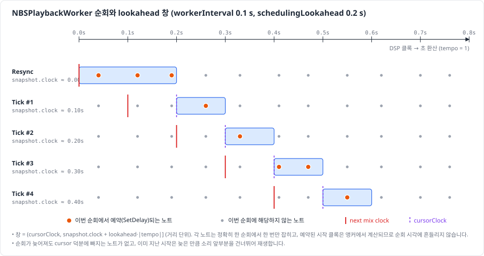
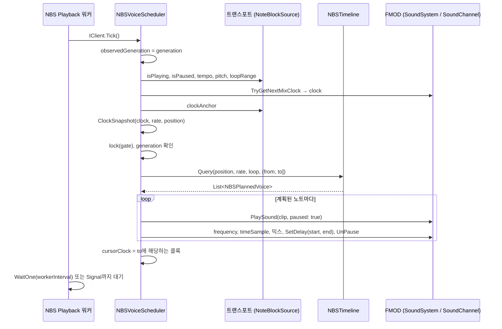

# 4. 워커와 예약: 소리가 FMOD에 들어가기까지

> 기준 커밋: `440c549c`. [← 목차](README.md) · 이전: [3. 클록 앵커](03-clock-anchor.md) · 다음: [5. 타임라인과 배치](05-timeline-placement.md)

`NBSVoiceScheduler<TTransport>`는 **자기 시간축이 없습니다.** 트랜스포트(보통 `NoteBlockSource`)의 앵커를 읽고, 앞으로 짧은 시간(lookahead) 안에 시작할 노트만 골라 FMOD 채널을 만들어 **DSP 클록에 예약**합니다.
예약 작업은 모든 스케줄러가 공유하는 백그라운드 스레드 하나(`NBSPlaybackWorker`)가 주기적으로 수행합니다.

- [4.1 전체 그림](#41-전체-그림)
- [4.2 `NBSPlaybackWorker`: 공유 스레드](#42-nbsplaybackworker-공유-스레드)
- [4.3 스케줄러의 상태](#43-스케줄러의-상태)
- [4.4 거리(distance)와 `ClockSnapshot`](#44-거리distance와-clocksnapshot)
- [4.5 `Tick`: 워커 한 번의 순회 (줄 단위)](#45-tick-워커-한-번의-순회-줄-단위)
- [4.6 `ScheduleUnsafe`와 `ResyncUnsafe`](#46-scheduleunsafe와-resyncunsafe)
- [4.7 `CreateVoiceUnsafe`: 노트 하나 → FMOD 채널 하나 (줄 단위)](#47-createvoiceunsafe-노트-하나--fmod-채널-하나-줄-단위)
- [4.8 Voice 목록과 정리](#48-voice-목록과-정리)
- [4.9 설정값의 의미](#49-설정값의-의미)

---

## 4.1 전체 그림





**왜 미리 예약하는가:** 워커가 "지금 울릴 노트"를 그때그때 재생하면 워커가 깨어나는 시각(수 ms 오차)이 그대로 리듬에 섞입니다.
대신 앞으로 0.2초 안의 노트를 **정확한 DSP 클록에 미리 걸어 두면**, 워커가 언제 깨어나든 FMOD 믹서가 샘플 단위로 정확히 시작합니다.

## 4.2 `NBSPlaybackWorker`: 공유 스레드

```csharp
// Playback/NBSPlaybackWorker.cs
19  static readonly Lock gate = new();
20  static readonly List<IClient> clients = [];
21  static readonly AutoResetEvent wakeEvent = new AutoResetEvent(false);
…
29  public static void Signal() => wakeEvent.Set();                  // 즉시 한 번 돌게 함

31  internal static void Register(IClient client)                    // 스케줄러 생성자에서 호출
    {
33      lock (gate)
        {
35          clients.Add(client);
36          stopping = false;
37          if (thread is not { IsAlive: true })                      // 스레드가 없으면 지연 생성
39              thread = new Thread(Run) { IsBackground = true, Name = "Runiverse OS NBS Playback" };
44              thread.Start();
        }
48      wakeEvent.Set();                                              // 새 클라이언트를 바로 처리
    }

73  static void Run()
    {
75      List<IClient> snapshot = [];                                  // 스레드 수명 동안 재사용
76      while (true)
        {
78          lock (gate)
            {
80              if (stopping) { thread = null; return; }
86              snapshot.Clear();
87              snapshot.AddRange(clients);                           // ① 잠금 안에서는 복사만
            }
90          for (int i = 0; i < snapshot.Count; i++)
                try { snapshot[i].Tick(); }                           // ② 잠금 밖에서 실행
                catch (Exception exception) { Debug.LogException(exception); }   // ③ 한 클라이언트의 오류가 다른 클라이언트를 막지 않음
102         if (snapshot.Count == 0)
103             wakeEvent.WaitOne();                                  // ④ 할 일이 없으면 Register/Signal까지 무기한 대기
            else
105             wakeEvent.WaitOne(TimeSpan.FromSeconds(NBSPlaybackSettings.workerInterval));   // ⑤ 주기 대기, Signal이면 즉시 깸
        }
    }
```

- ② 목록을 복사해서 돌기 때문에, `Tick` 실행 중에 스케줄러가 등록되거나 해제되어도 안전합니다. 해제(`Dispose`) 직후 한 번 더 `Tick`이 불릴 수는 있지만, 스케줄러가 `isDisposed`를 확인합니다.
- ⑤ `AutoResetEvent`이므로 `Signal()`을 여러 번 불러도 깨어나는 것은 한 번입니다. 명령(`Resync`, `OnRateChanged`, `UnPause`, `OnLoopChanged`)이 끝나면 `Signal()`을 불러서 다음 순회를 앞당깁니다.
- [`OnCodeUnloading`](../Runtime/NBS/Playback/NBSPlaybackWorker.cs#L57): 도메인 리로드 직전에 `stopping = true`로 두고 깨운 뒤 최대 1초 `Join`합니다.

## 4.3 스케줄러의 상태

```csharp
// NBSVoiceScheduler`1.cs
98   readonly Lock gate = new();                    // 아래 예약 상태 전체를 보호
99   readonly Lock voiceLock = new();               // voices 목록만 보호 (onStop 콜백용)
100  readonly List<Voice> voices = [];              // 예약됐거나 울리고 있는 채널
101  readonly List<Voice> voiceSnapshot = [];       // 순회용 재사용 버퍼
102  readonly List<NBSPlannedVoice> planned = [];   // Query 결과 재사용 버퍼
104  NBSPlaybackRate committedRate;                 // 마지막으로 반영한 tempo/pitch/정렬
105  double cursorClock;                            // 여기까지는 이미 예약했다(클록)
106  bool hasCursor;                                // cursorClock이 유효한가
107  long generation;                               // 명령마다 1 증가
108  bool isDisposed;
122  NBSTimeline timeline;                          // 노트 배치 계산기 (5장)
```

| 상태 | 의미 |
| --- | --- |
| `cursorClock` | **"이 클록 이전에 시작하는 노트는 모두 처리했다."** 다음 순회는 여기부터 이어서 찾습니다. 순회 간격이 불규칙해도 빠지거나 겹치는 노트가 없는 이유입니다. |
| `hasCursor == false` | "어디까지 했는지 모른다." 다음 `Tick`이 **Resync**(전부 정지 후 다시 시작)합니다. |
| `generation` | 명령이 상태를 바꿀 때마다 증가합니다. `Tick`이 잠금 밖에서 읽은 값과 다르면 그 순회는 버립니다(4.5). |
| `committedRate` | `OnRateChanged`가 "무엇에서 무엇으로 바뀌었는가"를 알기 위한 이전 값(6장). |

생성자([`#L76`](../Runtime/NBS/Playback/NBSVoiceScheduler%601.cs#L76))는 `NBSTimeline`을 만들고, `committedRate = ReadRate()`로 초기화한 뒤 **워커에 등록**합니다. 처음에는 `hasCursor == false`이므로 첫 `Tick`에서 Resync가 일어납니다.

## 4.4 거리(distance)와 `ClockSnapshot`

스케줄러는 "타임라인을 **진행 방향으로** 얼마나 더 가면 그 노트에 닿는가"를 **거리**라고 부릅니다. 단위는 타임라인 초이고 항상 진행 방향 기준이라, tempo가 음수(역재생)여도 거리는 앞으로 증가합니다.

```csharp
// NBSVoiceScheduler`1.Voices.cs
28  readonly record struct ClockSnapshot(ulong clock, int sampleRate, double position)
    {
30      public double ToClock(double distance, double absoluteTempo) => clock + ((distance / absoluteTempo) * sampleRate);
32      public double ToDistance(double clockValue, double absoluteTempo) => ((clockValue - clock) / sampleRate) * absoluteTempo;
    }
```

- `clock`: 이번 순회의 기준 클록 = **다음 믹스 클록**. 이보다 이른 클록에는 예약하지 않습니다.
- `position`: 그 클록에서의 타임라인 위치(반복 구간으로 접은 값).
- 거리 `d` ↔ 클록: `clock + d / |tempo| × sampleRate`. 타임라인 1초 = 벽시계 `1/|tempo|`초입니다.

```csharp
36  bool TryTakeClockSnapshot(in NBSPlaybackRate rate, NBSLoopRange? loop, out ClockSnapshot snapshot)
    {
38      snapshot = default;
39      int sampleRate = system.outputSampleRate;
40      if (sampleRate <= 0 || !NBSClockAnchor.TryGetNextMixClock(system, out ulong clock))   // ① 시스템 비활성
41          return false;
44      NBSClockAnchor anchor = transport.clockAnchor;
45      if (anchor.dspClock > clock)                                // ② 앵커가 '다음 믹스 클록'보다 뒤 = 리셋 전 클록이거나 MaxValue
46          return false;                                          //    트랜스포트가 곧 다시 앵커를 찍음
48      double linear = transport.isPlaying && !transport.isPaused ? anchor.GetTime(clock, rate.tempo, sampleRate) : anchor.time;
49      double position = loop is { } range ? range.Fold(linear, rate.tempo) : linear;
50      snapshot = new ClockSnapshot(clock, sampleRate, position);
51      return double.IsFinite(position);
    }
```

스냅샷은 트랜스포트의 앵커에서 **순수 계산**으로 위치를 얻습니다. 스케줄러가 계산하는 모든 시작 클록은 앵커 직선 위에 있습니다.

## 4.5 `Tick`: 워커 한 번의 순회 (줄 단위)

```csharp
// NBSVoiceScheduler`1.Tick.cs
8   void NBSPlaybackWorker.IClient.Tick()
    {
12      long observedGeneration = Volatile.Read(ref generation);      // ① 먼저 세대를 기억
13      if (!transport.isPlaying || transport.isPaused)               // ② 재생 중이 아니면 할 일 없음
14          return;
16      NBSPlaybackRate rate = ReadRate();                            // ③ tempo, pitch, 정렬 (트랜스포트 읽기)
17      NBSLoopRange? loop = ReadLoop();                              //    반복 범위 (트랜스포트 읽기)
18      if (!rate.canPlace || !TryTakeClockSnapshot(rate, loop, out ClockSnapshot snapshot))   // ④ tempo/pitch 0, 클록 없음
19          return;
21      lock (gate)
        {
23          if (isDisposed || observedGeneration != generation)       // ⑤ 그 사이 명령이 끼어들었으면 이번 순회 폐기
24              return;
26          if (!ReferenceEquals(clip.map, timeline.map) || !hasCursor)   // ⑥ 맵이 바뀌었거나 커서 없음
            {
28              ResyncUnsafe(rate, loop, snapshot);                   //    → 처음부터 다시
29              return;
            }
32          double absoluteTempo = Math.Abs((double)rate.tempo);
33          double fromDistance = snapshot.ToDistance(cursorClock, absoluteTempo);   // ⑦ 이미 예약한 곳까지의 거리
34          double toDistance = NBSPlaybackSettings.schedulingLookahead * absoluteTempo;   // ⑧ lookahead 끝까지의 거리
35          if (toDistance <= fromDistance)                           // ⑨ 이미 충분히 앞까지 예약됨
36              return;
38          ScheduleUnsafe(rate, loop, snapshot, fromDistance, false, toDistance);   // ⑩ (from, to] 구간 예약
        }
    }
```

1. ①~④ **트랜스포트는 `gate` 밖에서 읽습니다.** 잠금 순서를 *트랜스포트 → 스케줄러*로 고정하기 위해서입니다.
   - `NoteBlockSource`의 속성 getter는 `playingLock`을 잡습니다.
   - 반대로 명령은 트랜스포트가 `playingLock` 쓰기 잠금을 쥔 채 스케줄러의 `gate`를 잡습니다.
   - `Tick`이 `gate`를 쥔 채 트랜스포트를 읽으면 순서가 반대가 되어 교착 상태가 될 수 있습니다.
2. ⑤ 대가로 ①~④에서 읽은 값이 그 사이에 낡을 수 있습니다. 명령은 항상 `generation++` 하므로, 세대가 다르면 이번 순회는 그냥 버립니다. 명령이 `Signal()`을 불렀으므로 곧 다음 순회가 옵니다. 일종의 **낙관적 동시성 검사**입니다.
3. ⑥ `clip.map`은 `NoteBlockClip.Apply()`가 통째로 교체하는 불변 객체입니다(2장). 참조가 다르면 편집이 반영된 것이므로 타임라인을 다시 만들고 Resync합니다. 재생 중 편집이 자동으로 반영되는 경로입니다.
4. ⑦ `cursorClock`이 스냅샷 클록보다 앞이면 양수입니다. 워커가 늦게 깨어나서 커서가 이미 지났다면 **음수**가 되고, 그 사이의 노트는 늦은 시작으로 처리됩니다(4.7).
5. ⑩ `includeFrom == false`: 커서 위치의 노트는 지난 순회에서 이미 처리했으므로 제외합니다.

## 4.6 `ScheduleUnsafe`와 `ResyncUnsafe`

```csharp
42  void ScheduleUnsafe(in NBSPlaybackRate rate, NBSLoopRange? loop, in ClockSnapshot snapshot, double fromDistance, bool includeFrom, double toDistance)
    {
44      planned.Clear();
45      timeline.Query(snapshot.position, rate, loop, fromDistance, includeFrom, toDistance, planned);   // 5장
46      for (int i = 0; i < planned.Count; i++)
47          CreateVoiceUnsafe(planned[i], rate, snapshot);
49      cursorClock = snapshot.ToClock(toDistance, Math.Abs((double)rate.tempo));   // 커서를 창 끝으로
50      hasCursor = true;
    }

53  void ResyncUnsafe(in NBSPlaybackRate rate, NBSLoopRange? loop, in ClockSnapshot snapshot)
    {
55      StopAllVoicesUnsafe();                       // ① 예약·재생 중인 채널 전부 정지
56      hasCursor = false;
57      committedRate = rate;
59      NBSMap map = clip.map;
60      if (!ReferenceEquals(map, timeline.map))
61          timeline = new NBSTimeline(map, bank);   // ② 편집된 맵이면 타임라인 재생성
63      if (!transport.isPlaying || transport.isPaused || !rate.canPlace)
64          return;                                  // ③ 멈춘 상태면 정지만 하고 끝
66      planned.Clear();
67      timeline.QueryActive(snapshot.position, rate, loop, planned);   // ④ 지금 위치에서 '이미 울리고 있어야 할' 소리
68      for (int i = 0; i < planned.Count; i++)
69          CreateVoiceUnsafe(planned[i], rate, snapshot);              //    중간부터 재생
71      ScheduleUnsafe(rate, loop, snapshot, 0, true, NBSPlaybackSettings.schedulingLookahead * Math.Abs((double)rate.tempo));   // ⑤ [0, lookahead] 예약
    }
```

- ④ seek이나 재생 시작, 늦은 리로드에서는 현재 위치에 **걸쳐 있는** 소리(시작은 이미 지났지만 아직 끝나지 않은 소리)를 offset부터 복원합니다. `QueryActive`는 `low < position < high`인 노트만 고릅니다.
- ⑤ 위치에 정확히 시작하는 노트(거리 0)는 `includeFrom == true`로 여기서 잡습니다. ④와 겹치지 않습니다.

## 4.7 `CreateVoiceUnsafe`: 노트 하나 → FMOD 채널 하나 (줄 단위)

입력 `NBSPlannedVoice`(5장)는 "이 노트가 거리 `distance`에서 시작하고, 그 순간 소리의 `sourceTime`초부터 재생해야 한다"는 계획입니다.

```csharp
// NBSVoiceScheduler`1.Voices.cs
56  void CreateVoiceUnsafe(in NBSPlannedVoice plan, in NBSPlaybackRate rate, in ClockSnapshot snapshot)
    {
58      WaveAudioClip? clip = timeline.GetClip(plan.mapIndex);
59      if (clip == null || clip.isDisposed)                      // ① 악기 소리가 없으면 무음
60          return;
62      double ratio = timeline.GetRatio(plan.mapIndex);         // ② 노트 음높이 배율 (key, 미세 피치)
63      double sourceScale = plan.placement.sourceScale;         // ③ 타임라인 1초당 소리 몇 초 = ratio / timelineScale
64      bool forwardSource = plan.placement.startsAtAttack;      // ④ entry가 어택 = 소리 시간이 증가하는 방향
65      double sourceLength = plan.length * sourceScale;         // ⑤ 이 노트가 낼 소리 길이(초, Stopper로 잘렸을 수 있음)
68      double sourceTime = plan.sourceTime;
69      if (plan.distance < 0)                                   // ⑥ 늦은 시작: 이미 들렸어야 할 부분을 건너뜀
70          sourceTime += (forwardSource ? -plan.distance : plan.distance) * sourceScale;
72      double remainingSource = forwardSource ? sourceLength - sourceTime : sourceTime;   // ⑦ 남은 소리
73      if (!(remainingSource > 0))                              //    이미 끝난 짧은 소리는 소급 재생하지 않음
74          return;
76      double absolutePitch = Math.Abs((double)rate.pitch);
77      ulong startClock = Math.Max(snapshot.clock,              // ⑧ 시작 클록 (다음 믹스 클록보다 이르지 않게)
            ToClock(snapshot.ToClock(Math.Max(0, plan.distance), Math.Abs((double)rate.tempo))));
78      ulong endClock = plan.stopped && forwardSource           // ⑨ Stopper로 잘린 정방향 소리만 정지 클록
79          ? ToClock(startClock + ((remainingSource / (ratio * absolutePitch)) * snapshot.sampleRate))
80          : 0;
82      if (!system.Execute(static (soundSystem, sound) => soundSystem.PlaySound(sound, true), clip, out SoundChannel? channel) || channel == null)
83          return;                                              // ⑩ 일시 정지 상태로 채널 생성
85      Voice voice = new Voice(channel, plan.mapIndex, plan.position, clip, ratio, startClock, endClock);
86      try
        {
88          channel.frequency = (float)(clip.frequency * ratio * absolutePitch * Math.Sign(rate.pitch));   // ⑪ 음수 = 역재생
89          channel.timeSample = (uint)Math.Clamp(Math.Round(sourceTime * clip.frequency), 0, clip.samples - 1d);   // ⑫ 시작 샘플
90          ApplyMix(voice);                                     // ⑬ 음량, 팬, 3D (6장)
91          channel.SetDelay(startClock, endClock);              // ⑭ DSP 클록 예약
93          voice.stopHandler = stopped => RemoveVoice(stopped);
94          lock (voiceLock)
95              voices.Add(voice);
97          channel.onStop += voice.stopHandler;                 // ⑮ 자연 종료 시 목록에서 제거
98          channel.UnPause();                                   // ⑯ 이제 믹서가 startClock을 기다림
        }
100     catch (ObjectDisposedException)                          // 그 사이 채널이 사라짐(리셋 등)
102         RemoveVoice(channel);
    }
```

1. ③ `sourceScale`은 [`NBSTimeline.GetPlacement`](../Runtime/NBS/Playback/NBSTimeline.cs)가 `ratio / rate.timelineScale`로 넣은 값입니다. 노트가 타임라인 1초 동안 소리를 몇 초 진행하는지를 뜻합니다.
2. ④ 5장의 8가지 배치에서 `entry == attack`은 정확히 **pitch > 0**인 경우입니다. 이때 소리 위치가 0에서 커집니다. pitch < 0이면 소리 끝 쪽에서 시작해 0으로 줄어듭니다(FMOD 역재생).
3. ⑥ 거리가 음수라는 것은 노트 시작이 이미 지났다는 뜻입니다. 예를 들어 워커가 늦게 깨어 커서를 지난 경우입니다. 지난 타임라인 거리만큼 소리도 진행시킵니다. 역재생이면 소리 위치가 줄어드는 쪽으로 옮깁니다.
4. ⑦ README의 **"이미 끝난 짧은 소리는 소급해서 재생하지 않는다"**가 이 줄입니다.
5. ⑧ 늦은 노트(`distance < 0`)는 거리를 0으로 잘라 **다음 믹스 클록에 바로** 시작합니다. 그 밖의 노트는 앵커 직선 위의 정확한 클록에 시작합니다. `ToClock`([#L54](../Runtime/NBS/Playback/NBSVoiceScheduler%601.Voices.cs#L54))은 반올림하고 `[0, ulong.MaxValue]`로 포화합니다.
6. ⑨ 소리 길이 `remainingSource`(초)를 재생 속도 `ratio·|pitch|`로 나누면 벽시계 초가 됩니다. 정지 클록이 필요한 경우는 다음뿐입니다.
   - 잘리지 않은 소리는 끝까지 자연 재생되므로 필요 없습니다.
   - 역재생 소리는 잘린 지점에서 **시작**해 샘플 0에서 자연히 끝나므로 필요 없습니다.
7. ⑪ FMOD는 음수 frequency를 역재생으로 처리합니다. `clip.frequency`는 원본 샘플 레이트입니다. 스트림 클립은 역재생할 수 없어서, 5장의 `IsAudible`이 pitch < 0일 때 미리 제외합니다.
8. ⑩⑯ 일시 정지 상태로 만들고 모든 속성과 예약을 정한 뒤 재개하는 [FMOD 패턴](../../io.github.rumi727.runios.fmod/Documentation~/dsp-clock-and-mix-stamp.md#2-setdelay-클록으로-시작정지-예약)입니다. `PlaySound` 람다는 `static`이고, 클립을 상태 인자로 넘겨 캡처를 피합니다.
9. ⑮ `stopHandler`는 이 스케줄러를 캡처하는 람다라 노트마다 한 번 할당됩니다. 나중에 `StopVoice`에서 구독을 끊으려면 같은 델리게이트 인스턴스가 필요해서 `Voice`에 보관합니다.

> 스케줄러가 바꾸는 것은 `SoundChannel`의 시작·정지 **예약**과 frequency뿐입니다. 소리 사이의 간격은 `startClock`끼리의 차이로 정해지며, 이 값들은 모두 같은 앵커 직선에서 나옵니다. 그래서 **워커가 언제 순회하든 샘플 단위로 정확**합니다.

## 4.8 Voice 목록과 정리

```csharp
9   sealed class Voice(SoundChannel channel, int mapIndex, double startPosition, WaveAudioClip clip, double ratio, ulong startClock, ulong endClock)
    {
        …
18      public ulong startClock = startClock;          // tempo 변경 시 다시 계산됨
19      public ulong endClock = endClock;              // 0 = 정지 예약 없음
22      public double heldEndDistance = double.NaN;    // 일시 정지·tempo 0 동안 보관한 '정지점까지 남은 거리' (6장)
24      public Action<SoundChannel>? stopHandler;
    }
```

| 메서드 | 동작 |
| --- | --- |
| [`RemoveVoice(channel)`](../Runtime/NBS/Playback/NBSVoiceScheduler%601.Voices.cs#L106) | `voiceLock` 안에서 그 채널의 Voice를 목록에서 제거. `onStop`(FMOD 업데이트 스레드)에서도 불립니다. |
| [`SnapshotVoicesUnsafe()`](../Runtime/NBS/Playback/NBSVoiceScheduler%601.Voices.cs#L122) | `voiceLock` 안에서 재사용 버퍼 `voiceSnapshot`에 복사해 반환. 순회 중에 `onStop`이 목록을 바꿔도 안전합니다. `gate` 안에서만 부릅니다. |
| [`StopVoice(voice)`](../Runtime/NBS/Playback/NBSVoiceScheduler%601.Voices.cs#L131) | `onStop` 구독 해제 → 목록 제거 → `channel.Stop()`. 먼저 구독을 끊어서 콜백이 두 번 오지 않게 합니다. |
| `StopAllVoicesUnsafe()` | 전부 `StopVoice` |
| [`CancelPendingVoicesUnsafe(now)`](../Runtime/NBS/Playback/NBSVoiceScheduler%601.Voices.cs#L147) | `startClock > now`, 즉 **아직 시작하지 않은** Voice만 정지 |

`voices`에 잠금이 따로 있는 이유: `onStop`은 FMOD 업데이트 스레드에서 옵니다. 거기서 `gate`를 잡으면 `gate`를 쥔 채 `SoundSystem`을 부르는 스케줄러와 잠금 순서가 엇갈립니다. `voiceLock`은 목록 조작에만 아주 짧게 쓰이고, 그 안에서 다른 잠금을 잡지 않습니다.

## 4.9 설정값의 의미

[`NBSPlaybackSettings`](../Runtime/NBS/Playback/NBSPlaybackSettings.cs)

| 값 | 기본 | 의미 |
| --- | --- | --- |
| `workerInterval` | 0.1 s | 워커가 순회하는 주기. 바꾸면 `Signal()`로 즉시 반영합니다. 0 이하이거나 유한하지 않으면 예외입니다. |
| `schedulingLookahead` | 0.2 s | 각 순회가 **벽시계로** 얼마나 앞까지 예약하는가. 거리로는 `lookahead × |tempo|`입니다. 음수이거나 유한하지 않으면 예외입니다. |

- lookahead가 interval보다 넉넉해야(기본 2배) 워커가 조금 늦어도 노트가 제때 예약됩니다. 워커가 lookahead보다 더 늦으면 그 사이 노트는 **늦은 시작**(앞부분을 건너뛴 재생)이 됩니다.
- lookahead를 0으로 두어도 동작은 합니다. Resync는 현재 위치의 노트를 정확히 잡지만, 그 뒤 노트는 매 순회에서 늦은 시작으로만 재생됩니다.
- 예약을 길게 할수록 tempo·반복 변경 때 다시 계산하거나 취소할 Voice가 늘어납니다(6장).
