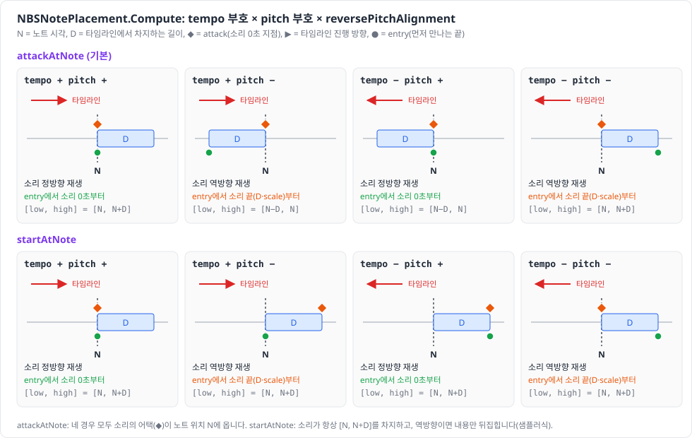
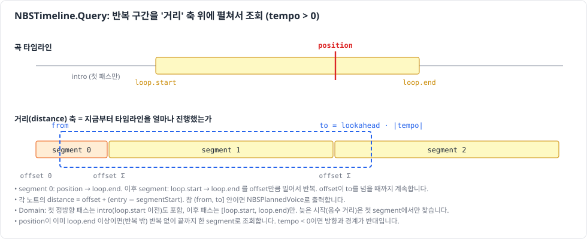

# 5. 타임라인과 배치: 노트가 타임라인의 어디를 차지하는가

> 기준 커밋: `440c549c`. [← 목차](README.md) · 이전: [4. 워커와 예약](04-worker-scheduling.md) · 다음: [6. 명령과 생명주기](06-commands-lifecycle.md)

4장의 스케줄러는 "다음 0.2초 안에 시작하는 노트"를 `NBSTimeline`에 묻습니다. 이 장은 그 대답이 어떻게 계산되는지 다룹니다.

- [5.1 기호](#51-기호)
- [5.2 `NBSTimeline` 생성: 노트마다 한 번 계산하는 값](#52-nbstimeline-생성-노트마다-한-번-계산하는-값)
- [5.3 `NBSPlaybackRate`](#53-nbsplaybackrate)
- [5.4 길이 D와 Sound Stopper](#54-길이-d와-sound-stopper)
- [5.5 `NBSNotePlacement`: 8가지 경우](#55-nbsnoteplacement-8가지-경우)
- [5.6 `Query`: 반복을 펼쳐서 창 안의 노트 찾기](#56-query-반복을-펼쳐서-창-안의-노트-찾기)
- [5.7 `QueryActive`: 지금 울리고 있어야 할 노트](#57-queryactive-지금-울리고-있어야-할-노트)
- [5.8 출력: `NBSPlannedVoice`](#58-출력-nbsplannedvoice)

---

## 5.1 기호

| 기호 | 의미 | 단위 |
| --- | --- | --- |
| `N` | 노트의 곡 시간 (`NBSMapNote.time`) | 타임라인 초 |
| `L` | 악기 소리 길이 (`clip.length`) | 소리 초 |
| `Q` | 노트 음높이 배율 (`ratio`, key·미세 피치에서 계산) | 배 |
| `T`, `P` | 트랜스포트의 tempo, pitch (부호 있음) | 배 |
| `D` | 노트가 **타임라인에서 차지하는 길이** | 타임라인 초 |

## 5.2 `NBSTimeline` 생성: 노트마다 한 번 계산하는 값

```csharp
// Playback/NBSTimeline.cs
36  public NBSTimeline(NBSMap map, NBSInstrumentBank bank)
    {
        …
49      for (int i = 0; i < notes.Length; i++)
        {
51          NBSNote note = notes[i].note;
52          NBSNoteMix mix = map.GetMix(note);                 // ① 레이어·노트 음량/팬/미세 피치 (2장)
53          mixes[i] = mix;
54          bases[i] = double.NaN;                             //    기본값 = 재생 안 함
56          WaveAudioClip? clip = bank.GetClip(note.instrument);
57          if (clip == null || clip.samples == 0 || mix.volume <= 0 ||                  // ② 무음 조건
                map.GetFunction(note.instrument) != NBSInstrumentFunction.none ||          //    기능성 악기(Tempo Changer 등)
                !map.IsLayerAudible(note.layer))                                          //    잠김/솔로 아님
58              continue;
61          int instrumentKey = map.TryGetCustomInstrumentIndex(note.instrument, out int customIndex)
                ? map.instruments[customIndex].key : NBSInstrumentBank.vanillaKey;       // ③ 커스텀 악기의 기준 key, 바닐라는 45
62          double ratio = 0.5 * Math.Pow(2, ((note.key + instrumentKey + (mix.pitch / 100d)) - 78) / 12d);   // ④
63          if (!double.IsFinite(ratio) || ratio <= 0)
64              continue;
66          clips[i] = clip;
67          ratios[i] = ratio;
68          bases[i] = clip.length / ratio;                    // ⑤ tempo = pitch = 1일 때의 길이
69          maximumBase = Math.Max(maximumBase, bases[i]);     // ⑥ 가장 긴 노트 (검색 범위용)
        }
    }
```

1. ④ Note Block Studio의 `play_sound`와 같은 식입니다.

   $$Q = 0.5 \cdot 2^{\frac{key + key_{inst} + fine/100 - 78}{12}}$$

   바닐라 악기는 `key + 45 − 78 = key − 33`이므로 key 45(F#4)에서 `0.5 · 2^(12/12) = 1`, 즉 원래 높이입니다.
2. ⑤ `bases[i]`는 tempo와 pitch가 1일 때 소리가 차지하는 타임라인 길이입니다. tempo·pitch와 무관한 부분을 **노트마다 한 번만** 계산해 두고, 재생 중에는 곱셈 한 번으로 `D`를 얻습니다.
3. 타임라인은 `map`과 `bank`로만 만들어지며 불변입니다. `clip.map`이 바뀌면 스케줄러가 새 타임라인을 만듭니다([4.5 ⑥](04-worker-scheduling.md#45-tick-워커-한-번의-순회-줄-단위)).

## 5.3 `NBSPlaybackRate`

```csharp
20  public readonly record struct NBSPlaybackRate(float tempo, float pitch, NBSReversePitchAlignment alignment)
26      public bool canPlace => tempo != 0 && pitch != 0 && float.IsFinite(tempo) && float.IsFinite(pitch);
32      public double timelineScale => Math.Abs((double)tempo) / Math.Abs((double)pitch);
42      public bool entryDependsOnLength => alignment == NBSReversePitchAlignment.attackAtNote ? pitch < 0 : tempo < 0;
```

- `canPlace == false`이면 tempo나 pitch가 0이거나 무한대입니다. 배치할 수 없으므로 새 예약을 하지 않습니다.
- `entryDependsOnLength`: 노트의 **시작 지점(entry)이 `D`에 따라 움직이는가**입니다. 아래 표에서 entry가 `N−D`나 `N+D`인 경우가 해당합니다. tempo·pitch를 바꾸면 `D`가 달라지므로 이미 예약한 시작 시각을 단순 비례로 옮길 수 없습니다([6.3](06-commands-lifecycle.md#63-onratechanged)).

## 5.4 길이 D와 Sound Stopper

```csharp
178  public double GetLength(int mapIndex, in NBSPlaybackRate rate, out bool stopped)
     {
180      stopped = false;
181      double length = rate.timelineScale * bases[mapIndex];              // ① D = (|T|/|P|) · L / Q
182      if (!double.IsFinite(length))
183          return double.NaN;                                             //    재생 안 하는 노트(NaN)
185      ref readonly NBSMapNote note = ref map.notes[mapIndex];
186      double stopLength = note.nextStopTime - note.time;                 // ② 다음 Stopper까지 (정방향 기준)
187      if (stopLength < length)
         {
189          stopped = true;
190          return stopLength;                                             // ③ D' = min(D, 다음 Stopper − N)
         }
193      return length;
     }
```

1. ① 왜 `|T|/|P|`인가:
   - 소리는 벽시계로 `L / (Q·|P|)`초 동안 울립니다.
   - 그동안 타임라인은 `|T|`배 속도로 진행하므로, 타임라인 길이는 `|T| · L / (Q·|P|)`입니다.
   - 따라서 tempo만 올리면 노트가 타임라인에서 **더 길게** 차지합니다. 같은 소리가 더 많은 곡 시간 동안 울리기 때문입니다.
2. ② `nextStopTime`은 맵을 만들 때 계산합니다(2장). 같은 레이어 범위를 멈추는 **곡 시간상 다음** Sound Stopper이며, 반복은 고려하지 않습니다(`NBSMapNote` 문서 주석).
3. ③ 길이 제한은 **정방향 렌더링 기준**입니다. 소리의 앞부분 `D'`만 남깁니다. 역방향 배치에서는 그 잘린 지점이 소리의 시작이 됩니다(4.7 ⑨).

## 5.5 `NBSNotePlacement`: 8가지 경우

```csharp
// Playback/NBSNotePlacement.cs
28  public readonly record struct NBSNotePlacement(double low, double high, double attack, bool forward, double sourceScale)
34      public double entry => forward ? low : high;            // 진행 방향에서 먼저 만나는 끝
40      public double exit => forward ? high : low;
46      public bool startsAtAttack => entry.Approximately(attack);
60      public double GetSourceTime(double time) => Math.Abs(time - attack) * sourceScale;   // 타임라인 위치 → 소리 위치

93  public static NBSNotePlacement Compute(double noteTime, double length, double sourceScale, in NBSPlaybackRate rate)
    {
95      bool forward = rate.tempo > 0;
96      bool signsMatch = forward == (rate.pitch > 0);
97      if (rate.alignment == NBSReversePitchAlignment.attackAtNote)
        {
99          return signsMatch
100             ? new NBSNotePlacement(noteTime, noteTime + length, noteTime, forward, sourceScale)   // [N, N+D], 어택 N
101             : new NBSNotePlacement(noteTime - length, noteTime, noteTime, forward, sourceScale);  // [N−D, N], 어택 N
        }
105     return new NBSNotePlacement(noteTime, noteTime + length, signsMatch ? noteTime : noteTime + length, forward, sourceScale);  // [N, N+D]
    }
```

- `low`, `high`: 노트가 차지하는 타임라인 구간입니다.
- `attack`: 소리의 0초가 놓이는 타임라인 위치입니다. 구간 안의 위치 `t`에서 소리 위치는 `|t − attack| × sourceScale`입니다.
- `sourceScale = Q / timelineScale` = 타임라인 1초당 소리 초입니다. 구간 전체에서 `D × sourceScale = L`(잘렸으면 그 비율)이 됩니다.



**부호의 뜻:** tempo 부호는 **타임라인이 어느 쪽으로 진행하는가**, pitch 부호는 **소리 내용이 어느 쪽으로 재생되는가**입니다. 둘은 독립입니다.

| 정렬 | 의미 | tempo<0일 때의 해석 |
| --- | --- | --- |
| `attackAtNote` (기본) | 어떤 조합이든 **소리의 어택이 노트 위치 N에** 옵니다. 역방향 소리는 `N`에서 끝나도록 앞쪽 `[N−D, N]`에 놓입니다. | 리듬이 노트 위치에 맞습니다. |
| `startAtNote` | 소리는 항상 `[N, N+D]`에 놓이고, 역방향이면 **내용만 뒤집힙니다**(샘플러의 reverse처럼). | tempo<0 재생은 pitch 부호가 반대인 tempo>0 렌더링을 시간축으로 뒤집은 것과 같습니다. 그래서 어택이 부호의 곱을 따릅니다(105행 주석). |

예시: `attackAtNote`, tempo +, pitch −
- 노트는 `[N−D, N]`에 놓이고, 타임라인은 왼쪽에서 오른쪽으로 진행하므로 entry = `N−D`입니다.
- entry에서 소리 위치는 `|N−D − N| × scale = L`, 즉 소리의 **끝**입니다.
- 음수 frequency로 거꾸로 재생되어 `N`에 도달할 때 소리 위치 0, 즉 **어택**이 됩니다. 리버스 심벌처럼 "빨려 들어가는" 소리가 박자에 맞게 끝납니다.

## 5.6 `Query`: 반복을 펼쳐서 창 안의 노트 찾기

스케줄러는 "현재 위치에서 거리 `(from, to]` 안에서 **entry**에 도달하는 노트"를 원합니다. 반복 구간이 있으면 진행하면서 `loop.end`에서 `loop.start`로 되돌아가므로, 이 범위가 곡 시간에서 여러 조각으로 나뉩니다. `Query`는 이것을 **세그먼트로 펼쳐서** 차례로 찾습니다.



```csharp
// Playback/NBSTimeline.Query.cs
38  public void Query(double position, in NBSPlaybackRate rate, NBSLoopRange? loop, double fromDistance, bool includeFrom, double toDistance, List<NBSPlannedVoice> output)
    {
41      if (!rate.canPlace || toDistance < fromDistance)
42          return;
44      bool forward = rate.tempo > 0;
45      Window window = new Window(rate, loop, fromDistance, includeFrom, toDistance, rate.timelineScale * maximumBase);   // ① 가장 긴 D
47      if (loop is not { } range || (forward ? position >= range.end : position < range.start))
        {
49          QuerySegment(window, position, forward ? double.PositiveInfinity : double.NegativeInfinity, 0, true, output);   // ② 반복 없음/반복 밖
50          return;
        }
53      double segmentStart = position;
54      double offset = 0;                                        // ③ 이 세그먼트의 시작까지 이미 진행한 거리
55      for (int segment = 0; offset <= toDistance; segment++)
        {
57          double boundary = forward ? range.end : range.start;
58          QuerySegment(window, segmentStart, boundary, offset, segment == 0, output);
60          offset += Math.Abs(boundary - segmentStart);
61          segmentStart = forward ? range.start : range.end;     // ④ 다음 세그먼트는 반복 시작(역방향이면 끝)부터
        }
    }
```

- ① 노트의 entry는 노트 시각 `N`에서 최대 `D`만큼 떨어질 수 있습니다(`N−D`, `N+D`). 그래서 시각으로 검색할 때는 가장 긴 `D`(`maximumLength`)만큼 범위를 넓히고, 실제 entry로 다시 거릅니다.
- ② 반복이 꺼져 있거나 위치가 이미 반복 구간 바깥(정방향으로 `end` 이후)이면, 경계가 무한대인 세그먼트 하나로 끝납니다.

### `QuerySegment`

```csharp
126  void QuerySegment(in Window window, double segmentStart, double boundary, double offset, bool firstSegment, List<NBSPlannedVoice> output)
     {
128      bool forward = window.rate.tempo > 0;
131      double nearDistance = firstSegment ? window.from - offset : Math.Max(0, window.from - offset);   // ① 늦은 시작은 첫 세그먼트에서만
132      double farDistance = window.to - offset;
133      double nearPosition = forward ? segmentStart + nearDistance : segmentStart - nearDistance;
134      double farPosition = forward ? Math.Min(boundary, segmentStart + farDistance) : Math.Max(boundary, segmentStart - farDistance);
135      double low = Math.Min(nearPosition, farPosition);                                                // ② 곡 시간 검색 범위
136      double high = Math.Max(nearPosition, farPosition);
138      Domain domain = Domain.Create(window.loop, window.loop != null && !double.IsInfinity(boundary), forward, firstSegment);   // ③
139      ReadOnlySpan<NBSMapNote> notes = map.notes.AsSpan();
140      for (int i = map.FindNoteAtOrAfter(low - window.maximumLength);                                  // ④ 이진 탐색으로 시작
              i < notes.Length && notes[i].time <= high + window.maximumLength; i++)
         {
142          if (!domain.Contains(notes[i].time) || !TryPlace(i, window.rate, out var placement, out double length, out bool stopped))
143              continue;                                                                            // ⑤ 도메인 밖이거나 무음
145          double entry = placement.entry;
146          if (forward ? entry >= boundary || (!firstSegment && entry < segmentStart)                 // ⑥ 세그먼트 밖 entry
                         : entry < boundary || (!firstSegment && entry > segmentStart))
147              continue;
149          double distance = offset + (forward ? entry - segmentStart : segmentStart - entry);        // ⑦ 펼친 거리
150          if (window.Contains(distance))                                                            // ⑧ (from, to] 또는 [from, to]
151              output.Add(new NBSPlannedVoice(i, distance, entry, placement.GetSourceTime(entry), placement, length, stopped));
         }
     }
```

1. ① `from`이 음수(커서가 이미 지남)이면 첫 세그먼트에서는 **현재 위치 뒤쪽**까지 찾아 늦은 노트를 잡습니다. 이후 세그먼트에서는 0으로 잘라서 반복 경계를 넘어 과거를 찾지 않습니다.
2. ③ `Domain`은 **노트 시각**의 허용 범위입니다.

   ```csharp
   113  public static Domain Create(NBSLoopRange? loop, bool looping, bool forward, bool firstPass)
        {
   115      if (!looping || loop is not { } range)
   116          return new Domain(double.NegativeInfinity, double.PositiveInfinity);   // 반복 없음: 전부
   119      if (firstPass)
   120          return forward ? new Domain(double.NegativeInfinity, range.end)         // 첫 정방향: intro 포함
                               : new Domain(range.start, double.PositiveInfinity);      // 첫 역방향: end 뒤 포함
   122      return new Domain(range.start, range.end);                                  // 이후 바퀴: 반복 구간만
        }
   ```

   두 번째 바퀴부터는 반복 구간 안의 노트만 재생합니다. 처음에만 intro(정방향일 때 `start` 이전)가 들어갑니다.
3. ④ `FindNoteAtOrAfter`는 `NBSMap.notes`(시각순 정렬)에서 이진 탐색합니다(2장). 탐색은 `O(log n + 창 안의 노트 수)`입니다.
4. ⑥ entry가 경계(`loop.end`)에 걸리거나 넘으면 이 바퀴의 노트가 아닙니다. 두 번째 바퀴부터는 `loop.start`보다 앞선 entry(예: `N−D` 배치가 구간 밖으로 삐져나온 경우)도 제외합니다.
5. ⑦ 펼친 거리 = 앞선 세그먼트들의 길이 합(`offset`) + 이 세그먼트 안에서의 거리. 4장의 스케줄러는 이 거리를 `snapshot.ToClock`으로 시작 클록으로 바꿉니다.

> **반복 경계에서 소리를 자르지 않습니다.** 반복 끝 직전에 시작한 노트는 위치가 되돌아간 뒤에도 끝까지 울립니다. 예약은 "entry가 이 바퀴 안에 있는가"만 봅니다.

## 5.7 `QueryActive`: 지금 울리고 있어야 할 노트

```csharp
89   public void QueryActive(double position, in NBSPlaybackRate rate, NBSLoopRange? loop, List<NBSPlannedVoice> output)
     {
92       if (!rate.canPlace) return;
95       bool forward = rate.tempo > 0;
96       double maximumLength = rate.timelineScale * maximumBase;
97       bool looping = loop is { } range && (forward ? position < range.end : position >= range.start);
99       Domain domain = Domain.Create(loop, looping, forward, true);
100      QueryContaining(rate, domain, position, position, 0, maximumLength, output);
     }

155  void QueryContaining(in NBSPlaybackRate rate, Domain domain, double point, double searchCenter, double distance, double maximumLength, List<NBSPlannedVoice> output)
     {
158      for (int i = map.FindNoteAtOrAfter(searchCenter - maximumLength); i < notes.Length && notes[i].time <= searchCenter + maximumLength; i++)
         {
160          if (!domain.Contains(notes[i].time) || !TryPlace(i, rate, out var placement, out double length, out bool stopped))
161              continue;
163          if (placement.low < point && point < placement.high)        // 위치가 구간 '안'에 있는 노트 (경계 제외)
164              output.Add(new NBSPlannedVoice(i, distance, point, placement.GetSourceTime(point), placement, length, stopped));
         }
     }
```

seek이나 재생 시작에서 현재 위치에 **걸쳐 있는** 소리를 `GetSourceTime(position)` 위치부터 바로(거리 0) 재생합니다. 경계를 제외(`<`)하므로, 정확히 지금 시작하는 노트는 이어지는 `Query(…, includeFrom: true)`가 맡습니다. 두 쿼리가 같은 노트를 두 번 내지 않습니다.

## 5.8 출력: `NBSPlannedVoice`

```csharp
36  public readonly record struct NBSPlannedVoice(int mapIndex, double distance, double position, double sourceTime, NBSNotePlacement placement, double length, bool stopped);
```

| 필드 | 뜻 |
| --- | --- |
| `mapIndex` | `NBSMap.notes` 인덱스 |
| `distance` | 현재 위치에서 시작 지점까지 펼친 거리. 음수면 늦은 시작입니다. |
| `position` | 시작 지점의 곡 시간(entry, `QueryActive`면 현재 위치) |
| `sourceTime` | 그 지점에서의 소리 위치(초) |
| `placement`, `length`, `stopped` | 배치, `D` 또는 `D'`, Stopper로 잘렸는가 |

이 값들은 4.7 `CreateVoiceUnsafe`의 입력이 됩니다. `Voice.startPosition`(= `position`)은 나중에 tempo가 바뀔 때 `RetimePendingVoice`가 소리 위치를 다시 계산하는 데 씁니다([6.3](06-commands-lifecycle.md#63-onratechanged)).
