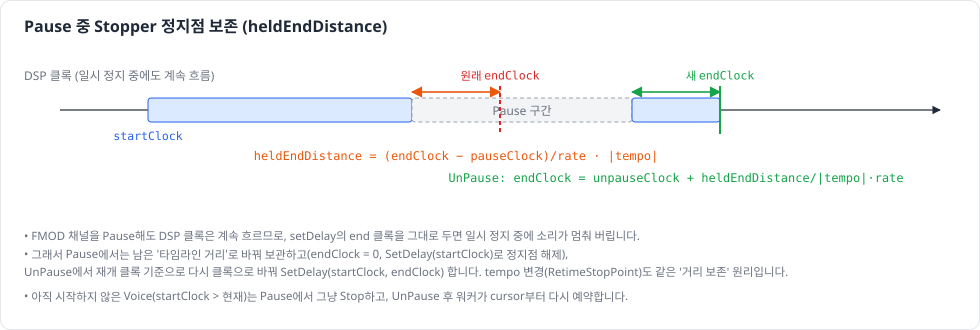
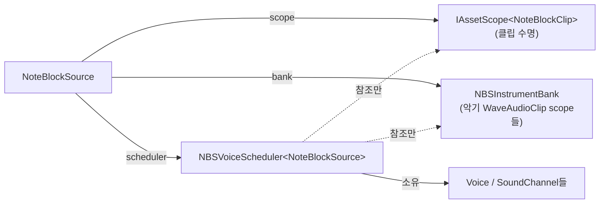

# 6. 명령과 생명주기

> 기준 커밋: `440c549c`. [← 목차](README.md) · 이전: [5. 타임라인과 배치](05-timeline-placement.md) · 다음: [7. 스레드와 잠금](07-threads-locks.md)

재생이 **불연속**하게 바뀌는 일(seek, 재생, tempo·pitch, 일시 정지, 반복 변경)은 4장의 워커 루프만으로는 처리할 수 없습니다.
트랜스포트가 먼저 앵커를 옮기고([3.6](03-clock-anchor.md#36-공개-속성별-흐름)), 이어서 스케줄러의 **명령**을 부릅니다. 명령은 이미 만든 Voice를 정리하거나 다시 맞춥니다.

- [6.1 모든 명령의 공통 뼈대](#61-모든-명령의-공통-뼈대)
- [6.2 `Resync`](#62-resync)
- [6.3 `OnRateChanged`](#63-onratechanged)
- [6.4 `Pause` / `UnPause`](#64-pause--unpause)
- [6.5 `Stop`](#65-stop)
- [6.6 `OnLoopChanged`](#66-onloopchanged)
- [6.7 `reversePitchAlignment`](#67-reversepitchalignment)
- [6.8 요약 표](#68-요약-표)
- [6.9 믹스 속성](#69-믹스-속성)
- [6.10 리로드와 생명주기 (`NoteBlockSource`)](#610-리로드와-생명주기-noteblocksource)

---

## 6.1 모든 명령의 공통 뼈대

```text
1) 트랜스포트에서 rate·loop를 읽고 ClockSnapshot을 만든다     ← gate 밖 (잠금 순서: 트랜스포트 → 스케줄러)
2) lock (gate)
     if (isDisposed) return;
     generation++;                                            ← 진행 중인 Tick 순회를 무효화
     … Voice 정리 / 재계산, cursor 갱신 …
3) NBSPlaybackWorker.Signal()                                 ← 다음 순회를 바로 돌려 새 예약을 채움
```

**`changeClock`**: 여러 명령이 `Math.Min(transport.clockAnchor.dspClock, snapshot.clock)`을 씁니다.

- 트랜스포트는 명령을 부르기 직전에 앵커를 "다음 믹스 클록"으로 옮겼습니다. 이 클록이 **변경이 효과를 내는 지점**입니다.
- 그 사이 마스터 클록이 조금 진행했을 수 있으므로, 앵커와 지금의 다음 믹스 클록 중 작은 값을 기준으로 삼습니다.

## 6.2 `Resync`

seek, 재생 시작, 정지(`time = 0`), 사운드 시스템 리셋 뒤에 부릅니다.

```csharp
// NBSVoiceScheduler`1.Commands.cs
14  public void Resync()
    {
        NBSPlaybackRate rate = ReadRate();
        NBSLoopRange? loop = ReadLoop();
        TryTakeClockSnapshot(rate, loop, out ClockSnapshot snapshot);   // 실패해도 진행 (sampleRate = 0)
        lock (gate)
        {
            if (isDisposed) return;
            generation++;
            if (snapshot.sampleRate > 0)
                ResyncUnsafe(rate, loop, snapshot);                     // 4.6: 전부 정지 → 걸친 소리 복원 → [0, lookahead] 예약
            else
            {
                StopAllVoicesUnsafe();                                  // 클록이 없으면 정지만 하고
                hasCursor = false;                                      // 다음 Tick이 다시 Resync
            }
        }
        NBSPlaybackWorker.Signal();
    }
```

다른 명령은 스냅샷이 실패하면 아무것도 하지 않고 끝나지만, `Resync`는 **최소한 모든 소리를 멈춥니다.** seek 후에 옛 위치의 소리가 남으면 안 되기 때문입니다.

## 6.3 `OnRateChanged`

tempo나 pitch를 바꾼 뒤 부릅니다. 가장 복잡한 명령입니다.

```csharp
51  public void OnRateChanged()
    {
        NBSPlaybackRate rate = ReadRate();
        NBSLoopRange? loop = ReadLoop();
        if (!TryTakeClockSnapshot(rate, loop, out ClockSnapshot snapshot))
            return;
60      ulong changeClock = Math.Min(transport.clockAnchor.dspClock, snapshot.clock);   // tempo가 바뀐 클록
        lock (gate)
        {
            if (isDisposed) return;
            generation++;
            NBSPlaybackRate previous = committedRate;
            committedRate = rate;

            if (rate.pitch == 0 || !float.IsFinite(rate.pitch))         // ① pitch 0: 모든 소리 정지
            { StopAllVoicesUnsafe(); hasCursor = false; return; }

            if (previous.pitch == 0 || !float.IsFinite(previous.pitch)) // ② pitch 0에서 복귀: 처음부터 다시
            { ResyncUnsafe(rate, loop, snapshot); return; }

            double previousTempo = Math.Abs((double)previous.tempo);
            double tempo = Math.Abs((double)rate.tempo);
86          bool keepsSchedule = previousTempo > 0 && tempo > 0 &&       // ③ 예약을 '비례 이동'으로 살릴 수 있는가
                Math.Sign(previous.tempo) == Math.Sign(rate.tempo) &&
                Math.Sign(previous.pitch) == Math.Sign(rate.pitch) &&
                previous.alignment == rate.alignment &&
                !rate.entryDependsOnLength;
93          bool paused = transport.isPaused;

            foreach Voice voice in SnapshotVoicesUnsafe():
101             if (voice.startClock > snapshot.clock && !keepsSchedule)  // ④ 아직 시작 안 한 소리 + 비례 이동 불가 → 취소
                    { StopVoice(voice); continue; }
                SetFrequency(voice, rate.pitch);                          // ⑤ 모든 소리: pitch 즉시 반영
                if (voice.startClock > snapshot.clock)
                    RetimePendingVoice(voice, rate, changeClock, …);      // ⑥ 대기 중: 시작·정지 클록 다시 계산
                else if (!paused)
                    RetimeStopPoint(voice, changeClock, …);               // ⑦ 울리는 중: Stopper 정지점만 다시 계산

            if (tempo == 0)
                hasCursor = false;                                        // ⑧ tempo 0: 새 예약 중단
            else if (keepsSchedule && hasCursor)
122             cursorClock = changeClock + (((cursorClock - changeClock) * previousTempo) / tempo);   // ⑨ 커서도 비례 이동
            else
                { cursorClock = snapshot.clock; hasCursor = true; }       // ⑩ 커서를 지금으로 (취소된 것들을 다시 예약)
        }
        NBSPlaybackWorker.Signal();
    }
```

1. ③ **비례 이동의 원리.** 아직 시작하지 않은 소리는 타임라인에서의 **거리**가 그대로입니다. tempo만 바뀌면 그 거리를 지나는 데 걸리는 벽시계 시간만 달라집니다.

   $$startClock' = changeClock + \frac{(startClock - changeClock) \cdot |T_{old}|}{|T_{new}|}$$

   이 식이 성립하려면 다음 조건이 모두 맞아야 합니다.
   - tempo가 0이 아니어야 합니다.
   - 진행 방향(tempo 부호)과 소리 방향(pitch 부호)이 그대로여야 합니다.
   - 정렬 방식이 같아야 합니다.
   - 노트의 entry가 `D`에 의존하지 않아야 합니다([5.3](05-timeline-placement.md#53-nbsplaybackrate)). `D`는 tempo/pitch에 따라 바뀌므로, entry가 `N±D`이면 시작 위치 자체가 움직입니다.

   하나라도 어긋나면 ④처럼 대기 중인 소리를 취소하고, ⑩에서 커서를 지금으로 되돌려 워커가 새 규칙으로 다시 예약하게 합니다.
2. ⑤ pitch는 이미 **울리고 있는 소리의 frequency도 즉시** 바꿉니다. tempo만 바뀌어도 frequency를 다시 쓰지만 값은 같습니다.
3. ⑥ [`RetimePendingVoice`](../Runtime/NBS/Playback/NBSVoiceScheduler%601.Commands.cs#L275):

   ```csharp
   double length = timeline.GetLength(voice.mapIndex, rate, out bool stopped);   // 새 D (Stopper 다시 적용)
   if (!(length > 0)) { StopVoice(voice); return; }
   NBSNotePlacement placement = timeline.GetPlacement(voice.mapIndex, length, rate);
   double sourceTime = placement.GetSourceTime(voice.startPosition);              // entry에서의 소리 위치
   double remainingSource = placement.startsAtAttack ? (length * placement.sourceScale) - sourceTime : sourceTime;
   if (!(remainingSource > 0)) { StopVoice(voice); return; }
   double distance = (((double)voice.startClock - changeClock) / sampleRate) * previousTempo;   // 옛 tempo로 거리 복원
   voice.startClock = ToClock(changeClock + ((distance / tempo) * sampleRate));                 // 새 tempo로 클록
   voice.endClock = stopped && placement.startsAtAttack
       ? ToClock(voice.startClock + ((Math.Abs(placement.exit - voice.startPosition) / tempo) * sampleRate))
       : 0;
   voice.channel.timeSample = …sourceTime…;
   voice.channel.SetDelay(voice.startClock, voice.endClock);
   ```

   시작 클록뿐 아니라 배치도 다시 계산합니다. pitch가 바뀌면 `D`와 `sourceScale`이 바뀌어, 시작 시 소리 위치와 Stopper 정지점이 달라지기 때문입니다. 예를 들어 Stopper로 잘린 역방향 소리는 **잘린 지점부터** 시작하는데, 그 지점은 `D'`에 따라 정해집니다.
4. ⑦ [`RetimeStopPoint`](../Runtime/NBS/Playback/NBSVoiceScheduler%601.Commands.cs#L303): Stopper 정지점은 **타임라인의 고정 위치**입니다. 남은 거리를 보존하고 클록만 새 tempo로 바꿉니다.
   - 일시 정지 중에는 건너뜁니다. 정지점이 `heldEndDistance`로 보관되어 있고 `UnPause`가 복원합니다.
   - tempo가 0이 되면 거리를 `heldEndDistance`에 보관하고 정지 예약(`endClock`)을 지웁니다. 타임라인이 멈춰 있으니 정지점에 영원히 도달하지 않기 때문입니다.
   - tempo가 다시 0이 아니게 되면 보관한 거리로 정지 클록을 다시 계산합니다.
5. ⑧ "tempo 0이면 새 예약만 멈춘다": 울리고 있는 소리는 그대로 끝까지 울립니다. `Tick`은 `rate.canPlace == false`라서 아무것도 하지 않습니다.

> **관찰된 동작:** `OnRateChanged`는 스냅샷을 만들지 못하면(사운드 시스템 비활성 등) `committedRate`도 갱신하지 않고 끝납니다. 이후 리셋이 끝나면 `Resync`가 `committedRate`를 다시 맞춥니다.

## 6.4 `Pause` / `UnPause`



```csharp
137  public void Pause()
     {
         if (!TryTakeClockSnapshot(ReadRate(), ReadLoop(), out ClockSnapshot snapshot)) return;
         lock (gate)
         {
             if (isDisposed) return;
             generation++;
             double tempo = Math.Abs((double)committedRate.tempo);
             foreach Voice voice:
                 if (voice.startClock > snapshot.clock) { StopVoice(voice); continue; }   // ① 대기 중인 소리는 취소
                 voice.channel.Pause();                                                 // ② 울리는 소리는 그 자리에서 멈춤
                 if (voice.endClock != 0)                                               // ③ Stopper 정지점이 있으면
                 {
167                  voice.heldEndDistance = tempo > 0 ? (((double)voice.endClock - snapshot.clock) / snapshot.sampleRate) * tempo : voice.heldEndDistance;
                     voice.endClock = 0;
                     voice.channel.SetDelay(voice.startClock);                          //    정지 예약 해제
                 }
             hasCursor = false;                                                         // ④ 커서 무효 (재개 시 다시 정함)
         }
     }
```

- ③ **FMOD 채널을 일시 정지해도 DSP 클록은 계속 흐릅니다.** `setDelay`의 정지 클록을 그대로 두면 일시 정지 중에 그 클록이 지나가 소리가 끊깁니다. 그래서 정지점을 "남은 타임라인 거리"로 바꿔 보관하고 예약을 지웁니다.
- 일시 정지 중에는 워커 `Tick`이 바로 반환하므로 `Signal`을 부르지 않습니다.

```csharp
186  public void UnPause()
     {
         if (!TryTakeClockSnapshot(…)) return;
         lock (gate)
         {
             if (isDisposed) return;
             generation++;
             double tempo = Math.Abs((double)committedRate.tempo);
             foreach Voice voice:
                 if (tempo > 0 && double.IsFinite(voice.heldEndDistance))
                 {
207                  voice.endClock = ToClock(snapshot.clock + ((voice.heldEndDistance / tempo) * snapshot.sampleRate));   // ① 보관한 거리 → 새 정지 클록
                     voice.heldEndDistance = double.NaN;
                     voice.channel.SetDelay(voice.startClock, voice.endClock);
                 }
                 voice.channel.UnPause();                                               // ② 소리 위치는 멈춘 곳에서 이어짐
221          cursorClock = Math.Min(transport.clockAnchor.dspClock, snapshot.clock);     // ③ 재개 앵커부터 다시 예약
             hasCursor = tempo > 0;
         }
         NBSPlaybackWorker.Signal();
     }
```

README의 "Pause는 소리 위치까지 멈춥니다"가 이것입니다. 울리던 소리는 지워지지 않고 그 자리에서 멈췄다가 이어집니다.

## 6.5 `Stop`

```csharp
232  public void Stop()
     {
         lock (gate)
         {
             if (isDisposed) return;
             generation++;
             StopAllVoicesUnsafe();
             hasCursor = false;
         }
     }
```

클록이 필요 없으므로 스냅샷도 만들지 않습니다. `NoteBlockSource.Stop()`에서는 `time = 0`의 `Resync`가 먼저 실행되고(재생 중이 아니라 정지만 함), 이어서 `OnStop`이 이 메서드를 부릅니다.

## 6.6 `OnLoopChanged`

```csharp
249  public void OnLoopChanged()
     {
         if (!TryTakeClockSnapshot(…)) return;
         lock (gate)
         {
             if (isDisposed) return;
             generation++;
261          ulong changeClock = Math.Min(transport.clockAnchor.dspClock, snapshot.clock);
262          CancelPendingVoicesUnsafe(changeClock);           // ① 변경 지점 이후에 시작하는 예약만 취소
             cursorClock = changeClock;                         // ② 거기서부터 새 범위로 다시 예약
             hasCursor = hasCursor && committedRate.tempo != 0;
         }
         NBSPlaybackWorker.Signal();
     }
```

반복 범위가 바뀌면 "앞으로 어디서 되돌아가는가"만 달라집니다. 이미 울리는 소리는 그대로 두고, 아직 시작하지 않은 예약만 새 범위로 다시 계산합니다.

## 6.7 `reversePitchAlignment`

```csharp
128  public NBSReversePitchAlignment reversePitchAlignment
     {
         set
         {
             if (_reversePitchAlignment == value) return;
             _reversePitchAlignment = value;
             OnRateChanged();        // alignment가 달라 keepsSchedule = false → 대기 예약 취소 후 다시 예약
         }
     }
```

## 6.8 요약 표

| 명령 | 대기 중인 Voice | 울리는 Voice | cursor | Signal |
| --- | --- | --- | --- | --- |
| `Resync` | 전부 정지 | 전부 정지 → 걸친 소리를 offset부터 새로 | `[0, lookahead]` 예약 후 창 끝 | O |
| `OnRateChanged` (비례 가능) | 시작·정지 클록 비례 이동, 배치 재계산 | frequency 갱신, 정지점 비례 이동 | 비례 이동 | O |
| `OnRateChanged` (비례 불가) | 취소 | frequency 갱신, 정지점 비례 이동 | 지금(snapshot.clock) | O |
| pitch → 0 | 전부 정지 | 전부 정지 | 없음 | – |
| pitch 0 → 복귀 | – | – | Resync | – |
| tempo → 0 | 취소(비례 불가) | 그대로 울림, 정지점 보관 | 없음 | O |
| `Pause` | 취소 | `channel.Pause`, 정지점 보관 | 없음 | – |
| `UnPause` | – | 정지점 복원, `channel.UnPause` | 재개 앵커 | O |
| `Stop` | 전부 정지 | 전부 정지 | 없음 | – |
| `OnLoopChanged` | 변경 지점 이후 시작분 취소 | 그대로 | 변경 지점 | O |

## 6.9 믹스 속성

`volume`, `panStereo`, `spatialBlend`, `dopplerLevel`, `spread`, `minMaxDistance`, `rolloffMode`, `spatialState`는 예약과 무관하게 **모든 Voice에 즉시** 적용됩니다.

```csharp
// NBSVoiceScheduler`1.Mix.cs
12   public float volume
     {
         get => _volume;
         set => SetMix(ref _volume, value, static (scheduler, voice) => voice.channel.volume = scheduler.timeline.GetMix(voice.mapIndex).volume * scheduler._volume);
     }

116  void SetMix<T>(ref T field, T value, Action<NBSVoiceScheduler<TTransport>, Voice> apply, bool compare = true)
     {
         lock (gate)
         {
             if (compare && EqualityComparer<T>.Default.Equals(field, value)) return;   // 같으면 아무것도 안 함
             field = value;
             foreach Voice v in SnapshotVoicesUnsafe():
                 try { apply(this, v); }
                 catch (ObjectDisposedException) { RemoveVoice(v.channel); }
         }
     }

140  float GetPan(Voice voice) => Mathf.Lerp(timeline.GetMix(voice.mapIndex).panning, _panStereo, Math.Abs(_panStereo));
```

- 적용 람다는 모두 `static`이고 스케줄러를 인자로 받습니다. 매번 클로저를 할당하지 않기 위해서입니다.
- 최종 음량 = 노트 믹스 음량(레이어 × velocity, 2장) × 소스 음량.
- 팬: 소스 `panStereo`가 0이면 노트 팬 그대로, ±1이면 소스 팬으로 완전히 덮어씁니다. 그 사이는 `|pan|` 비율로 보간합니다.
- [`spatialState`](../Runtime/NBS/Playback/NBSVoiceScheduler%601.Mix.cs#L97)는 매 프레임(`NoteBlockSource.Update`) 들어옵니다. `AudioSpatialState`는 `IEquatable`이 없어서 `EqualityComparer` 비교가 박싱을 일으키므로, 위치·속도·회전을 직접 비교하고 `compare: false`로 넘깁니다. `spatialBlend == 0`(완전 2D)이면 채널에 쓰지 않습니다.
- 새 Voice는 생성 시 [`ApplyMix`](../Runtime/NBS/Playback/NBSVoiceScheduler%601.Mix.cs#L142)로 현재 값을 한 번에 받습니다.

## 6.10 리로드와 생명주기 (`NoteBlockSource`)

### 무엇을 소유하는가



스케줄러는 클립과 bank를 **소유하지 않습니다.** 그래서 해제 순서는 항상 **스케줄러 → bank → scope**입니다.

### `ReloadCore` (줄 단위)

```csharp
// NoteBlockSource.Lifecycle.cs
22  public UniTask Reload() => reloadGate.Run(ReloadCore);       // AsyncReloadGate: 동시 요청을 직렬화하고 최신 요청 하나로 합침

24  async UniTask ReloadCore()
    {
26      AssetRef<NoteBlockClip> target = _clip;
28      if (this == null || !isActiveAndEnabled || (target.IsSameTarget(scope) && (bank?.IsSameTarget() ?? true)))
29          return;                                               // ① 클립도 악기 소리도 그대로면 할 일 없음
31      IAssetScope<NoteBlockClip>? newScope = await target.LoadScopeAsync();          // ② 클립 로드
32      NBSInstrumentBank? newBank = null;
33      try
        {
35          if (newScope != null && this != null && isActiveAndEnabled)
36              newBank = await NBSInstrumentBank.LoadAsync(newScope.asset.map, GetInstrumentNamespace(target));   // ③ 악기 로드
        }
        catch { DisposeQueue.Enqueue(newScope); throw; }
44      if (this == null || !isActiveAndEnabled)                  // ④ 기다리는 동안 비활성화됨 → 새 것 버림
        { DisposeQueue.Enqueue(newBank); DisposeQueue.Enqueue(newScope); return; }

55      playingLock.EnterWriteLock();                             // ⑤ 교체는 잠금 안에서 한 번에
        try
        {
59          oldScheduler = scheduler; oldBank = bank; oldScope = scope;
65          MoveAnchorUnsafe();                                   // ⑥ 옛 클립의 반복 범위로 현재 위치를 먼저 접음
67          scope = newScope;
68          bank = newBank;
69          scheduler = newScope != null && newBank != null ? CreateScheduler(newScope.asset, newBank) : null;   // ⑦ 새 스케줄러(워커 등록)
72          MoveAnchorUnsafe();                                   // ⑧ 새 클립의 반복 범위로 다시 접음
        }
        finally { playingLock.ExitWriteLock(); }
79      oldScheduler?.Dispose();                                  // ⑨ 옛 스케줄러 먼저 (소리 정지, 워커 해제)
80      DisposeQueue.Enqueue(oldBank);                            //    그다음 bank, scope는 메인 스레드에서 나중에 해제
81      DisposeQueue.Enqueue(oldScope);
    }
```

1. ① `bank.IsSameTarget()`도 확인하는 이유: 클립은 같아도 처음 로드할 때 악기 소리가 없었다가(리소스팩 로드 전) 나중에 생겼을 수 있습니다. 소스는 `IReloadable`로 `ResourceManager`에 등록되어 있어서([`#L127`](../Runtime/NBS/NoteBlockSource.Lifecycle.cs#L127)) 리소스 리로드 때마다 이 검사를 합니다.
2. ⑥⑧ 두 번 접는 이유: 앵커는 접기 전의 **선형** 위치를 저장하고, `MoveAnchorUnsafe`는 **그때의 클립**의 반복 범위로 접습니다([3.3](03-clock-anchor.md#33-앵커를-정하는-세-메서드)).
   - ⑥은 교체 전, 옛 클립의 범위로 접습니다. 이 단계가 없으면 옛 클립에서 반복한 횟수가 선형 위치에 남습니다. 새 클립의 반복 범위가 더 길면 그 횟수가 위치에 다시 나타납니다.
   - ⑧은 교체 후, 새 클립의 범위로 다시 접습니다. 새 스케줄러가 위치를 읽기 전에 새 범위 안에 들어가 있게 됩니다.
   - 그래서 짧은 곡 → 긴 곡과 긴 곡 → 짧은 곡 교체가 같은 규칙을 따릅니다. 커밋 `440c549c`가 ⑥을 추가했습니다. 그 전에는 ⑧만 있어 교체 방향에 따라 위치가 다르게 이어졌습니다.
3. ⑦ 새 스케줄러는 `hasCursor == false`로 시작하므로, 워커의 첫 `Tick`이 `ResyncUnsafe`를 실행합니다. 재생 중이었다면 **현재 위치에 걸친 소리부터 복원**됩니다. README의 "늦은 로드는 현재 위치에 걸친 소리를 offset부터 복원"이 이 경로입니다.
4. ⑨ `DisposeQueue`는 리소스 해제를 메인 스레드의 프레임 업데이트로 미뤄, 프레임당 약 10 ms 예산 안에서 처리합니다(`core` 패키지).

[`CreateScheduler`](../Runtime/NBS/NoteBlockSource.Lifecycle.cs#L84)는 소스의 현재 믹스·3D 설정을 초기값으로 넣습니다. 악기 네임스페이스([`GetInstrumentNamespace`](../Runtime/NBS/NoteBlockSource.Lifecycle.cs#L97))는 다음 규칙을 따릅니다.
- 레지스트리 참조면 클립 식별자의 네임스페이스를 씁니다.
- 에셋을 직접 참조하면 `directInstrumentNamespace`를 씁니다.

### 활성화와 프레임

| 시점 | 동작 |
| --- | --- |
| `OnEnable` ([#L114](../Runtime/NBS/NoteBlockSource.Lifecycle.cs#L114)) | Rigidbody 캐시 → `onUpdate += SyncTimeToMixer`, `onReset += OnSoundSystemReset` → `AttachReloadable` → `Reload()` |
| `OnDisable` ([#L132](../Runtime/NBS/NoteBlockSource.Lifecycle.cs#L132)) | `base.OnDisable()`(→ `Stop()`) → 구독 해제 → 잠금 안에서 세 필드를 null로 → 스케줄러 `Dispose` → bank·scope는 `DisposeQueue` |
| `Update` ([#L184](../Runtime/NBS/NoteBlockSource.Lifecycle.cs#L184)) | `spatialBlend > 0`일 때만 속도를 구합니다(Rigidbody → Rigidbody2D → `nonRigidbodyVelocity`면 위치 차분, 최대 20). 그다음 `scheduler.spatialState`를 갱신합니다. |
| `clip = …` | 활성 상태면 `Reload()` |

`Play()`가 리로드 완료 전에 불려도 괜찮습니다. 시간축(앵커)은 소스가 가지고 있으므로 위치는 그대로 진행하고, 스케줄러가 생기는 순간 `Resync`로 그 위치의 소리가 복원됩니다.

### 다시 `Reload()`가 필요한 편집

`Apply()`로 맵만 바꾸면 스케줄러가 자동으로 새 타임라인을 씁니다([4.5 ⑥](04-worker-scheduling.md#45-tick-워커-한-번의-순회-줄-단위)). 하지만 bank는 **로드할 때 쓰인 악기만** 불러옵니다(2장). 따라서 다음 경우에는 `Reload()`가 필요합니다.

- 사운드 파일을 바꾼 경우
- 커스텀 악기 순서를 바꾼 경우
- 로드할 때 무음이던 레이어의 무음을 해제한 경우
- 새 악기를 추가한 경우
