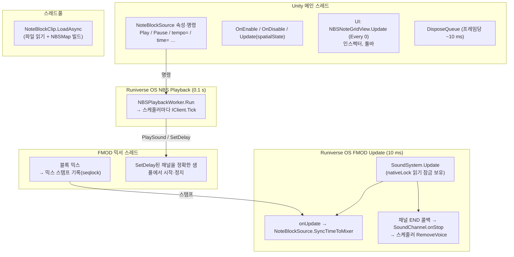
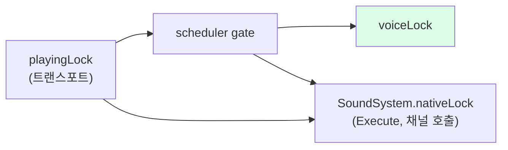
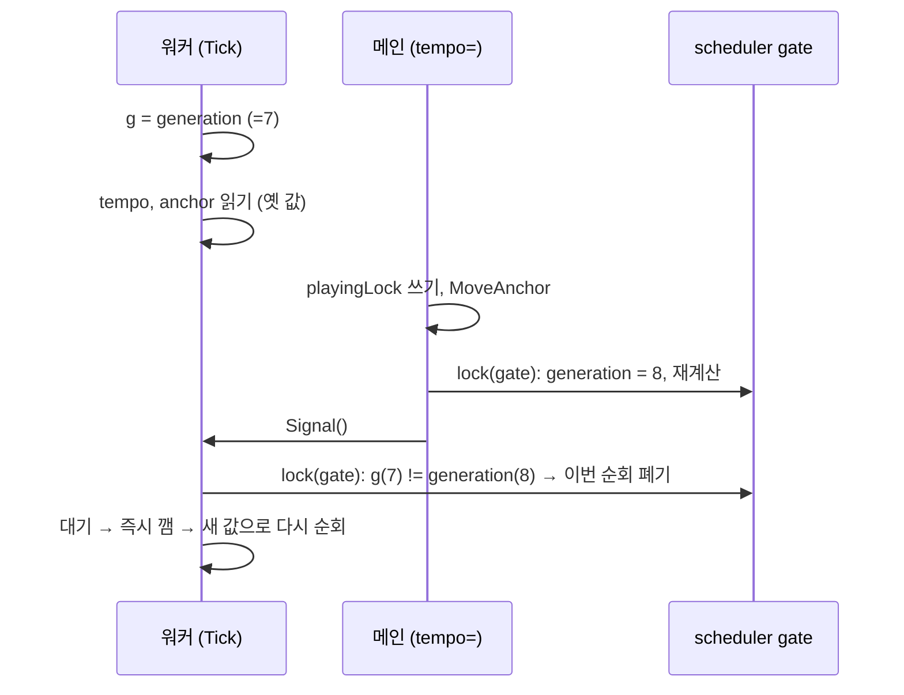

# 7. 스레드와 잠금

> 기준 커밋: `440c549c`. [← 목차](README.md) · 이전: [6. 명령과 생명주기](06-commands-lifecycle.md) · 다음: [8. 에디터 프리뷰](08-editor-preview.md)

NBS 재생에는 최소 다섯 종류의 스레드가 관여합니다. 이 장은 **어떤 코드가 어느 스레드에서 도는지**, 그리고 교착 상태를 피하기 위해 지키는 **잠금 순서**를 한곳에 모읍니다.

## 7.1 스레드 지도

| 스레드 | 주기 | 여기서 도는 NBS 관련 코드 |
| --- | --- | --- |
| 메인 | 프레임 | 모든 공개 속성·명령(보통), `Update`의 3D 상태, 리로드 교체, UI 갱신 |
| 스레드풀 | 로드 시 | `NoteBlockClip.LoadAsync`의 읽기·맵 빌드(2장) |
| NBS Playback | `workerInterval` 또는 `Signal` | `Tick` → `Query` → `CreateVoiceUnsafe` (4장) |
| FMOD Update | 10 ms | `SyncTimeToMixer`(3장), `onStop`(Voice 목록 정리), 보류 `timeSample` 재시도 |
| FMOD 믹서 | 블록 | 믹스 스탬프 쓰기, 예약된 채널 시작·정지 |

공개 API는 메인 스레드 전용이 아닙니다. 내부 상태는 모두 아래 잠금으로 보호합니다. 단, `MonoBehaviour` 생명주기와 `transform` 접근은 Unity 규칙대로 메인 스레드에서 합니다.

## 7.2 잠금 목록

| 잠금 | 소유자 | 종류 | 보호 대상 |
| --- | --- | --- | --- |
| `playingLock` | `RuniAudioSource` (public) | `ReaderWriterLockSlim`, 재귀 허용 | 재생 상태, 보간 기준점, `_clockAnchor`, `anchorAdvances`, `scheduler`/`bank`/`scope` 필드 |
| `gate` | `NBSVoiceScheduler` | `Lock` | 커서, generation, timeline, committedRate, Voice 재계산, 믹스 값 |
| `voiceLock` | `NBSVoiceScheduler` | `Lock` | `voices` 목록만 |
| worker `gate` | `NBSPlaybackWorker` (static) | `Lock` | 클라이언트 목록, 스레드 참조 |
| `gate` | `NBSPreviewTransport` | `Lock` | 앵커와 재생 플래그 |
| `nativeLock` | `SoundSystem` | `ReaderWriterLockSlim`, 재귀 허용 | FMOD 호출(읽기) ↔ Reset/Dispose(쓰기) |
| `playbackLock` | `SoundChannel` | `ReaderWriterLockSlim` | 채널 위치 |
| (seqlock) | 믹스 스탬프 | 잠금 없음 | 스탬프 3필드 |

## 7.3 잠금 순서

**규칙: 왼쪽 잠금을 쥔 채 오른쪽을 잡을 수 있지만, 반대 방향은 안 됩니다.**

1. **트랜스포트 → 스케줄러**: `NoteBlockSource`는 `playingLock` 쓰기 잠금을 쥔 채 `scheduler.Resync()` 등을 부르고, 명령은 그 안에서 `gate`를 잡습니다. 그래서 `Tick`은 **`gate` 밖에서 트랜스포트를 읽습니다**([4.5](04-worker-scheduling.md#45-tick-워커-한-번의-순회-줄-단위)).
2. **스케줄러 → 사운드 시스템**: `gate` 안에서 `PlaySound`, `SetDelay` 같은 FMOD 호출(`nativeLock` 읽기)을 합니다.
3. **`voiceLock`은 막다른 잠금**입니다. 그 안에서는 다른 잠금을 잡지 않고 목록만 조작합니다. 그래서 `nativeLock` 읽기를 쥔 업데이트 스레드의 `onStop`에서도 안전하게 잡을 수 있습니다. `onStop`이 `gate`를 잡으면 `gate → nativeLock`과 순서가 반대가 됩니다.

### 낙관적 검사: `generation`

규칙 1 때문에 `Tick`이 트랜스포트를 읽는 순간과 `gate`를 잡는 순간 사이에 틈이 생깁니다. 그 틈에 명령이 끼어들면 `Tick`이 읽은 값은 낡은 값입니다.

잠금을 하나 더 두는 대신 **세대 번호 하나로 틈을 감지하고 버리는** 방식입니다. 명령은 끝에서 `Signal()`을 부르므로 버린 순회는 곧 다시 실행됩니다.

### 교착 상태 회피: `SyncTimeToMixer`의 `TryEnterWriteLock(0)`

FMOD 업데이트 스레드는 `nativeLock` **읽기 잠금을 쥔 채** `onUpdate`를 부릅니다. `ReaderWriterLockSlim`은 쓰기 대기자가 있으면 새 읽기 요청을 막습니다. 그래서 다음 세 스레드가 만나면 교착 상태가 됩니다.

| 스레드 | 쥔 것 | 기다리는 것 |
| --- | --- | --- |
| FMOD Update | `nativeLock` 읽기 | `playingLock` 쓰기 (`SyncTimeToMixer`) |
| 메인 (`tempo=`) | `playingLock` 쓰기 | `nativeLock` 읽기 (`TryGetNextMixClock`) — 대기 중인 writer 뒤에 줄 섬 |
| 리셋 호출자 | `lifecycleLock` | `nativeLock` 쓰기 (Update가 끝나길) |

그래서 `SyncTimeToMixer`는 `playingLock`을 **기다리지 않고 시도만** 합니다. 실패하면 그 블록은 건너뛰고 다음 블록에서 따라잡습니다([3.5](03-clock-anchor.md#35-믹서를-따라가기-synctimetomixer)). FMOD 패키지의 `WaveAudioSource`도 같은 스레드에서 업그레이드 가능 읽기 잠금을 씁니다.

## 7.4 해제와 경쟁

- **스케줄러 해제 중의 `Tick`:** 워커는 클라이언트 목록을 복사해서 돌기 때문에, `Dispose`가 `Unregister`한 직후에도 한 번 더 `Tick`이 올 수 있습니다. `Dispose`는 `gate` 안에서 `isDisposed = true; generation++`로 막고, 모든 명령과 `Tick`은 `isDisposed`를 먼저 확인합니다.
- **`ObjectDisposedException`:** 채널은 언제든 끝나거나(리셋, FMOD가 회수) 해제될 수 있습니다. Voice를 다루는 모든 루프가 이 예외를 잡아 `RemoveVoice`로 정리합니다.
- **리로드 교체:** `ReloadCore`는 새 스케줄러를 `playingLock` 안에서 넣고, 옛 스케줄러는 잠금 밖에서 해제합니다([6.10](06-commands-lifecycle.md#610-리로드와-생명주기-noteblocksource)). 해제는 모든 채널을 멈추는 작업이라, 잠금 밖으로 빼서 `playingLock`을 쥐는 시간을 짧게 합니다.
- **맵 교체:** `NoteBlockClip.map`은 `Volatile` 읽기/쓰기로 통째 교체되는 불변 객체입니다. 워커는 잠금 없이 읽고, 참조가 바뀐 것을 보면 새 타임라인을 만듭니다(2장, 4장).
