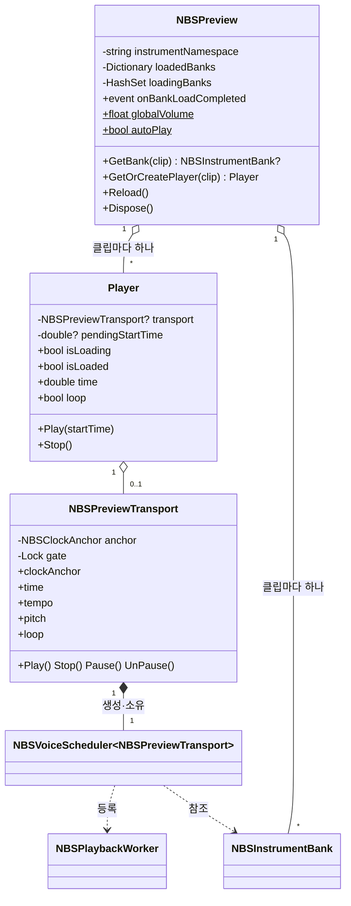
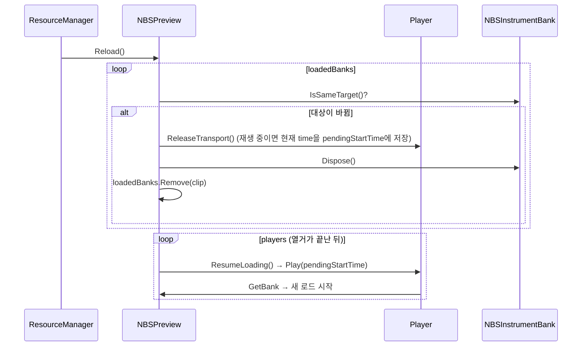
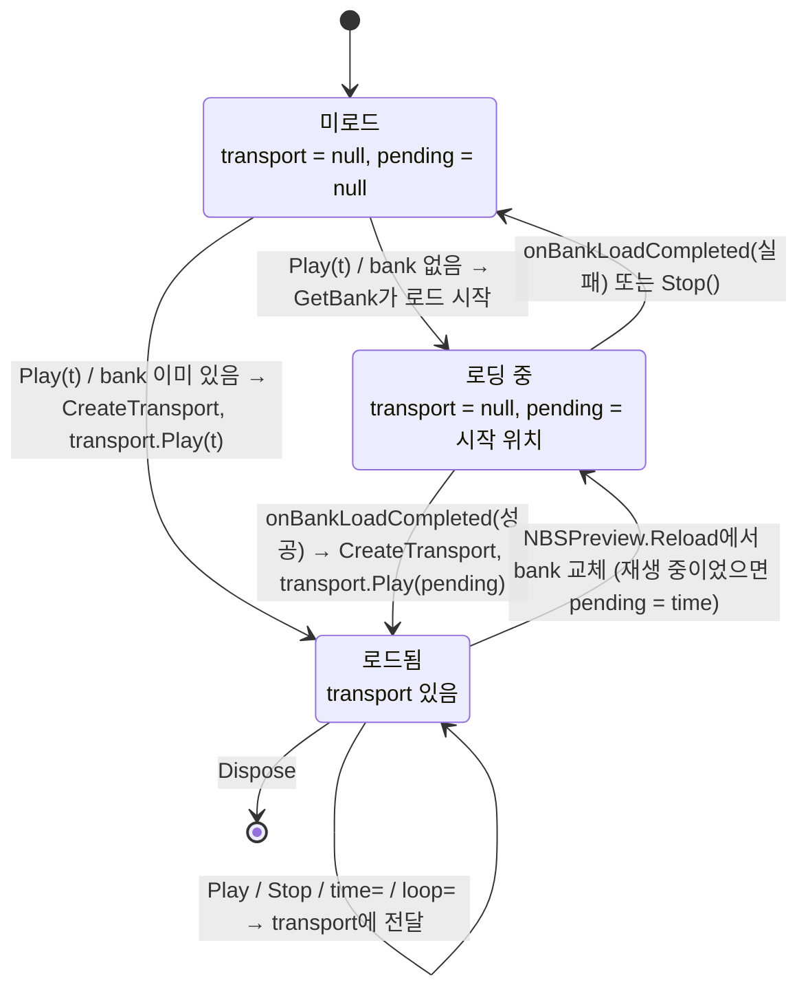

# 8. 에디터 프리뷰

> 기준 커밋: `440c549c`. [← 목차](README.md) · 이전: [7. 스레드와 잠금](07-threads-locks.md) · 다음: [9. 노트 그리드 뷰](09-grid-view.md)

씬에 `NoteBlockSource`를 놓지 않고도 인스펙터에서 `.nbs`를 들어 볼 수 있게 하는 부분입니다.
오디오 파일 미리듣기(FMOD 패키지의 `AudioPreview`)는 채널 하나만 재생하면 되므로 단순합니다. NBS는 노트마다 채널을 예약해야 하므로 **런타임과 같은 스케줄러**를 써야 합니다.
그래서 `MonoBehaviour` 없이 스케줄러를 움직이는 **트랜스포트 클래스 `NBSPreviewTransport`**가 따로 있습니다.

- [8.1 구성](#81-구성)
- [8.2 `NBSPreview`: 클립별 악기 bank 캐시](#82-nbspreview-클립별-악기-bank-캐시)
- [8.3 `NBSPreview.Player`: 로딩을 기다리는 재생 요청](#83-nbspreviewplayer-로딩을-기다리는-재생-요청)
- [8.4 `NBSPreviewTransport` (줄 단위)](#84-nbspreviewtransport-줄-단위)
- [8.5 `NoteBlockSource`와의 차이](#85-noteblocksource와의-차이)
- [8.6 프리뷰를 띄우는 곳들](#86-프리뷰를-띄우는-곳들)
- [8.7 `NBSPreviewToolbar`](#87-nbspreviewtoolbar)
- [8.8 `NoteBlockSourceEditor`](#88-noteblocksourceeditor)

---

## 8.1 구성



- **소유:** `NBSPreview` → `Player`와 bank, `Player` → `NBSPreviewTransport`, 트랜스포트 → 스케줄러.
- **해제 순서:** 스케줄러가 bank를 참조하므로 항상 **Player(트랜스포트·스케줄러) → bank** 순서로 해제합니다.

## 8.2 `NBSPreview`: 클립별 악기 bank 캐시

```csharp
// Editor/NBS/NBSPreview.cs
     public NBSPreview(string instrumentNamespace)
     {
         this.instrumentNamespace = instrumentNamespace;     // 커스텀 악기를 찾을 리소스 네임스페이스
         ResourceManager.AttachReloadable(this);             // 리소스팩 리로드 때 Reload() 호출
     }

64   public NBSInstrumentBank? GetBank(NoteBlockClip clip)
     {
         ObjectDisposedException.ThrowIf(isDisposed, this);
         if (loadedBanks.TryGetValue(clip, out NBSInstrumentBank? bank))
             return bank;                                     // ① 이미 있음
         if (loadingBanks.Add(clip))
             LoadBank(clip).Forget();                         // ② 처음 요청이면 로드 시작 (중복 요청은 무시)
         return null;                                         // ③ 아직 없음 → 완료 이벤트를 기다려야 함
     }

133  async UniTaskVoid LoadBank(NoteBlockClip clip)
     {
         NBSInstrumentBank? bank = null;
         try { bank = await NBSInstrumentBank.LoadAsync(clip.map, instrumentNamespace); }
         catch (Exception e) { Debug.LogException(e); }
         if (isDisposed) { bank?.Dispose(); return; }         // ④ 그 사이 프리뷰가 닫힘
         loadingBanks.Remove(clip);                           // ⑤ 실패해도 지움 → 다음 요청이 다시 시도
         if (bank != null)
             loadedBanks.Add(clip, bank);
         onBankLoadCompleted?.Invoke(clip);                   // ⑥ 성공·실패 모두 알림
     }
```

**리로드** ([`#L107`](../Editor/NBS/NBSPreview.cs#L107)): 리소스팩이 바뀌면 `bank.IsSameTarget()`이 거짓인 bank만 교체합니다(2장).



`ResumeLoading`을 열거가 끝난 **뒤에** 부르는 이유: 로드가 중단 없이 바로 끝나면 `loadedBanks`에 항목이 추가되는데, 열거 중인 딕셔너리에 추가하면 예외가 납니다. 열거 중에 현재 항목을 지우는 것은 허용됩니다.

**해제** ([`#L81`](../Editor/NBS/NBSPreview.cs#L81)): `players`를 먼저 해제하고(스케줄러가 bank를 쓰므로) 그다음 bank를 해제합니다.

## 8.3 `NBSPreview.Player`: 로딩을 기다리는 재생 요청

`Player`는 사용자가 누른 재생을 기억했다가 **bank가 준비되면** 트랜스포트를 만들어 재생합니다. `IPlayControl`, `IStoppable`, `ISeekable`만 구현합니다(일시 정지 없음).



```csharp
// Editor/NBS/NBSPreview.Player.cs
148  public void Play(double startTime = 0)
     {
         if (transport == null)
         {
             pendingStartTime = startTime;               // ① 요청 '전에' 기록: 로드가 동기로 끝나면 이벤트가 요청 안에서 옴
             NBSInstrumentBank? bank = preview.GetBank(clip);
             if (transport != null || bank == null)      // ② 이벤트가 이미 트랜스포트를 만들었거나, 아직 로딩 중
                 return;
             CreateTransport(bank);                      // ③ bank가 이미 있었음
         }
         pendingStartTime = null;
         transport!.Play(startTime);
     }

202  void OnBankLoadCompleted(NoteBlockClip loaded)
     {
         if (loaded != clip || pendingStartTime is not { } startTime)    // 다른 클립이거나 재생 요청이 없음
             return;
         pendingStartTime = null;
         if (!preview.loadedBanks.TryGetValue(clip, out NBSInstrumentBank? bank))
             return;                                                     // 로드 실패 → 미로드로
         CreateTransport(bank);
         transport!.Play(startTime);
     }

182  internal void ReleaseTransport()
     {
         if (transport is { isPlaying: true })
             pendingStartTime = transport.time;          // 리로드 후 이어서 재생할 위치
         transport?.Dispose();
         transport = null;
     }
```

- `time` setter: 트랜스포트가 있으면 seek하고, 없으면 그 위치에서 `Play`합니다.
- `loop`: 트랜스포트가 생기기 전에는 NBS 헤더의 반복 설정을 보여 줍니다.
- `volume`은 정적 `globalVolume`(기본 0.5)입니다. 바꾸면 정적 `globalPlayers`에 등록된 모든 플레이어의 트랜스포트에 반영됩니다.

## 8.4 `NBSPreviewTransport` (줄 단위)

`INBSTransport`([1장](01-api-entry.md#13-커스텀-트랜스포트))의 **최소 구현**입니다. `NoteBlockSource`가 3장에서 하는 일 중 **앵커 관리만** 남기고 보간·출력 시간·3D·잠금 계층을 모두 뺐습니다.

```csharp
// Editor/NBS/NBSPreviewTransport.cs
21   public sealed class NBSPreviewTransport : INBSTransport, IPlayControl, IPausable, IStoppable, ISeekable, ILoopControl, ITempoControl, IPitchControl, IDisposable
35   public NBSPreviewTransport(NoteBlockClip clip, NBSInstrumentBank bank)
     {
         this.clip = clip;
         _loop = clip.header.loop;                                          // ① 반복 여부의 초기값은 파일 설정
         scheduler = new NBSVoiceScheduler<NBSPreviewTransport>(clip, bank, this);   // ② 자기 스케줄러를 만듦 → 워커 등록
         SoundSystem.main.onResetting += OnSoundSystemResetting;
         SoundSystem.main.onReset += OnSoundSystemReset;
     }
```

### 앵커

```csharp
49   public NBSClockAnchor clockAnchor { get { lock (gate) return anchor; } }   // 스케줄러(워커 스레드)가 읽음

222  void Anchor(double linearTime)                                          // seek, 재생
     {
         ulong clock = NBSClockAnchor.TryGetNextMixClock(SoundSystem.main, out ulong nextMixClock) ? nextMixClock : ulong.MaxValue;
         lock (gate)
             anchor = new NBSClockAnchor(clock, linearTime);
     }

233  void MoveAnchor()                                                       // tempo·반복 변경, 일시 정지·재개
     {
         bool hasClock = NBSClockAnchor.TryGetNextMixClock(SoundSystem.main, out ulong clock);   // 잠금 밖에서 클록 읽기
         lock (gate)
         {
             double linear = hasClock && _isPlaying && !_isPaused ? anchor.GetTime(clock, _tempo, SoundSystem.main.outputSampleRate) : anchor.time;
             anchor = new NBSClockAnchor(hasClock ? clock : ulong.MaxValue, Fold(linear));   // 3.3과 같은 '먼저 접기'
         }
     }
```

3장의 `AnchorUnsafe`/`MoveAnchorUnsafe`와 **같은 규칙**입니다. 차이는 두 가지입니다.

- 진행 여부를 `anchorAdvances`로 따로 기록하지 않고 매번 `_isPlaying && !_isPaused`를 봅니다.
- 보간 기준점을 맞추는 단계(`SyncTimeTo…`)가 없습니다.

`gate`는 짧은 대입에만 쓰고, 그 안에서 사운드 시스템이나 스케줄러를 부르지 않습니다. 그래서 스케줄러가 `clockAnchor`를 읽을 때 생기는 잠금 순서 문제가 없습니다.

### `time`: 보간하지 않고 마스터 클록에서 바로 계산

```csharp
85   public double time
     {
         get
         {
             SoundSystem.main.Execute(static system => system.GetMasterDSPClock(), out ulong clock);   // ① '지금'의 마스터 클록
             return Fold(GetTime(clock));
         }
         set
         {
             Anchor(value);
             scheduler?.Resync();
         }
     }

244  double GetTime(ulong clock)
     {
         lock (gate)
             return _isPlaying && !_isPaused ? anchor.GetTime(clock, _tempo, SoundSystem.main.outputSampleRate) : anchor.time;
     }
```

- ① 마스터 DSP 클록은 블록 단위로 움직이므로, 프리뷰의 `time`은 **블록 단위 계단**(예: 21 ms)으로 움직입니다. 출력 지연 보정도 없습니다. 미리보기 용도로 충분하다고 보고 3장의 믹스 스탬프 보간을 쓰지 않습니다.
- 재생 직후에는 마스터 클록이 앵커(다음 믹스 클록)보다 작으므로, `GetTime`이 `anchor.time`을 돌려줘서 위치가 유지됩니다.
- 곡 끝을 지나도 `time`은 계속 커집니다. 반복이 꺼져 있으면 곡 끝에서 멈추게 하는 일은 툴바가 맡습니다(8.7).

### 명령

```csharp
164  public void Play(double startTime = 0)
     {
         lock (gate) { _isPlaying = true; _isPaused = false; }
         time = startTime;                         // Anchor + Resync
     }

176  public void Stop()
     {
         lock (gate) { _isPlaying = false; _isPaused = false; anchor = anchor with { time = 0 }; }
         scheduler?.Stop();
     }

189  public void Pause()
     {
         MoveAnchor();                             // ① 아직 재생 중 상태로: 다음 믹스 클록에서의 위치를 굳힘
         lock (gate) _isPaused = true;
         scheduler?.Pause();
     }

199  public void UnPause()
     {
         MoveAnchor();                             // ② 아직 일시 정지 상태로: 유지 중인 위치를 새 클록으로 옮김
         lock (gate) _isPaused = false;
         scheduler?.UnPause();
     }

     public float tempo { set { MoveAnchor(); _tempo = value; scheduler?.OnRateChanged(); } }   // 옛 tempo로 앵커 이동 후 변경
     public float pitch { set { _pitch = value; scheduler?.OnRateChanged(); } }                 // 타임라인과 무관 → 앵커 그대로
     public bool loop  { set { MoveAnchor(); _loop = value; scheduler?.OnLoopChanged(); } }
```

①과 ②에서 `MoveAnchor`를 상태 플래그를 바꾸기 **전에** 부르는 순서가 핵심입니다. `MoveAnchor`는 현재 플래그로 "지금까지의 직선"을 계산합니다. 일시 정지라면 진행하던 직선의 끝을, 재개라면 멈춰 있던 위치를 구한 뒤 새 앵커에 넘겨 줍니다.

**반복 범위는 파일 설정으로 고정**입니다.

- `loopStart`는 `TickToTime(header.loopStartTick)`, `loopEnd`는 `clip.length`입니다. setter는 아무것도 하지 않습니다([`#L119`](../Editor/NBS/NBSPreviewTransport.cs#L119)).
- 켜고 끌 수 있는 것은 `loop`뿐입니다.

### 사운드 시스템 리셋

```csharp
255  void OnSoundSystemResetting(SoundSystem system)       // 리셋 직전: 옛 클록을 아직 읽을 수 있음
     {
         SoundSystem.main.Execute(static soundSystem => soundSystem.GetMasterDSPClock(), out ulong clock);
         resetTime = GetTime(clock);                      // 접기 전 선형 위치 저장
     }

261  void OnSoundSystemReset(SoundSystem system)          // 리셋 직후: 클록이 0부터 다시 시작
     {
         Anchor(resetTime);                               // 새 클록에 같은 위치로 앵커
         scheduler?.Resync();
     }
```

`NoteBlockSource`는 리셋 중에도 `RuniAudioSource` 보간이 위치를 들고 있어서 `onReset`만 처리하면 됩니다. 프리뷰 트랜스포트는 위치가 곧 클록 계산이라 리셋 후에는 옛 클록 기준 위치를 알 수 없습니다. 그래서 **`onResetting`에서 미리 저장**합니다.

## 8.5 `NoteBlockSource`와의 차이

| | `NoteBlockSource` | `NBSPreviewTransport` |
| --- | --- | --- |
| 기반 | `RuniAudioSource`(`MonoBehaviour`) | 평범한 클래스, 에디터 어셈블리 |
| 스케줄러 | 리로드 때마다 새로 만들고 소유 | 생성자에서 한 번 만들고 소유 |
| 앵커 보호 | `playingLock`(재귀 RW, public) | 전용 `Lock gate`(짧은 대입만) |
| `time` | 믹스 스탬프로 재보간, 매끄러움 | 마스터 클록 직접 계산, 블록 계단 |
| `outputTime` | 있음 | 없음 |
| 반복 범위 | 파일 또는 `loopStart`/`loopEnd` | 파일 고정 |
| 3D·팬·리롤오프 | 있음 | 없음(volume만) |
| 리셋 | `onReset`에서 보간 위치로 재앵커 | `onResetting`에 저장 → `onReset`에서 재앵커 |
| 곡 끝 처리 | 계속 진행(반복이 없으면 소리만 없음) | 계속 진행 → 툴바가 `Stop()` |

## 8.6 프리뷰를 띄우는 곳들

| 호스트 | 언제 | 악기 네임스페이스 | 하는 일 |
| --- | --- | --- | --- |
| [`NoteBlockClipEditor`](../Editor/Unity/Drawers/NBS/NoteBlockClipEditor.cs) | 프로젝트에 임포트한 `.nbs` 에셋의 인스펙터 | `runios`(`Identifier.defaultNamespace`) | `OnEnable`에서 `NBSPreview` 생성, `autoPlay`면 재생합니다. 인스펙터 본문은 `NBSClipInfoGUI`(곡·재생·구성·통계)입니다. 프리뷰 창에는 `NBSNoteGridView` + 창 툴바의 `NBSPreviewToolbar`를 넣습니다. `OnDisable`에서 `Dispose`합니다. |
| [`NoteBlockClipPackDrawer`](../Editor/Resource/NBS/NoteBlockClipPackDrawer.cs) | 리소스팩 브라우저에서 `assets/<ns>/nbses/*.nbs` 선택 | 경로의 `<ns>` | `NoteBlockClip.LoadAsync(node)`로 직접 로드합니다(`HideAndDontSave`). 대상이 하나일 때만 `NBSPreview`를 만듭니다. 비활성화된 뒤 끝난 로드는 즉시 파괴합니다. |
| [`NoteBlockSourceEditor`](../Editor/Unity/Drawers/NBS/NoteBlockSourceEditor.cs) | 씬의 `NoteBlockSource` 인스펙터 | (프리뷰 안 씀) | 실제 소스를 그대로 그리드에 연결합니다(8.8). |

## 8.7 `NBSPreviewToolbar`

[`Editor/UIElements/NBS/NBSPreviewToolbar.cs`](../Editor/UIElements/NBS/NBSPreviewToolbar.cs)는 재생·자동 재생·반복·따라가기 모드·음량 컨트롤입니다. `schedule.Execute(Update).Every(0)`으로 매 UI 틱 상태를 맞춥니다.

```csharp
125  void Update()
     {
         NBSPreview.Player? current = player;
130      if (current is { isPlaying: true, loop: false } && current.time >= current.length)
131          current.Stop();                                     // ① 반복이 없으면 곡 끝에서 정지 (트랜스포트는 스스로 멈추지 않음)
         bool isPlaying = current?.isPlaying == true;
135      play.SetEnabled(clip != null && current?.isLoading != true);   // ② 로딩 중에는 재생 버튼 비활성
136      play.SetValueWithoutNotify(isPlaying);
141      loop.SetEnabled(current is { isLoaded: true });         // ③ 트랜스포트가 생긴 뒤에만 반복 토글 가능
142      loop.SetValueWithoutNotify(current?.loop ?? (clip != null && clip.header.loop));
         …
149      int shown = (int)(NBSPreview.globalVolume * 100).Floor();
150      if (shown != shownVolume) { shownVolume = shown; volume.tooltip = $"…: {shown}"; }   // ④ 매 프레임 문자열을 만들지 않음
     }
```

- 따라가기 모드 메뉴는 정적 `NBSNoteGridView.followMode`를 바꿉니다([9장](09-grid-view.md)). 모든 그리드가 공유합니다.
- 재생 토글을 켜면 `preview.GetOrCreatePlayer(clip).Play()`, 끄면 `Stop()`입니다.

## 8.8 `NoteBlockSourceEditor`

`RuniAudioSourceEditor<NoteBlockSource>`(Sound 에디터의 공통 인스펙터와 `PlaybackController`)를 확장합니다.

| 부분 | 내용 |
| --- | --- |
| 시간 단위 | `PlaybackController`에 `NBSTickTimeUnit`(tick)과 `NBSColumnTimeUnit`(노트가 있는 열 인덱스)을 추가합니다. |
| 타임라인 레인 | [`NBSTimelineLaneDrawer.Draw`](../Editor/IMGUI/NBS/NBSTimelineLaneDrawer.cs#L54)가 IMGUI 타임라인 아래에 그립니다. 위쪽 레인은 TPS 계단 그래프(템포 변경)이고, 아래쪽 레인은 Sound Stopper(전체/범위 색 구분)입니다. 파일 반복 구간은 초록 배경과 깃발로 표시합니다. 마커에 마우스를 올리면 정보가 보이고, 클릭하면 그 위치로 이동합니다. |
| 재생 설정 | tempo·pitch 슬라이더는 −3~3입니다. **워커 주기와 lookahead**(`NBSPlaybackSettings`, 전역 정적 값)도 여기서 바꿀 수 있습니다. |
| 시각 효과 카드 | Rainbow·배경 강조·색·"곡 저장됨" 팝업을 IMGUI로 흉내 냅니다. 저장 팝업이 지나갔는지는 **앵커가 그대로인 동안** tick이 저장 팝업 tick을 넘었는지로 판단합니다. seek·tempo 변경은 앵커를 바꾸므로 점프로 간주해 팝업을 띄우지 않습니다. 반복 경계를 넘은 경우는 [`CrossesSavePopup`](../Editor/Unity/Drawers/NBS/NoteBlockSourceEditor.cs#L310)이 두 구간으로 나눠 검사합니다. |
| 미리보기 창 | `NBSNoteGridView { player = source }`. 클립이 비동기로 로드·교체되므로 100 ms마다 `loadedClip`을 확인해 그리드에 넣습니다. |

> **관찰된 동작:** 화면들이 읽는 "현재 위치"의 출처가 세 가지입니다.
>
> | 화면 | 읽는 값 | 특징 |
> | --- | --- | --- |
> | 노트 그리드(9장) | `player.time` | `NoteBlockSource`에서는 믹서 기준이라 실제 소리보다 출력 지연만큼 앞섭니다. 프리뷰에서는 블록 단위 계단입니다. |
> | 시각 효과 카드 | [`TryGetTimelineTick`](../Editor/Unity/Drawers/NBS/NoteBlockSourceEditor.cs#L292) | 앵커를 다음 믹스 클록에서 직접 계산합니다. |
> | 인스펙터 정보(TPS/BPM) | `source.tick` | `time`과 같은 값입니다. |
>
> 이 기준 커밋의 상태를 기록한 것이며, 각 화면의 용도에 맞게 의도적으로 다르게 고른 것일 수 있습니다.
