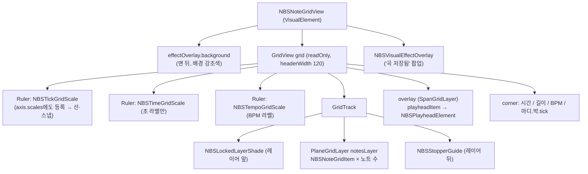

# 9. 노트 그리드 뷰 (`NBSNoteGridView`)

> 기준 커밋: `440c549c`. [← 목차](README.md) · 이전: [8. 에디터 프리뷰](08-editor-preview.md)
>
> 선행: [Grids 프레임워크](../../io.github.rumi727.runios.uielements/Documentation~/Grids/README.md)

`NBSNoteGridView`는 Note Block Studio 편집 화면과 비슷한 **읽기 전용** 노트 그리드입니다. 범용 `GridView` 위에 NBS 맵을 올리고, `ISeekable` 플레이어(`NoteBlockSource` 또는 `NBSPreview.Player`)를 따라 재생 헤드, 노트 플래시, 시각 효과를 보여 줍니다.

## 9.1 구성



## 9.2 클립 → 그리드 (`Rebuild`)

`clip`을 설정하면 [`Rebuild(clip.map)`](../Runtime/UIElements/NBS/NBSNoteGridView.cs#L167)이 그리드를 통째로 다시 만듭니다.

1. 레이어 수는 `max(layers.Length, 가장 큰 노트 레이어 + 1)`입니다.
2. 노트마다 `NBSNoteGridItem : PlaneGridItem { start = tick, top = layer }`를 만들고, 플래시용 목록에도 넣습니다(tick순 정렬).
3. `PlaneGridLayer` 설정:
   - `unitHeight = cellSize(32)`, `verticalLength = 레이어 수`
   - `maximumElementCount = 1024`, `minimumElementPixelsPerUnit = 4`: 이 한계를 넘으면 [dense 모드](../../io.github.rumi727.runios.uielements/Documentation~/Grids/README.md#5-gridlayerrefresh-가상화-줄-단위)가 되어 악기별 평균색 사각형으로 그립니다.
   - `makeElement = MakeBlock`, `releaseElement`는 `Stack` 풀에 반납합니다.
   - `makeRowHeader`: 레이어 번호, 이름, 잠금·솔로 배지
4. 잠긴 레이어가 있으면 `NBSLockedLayerShade`를 넣습니다. 연속된 잠긴 행은 사각형 하나로 합칩니다.
5. Stopper가 있으면 `NBSStopperGuide`를 넣습니다. `axis.changed`마다 다시 그리고, Stopper를 이진 탐색합니다.
6. `axis.scrollRange = [0, max(1, tickLength)]`. **가로축 단위는 NBS tick**입니다. 시간은 템포 맵으로 변환합니다.

[`MakeBlock`](../Runtime/UIElements/NBS/NBSNoteGridView.cs#L324): 풀에서 꺼낸 `NBSNoteBlockElement`에 무음·잠금 클래스, 높이(`cellSize × verticalScale`), 노트(`Bind`), 악기 텍스처(`runios:nbs/block/{i}`, 비동기 로드)를 다시 설정합니다. 막 연주된 노트면 진행 중인 플래시를 이어받습니다.

## 9.3 재생 추적 (`Update`, 매 UI 틱)

```csharp
// UIElements/NBS/NBSNoteGridView.Playback.cs
93   schedule.Execute(Update).Every(0);

110  void Update()
     {
         bool isPlaying = false; double time = 0; double tick = 0;
117      if (map != null && player is { isPlaying: true } playing)
         {
             isPlaying = true;
120          time = playing.time;                          // ① ISeekable.time 하나만 읽음
121          tick = map.tempo.TimeToTick(time);
122          UpdateEffects(map, time, tick);               // ② 플래시·시각 효과
         }
         else
125          ResetPlayback();
127      if (map != null && !double.IsNaN(dragTick))       // ③ 눈금자를 끄는 중이면 그 위치를 표시
         { tick = dragTick; time = map.tempo.TickToTime(dragTick); ShowPlayhead(dragTick); }
133      else if (isPlaying)
         {
136          ShowPlayhead(followMode == NBSFollowMode.tickByTick ? Math.Floor(tick) : tick);
139          if (player is not IPausable { isPaused: true })
140              Follow(tick);                             // ④ 화면 따라가기
         }
142      else if (playheadItem.layer != null)
143          grid.overlay.items.Remove(playheadItem);      // 재생 중이 아니면 헤드 숨김
145      if (map != null)
146          UpdateTimeDisplay(map, time, tick);           // ⑤ 모서리 표시 (값이 바뀔 때만 문자열 생성)
     }
```

- ① 플레이어가 `NoteBlockSource`이면 `time`은 [믹스 스탬프로 보간된 믹서 기준 위치](03-clock-anchor.md#34-time과-outputtime을-앵커에-맞추기)입니다. 프리뷰 플레이어이면 [블록 단위 계단](08-editor-preview.md#time-보간하지-않고-마스터-클록에서-바로-계산)입니다.
- [`ShowPlayhead`](../Runtime/UIElements/NBS/NBSNoteGridView.Playback.cs#L171)는 `playheadItem.start`만 바꿉니다. 그러면 Grids의 `MarkDirty`로 **overlay 레이어만** 다음 프레임에 갱신됩니다. 재생 헤드 요소(`NBSPlayheadElement`)는 하나를 계속 재사용하고(`overlay.makeElement = _ => playhead`), 삼각형 표시는 색이 바뀔 때만 다시 그립니다.
- **눈금자 클릭·끌기로 seek**합니다. 끄는 동안에는 헤드만 움직이고, 끌기가 끝날 때 한 번만 seek합니다. 매번 seek하면 따라가기가 화면을 옮겨 다음 포인터 위치가 다른 tick이 되기 때문입니다([#L74](../Runtime/UIElements/NBS/NBSNoteGridView.Playback.cs#L74) 주석). 재생 중이 아니면 `IPlayControl.Play(time)`으로 시작합니다.

### 따라가기 모드 ([`Follow`](../Runtime/UIElements/NBS/NBSNoteGridView.Playback.cs#L179))

`NBSNoteGridView.followMode`는 **정적**(모든 그리드 공유)이며 기본값은 `pageByPage`입니다.

| 모드 | 화면 왼쪽 끝(offset) |
| --- | --- |
| `none` | 움직이지 않음 |
| `tickByTick` | `floor(tick) − ceil(보이는 tick 수 / 2)`: tick 단위로 끊어서 가운데 유지, 헤드도 정수 tick에 둠 |
| `pageByPage` | 헤드가 화면 오른쪽 끝 −1 tick에 닿거나 왼쪽 밖으로 나가면 `floor(tick) − 1`로 넘김 |
| `frameByFrame` | `tick − 보이는 tick 수 / 2`: 매끄럽게 가운데 유지 |

결과는 `[0, 곡 길이 − 보이는 폭]`으로 제한해 `axis.SetView`합니다. 축이 바뀌므로 그리드 **전체**가 갱신됩니다. 따라가기 중에는 매 프레임 전체 갱신이 일어납니다.

## 9.4 연속 재생과 점프 판정 (`UpdateEffects`)

```csharp
149  void UpdateEffects(NBSMap currentMap, double time, double tick)
     {
151      double now = Time.realtimeSinceStartupAsDouble;
154      bool continuous = !double.IsNaN(previousTime) && time >= previousTime
                           && time - previousTime <= ((now - previousRealTime) * 4) + 0.1;   // 앞으로, 실제 시간의 4배+0.1초 이내
156      playhead.SetColor(effectOverlay.Update(currentMap.visualEffects, previousTick, tick, continuous, now));
157      noteFlash.Update(currentMap, continuous ? previousTick : Math.Floor(tick) - 1, tick, now);
         previousTime = time; previousTick = tick; previousRealTime = now;
     }
```

"재생으로 지나간 tick"과 "seek·반복으로 건너뛴 tick"을 구분하려는 판정입니다.

- **연속이면** 지난 프레임 tick부터 이번 tick 사이의 노트를 모두 플래시하고, 그 사이의 "곡 저장됨" 팝업을 띄웁니다.
- **점프면** 현재 tick의 열만 플래시하고 팝업은 띄우지 않습니다.

> **관찰된 동작:** 판정 조건에 `time >= previousTime`이 있어서, tempo < 0(역재생)이면 매 프레임이 점프로 판정됩니다. 이때는 현재 tick 열의 노트만 플래시됩니다.

### `NBSNoteFlash`

- 노트 목록을 tick순으로 한 번 정렬해 둡니다. 매 프레임 `(fromTick, toTick]`을 **이진 탐색**으로 찾고, 해당 노트의 `playedAt = now`로 두고 플래시 1을 줍니다.
- 플래시는 1초 동안 선형으로 사라집니다. 사라지는 중인 노트만 `flashing` 목록에서 매 프레임 갱신합니다.
- 잠긴 레이어의 노트는 NBS처럼 플래시하지 않습니다.
- 화면 밖이라 요소가 없는 노트도 `playedAt`이 기록됩니다. 나중에 요소가 만들어지면 남은 만큼 플래시를 이어받습니다(9.2).

### `NBSVisualEffectOverlay`

[2.8](02-data-model.md#28-nbsvisualeffectmap)의 맵에서 현재 상태를 읽어 다음을 처리합니다.

- 강조색(Rainbow면 시간에 따라 순환)을 돌려줍니다. 재생 헤드가 이 색을 씁니다.
- 배경 강조가 켜져 있으면 그리드 뒤 배경 요소에 색을 칠합니다.
- 연속 재생 중에 저장 팝업 tick을 지나면 "곡 저장됨"을 1초 보여 주고 0.25초 동안 사라지게 합니다.

## 9.5 NBS 전용 스케일

| 스케일 | 역할 |
| --- | --- |
| [`NBSTickGridScale`](../Runtime/UIElements/NBS/NBSTickGridScale.cs) | 마디·박·tick 선을 긋습니다. 박자표(`timeSignature`)를 따르며, 선 사이가 충분히 벌어질 때까지 간격을 2배씩 늘립니다. **유일하게 `axis.scales`에 있어** 선과 스냅(`Math.Round`)을 정합니다. |
| [`NBSTimeGridScale`](../Runtime/UIElements/NBS/NBSTimeGridScale.cs) | 선 없이 라벨만 둡니다(`drawLines = false`). 확대 수준에 맞는 초 간격을 고르고, 템포 맵으로 tick 위치를 구해 라벨을 답니다. 템포가 바뀌는 곡에서는 간격이 일정하지 않습니다. |
| [`NBSTempoGridScale`](../Runtime/UIElements/NBS/NBSTempoGridScale.cs) | 템포 변경점마다 BPM 라벨을 둡니다. 템포 변경 목록을 이진 탐색합니다. 라벨 문자열은 템포 맵을 설정할 때 한 번 만듭니다. |

## 9.6 노트 정보 팝업

노트를 선택하면 `NBSNoteInfoPopup.Create(map, selection)`이 선택 아이템 아래에 팝업을 띄웁니다. 그리드가 읽기 전용이어도 팝업은 활성 상태(`enabledWhenReadOnly`)이고 입력을 통과시킵니다(`PickingMode.Ignore`). 언어가 바뀌면 팝업 팩토리를 다시 설정해 팝업을 새로 만듭니다.
