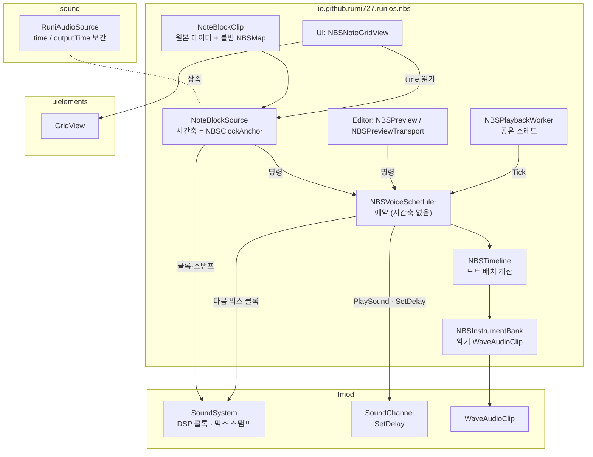

# NBS 패키지 작동 원리

> 기준 커밋: `440c549c`. 코드 링크의 줄 번호는 이 커밋 기준입니다. 사용법 요약은 [패키지 README](../README.md)에 있습니다.

`io.github.rumi727.runios.nbs`가 Note Block Studio 곡을 읽어 **FMOD DSP 클록에 샘플 단위로 정확하게** 재생하기까지의 내부 구조를 코드를 따라가며 설명합니다.
C#에 익숙하고 오디오 엔진은 처음인 독자를 기준으로 썼습니다.

> 🎛️ **인터랙티브 시뮬레이터:** 믹스 블록, 앵커, 워커 순회, lookahead 예약, `time`/`outputTime` 보간을 슬라이더로 움직여 볼 수 있습니다.
> [브라우저에서 열기](https://raw.githack.com/Rumi727/Runiverse-OS/main/Packages/io.github.rumi727.runios.nbs/Documentation~/interactive/nbs-scheduler.html) · [저장소의 파일](interactive/nbs-scheduler.html)
> (브라우저 링크는 이 파일이 `main`에 push된 뒤부터 동작합니다. 저장소의 파일은 내려받아 로컬에서 열 수 있습니다.)

## 한 장으로 보기

**핵심 아이디어 세 가지**

1. **시간은 DSP 클록 위의 직선 하나로 정의합니다.** `NBSClockAnchor(dspClock, time)` = "이 클록에서 타임라인은 이 위치". 모든 소리의 시작 클록이 이 직선에서 산술로 나오므로 소리 사이 간격이 샘플 단위로 정확합니다. → [3장](03-clock-anchor.md)
2. **소리는 미리 예약합니다.** 공유 워커가 0.1초마다 깨어나 앞으로 0.2초 안에 시작할 노트를 `SoundChannel.SetDelay`로 정확한 클록에 걸어 둡니다. 워커가 늦게 깨어나도 리듬은 흔들리지 않습니다. → [4장](04-worker-scheduling.md)
3. **노트 배치는 tempo·pitch와 분리합니다.** 노트가 타임라인에서 차지하는 길이 `D = (|tempo|/|pitch|) · L / Q`의 tempo·pitch 무관 부분을 미리 계산해 두고, 부호 조합(정/역방향 × 정/역재생)마다 배치 규칙 하나로 처리합니다. → [5장](05-timeline-placement.md)

## 읽는 순서

| 장 | 내용 | 깊이 |
| --- | --- | --- |
| [1. API 시작점](01-api-entry.md) | 사용 예, `Play()` 호출 그래프, 커스텀 트랜스포트, 설정 | 개요 |
| [2. 데이터 모델](02-data-model.md) | `.nbs` → `NBSReader` → `NoteBlockClip` → `NBSMap`(정렬, 템포, Stopper), 악기 bank | 핵심부 줄 단위 |
| [3. 클록 앵커](03-clock-anchor.md) | `NBSClockAnchor`, 다음 믹스 클록, `time`/`outputTime` 보간, 반복 접기, 리셋 | **줄 단위** |
| [4. 워커와 예약](04-worker-scheduling.md) | 공유 워커, `Tick`, 거리와 커서, lookahead, `CreateVoiceUnsafe` | **줄 단위** |
| [5. 타임라인과 배치](05-timeline-placement.md) | 음높이 비율, 길이 `D`, Stopper 절단, 배치 8가지, 반복 펼치기 쿼리 | **줄 단위** |
| [6. 명령과 생명주기](06-commands-lifecycle.md) | Resync / OnRateChanged / Pause / UnPause / Stop / OnLoopChanged, 믹스, 리로드 | **줄 단위** |
| [7. 스레드와 잠금](07-threads-locks.md) | 스레드 지도, 잠금 순서, generation, 교착 상태 회피 | 정리 |
| [8. 에디터 프리뷰](08-editor-preview.md) | `NBSPreview`, `Player` 상태, `NBSPreviewTransport`, 인스펙터·툴바 | **줄 단위** |
| [9. 노트 그리드 뷰](09-grid-view.md) | 재생 헤드, 따라가기, 플래시, 시각 효과, NBS 스케일 | 개요 + 핵심 |

**연관 패키지 문서** (각 패키지에서 독립적으로 읽을 수 있습니다)

| 패키지 | 문서 | NBS에서 쓰는 부분 |
| --- | --- | --- |
| `io.github.rumi727.runios.sound` | [Sound 구조](../../io.github.rumi727.runios.sound/Documentation~/README.md), [시간 보간](../../io.github.rumi727.runios.sound/Documentation~/time-interpolation.md) | `RuniAudioSource`의 보간, 재생 인터페이스 |
| `io.github.rumi727.runios.fmod` | [FMOD 구조](../../io.github.rumi727.runios.fmod/Documentation~/README.md), [DSP 클록과 믹스 스탬프](../../io.github.rumi727.runios.fmod/Documentation~/dsp-clock-and-mix-stamp.md), [WaveAudioSource](../../io.github.rumi727.runios.fmod/Documentation~/wave-audio-source.md) | DSP 클록, `SetDelay`, 믹스 스탬프, `WaveAudioClip` |
| `io.github.rumi727.runios.uielements` | [Grids](../../io.github.rumi727.runios.uielements/Documentation~/Grids/README.md) | `NBSNoteGridView`의 기반 |

## 용어집

| 용어 | 뜻 |
| --- | --- |
| **DSP 클록** | FMOD 믹서가 지금까지 만든 출력 샘플 수. 블록 단위로 증가합니다. |
| **믹스 블록** | 믹서가 한 번에 계산하는 샘플 묶음(`getDSPBufferSize`, 예: 1024샘플 ≈ 21 ms @ 48 kHz) |
| **다음 믹스 클록** | 마스터 클록 + 한 블록. 믹서가 아직 손대지 않았음이 확실한 첫 클록. 모든 명령이 여기서 효과를 냅니다. |
| **믹스 스탬프** | `(dspClock, outputClock, timestamp)`: 믹서가 블록을 끝낸 클록, 그 순간 스피커 위치, 그 벽시계 시각 |
| **앵커** | `NBSClockAnchor(dspClock, time)`: 타임라인 직선의 기준점. 이전에는 멈춰 있고 이후로 tempo의 기울기로 진행합니다. |
| **선형 / 접힌 시간** | 앵커에 저장하는 반복 전 위치 / 반복 구간 안으로 되돌린(`Fold`) 위치 |
| **타임라인 초 / 벽시계 초** | 곡 시간 / 실제 시간. 타임라인 1초 = 벽시계 `1/|tempo|`초 |
| **소리 시간(source time)** | 악기 소리 파일 안에서의 위치(초) |
| **거리(distance)** | 현재 위치에서 진행 방향으로 잰 타임라인 초. 반복을 펼친 축 위의 값입니다. |
| **커서** | `cursorClock`: 여기까지 예약을 마쳤다는 표시 |
| **Voice** | 노트 하나를 위해 만든 `SoundChannel`과 그 예약 정보 |
| **entry / exit / attack** | 진행 방향에서 먼저 만나는 노트 구간 끝 / 나중 끝 / 소리 0초가 놓인 위치 |
| **D** | 노트가 타임라인에서 차지하는 길이 |
| **트랜스포트** | 타임라인을 소유하고 스케줄러에 명령하는 쪽(`NoteBlockSource`, `NBSPreviewTransport`) |

## 파일 지도 (`Runtime/NBS`)

| 영역 | 파일 |
| --- | --- |
| 원본 데이터 | `NBSHeader`, `NBSNote`, `NBSLayer`, `NBSLayerLock`, `NBSInstrument`, `NBSInstrumentFunction`, `NBSReader`, `NoteBlockClip` |
| 불변 맵 | `NBSMap`(.Build / .Queries / .NoteCollection / .Enumerators), `NBSMapNote`, `NBSMapColumn`, `NBSNoteMix`, `NBSTempoMap`, `NBSTempoChange`, `NBSSoundStopper`, `NBSVisualEffectMap`, `NBSVisualEffectState` |
| 소스 | `NoteBlockSource`(.Clock / .Lifecycle) |
| 재생 엔진 (`Playback/`) | `INBSTransport`, `NBSClockAnchor`, `NBSLoopRange`, `NBSPlaybackRate`, `NBSReversePitchAlignment`, `NBSNotePlacement`, `NBSPlannedVoice`, `NBSTimeline`(.Query), `NBSVoiceScheduler<T>`(.Tick / .Commands / .Voices / .Mix), `NBSPlaybackWorker`, `NBSPlaybackSettings`, `NBSInstrumentBank` |
| 리소스 (`Resource/NBS`) | `NBSAssetRegistry`(`runios:nbs`), `NBSAssetHandle` |
| UI (`UIElements/NBS`) | `NBSNoteGridView`(.Playback), `NBSNoteGridItem`, `NBSNoteBlockElement`, `NBSPlayheadElement`, `NBSNoteFlash`, `NBSVisualEffectOverlay`, `NBSFollowMode`, 스케일 3종, `NBSStopperGuide`, `NBSLockedLayerShade`, `NBSNoteInfoPopup` |
| 에디터 (`Editor/`) | `NoteBlockClipImporter`, `NBSPreview`(.Player), `NBSPreviewTransport`, `NBSPreviewToolbar`, 인스펙터 2종, `NoteBlockClipPackDrawer`, IMGUI(`NBSTimelineLaneDrawer`, 시간 단위 2종, `NBSClipInfoGUI`) |

## 그림 목록

| 그림 | 장 |
| --- | --- |
| [클록 앵커](images/clock-anchor.svg) | 3 |
| [time과 outputTime](images/time-output-time.svg) | 3 |
| [lookahead 예약](images/lookahead.svg) | 4 |
| [배치 8가지](images/placement.svg) | 5 |
| [반복 펼치기](images/loop-unroll.svg) | 5 |
| [Pause와 heldEndDistance](images/pause-hold.svg) | 6 |
| [템포 맵](images/tempo-map.svg) | 2 |
