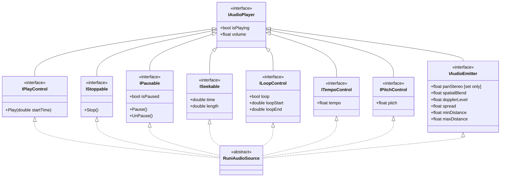

# 1. 능력 인터페이스

> 기준 커밋: `3a2b24b9`. [← 목차](README.md) · 다음: [2. 재생 상태와 명령](02-playback-state.md)

Sound 패키지는 "오디오 플레이어"를 하나의 큰 인터페이스로 정의하지 않습니다.
"재생할 수 있다", "위치를 옮길 수 있다", "속도를 바꿀 수 있다" 같은 **능력마다 작은 인터페이스**를 두고, 모두 `IAudioPlayer`를 상속하게 합니다.
소비자는 자기가 쓰는 능력만 요구하고, 구현은 지원하는 능력만 구현합니다.

- [1.1 인터페이스 지도](#11-인터페이스-지도)
- [1.2 선언](#12-선언)
- [1.3 왜 나누는가](#13-왜-나누는가)
- [1.4 의미가 헷갈리기 쉬운 멤버](#14-의미가-헷갈리기-쉬운-멤버)

---

## 1.1 인터페이스 지도

모든 능력 인터페이스는 **`IAudioPlayer`만 상속하고 서로는 상속하지 않습니다.** 그래서 "위치를 옮길 수 있지만 일시 정지는 못 하는" 구현도 자연스럽게 표현됩니다.
[`RuniAudioSource`](../Runtime/Sounds/RuniAudioSource.cs#L11)는 여덟 능력을 모두 구현하는 `MonoBehaviour` 기반 추상 클래스입니다([2장](02-playback-state.md)).

## 1.2 선언

인터페이스 파일은 모두 몇 줄짜리입니다. 멤버를 그대로 옮깁니다.

| 인터페이스 | 멤버 (실제 선언) |
| --- | --- |
| [`IAudioPlayer`](../Runtime/Sounds/IAudioPlayer.cs#L3) | `bool isPlaying { get; }`, `float volume { get; set; }` |
| [`IPlayControl`](../Runtime/Sounds/IPlayControl.cs#L3) | `void Play(double startTime = 0);` |
| [`IStoppable`](../Runtime/Sounds/IStoppable.cs#L3) | `void Stop();` |
| [`IPausable`](../Runtime/Sounds/IPausable.cs#L3) | `bool isPaused { get; set; }`, `void Pause();`, `void UnPause();` |
| [`ISeekable`](../Runtime/Sounds/ISeekable.cs#L3) | `double time { get; set; }`, `double length { get; }` |
| [`ILoopControl`](../Runtime/Sounds/ILoopControl.cs#L3) | `bool loop { get; set; }`, `double loopStart { get; set; }`, `double loopEnd { get; set; }` |
| [`ITempoControl`](../Runtime/Sounds/ITempoControl.cs#L3) | `float tempo { get; set; }` |
| [`IPitchControl`](../Runtime/Sounds/IPitchControl.cs#L3) | `float pitch { get; set; }` |
| [`IAudioEmitter`](../Runtime/Sounds/IAudioEmitter.cs#L3) | `float panStereo { set; }`, `float spatialBlend`, `dopplerLevel`, `spread`, `minDistance`, `maxDistance` (모두 `{ get; set; }`) |

시간 단위는 모두 **초(`double`)** 입니다. `tempo`, `pitch`, `volume`, 공간 속성은 `float`입니다.

## 1.3 왜 나누는가

소비자가 받는 타입이 곧 그 소비자의 요구 사항이 됩니다.

| 소비자의 일 | 요구하는 능력 |
| --- | --- |
| 재생 버튼 | `IPlayControl` |
| 정지 버튼 | `IStoppable` (활성화 여부는 `IAudioPlayer.isPlaying`) |
| 일시 정지 토글 | `IPausable` |
| 위치 표시·슬라이더·건너뛰기 | `ISeekable` |
| 반복 구간 핸들 | `ISeekable` + `ILoopControl` |

에디터의 [`PlaybackController`](08-editor.md#82-playbackcontroller)가 이 방식을 그대로 씁니다. 대상 목록을 `IAudioPlayer`로 받고, 버튼마다 `targets.OfType<IPlayControl>()`처럼 필요한 능력으로 걸러 냅니다.
그래서 종류가 다른 플레이어를 한 컨트롤러에 섞어 넣어도 각 버튼은 지원하는 대상에만 동작합니다.

## 1.4 의미가 헷갈리기 쉬운 멤버

- **`isPlaying`은 일시 정지 중에도 `true`입니다.** "재생 세션이 열려 있다"는 뜻이고, 진행 중인지는 `isPlaying && !isPaused`입니다([2장](02-playback-state.md#21-상태와-잠금)).
- **`tempo`와 `pitch`는 별개입니다.** `tempo`는 타임라인이 진행하는 속도이고 `time`의 기울기가 됩니다([3장](03-time-interpolation.md)). `pitch`는 소리 높이입니다. 둘을 어떻게 섞어 실제 재생 속도를 정할지는 구현이 정합니다.
- **`tempo`는 음수일 수 있습니다.** 음수면 `time`이 거꾸로 흐르고, 0이면 멈춥니다. 인터페이스와 기반 클래스는 범위를 제한하지 않습니다.
- **`loopStart`/`loopEnd`는 범위 값일 뿐입니다.** 반복을 실제로 수행하는 것(`time`을 구간 안으로 되돌리기 등)도, 구간이 곡 길이를 벗어날 때의 해석도 구현이 정합니다.
- **`IAudioEmitter.panStereo`는 setter만 요구합니다.** 팬 값을 읽어 올 수 없는 백엔드가 있기 때문입니다. 인터페이스가 getter를 요구하면 그런 백엔드는 이 인터페이스를 구현할 수 없습니다. `RuniAudioSource`는 직렬화 필드를 가지므로 getter도 공개합니다([`#L256`](../Runtime/Sounds/RuniAudioSource.cs#L256)).
- 3D 위치·속도·회전은 이 인터페이스들에 없습니다. 값 묶음인 [`AudioSpatialState`](07-resources.md#73-audiospatialstate)가 따로 있습니다.
