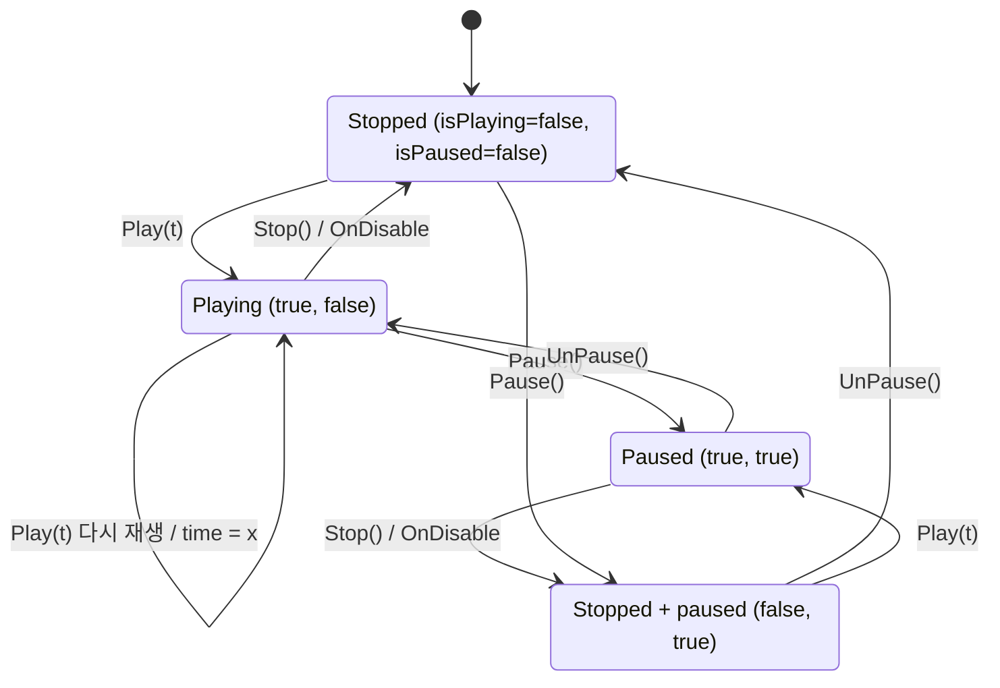

# 2. 재생 상태와 명령: `RuniAudioSource`

> 기준 커밋: `3a2b24b9`. [← 목차](README.md) · 이전: [1. 능력 인터페이스](01-capability-interfaces.md) · 다음: [3. 시간 보간](03-time-interpolation.md)

[`RuniAudioSource`](../Runtime/Sounds/RuniAudioSource.cs#L11)는 [1장](01-capability-interfaces.md)의 능력 인터페이스를 모두 구현하는 추상 `MonoBehaviour`입니다.
소리를 실제로 내지는 않습니다. **재생 상태, 잠금, 보간 시간**을 한곳에서 관리하고, 상태가 바뀔 때마다 파생 클래스의 훅을 부릅니다.
파생 클래스는 훅에서 엔진을 조작하고, 엔진이 알려 주는 위치로 기준점을 다시 잡기만 하면 됩니다.

이 장은 상태와 명령을, [3장](03-time-interpolation.md)은 그 명령들이 `time`/`outputTime`의 기준점을 어떻게 바꾸는지를 다룹니다.

- [2.1 상태와 잠금](#21-상태와-잠금)
- [2.2 설정 속성](#22-설정-속성)
- [2.3 `Play`](#23-play)
- [2.4 `Stop`](#24-stop)
- [2.5 `Pause`와 `UnPause`](#25-pause와-unpause)
- [2.6 `OnEnable`과 `OnDisable`](#26-onenable과-ondisable)
- [2.7 상태 전이 한눈에](#27-상태-전이-한눈에)
- [2.8 잠금 규칙](#28-잠금-규칙)
- [2.9 파생 클래스 계약과 최소 예제](#29-파생-클래스-계약과-최소-예제)

---

## 2.1 상태와 잠금

```csharp
// Runtime/Sounds/RuniAudioSource.cs
24  public readonly ReaderWriterLockSlim playingLock = new(LockRecursionPolicy.SupportsRecursion);   // ①

37  public new bool isActiveAndEnabled                                                            // ②
    {
        get
        {
41          playingLock.EnterReadLock();
            try
            {
45              return _isActiveAndEnabled;
            }
            finally
            {
49              playingLock.ExitReadLock();
            }
        }
    }
53  bool _isActiveAndEnabled;

63  public bool isPlaying => Volatile.Read(ref _isPlaying);                                        // ③
64  bool _isPlaying = false;

77  public bool isPaused
    {
79      get => Volatile.Read(ref _isPaused);                                                       // ③
        set
        {
82          if (value)
83              Pause();                                                                           // ④
            else
85              UnPause();
        }
    }
88  bool _isPaused = false;
```

1. ① **잠금 하나가 이 소스의 상태 전체를 보호합니다.** 활성 여부, 재생·일시 정지 플래그, `time`과 `outputTime`의 기준점, `tempo` 변경이 모두 이 잠금 아래에 있습니다.
   - `public`이므로 파생 클래스와 외부 코드도 같은 잠금을 씁니다. 예를 들어 파생 클래스는 엔진 조작과 기준점 갱신을 한 쓰기 잠금 안에서 묶을 수 있습니다.
   - `SupportsRecursion`인 이유는 쓰기 잠금 안의 경로가 같은 잠금을 다시 잡는 멤버를 부르기 때문입니다. 예를 들어 `Play`는 쓰기 잠금 안에서 `time` setter를 부르고, setter는 다시 쓰기 잠금을 잡습니다.
2. ② `MonoBehaviour.isActiveAndEnabled`를 `new`로 가립니다.
   - Unity의 원래 속성은 메인 스레드에서만 부를 수 있습니다.
   - 이 속성은 `OnEnable`/`OnDisable`에서 캐시한 값을 읽기 잠금으로 읽으므로 어느 스레드에서든 부를 수 있습니다([2.6](#26-onenable과-ondisable)).
3. ③ `isPlaying`과 `isPaused`의 getter는 **잠금 없이** `Volatile.Read`로 읽습니다. 값을 쓰는 곳은 모두 쓰기 잠금 안이므로, 읽는 쪽은 "어느 순간의 스냅샷"을 얻습니다. UI가 프레임마다 버튼 상태를 정할 때처럼 자주 읽는 곳에서 잠금 비용 없이 확인할 수 있습니다.
4. ④ `isPaused` setter는 플래그를 직접 바꾸지 않고 `Pause()`/`UnPause()`를 부릅니다. 그래서 대입으로 바꾸어도 기준점 갱신과 훅 호출이 똑같이 일어납니다.

**두 플래그는 서로 독립입니다.** `isPlaying`은 "재생 세션이 열려 있다", `isPaused`는 "진행을 멈춰 두었다"를 뜻합니다.
진행 중인지는 `_isPlaying && !_isPaused`로 판단합니다. 이 조건이 `time` 외삽 여부를 정합니다([3장](03-time-interpolation.md#32-time-getter)).

## 2.2 설정 속성

`tempo`를 뺀 설정 속성은 모두 같은 모양입니다. 직렬화 필드 하나와 그것을 그대로 읽고 쓰는 가상 접근자입니다.

```csharp
// Runtime/Sounds/RuniAudioSource.cs
169  public virtual float volume
     {
171      get => _volume;
172      set => _volume = value;
     }
174  [SerializeField] volatile float _volume = 1;                // ①

234  public virtual double loopStart
     {
236      get => Volatile.Read(ref _loopStart);                   // ②
237      set => Volatile.Write(ref _loopStart, value);
     }
239  [SerializeField] double _loopStart;

250  [SerializeField] double _loopEnd = double.MaxValue;         // ③
```

1. ① 필드가 `volatile`이고 접근자는 잠금을 잡지 않습니다. 다른 스레드(예: 오디오 스레드)가 읽어도 최신 값을 봅니다.
2. ② `double`은 C#에서 `volatile`로 선언할 수 없습니다. 그래서 `loopStart`/`loopEnd`는 `Volatile.Read`/`Volatile.Write`로 같은 효과를 냅니다.
3. ③ `loopEnd`의 기본값은 `double.MaxValue`입니다. "끝 없음"을 뜻하며, 인스펙터는 이 값을 "없음"으로 표시합니다([8장](08-editor.md#86-runiaudiosourceeditor)).

| 속성 | 필드 기본값 | 줄 |
| --- | --- | --- |
| `volume` | 1 | [#L169](../Runtime/Sounds/RuniAudioSource.cs#L169) |
| `tempo` | 1 | [#L187](../Runtime/Sounds/RuniAudioSource.cs#L187) |
| `pitch` | 1 | [#L212](../Runtime/Sounds/RuniAudioSource.cs#L212) |
| `loop` | `false` | [#L223](../Runtime/Sounds/RuniAudioSource.cs#L223) |
| `loopStart` / `loopEnd` | 0 / `double.MaxValue` | [#L234](../Runtime/Sounds/RuniAudioSource.cs#L234), [#L245](../Runtime/Sounds/RuniAudioSource.cs#L245) |
| `panStereo` | 0 | [#L256](../Runtime/Sounds/RuniAudioSource.cs#L256) |
| `spatialBlend` | 0 | [#L267](../Runtime/Sounds/RuniAudioSource.cs#L267) |
| `dopplerLevel` | 1 | [#L278](../Runtime/Sounds/RuniAudioSource.cs#L278) |
| `spread` | 0 | [#L289](../Runtime/Sounds/RuniAudioSource.cs#L289) |
| `minDistance` / `maxDistance` | 0 / 16 | [#L300](../Runtime/Sounds/RuniAudioSource.cs#L300), [#L311](../Runtime/Sounds/RuniAudioSource.cs#L311) |

**기반 클래스는 값을 저장만 합니다.** 접근자가 `virtual`이므로, 파생 클래스는 setter를 재정의해 `base`에 저장한 뒤 엔진 채널에도 적용할 수 있습니다.

`tempo`만 다릅니다. 진행 속도가 바뀌면 그때까지의 위치를 먼저 굳혀야 하므로, setter가 쓰기 잠금 안에서 기준점을 다시 잡습니다([3.5](03-time-interpolation.md#35-명령마다-기준점이-어떻게-바뀌는가)).

```csharp
187  public virtual float tempo
     {
189      get => _tempo;
         set
         {
192          playingLock.EnterWriteLock();
             try
             {
196              SyncInterpolatedTime(time);       // 바뀌기 전 기울기로 지금 위치를 굳힘
197              ContinueOutputTimeUnsafe();       // outputTime도 같은 방식으로
198              _tempo = value;
             }
             finally
             {
202              playingLock.ExitWriteLock();
             }
         }
     }
206  [SerializeField] volatile float _tempo = 1;
```

## 2.3 `Play`

```csharp
// Runtime/Sounds/RuniAudioSource.cs
333  public void Play(double startTime = 0)
     {
335      if (!isActiveAndEnabled)                 // ① 비활성이면 아무것도 하지 않음
336          return;

338      playingLock.EnterWriteLock();
         try
         {
342          ContinueOutputTimeUnsafe();          // ② 상태를 바꾸기 전에 outputTime을 굳힘
343          _isPlaying = true;

345          time = startTime;                    // ③ 가상 time setter
346          OnPlay();                            // ④ 쓰기 잠금 보유 중
         }
         finally
         {
350          playingLock.ExitWriteLock();
         }
     }
```

1. ① 비활성 소스에 대한 `Play`는 조용히 무시됩니다. 예외도 로그도 없습니다. 이 검사는 쓰기 잠금을 잡기 전에 하며, `isActiveAndEnabled`는 읽기 잠금으로 읽습니다.
2. ② `outputTime`의 외삽 규칙은 `_isPlaying`에 따라 달라집니다. 규칙을 바꾸기 직전에 현재 값을 기준점으로 굳혀 두어야 값이 튀지 않습니다([3.4](03-time-interpolation.md#34-continueoutputtimeunsafe-상태가-바뀌어도-이어지게)).
   - 파생 클래스가 `outputTime`을 따로 동기화하지 않으면, `outputTime`은 `startTime`으로 점프하지 않고 **이전 값에서 이어서** 진행합니다.
3. ③ `time`을 **대입**합니다. 파생 클래스가 `time` setter를 재정의해 "엔진 위치 이동"을 하면, 재생 시작에서도 그 처리가 그대로 일어납니다.
   - `_isPlaying = true`를 먼저 하므로, 대입 직후부터 `time`은 지금 시각을 기준으로 외삽됩니다.
4. ④ `OnPlay()`는 `time`이 시작 위치로 정해진 뒤, **쓰기 잠금을 보유한 채** 불립니다.

이미 재생 중일 때 `Play`를 부르면 같은 경로를 다시 지나갑니다. 즉 처음부터(또는 `startTime`부터) 다시 재생합니다. 에디터의 재생 버튼이 재생 중에 "▶↻"로 바뀌는 이유입니다([8장](08-editor.md#83-drawcontrol-버튼과-기능-플래그)).

`Play`는 `_isPaused`를 건드리지 않습니다. 일시 정지된 상태에서 `Play`하면 위치는 `startTime`으로 옮겨지지만 일시 정지는 유지됩니다([2.7](#27-상태-전이-한눈에)).

## 2.4 `Stop`

```csharp
372  public void Stop()
     {
374      playingLock.EnterWriteLock();
         try
         {
378          _isPlaying = false;                                  // ①

380          time = 0;                                            // ② 가상 time setter
381          SyncInterpolatedOutputTime(0, Stopwatch.GetTimestamp()); // ③
382          OnStop();
         }
         finally
         {
386          playingLock.ExitWriteLock();
         }
     }
```

1. ① 플래그를 먼저 내리므로 ②③ 이후 `time`과 `outputTime`은 0에 고정됩니다(진행 중이 아니므로 외삽하지 않음).
2. ② `Play`와 마찬가지로 `time`을 **대입**합니다. 재정의한 setter의 엔진 위치 이동이 정지에서도 일어납니다.
3. ③ `outputTime`은 `ContinueOutputTimeUnsafe`로 이어 주지 않고 0으로 바로 옮깁니다. 정지는 "이어지는 진행"이 아니라 처음 위치로의 이동이기 때문입니다.

`Stop`은 활성 여부를 검사하지 않고, `_isPaused`도 지우지 않습니다.

## 2.5 `Pause`와 `UnPause`

```csharp
408  public void Pause()
     {
410      playingLock.EnterWriteLock();
         try
         {
414          SyncInterpolatedTime(time);       // ① 가상 time getter로 지금 위치를 읽어 굳힘
415          ContinueOutputTimeUnsafe();       // ② outputTime도 굳힘
416          _isPaused = true;                 // ③

418          OnPause();
         }
         finally
         {
422          playingLock.ExitWriteLock();
         }
     }

444  public void UnPause()
     {
446      playingLock.EnterWriteLock();
         try
         {
450          SyncInterpolatedTime(time);       // ④ 멈춰 있던 값을 "지금" 시각으로 다시 잡음
451          ContinueOutputTimeUnsafe();
452          _isPaused = false;

454          OnUnPause();
         }
         finally
         {
458          playingLock.ExitWriteLock();
         }
     }
```

1. ① 지금 위치를 기준점으로 굳힙니다. 굳히지 않고 플래그만 올리면 getter가 오래된 `baseTime`을 돌려줘 위치가 뒤로 튑니다.
   - `time` getter는 `virtual`입니다. 파생 클래스가 getter를 재정의했다면(예: 반복 구간으로 되돌리기) 그 값이 기준점이 됩니다.
2. ② `outputTime`도 같은 이유로 굳힙니다. 미래 기준점이 있으면 그 미래를 유지합니다([3.4](03-time-interpolation.md#34-continueoutputtimeunsafe-상태가-바뀌어도-이어지게)).
3. ③ `_isPlaying`은 검사하지 않습니다. 정지 상태에서도 일시 정지 플래그를 올릴 수 있습니다.
4. ④ 일시 정지 중 `time`은 `baseTime` 그대로입니다. 그 값을 **지금 시각**으로 다시 잡아야 재개 순간부터 진행합니다. 원래 타임스탬프를 두면 멈춰 있던 동안의 시간이 한꺼번에 더해집니다.

이미 일시 정지된 상태에서 `Pause`를 다시 불러도 값은 바뀌지 않습니다. getter가 `baseTime`을 돌려주므로 같은 값으로 다시 굳힐 뿐입니다. 훅은 다시 불립니다.

## 2.6 `OnEnable`과 `OnDisable`

```csharp
590  protected virtual void OnEnable()
     {
592      playingLock.EnterWriteLock();
         try
         {
596          _isActiveAndEnabled = true;
         }
         finally
         {
600          playingLock.ExitWriteLock();
         }
     }

612  protected virtual void OnDisable()
     {
614      playingLock.EnterWriteLock();
         try
         {
618          _isActiveAndEnabled = false;
619          Stop();                           // ① 재귀 쓰기 잠금
         }
         finally
         {
623          playingLock.ExitWriteLock();
         }
     }
```

- 컴포넌트가 꺼지면 재생을 멈춥니다. 꺼진 동안의 `Play`는 [2.3](#23-play)의 ①에서 무시됩니다.
- ① 플래그 변경과 `Stop`이 한 쓰기 잠금 안에 있습니다. `Stop`은 같은 잠금을 다시 잡으며, 재귀 정책 덕분에 막히지 않습니다.
- 두 메서드는 `protected virtual`입니다. 재정의할 때는 `base.OnEnable()`/`base.OnDisable()`을 불러야 캐시와 정지가 유지됩니다.

## 2.7 상태 전이 한눈에

두 플래그가 독립이므로 상태는 네 가지입니다. 일시 정지는 재생과 독립된 플래그이므로, 일시 정지한 채로 `Play`하면 일시 정지가 유지됩니다.



| 명령 | 활성 검사 | 쓰기 잠금 | 바꾸는 플래그 | `time` | `outputTime` | 훅 |
| --- | --- | --- | --- | --- | --- | --- |
| `Play(t)` | 예 | 예 | `_isPlaying = true` | `= t` (setter) | 이어짐 | `OnPlay` |
| `Stop()` | 아니요 | 예 | `_isPlaying = false` | `= 0` (setter) | 0으로 | `OnStop` |
| `Pause()` | 아니요 | 예 | `_isPaused = true` | 지금 값으로 굳힘 | 이어짐 | `OnPause` |
| `UnPause()` | 아니요 | 예 | `_isPaused = false` | 지금 시각으로 다시 잡음 | 이어짐 | `OnUnPause` |
| `tempo = v` | 아니요 | 예 | 없음 | 지금 값으로 굳힘 | 이어짐 | 없음 |
| `OnDisable` | — | 예 | `_isActiveAndEnabled = false` | `Stop()` | `Stop()` | `OnStop` |

## 2.8 잠금 규칙

| 멤버 | 잠금 |
| --- | --- |
| `isPlaying`, `isPaused` getter, 설정 속성의 getter·setter(`tempo` setter 제외) | 없음 (`volatile`) |
| `isActiveAndEnabled`, `time` getter, `outputTime` getter | 읽기 잠금 |
| `Play`, `Stop`, `Pause`, `UnPause`, `tempo` setter, `time` setter, `SyncInterpolatedTime`, `SyncInterpolatedOutputTime`, `OnEnable`, `OnDisable` | 쓰기 잠금 |

알아 둘 점:

- **읽기 잠금만 보유한 상태에서 쓰기 잠금 경로를 부르면 안 됩니다.** `ReaderWriterLockSlim`은 재귀를 허용해도 읽기 → 쓰기 승격은 허용하지 않고 `LockRecursionException`을 던집니다. 쓰기 경로가 필요하면 처음부터 쓰기 잠금이나 업그레이드 가능 읽기 잠금(`EnterUpgradeableReadLock`)을 잡습니다. `SyncInterpolatedTime`의 XML 주석이 이 조건을 적고 있습니다([`#L482`](../Runtime/Sounds/RuniAudioSource.cs#L482)).
- **훅(`OnPlay`/`OnStop`/`OnPause`/`OnUnPause`)은 쓰기 잠금을 보유한 채 불립니다.**
  - 훅 안에서 다른 스레드가 하는 일을 기다리면 교착 상태가 될 수 있습니다. 그 스레드가 이 소스의 `time`을 읽으려고 읽기 잠금을 기다리는 경우입니다.
  - 반대로, 훅 안에서는 기준점과 엔진 상태를 다른 스레드의 간섭 없이 함께 바꿀 수 있습니다.

## 2.9 파생 클래스 계약과 최소 예제

파생 클래스가 해야 할 일은 다음과 같습니다.

1. `length`를 구현합니다(유일한 `abstract` 멤버, [`#L163`](../Runtime/Sounds/RuniAudioSource.cs#L163)).
2. 훅에서 엔진을 조작합니다. 위치 이동이 필요하면 `time` setter를 재정의합니다. `Play`와 `Stop`도 이 setter를 거칩니다.
3. 엔진이 위치를 알려 줄 때마다 `SyncInterpolatedTime(position, timestamp)`으로 기준점을 다시 잡습니다. 출력 지연을 알면 `SyncInterpolatedOutputTime`도 부릅니다([3.6](03-time-interpolation.md#36-기준점을-잡는-메서드)).
4. 필요한 설정 속성을 재정의해 엔진에 전달합니다.

아래는 **이 저장소에 없는 예제**입니다. `IExampleVoice`는 설명을 위한 가상의 엔진 API입니다.

```csharp
// 예제 (저장소에 없는 코드)
public sealed class ExampleAudioSource : RuniAudioSource
{
    IExampleVoice? voice;   // 가상의 엔진 채널

    public override double length => voice?.length ?? 0;

    // Play(startTime)과 Stop()도 이 setter를 거칩니다.
    public override double time
    {
        get => base.time;
        set
        {
            playingLock.EnterWriteLock();   // 기준점과 엔진 위치를 한 번에 바꿉니다.
            try
            {
                base.time = value;
                voice?.Seek(value);
            }
            finally
            {
                playingLock.ExitWriteLock();
            }
        }
    }

    public override float volume
    {
        get => base.volume;
        set
        {
            base.volume = value;
            voice?.SetVolume(value);
        }
    }

    // 쓰기 잠금을 보유한 채 불립니다. 다른 스레드를 기다리지 않습니다.
    protected override void OnPlay() => voice?.Start();
    protected override void OnStop() => voice?.Stop();
    protected override void OnPause() => voice?.SetPaused(true);
    protected override void OnUnPause() => voice?.SetPaused(false);

    void Update()
    {
        // 엔진이 "벽시계 timestamp에 위치 position을 계산했다"고 알려 줄 때 기준점을 다시 잡습니다.
        if (voice != null && voice.TryGetPosition(out double position, out long timestamp, out double latency))
        {
            SyncInterpolatedTime(position, timestamp);
            SyncInterpolatedOutputTime(position - (latency * tempo), timestamp);
        }
    }
}
```

`timestamp`는 `Stopwatch.GetTimestamp()` 단위입니다. "내가 값을 발견한 시각"이 아니라 **"엔진이 그 값을 만든 시각"**을 넘기는 것이 핵심입니다. 이유는 [3.6](03-time-interpolation.md#36-기준점을-잡는-메서드)에 있습니다.
