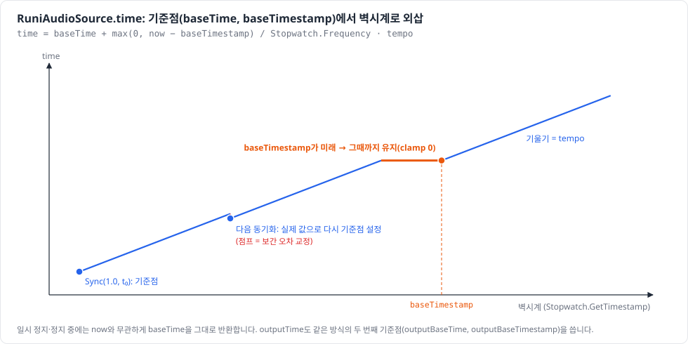
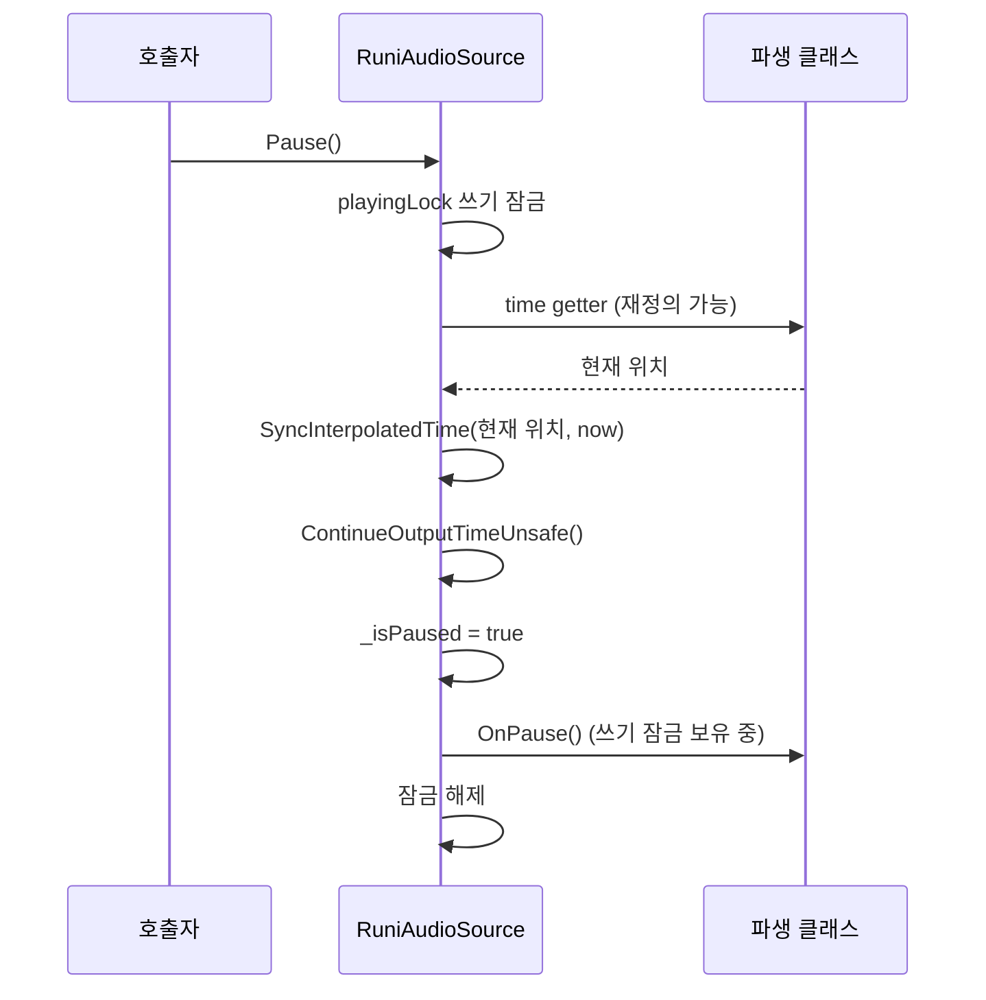

# 3. 시간 보간: `time`과 `outputTime`

> 기준 커밋: `3a2b24b9`. [← 목차](README.md) · 이전: [2. 재생 상태와 명령](02-playback-state.md) · 다음: [4. 파형 피라미드](04-waveform-pyramid.md)

오디오 엔진은 재생 위치를 보통 **블록 단위로만** 알려 줍니다(예: 1024샘플, 48 kHz에서 약 21 ms마다).
그 값을 화면에 그대로 쓰면 플레이헤드가 계단처럼 움직입니다.
`RuniAudioSource`는 **마지막으로 알고 있는 위치와 그 위치의 벽시계 시각**을 기준점으로 저장해 두고, 읽을 때마다 벽시계로 외삽합니다.

- 파생 클래스는 엔진에서 새 위치를 알게 될 때마다 기준점만 다시 잡습니다.
- 소비자는 `time`/`outputTime`을 언제든, 어느 스레드에서든 읽어 매끄러운 값을 얻습니다.



- [3.1 상태](#31-상태)
- [3.2 `time` getter](#32-time-getter)
- [3.3 `outputTime`](#33-outputtime)
- [3.4 `ContinueOutputTimeUnsafe`: 상태가 바뀌어도 이어지게](#34-continueoutputtimeunsafe-상태가-바뀌어도-이어지게)
- [3.5 명령마다 기준점이 어떻게 바뀌는가](#35-명령마다-기준점이-어떻게-바뀌는가)
- [3.6 기준점을 잡는 메서드](#36-기준점을-잡는-메서드)

---

## 3.1 상태

| 필드 | 줄 | 의미 |
| --- | --- | --- |
| `baseTime`, `baseTimestamp` | [#L122](../Runtime/Sounds/RuniAudioSource.cs#L122) | `time`의 기준점: "벽시계 `baseTimestamp`에 위치는 `baseTime`이었다" |
| `outputBaseTime`, `outputBaseTimestamp` | [#L156](../Runtime/Sounds/RuniAudioSource.cs#L156) | `outputTime`의 기준점 |
| `_isPlaying`, `_isPaused` | [#L64](../Runtime/Sounds/RuniAudioSource.cs#L64), [#L88](../Runtime/Sounds/RuniAudioSource.cs#L88) | 진행 중 = `_isPlaying && !_isPaused` ([2.1](02-playback-state.md#21-상태와-잠금)) |
| `_tempo` | [#L206](../Runtime/Sounds/RuniAudioSource.cs#L206) | 기울기(부호 있음) |

- 타임스탬프 단위는 `System.Diagnostics.Stopwatch` 틱입니다(`Stopwatch.Frequency` 틱 = 1초).
- 위치 단위는 초입니다.
- 모두 [`playingLock`](../Runtime/Sounds/RuniAudioSource.cs#L24)이 보호합니다.

## 3.2 `time` getter

```csharp
// Runtime/Sounds/RuniAudioSource.cs
101  public virtual double time
     {
         get
         {
105          playingLock.EnterReadLock();
             try
             {
110              if (_isPlaying && !_isPaused)                                               // ① 진행 중일 때만 외삽
111                  return baseTime + (((Stopwatch.GetTimestamp() - baseTimestamp).Clamp(0)   // ② 경과 틱, 음수면 0
                                         / (double)Stopwatch.Frequency) * tempo);            // ③ 초 × tempo
                 else
113                  return baseTime;                                                        // ④ 정지·일시 정지는 고정
             }
             finally
             {
117              playingLock.ExitReadLock();
             }
         }
120      set => SyncInterpolatedTime(value);                                                 // ⑤ 대입 = 지금 기준점 재설정
     }
```

1. ① 진행 중이 아니면 외삽하지 않습니다. 일시 정지·정지 중에는 벽시계와 무관하게 ④ `baseTime`을 돌려줍니다.
2. ② **`Clamp(0)`가 이 설계의 핵심입니다.** 기준 타임스탬프를 **미래**로 잡을 수 있고, 그러면 그 시각까지 경과가 0으로 잘려 **위치가 유지**됩니다.
   - "명령은 지금 받았지만 효과는 오디오가 다음 블록에 도달할 때 시작된다"는 상황을 별도 상태 없이 표현할 수 있습니다(그림 A의 주황 구간).
   - `long.MaxValue`를 넣으면 무기한 유지합니다.
3. ③ 기울기는 `tempo`입니다. 음수면 시간이 거꾸로 흐르고, 0이면 멈춥니다.
   - `tempo`는 `volatile` 필드를 읽는 getter입니다. `tempo` setter는 기울기를 바꾸기 전에 기준점을 굳히므로([3.5](#35-명령마다-기준점이-어떻게-바뀌는가)), 한 기준점 구간 안의 기울기는 일정합니다.
4. ⑤ 대입은 "지금 이 위치"로 기준점을 다시 잡습니다. 미래 기준점을 잡으려면 [`SyncInterpolatedTime(time, timestamp)`](#36-기준점을-잡는-메서드)을 씁니다.

반복 구간으로 되돌리는 처리(loop wrap)는 하지 않습니다. `time`은 `loopEnd`를 지나도 계속 증가합니다. 되돌리기가 필요하면 파생 클래스가 getter를 재정의합니다.

## 3.3 `outputTime`

`time`은 "엔진이 **계산한** 위치"입니다. 그 소리가 스피커에서 나오기까지는 출력 버퍼만큼 더 걸립니다.
`outputTime`은 "**지금 출력되고 있는** 위치"를 위한 두 번째 기준점입니다.

```csharp
140  public virtual double outputTime
     {
         get
         {
144          playingLock.EnterReadLock();
             try
             {
148              return GetInterpolatedOutputTimeUnsafe(Stopwatch.GetTimestamp());
             }
             finally
             {
152              playingLock.ExitReadLock();
             }
         }
     }

558  double GetInterpolatedOutputTimeUnsafe(long timestamp)
     {
560      if (_isPlaying && !_isPaused)
561          return outputBaseTime + (((timestamp - outputBaseTimestamp).Clamp(0) / (double)Stopwatch.Frequency) * tempo);
         else
563          return outputBaseTime;
     }
```

- 외삽 규칙은 `time`과 같습니다. 미래 기준점도 똑같이 유지됩니다.
- `time`과 달리 setter가 없습니다. 기준점은 파생 클래스가 [`SyncInterpolatedOutputTime`](#36-기준점을-잡는-메서드)으로만 잡습니다.
- 계산을 `GetInterpolatedOutputTimeUnsafe(timestamp)`로 뺀 이유는 [3.4](#34-continueoutputtimeunsafe-상태가-바뀌어도-이어지게)가 **"지금"이 아닌 시각**의 값을 구해야 하기 때문입니다. 이름의 `Unsafe`는 호출자가 잠금을 보유한다는 뜻입니다.
- **두 값은 서로 독립입니다.** 파생 클래스가 `outputTime`을 동기화하지 않으면, `outputTime`은 재생·일시 정지·tempo 변경을 거치며 이어지기만 합니다. 탐색, 반복, 일시 정지처럼 명시적으로 이동한 직후에는 들리는 위치와 다를 수 있습니다. XML 주석에 적힌 계약입니다([`#L131`](../Runtime/Sounds/RuniAudioSource.cs#L131)).

## 3.4 `ContinueOutputTimeUnsafe`: 상태가 바뀌어도 이어지게

```csharp
575  void ContinueOutputTimeUnsafe()
     {
577      long timestamp = Max(Stopwatch.GetTimestamp(), outputBaseTimestamp);   // ① 지금, 단 기준이 미래면 그 미래
578      outputBaseTime = GetInterpolatedOutputTimeUnsafe(timestamp);           // ② 바뀌기 전 규칙으로 그 시점의 값을 계산
579      outputBaseTimestamp = timestamp;                                       // ③ 새 기준점으로 고정
     }
```

`Play`, `Pause`, `UnPause`, `tempo` setter가 **외삽 규칙을 바꾸기 직전에** 부릅니다. 호출자는 쓰기 잠금을 보유합니다.
바뀌기 전 규칙으로 현재 값을 계산해 기준점으로 굳혀 두므로, 규칙(진행 여부, 기울기)이 바뀌어도 값이 튀지 않습니다.

1. ① **기준이 미래면 그 미래를 유지합니다.** 아직 진행이 시작되지 않은 "유지 구간"이 상태 변경 때문에 사라지지 않게 하기 위해서입니다.
   - 그림 B: 출력 기준점이 70 ms에 있는데 50 ms에 `tempo = 2`가 들어옵니다.
   - 실제 코드(보라)는 기준 시각을 70 ms로 둔 채 값만 다시 계산합니다. 그래서 70 ms까지 유지한 뒤 기울기 2로 진행합니다.
   - 만약 지금(50 ms)으로 다시 잡았다면(빨강 점선) 50 ms부터 진행해, 출력 지연만큼의 유지가 사라졌을 것입니다.
2. ② 이 시점의 `_isPlaying`/`_isPaused`/`tempo`는 아직 **바뀌기 전**입니다. 호출자가 상태를 바꾸기 전에 부르기 때문입니다.
3. ③ 이후 새 규칙은 이 기준점에서 시작합니다.

`time`에는 이런 메서드가 없습니다. `time`은 `SyncInterpolatedTime(time)`처럼 **지금** 값으로 다시 잡습니다(3.5). 그래서 `time`의 미래 기준점은 `Pause`/`UnPause`/`tempo` 변경 시 지금으로 당겨지고, 남은 유지 구간이 사라집니다.

두 값의 규칙이 다른 것은 의도입니다.

- **`time`은 논리적인 위치입니다.** 사용자가 바꾼 설정(tempo, 일시 정지)이 우선이므로 변경이 곧바로 적용됩니다.
- **`outputTime`은 백엔드가 실제로 출력하는 위치를 따라가야 합니다.** 미래 기준점은 "출력이 이 위치에 도달하는 시각"이므로, 상태가 바뀌어도 그 시각까지 기다렸다가 다음 동기화로 맞춰집니다.

## 3.5 명령마다 기준점이 어떻게 바뀌는가

| 명령 | 줄 | 동작 순서 (모두 `playingLock` 쓰기 잠금 안) |
| --- | --- | --- |
| `Play(start)` | [#L333](../Runtime/Sounds/RuniAudioSource.cs#L333) | 비활성이면 무시 → `ContinueOutputTimeUnsafe` → `_isPlaying = true` → **`time = start`**(가상 setter) → `OnPlay()` |
| `Stop()` | [#L372](../Runtime/Sounds/RuniAudioSource.cs#L372) | `_isPlaying = false` → **`time = 0`** → `SyncInterpolatedOutputTime(0, now)` → `OnStop()` |
| `Pause()` | [#L408](../Runtime/Sounds/RuniAudioSource.cs#L408) | `SyncInterpolatedTime(time)`(현재 값을 굳힘) → `ContinueOutputTimeUnsafe` → `_isPaused = true` → `OnPause()` |
| `UnPause()` | [#L444](../Runtime/Sounds/RuniAudioSource.cs#L444) | `SyncInterpolatedTime(time)`(정지 값, 지금 시각) → `ContinueOutputTimeUnsafe` → `_isPaused = false` → `OnUnPause()` |
| `tempo = v` | [#L187](../Runtime/Sounds/RuniAudioSource.cs#L187) | `SyncInterpolatedTime(time)` → `ContinueOutputTimeUnsafe` → `_tempo = v` |
| `time = v` | [#L120](../Runtime/Sounds/RuniAudioSource.cs#L120) | `SyncInterpolatedTime(v)`(지금 기준) |
| `OnDisable` | [#L612](../Runtime/Sounds/RuniAudioSource.cs#L612) | `_isActiveAndEnabled = false` → `Stop()` |



- `Pause`/`UnPause`/`tempo`의 `SyncInterpolatedTime(time)`은 **가상 `time` getter**를 거칩니다. 파생 클래스가 getter를 재정의했다면 그 값이 기준점이 됩니다.
- `Play`와 `Stop`은 `time`을 **대입**합니다. 파생 클래스가 setter에서 엔진 위치를 옮기면 재생 시작과 정지에도 그 처리가 적용됩니다.

## 3.6 기준점을 잡는 메서드

```csharp
487  protected void SyncInterpolatedTime(double time) => SyncInterpolatedTime(time, Stopwatch.GetTimestamp());   // ①

508  protected void SyncInterpolatedTime(double time, long timestamp)
     {
510      playingLock.EnterWriteLock();                 // ② 재귀 쓰기 잠금
         try
         {
514          baseTime = time;
515          baseTimestamp = timestamp;                // ③ 과거·미래 모두 허용
         }
         finally
         {
519          playingLock.ExitWriteLock();
         }
     }

542  protected void SyncInterpolatedOutputTime(double time, long timestamp)
     {
544      playingLock.EnterWriteLock();
         try
         {
548          outputBaseTime = time;
549          outputBaseTimestamp = timestamp;
         }
         finally
         {
553          playingLock.ExitWriteLock();
         }
     }
```

1. ① 타임스탬프를 생략하면 "지금"입니다. `time` setter가 이 오버로드를 씁니다.
2. ② 이미 쓰기 잠금이나 업그레이드 가능 읽기 잠금을 보유한 상태에서도 부를 수 있습니다. **읽기 잠금만 보유한 상태에서는 부르면 안 됩니다**([2.8](02-playback-state.md#28-잠금-규칙)).
3. ③ 타임스탬프는 아무 값이나 받습니다.
   - **과거:** "엔진이 그 위치를 계산한 시각"을 넘기면, 그 뒤 경과만큼 외삽되어 지금 값이 정확해집니다.
   - **미래:** 그 시각까지 위치가 유지됩니다. 예약된 시작처럼 "효과가 나중에 나는 명령"에 씁니다.

**타임스탬프는 "값을 발견한 시각"이 아니라 "엔진이 값을 만든 시각"이어야 합니다.**
파생 클래스가 엔진 위치를 확인하는 주기(예: `Update`)는 엔진의 블록 주기와 맞지 않습니다.
발견한 시각을 넘기면, 발견이 늦은 만큼 위치가 뒤처진 기준점이 생기고 다음 동기화에서 앞으로 튑니다.
만든 시각을 넘기면 확인 주기가 불규칙해도 직선이 정확히 이어지고, 동기화 때의 점프(그림 A의 보정 점프)는 엔진 값 자체의 오차만 남습니다.

출력 지연을 아는 파생 클래스는 `outputTime` 기준점을 이렇게 잡습니다.

```csharp
// 예제
SyncInterpolatedTime(position, timestamp);
SyncInterpolatedOutputTime(position - (latencySeconds * tempo), timestamp);
```

지연이 벽시계 초라면 그동안 타임라인은 `latencySeconds × tempo`만큼 진행하므로 그만큼 뺍니다. 지연을 타임스탬프 쪽으로 옮겨 `SyncInterpolatedOutputTime(position, timestamp + 지연 틱)`처럼 미래 기준점으로 표현할 수도 있습니다. 이때는 그림 B처럼 그 시각까지 `outputTime`이 유지됩니다.
