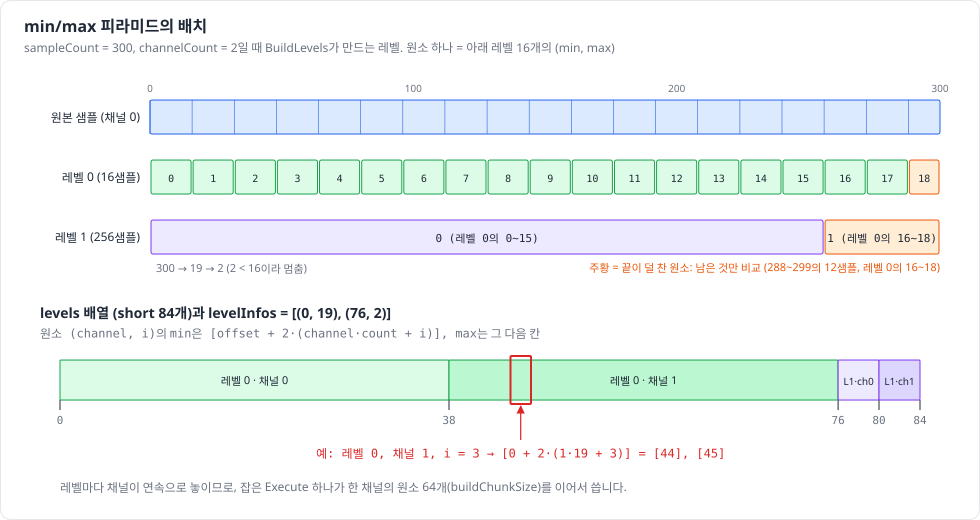

# 4. 파형 피라미드: `Waveform` 생성

> 기준 커밋: `3a2b24b9`. [← 목차](README.md) · 이전: [3. 시간 보간](03-time-interpolation.md) · 다음: [5. 파형 축약](05-waveform-reduction.md)

파형을 화면에 그리려면 "샘플 구간 [a, b]를 픽셀 하나로 줄이면 최솟값과 최댓값은?"을 픽셀마다 물어야 합니다.
곡 전체를 한 화면에 띄우면 픽셀 하나가 수만 샘플을 덮으므로, 매번 원본을 훑으면 너무 느립니다.

[`Waveform`](../Runtime/Sounds/Waveform.cs#L16)은 생성할 때 **16개씩 묶은 min/max를 여러 층으로 쌓은 피라미드**를 미리 만들어 둡니다.
그러면 긴 구간도 위층 원소 몇 개로 답할 수 있습니다. 이 장은 피라미드를 만드는 과정을, [5장](05-waveform-reduction.md)은 그것으로 구간을 줄이는 과정을 다룹니다.

- [4.1 계약](#41-계약)
- [4.2 생성자: 소유권과 검증](#42-생성자-소유권과-검증)
- [4.3 `BuildLevels`: 레벨 배치와 잡 체인](#43-buildlevels-레벨-배치와-잡-체인)
- [4.4 `BuildFromSamplesJob`](#44-buildfromsamplesjob)
- [4.5 `BuildFromLevelJob`](#45-buildfromleveljob)
- [4.6 `Dispose`와 `pendingJobs`](#46-dispose와-pendingjobs)

---

## 4.1 계약

| 항목 | 내용 |
| --- | --- |
| 스레드 | 생성, 사용, 해제를 모두 **메인 스레드**에서 합니다(XML 주석 [`#L13`](../Runtime/Sounds/Waveform.cs#L13)). 무거운 계산은 내부에서 잡으로 돌립니다. |
| 입력 | 16비트 **planar** 샘플: `[channel * sampleCount + sample]`. 채널마다 연속으로 놓입니다. |
| 소유권 | 생성자가 `NativeArray<short>`의 소유권을 가져갑니다. 생성자가 예외를 던져도 가져갑니다. |
| 해제 | `IDisposable`. `Dispose`는 스케줄한 잡을 기다린 뒤 배열을 해제합니다. |
| 값 범위 | 저장은 `short` 그대로, 결과는 `/ 32768f`로 정규화한 -1..1입니다([5장](05-waveform-reduction.md)). |

```csharp
// Runtime/Sounds/Waveform.cs
18  const int branch = 16;                 // 한 원소가 묶는 아래 레벨 원소 수

20  NativeArray<short> samples;            // 원본 (planar)

    // 레벨 l의 원소 하나는 원본 샘플 16^(l+1)개의 (min, max) 짝이며, [offset + 2 * (channel * count + i)]에 저장됩니다.
23  NativeArray<short> levels;

    // 레벨마다 levels 안의 (offset, count)입니다.
26  NativeArray<int2> levelInfos;

29  JobHandle pendingJobs;                 // Dispose가 기다릴 잡들
30  bool isDisposed;

32  public int channelCount { get; }
33  public int sampleCount { get; }       // 채널 하나의 샘플 수
```

## 4.2 생성자: 소유권과 검증

```csharp
50  public Waveform(NativeArray<short> planarSamples, int channelCount)
    {
52      samples = planarSamples;                                   // ① 검증보다 먼저 소유권을 가져감
        try
        {
55          if (!planarSamples.IsCreated)
56              throw new ArgumentException("The planar samples are not created.", nameof(planarSamples));

58          ArgumentOutOfRangeException.ThrowIfNegativeOrZero(channelCount);

60          if (planarSamples.Length % channelCount != 0)          // ② 채널마다 같은 길이
61              throw new ArgumentException($"…", nameof(planarSamples));

63          this.channelCount = channelCount;
64          sampleCount = planarSamples.Length / channelCount;

66          BuildLevels();                                         // ③ 피라미드를 다 만들 때까지 블록
        }
        catch
        {
70          Dispose();                                             // ④ 실패해도 받은 배열을 해제
71          throw;
        }
    }
```

1. ① 필드에 먼저 넣어 두므로, 어느 줄에서 예외가 나도 ④의 `Dispose`가 원본을 해제합니다. 호출자는 "넘겼으면 끝"이라는 규칙 하나만 지키면 됩니다. 성공과 실패를 나눠 해제를 고민할 필요가 없습니다.
2. ② `sampleCount`가 0이어도(빈 배열) 유효합니다. 이때 피라미드 레벨은 없고, 축약 메서드는 모든 열을 빈 열로 채웁니다([5.1](05-waveform-reduction.md#51-공통-계약)).
3. ③ `BuildLevels`는 끝에서 잡을 `Complete()`하므로 **생성자는 동기적**입니다. 생성자가 돌아오면 피라미드가 완성되어 있습니다.

## 4.3 `BuildLevels`: 레벨 배치와 잡 체인



```csharp
75  void BuildLevels()
    {
77      List<int2> infos = [];
78      int count = sampleCount;
79      int length = 0;
80      while (count >= branch)                                              // ① 16개 미만이 되면 멈춤
        {
82          count = ((count + branch) - 1) / branch;                         // ② 올림 나눗셈
83          infos.Add(new int2(length, count));                              // (offset, count)
84          length = checked(length + (count * channelCount * 2));           // ③ 채널 × (min, max)
        }

87      levelInfos = new NativeArray<int2>(infos.Count, Allocator.Persistent);
88      for (int i = 0; i < infos.Count; i++)
89          levelInfos[i] = infos[i];

91      levels = new NativeArray<short>(length, Allocator.Persistent, NativeArrayOptions.UninitializedMemory);   // ④

        // 잡이 levels에 쓰는 동안에는 서브 배열을 만들 수 없으므로 레벨별 구간을 먼저 만들어 둡니다.
94      NativeArray<short>[] views = new NativeArray<short>[infos.Count];
95      for (int level = 0; level < infos.Count; level++)
96          views[level] = levels.GetSubArray(infos[level].x, infos[level].y * channelCount * 2);   // ⑤

        // 스케줄 도중 실패해도 Dispose가 이미 스케줄된 잡을 기다리도록 체인을 pendingJobs에 둡니다.
99      for (int level = 0; level < infos.Count; level++)
        {
101         int levelCount = infos[level].y;
102         int chunksPerChannel = ((levelCount + buildChunkSize) - 1) / buildChunkSize;   // ⑥
103         if (level == 0)
            {
105             pendingJobs = new BuildFromSamplesJob
                {
107                 source = samples,
108                 output = views[level],
109                 sourceCount = sampleCount,
110                 count = levelCount,
111                 chunksPerChannel = chunksPerChannel
112             }.Schedule(chunksPerChannel * channelCount, 16, pendingJobs);              // ⑦
            }
            else
            {
116             pendingJobs = new BuildFromLevelJob
                {
118                 source = views[level - 1],
119                 output = views[level],
120                 sourceCount = infos[level - 1].y,
121                 count = levelCount,
122                 chunksPerChannel = chunksPerChannel
123             }.Schedule(chunksPerChannel * channelCount, 16, pendingJobs);
            }
        }

127     pendingJobs.Complete();                                                          // ⑧
    }
```

1. ① 원소가 16개 미만인 층은 만들지 않습니다. 그래서 맨 위 레벨의 원소 수는 1~15입니다. `sampleCount < 16`이면 레벨이 하나도 없습니다(`levelInfos.Length == 0`).
2. ② 올림 나눗셈이므로 마지막 원소는 덜 찬 묶음일 수 있습니다. 그림의 주황 원소처럼, 남은 것만 비교합니다(4.4).
3. ③ 레벨 하나는 `count × channelCount × 2`개의 `short`입니다. `checked`는 아주 긴 오디오에서 `int` 오버플로를 조용히 넘기지 않고 예외로 만들기 위한 것입니다.
   - 레벨 원소 수의 합은 약 `sampleCount / 15`이므로, 피라미드 전체는 원본의 약 `2 / 15 ≈ 13%` 크기입니다.
4. ④ 모든 원소를 잡이 덮어쓰므로 초기화하지 않습니다.
5. ⑤ 레벨마다 서브 배열 "창"을 미리 만들어 둡니다. 주석 그대로, 잡이 `levels`에 쓰는 동안에는 안전 시스템이 `GetSubArray`를 막기 때문입니다.
6. ⑥ 잡의 작업 단위는 **원소 하나가 아니라 원소 64개 묶음**(`buildChunkSize`)입니다. 이유는 4.4에 있습니다.
7. ⑦ 각 레벨의 잡은 바로 아래 레벨의 잡에 의존합니다(`pendingJobs`를 의존성으로 넘기고 다시 받음). 레벨 사이는 순차, 레벨 안은 병렬입니다.
   - 체인을 지역 변수가 아니라 `pendingJobs` 필드에 두는 이유는 주석대로입니다. 스케줄 도중 예외가 나면 생성자의 `catch` → `Dispose`가 이미 스케줄된 잡을 기다린 뒤 해제합니다.
8. ⑧ 마지막 레벨까지 기다립니다. 생성자가 동기적인 이유입니다.

## 4.4 `BuildFromSamplesJob`

원본 샘플에서 레벨 0을 만듭니다.

```csharp
// Runtime/Sounds/Waveform.BuildFromSamplesJob.cs
11  [BurstCompile]
12  struct BuildFromSamplesJob : IJobParallelFor
    {
14      [ReadOnly] public NativeArray<short> source;
15      [NativeDisableParallelForRestriction, WriteOnly] public NativeArray<short> output;   // ①
16      public int sourceCount;
17      public int count;
18      public int chunksPerChannel;

20      public void Execute(int chunk)
        {
22          int channel = chunk / chunksPerChannel;                               // ② 나눗셈은 묶음당 한 번
23          int first = (chunk - (channel * chunksPerChannel)) * buildChunkSize;
24          int last = math.min(first + buildChunkSize, count);
25          int sourceOffset = channel * sourceCount;
26          int outputOffset = channel * count;

28          for (int i = first; i < last; i++)
            {
30              int begin = i * branch;
31              int offset = sourceOffset + begin;

33              int min = int.MaxValue;
34              int max = int.MinValue;
35              if (begin + branch <= sourceCount)                               // ③ 꽉 찬 원소
                {
37                  for (int j = 0; j < branch; j++)                             //    상수 반복 → Burst가 펼침
                    {
39                      int value = source[offset + j];
40                      min = math.min(min, value);
41                      max = math.max(max, value);
                    }
                }
                else                                                             // ④ 채널 끝의 덜 찬 원소
                {
46                  for (int j = 0; j < sourceCount - begin; j++)
                    {
48                      int value = source[offset + j];
49                      min = math.min(min, value);
50                      max = math.max(max, value);
                    }
                }

55              output[(outputOffset + i) * 2] = (short)min;                     // ⑤
56              output[((outputOffset + i) * 2) + 1] = (short)max;
            }
        }
    }
```

1. ① `IJobParallelFor`는 기본적으로 `Execute(index)`가 `[index]`에만 쓰도록 강제합니다. 이 잡은 묶음 하나가 원소 여러 개, 배열 칸 여러 개에 쓰므로 그 제한을 끕니다. 묶음끼리 쓰는 칸이 겹치지 않으므로 안전합니다.
2. ② 묶는 이유는 [`Waveform.cs#L317`](../Runtime/Sounds/Waveform.cs#L317)의 주석에 있습니다.
   - 원소 하나의 실제 일은 비교 16번뿐입니다.
   - 원소마다 `Execute`를 부르면 채널을 구하는 나눗셈, 루프 진입, 벡터 수평 축약이 그보다 비쌉니다.
   - 64개씩 묶으면 이 비용이 묶음당 한 번으로 줄어듭니다.
3. ③ 꽉 찬 원소는 반복 횟수가 상수(16)인 루프로 처리합니다. Burst가 루프를 펼쳐 벡터화할 수 있습니다.
4. ④ 채널의 마지막 원소만 남은 샘플 수만큼 도는 일반 루프를 탑니다. 묶음은 채널 경계를 넘지 않습니다(② `channel`이 묶음 단위로 정해짐).
5. ⑤ 16비트 값들의 min/max이므로 `short`로 되돌려도 손실이 없습니다. 원본의 한 쌍 `(min, max)`가 레벨 배열의 연속한 두 칸입니다.

## 4.5 `BuildFromLevelJob`

레벨 l-1에서 레벨 l을 만듭니다. 구조는 4.4와 같고, 다른 점은 세 가지입니다.

```csharp
// Runtime/Sounds/Waveform.BuildFromLevelJob.cs
15  // 같은 levels 배열에서 이전 레벨 구간을 읽고 다음 레벨 구간에 씁니다. 두 구간은 겹치지 않습니다.
16  [ReadOnly, NativeDisableContainerSafetyRestriction] public NativeArray<short> source;   // ①
17  [NativeDisableParallelForRestriction, WriteOnly] public NativeArray<short> output;

33  int offset = (sourceOffset + begin) * 2;                                               // ②

41  min = math.min(min, source[offset + (j * 2)]);                                         // ③
42  max = math.max(max, source[offset + (j * 2) + 1]);
```

1. ① `source`와 `output`은 **같은 `levels` 배열의 두 서브 배열**입니다. 안전 시스템은 한 잡이 같은 메모리를 읽기·쓰기로 동시에 갖는 것을 거부하므로 `source` 쪽 검사를 끕니다. 두 구간이 겹치지 않는 것은 `BuildLevels`의 오프셋이 보장합니다.
2. ② 원본은 원소 하나가 `short` 하나였지만, 레벨 원소는 `(min, max)` 두 칸입니다. 그래서 오프셋에 2를 곱합니다.
3. ③ 아래 레벨의 min끼리, max끼리 합칩니다. 덜 찬 원소 처리(`sourceCount - begin`)도 4.4와 같습니다.

## 4.6 `Dispose`와 `pendingJobs`

```csharp
// Runtime/Sounds/Waveform.cs
300  public void Dispose()
     {
         // 잡이 읽는 중인 배열을 해제하지 않도록 먼저 기다립니다. 생성 도중 실패했을 때는 만들어진 배열만 해제합니다.
303      pendingJobs.Complete();

305      if (samples.IsCreated)
306          samples.Dispose();

308      if (levels.IsCreated)
309          levels.Dispose();

311      if (levelInfos.IsCreated)
312          levelInfos.Dispose();

314      isDisposed = true;
     }
```

- `pendingJobs`에는 생성 잡뿐 아니라 [5장](05-waveform-reduction.md)의 `Schedule*` 메서드가 스케줄한 잡도 모두 합쳐집니다(`JobHandle.CombineDependencies`). 호출자가 축약 잡을 기다리지 않고 `Dispose`해도, 잡이 읽는 배열이 먼저 해제되지 않습니다.
- `IsCreated` 검사는 생성자 실패 경로를 위한 것입니다. 예를 들어 `levelInfos`만 만들고 실패했다면 그것만 해제합니다.
- 이후 `Schedule*`를 부르면 `ObjectDisposedException`이 납니다.
