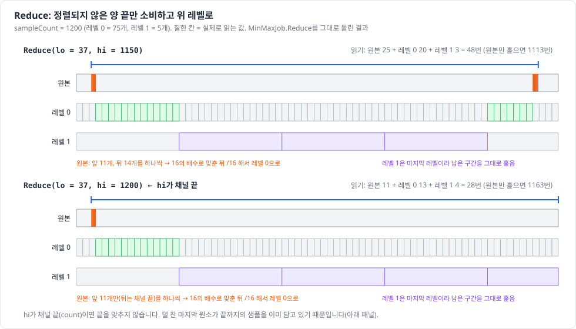
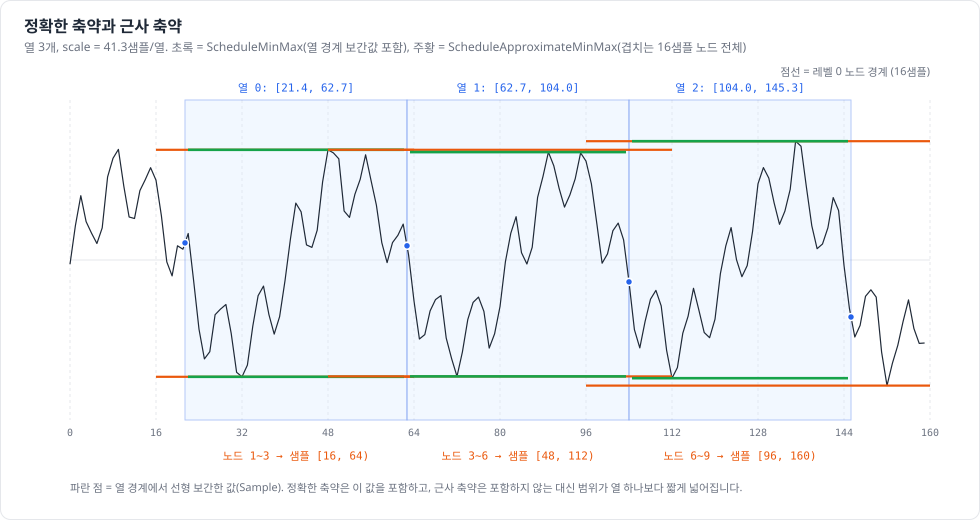

# 5. 파형 축약: 구간을 열로 줄이기

> 기준 커밋: `3a2b24b9`. [← 목차](README.md) · 이전: [4. 파형 피라미드](04-waveform-pyramid.md) · 다음: [6. 파형 렌더링](06-waveform-rendering.md)

`Waveform`의 공개 메서드는 세 개입니다. 모두 잡을 **스케줄만 하고** `JobHandle`을 돌려줍니다.

| 메서드 | 결과 | 쓰는 곳 |
| --- | --- | --- |
| [`ScheduleMinMax`](../Runtime/Sounds/Waveform.cs#L149) | 열마다 정확한 `(min, max)` | 렌더러의 선·피크 방식 |
| [`ScheduleApproximateMinMax`](../Runtime/Sounds/Waveform.cs#L206) | 열마다 근사 `(min, max)`, 열이 길 때 더 쌈 | 렌더러의 밀도 방식 하위 열 |
| [`ScheduleResample`](../Runtime/Sounds/Waveform.cs#L272) | 균등 간격 위치의 보간 값 | 렌더러의 열 경계 값 |

렌더러가 이 셋을 어떻게 조합하는지는 [6장](06-waveform-rendering.md)에 있습니다.

- [5.1 공통 계약](#51-공통-계약)
- [5.2 `Sample`: 샘플 사이의 선형 보간](#52-sample-샘플-사이의-선형-보간)
- [5.3 `ScheduleMinMax`](#53-scheduleminmax)
- [5.4 `MinMaxJob.Execute`: 열 묶음 처리](#54-minmaxjobexecute-열-묶음-처리)
- [5.5 `Reduce`: 피라미드 타기](#55-reduce-피라미드-타기)
- [5.6 `ScheduleApproximateMinMax`](#56-scheduleapproximateminmax)
- [5.7 `ScheduleResample`](#57-scheduleresample)
- [5.8 호출자가 할 일](#58-호출자가-할-일)

---

## 5.1 공통 계약

- **구간:** `startSample`과 `endSample`은 **소수 샘플 위치**(`double`)이며 `0 <= startSample <= endSample <= sampleCount - 1`이어야 합니다.
- **열:** `scale = (endSample - startSample) / width`일 때 열 `x`는 `[startSample + x·scale, startSample + (x+1)·scale]`을 덮습니다. 이웃한 열은 경계를 공유합니다.
- **결과 배치:** `[channel * width + x]`. 결과 배열은 호출자가 만들고 소유하며, 길이가 `channelCount * width` 이상이어야 합니다.
- **정규화:** 값은 `short / 32768f`, 즉 -1..1입니다.
- **빈 파형:** `sampleCount == 0`이면 구간을 검사하지 않습니다. min/max 결과는 모든 열이 `(float.MaxValue, float.MinValue)`, 즉 **min > max인 "빈 열"** 이고, Resample 결과는 0입니다.

검증 코드는 세 메서드가 같습니다.

```csharp
// Runtime/Sounds/Waveform.cs
151  ObjectDisposedException.ThrowIf(isDisposed, this);
152  ArgumentOutOfRangeException.ThrowIfNegative(width);

     // 샘플이 없으면 잡이 원본을 읽지 않고 모든 열을 빈 열로 채우므로 구간을 검사하지 않습니다.
     // 부정 비교로 쓴 것은 NaN도 거부하기 위해서입니다.
156  if (sampleCount > 0 && !(startSample >= 0 && startSample <= endSample && endSample <= sampleCount - 1))   // ①
157      throw new ArgumentOutOfRangeException(nameof(startSample), $"…");

159  int columnCount = checked(channelCount * width);
160  if (!result.IsCreated || result.Length < columnCount)
161      throw new ArgumentException($"…", nameof(result));
```

1. ① `start < 0 || …`처럼 쓰면 NaN과의 비교가 모두 `false`라 NaN이 통과합니다. "조건을 모두 만족하지 **않으면**"으로 쓰면 NaN이 거부됩니다.

## 5.2 `Sample`: 샘플 사이의 선형 보간

```csharp
     // MinMaxJob의 열 경계와 ResampleJob이 같은 값을 내도록 두 잡이 이 보간을 함께 씁니다.
326  static float Sample(NativeArray<short> samples, int sampleCount, int offset, double position)
     {
328      int previous = (int)position;
329      if (previous >= sampleCount - 1)                         // ① 마지막 샘플 이후는 마지막 값
330          return samples[(offset + sampleCount) - 1] / 32768f;

332      float t = (float)(position - previous);
333      return math.lerp(samples[offset + previous] / 32768f, samples[offset + previous + 1] / 32768f, t);   // ②
     }
```

**이 패키지가 보는 파형은 "샘플 사이를 직선으로 이은 꺾은선"입니다.** 열 경계처럼 정수가 아닌 위치의 값은 이 꺾은선 위의 값입니다.

1. ① 구간 계약상 위치는 `sampleCount - 1`을 넘지 않습니다. 이 분기는 정확히 마지막 샘플 위치에서 `previous + 1`을 읽지 않게 막습니다.
2. ② 정확한 축약(5.4)과 Resample(5.7)이 **같은 함수**를 쓰므로, 같은 위치에서 두 결과가 같은 값을 냅니다. 렌더러는 이 성질에 기대어 두 결과를 이어 붙입니다([6.5](06-waveform-rendering.md#65-linealpha-확대-상태의-선)).

## 5.3 `ScheduleMinMax`

```csharp
     // 열이 짧을 때만 묶습니다. MinMaxJob이 원본을 순서대로 훑는 기준과 같습니다.
164  double scale = (endSample - startSample) / width;
165  int columnsPerChunk = scale <= branch * 2 ? minMaxChunkSize : 1;            // ① 32샘플 이하 열은 64개씩
166  int chunksPerChannel = ((width + columnsPerChunk) - 1) / columnsPerChunk;

168  JobHandle handle = new MinMaxJob
     {
170      samples = samples,
171      levels = levels,
172      levelInfos = levelInfos,
173      result = result,
         …
178      startSample = startSample,
179      scale = scale
180  }.Schedule(chunksPerChannel * channelCount, columnsPerChunk == 1 ? 16 : 1, dependency);   // ②

182  pendingJobs = JobHandle.CombineDependencies(pendingJobs, handle);              // ③
183  return handle;
```

1. ① 작업 단위를 열 길이에 따라 바꿉니다. 이유는 [`MinMaxJob.cs#L11`](../Runtime/Sounds/Waveform.MinMaxJob.cs#L11)의 주석에 있습니다.
   - **짧은 열:** 열마다의 진입 비용(채널 나눗셈, 양 끝 보간을 위한 띄엄띄엄 읽기)이 실제로 읽는 샘플보다 비쌉니다. 그래서 64개(`minMaxChunkSize`)씩 묶습니다.
   - **긴 열:** 열 하나의 일이 이미 커서 묶어도 이득이 없습니다. 작업 단위만 줄어 스레드 사이 분배가 나빠지므로 묶지 않습니다.
2. ② `innerloopBatchCount`도 맞춥니다. 묶음 하나가 무거우면 1, 열 하나씩이면 16개씩 훔쳐 가게 합니다.
3. ③ [4.6](04-waveform-pyramid.md#46-dispose와-pendingjobs)처럼 `Dispose`가 이 잡을 기다리게 합니다.

## 5.4 `MinMaxJob.Execute`: 열 묶음 처리

```csharp
// Runtime/Sounds/Waveform.MinMaxJob.cs
19  [BurstCompile(FloatMode = FloatMode.Fast)]
20  struct MinMaxJob : IJobParallelFor
    …
33  public void Execute(int chunk)
    {
35      int channel = chunk / chunksPerChannel;
36      int firstColumn = (chunk - (channel * chunksPerChannel)) * columnsPerChunk;
37      int lastColumn = math.min(firstColumn + columnsPerChunk, width);
38      int resultOffset = channel * width;

40      if (sampleCount == 0)                                                          // ① 빈 파형
        {
42          for (int x = firstColumn; x < lastColumn; x++)
43              result[resultOffset + x] = new float2(float.MaxValue, float.MinValue);
45          return;
        }

48      int offset = channel * sampleCount;

        // 샘플 사이를 직선으로 이은 파형에서 열 x가 덮는 [start, end] 구간의 최솟값과 최댓값을 구합니다.
        // 열 x의 start는 열 x - 1의 end와 같은 식이므로 이어서 써도 열마다 따로 계산한 값과 같습니다.
52      double start = startSample + (firstColumn * scale);
53      float startValue = Sample(samples, sampleCount, offset, start);              // ② 묶음의 첫 경계

        // 축약이 원본을 직접 훑는 길이(branch * 2) 이하의 열은 피라미드를 쓰지 않으므로 원본을 한 번 순서대로 훑습니다.
56      bool sequential = scale <= branch * 2;
57      int next = (int)start + 1;                                                     // ③ 순차 커서

59      for (int x = firstColumn; x < lastColumn; x++)
        {
61          double end = startSample + ((x + 1) * scale);
62          float endValue = Sample(samples, sampleCount, offset, end);

64          float min = math.min(startValue, endValue);                                // ④ 양 끝 보간 값
65          float max = math.max(startValue, endValue);

67          int first = (int)start + 1;                                                // ⑤ 열 안쪽의 정수 샘플
68          int last = math.min((int)end, sampleCount - 1);
69          if (sequential)
            {
71              int innerMin = int.MaxValue;
72              int innerMax = int.MinValue;
73              for (; next <= last; next++)                                           // ⑥ 커서를 이어서 전진
                {
75                  int value = samples[offset + next];
76                  innerMin = math.min(innerMin, value);
77                  innerMax = math.max(innerMax, value);
                }

80              if (innerMin <= innerMax)                                              // ⑦ 안쪽 샘플이 있었을 때만
                {
82                  min = math.min(min, innerMin / 32768f);
83                  max = math.max(max, innerMax / 32768f);
                }
            }
86          else if (first <= last)
            {
88              Reduce(channel, first, last + 1, out int innerMin, out int innerMax);  // ⑧ 피라미드
89              min = math.min(min, innerMin / 32768f);
90              max = math.max(max, innerMax / 32768f);
            }

93          result[resultOffset + x] = new float2(min, max);

95          start = end;                                                               // ⑨ 경계 공유
96          startValue = endValue;
        }
    }
```

1. ① 빈 파형이면 원본을 읽지 않고 빈 열로 채웁니다. 5.1의 "검사 생략"이 안전한 이유입니다.
2. ② 묶음의 첫 경계만 따로 보간합니다. 이후 경계는 ⑨에서 이어받습니다.
3. ③ 순차 모드의 커서입니다. 묶음 안의 열들이 원본을 **한 번만** 앞으로 훑게 합니다.
4. ④ **열의 값은 꺾은선 위 [start, end]의 min/max입니다.** 꺾은선의 극값은 양 끝이나 안쪽 정수 샘플에만 있으므로, 양 끝 보간 값과 안쪽 샘플만 보면 됩니다.
5. ⑤ `start`가 정수여도 `+1`부터 셉니다. 그 위치의 샘플 값은 ④의 `startValue`와 같기 때문입니다. `last`는 `end` 이하의 마지막 정수 샘플입니다.
6. ⑥ `next`는 열마다 새로 시작하지 않고 이어서 전진합니다. 열 x의 `first`는 열 x-1의 `last + 1`과 같으므로, 커서 위치가 곧 이번 열의 `first`입니다.
7. ⑦ 열이 1샘플보다 짧으면 안쪽 정수 샘플이 없을 수 있습니다. 이때는 양 끝 값만 씁니다.
8. ⑧ 32샘플보다 긴 열은 [5.5](#55-reduce-피라미드-타기)의 `Reduce`로 피라미드를 탑니다. `[first, last + 1)` 반열린 구간을 넘깁니다.
9. ⑨ 오른쪽 경계 값이 다음 열의 왼쪽 경계 값입니다. 경계 보간을 열마다 두 번이 아니라 한 번만 합니다. 주석대로 열마다 따로 계산한 값과 같습니다. `start`가 이전 열의 `end`와 같은 식으로 계산되기 때문입니다.

`FloatMode.Fast`는 부동소수점 연산의 순서 변경과 근사를 허용해 Burst가 더 공격적으로 최적화하게 합니다. 축약 잡 세 개(`MinMaxJob`, `ApproximateMinMaxJob`, `ResampleJob`)가 이 모드이고, 정수만 다루는 생성 잡 두 개는 기본 모드입니다.

## 5.5 `Reduce`: 피라미드 타기

```csharp
     // 원본 샘플 [lo, hi)를 레벨마다 정렬되지 않은 양 끝만 소비하고 나머지는 상위 레벨로 올려 보내며 축약합니다.
101  void Reduce(int channel, int lo, int hi, out int min, out int max)
     {
103      min = int.MaxValue;
104      max = int.MinValue;

106      int level = -1;                                                       // ① -1 = 원본 샘플
107      int count = sampleCount;
108      int baseIndex = channel * sampleCount;

110      while (level != levelInfos.Length - 1 && hi - lo > branch * 2)        // ② 맨 위가 아니고 충분히 길 때
         {
112          for (; lo % branch != 0; lo++)                                    // ③ 왼쪽 끝을 16의 배수까지
113              Take(level, baseIndex, lo, ref min, ref max);

115          for (; hi % branch != 0 && hi != count; hi--)                     // ④ 오른쪽 끝을 16의 배수까지
116              Take(level, baseIndex, hi - 1, ref min, ref max);

118          int2 next = levelInfos[level + 1];
119          lo /= branch;                                                     // ⑤ 한 레벨 위 좌표로
120          hi = hi == count ? next.y : hi / branch;

122          level++;
123          count = next.y;
124          baseIndex = next.x + (channel * count * 2);
         }

127      for (int i = lo; i < hi; i++)                                         // ⑥ 남은 구간을 이 레벨에서 훑음
128          Take(level, baseIndex, i, ref min, ref max);
     }

131  void Take(int level, int baseIndex, int i, ref int min, ref int max)
     {
133      if (level < 0)
         {
135          int value = samples[baseIndex + i];                               // 원본: 값 하나
136          min = math.min(min, value);
137          max = math.max(max, value);
         }
         else
         {
141          min = math.min(min, levels[baseIndex + (i * 2)]);                 // 레벨: (min, max) 짝
142          max = math.max(max, levels[baseIndex + (i * 2) + 1]);
         }
     }
```



1. ① 레벨 -1을 원본으로 두면 원본과 레벨을 같은 루프로 다룰 수 있습니다. `count`와 `baseIndex`가 레벨마다 바뀌고, `Take`가 레벨에 맞게 읽습니다.
2. ② 두 조건 중 하나라도 깨지면 올라가기를 멈춥니다.
   - 맨 위 레벨이면 더 올라갈 곳이 없습니다. 레벨이 없을 때(`levelInfos.Length == 0`)는 `level == -1 == Length - 1`이라 바로 멈춥니다.
   - 구간이 32원소 이하면 양 끝을 맞추는 데 최대 30번을 읽어야 하므로 그냥 훑는 편이 낫습니다.
3. ③ ④ 16의 배수에 맞지 않는 양 끝 원소만 이 레벨에서 하나씩 소비합니다. 맞춰진 가운데 부분은 위 레벨의 원소가 정확히 덮습니다.
4. ④ **`hi == count`이면 오른쪽 끝을 맞추지 않습니다.** 위 레벨의 마지막 원소는 덜 찬 묶음이라 채널 끝까지의 원소를 이미 담고 있기 때문입니다. 그래서 ⑤에서 `hi`는 위 레벨의 원소 수(`next.y`)가 됩니다. 그림의 아래 패널이 이 경우입니다.
5. ⑤ `baseIndex`는 그 레벨에서 이 채널의 시작입니다. [4.3](04-waveform-pyramid.md#43-buildlevels-레벨-배치와-잡-체인)의 배치 `offset + 2·(channel·count + i)`와 같습니다.
6. ⑥ 레벨마다 소비하는 원소는 최대 30개(양쪽 15개씩)이고 레벨 수는 `log16(sampleCount)`이므로, 열 하나의 비용은 열 길이와 거의 무관합니다. 그림의 위 패널은 1113샘플 구간을 48번 읽기로 끝냅니다.

## 5.6 `ScheduleApproximateMinMax`

정확한 축약은 열 경계를 보간하고 양 끝을 원소 하나씩 소비합니다. 열이 아주 많고 각 열이 길면 그것도 비용입니다.
근사 축약은 **열과 겹치는 노드를 통째로** 씁니다. 결과 범위가 조금 넓어지는 대신 열당 노드 1~17개만 읽습니다.



```csharp
// Runtime/Sounds/Waveform.cs
     // 열이 가장 작은 노드(16샘플)보다 짧으면 노드에 맞출 수 없으므로 정확한 축약을 씁니다. 이때 읽을 샘플이 적어 정확한 축약도 쌉니다.
220  double scale = (endSample - startSample) / width;
221  if (sampleCount == 0 || levelInfos.Length == 0 || !(scale >= branch))      // ①
222      return ScheduleMinMax(startSample, endSample, width, result, dependency);

     // 노드가 열보다 길지 않은 가장 거친 레벨을 고릅니다.
225  int level = 0;
226  int nodeSize = branch;
227  while (level + 1 < levelInfos.Length && (long)nodeSize * branch <= scale)  // ②
     {
229      level++;
230      nodeSize *= branch;
     }

233  JobHandle handle = new ApproximateMinMaxJob
     {
         …
240      levelOffset = levelInfos[level].x,
241      levelCount = levelInfos[level].y,
242      nodeSize = nodeSize
243  }.Schedule(columnCount, 16, dependency);                                   // ③ 열 하나씩
```

```csharp
// Runtime/Sounds/Waveform.ApproximateMinMaxJob.cs
26  public void Execute(int index)
    {
28      int channel = index / width;
29      int x = index - (channel * width);

31      double start = startSample + (x * scale);
32      double end = startSample + ((x + 1) * scale);

34      int first = (int)start / nodeSize;                          // ④ start를 담은 노드
35      int last = math.min((int)end / nodeSize, levelCount - 1);   //    end를 담은 노드
36      int baseIndex = levelOffset + (channel * levelCount * 2);

38      int min = int.MaxValue;
39      int max = int.MinValue;
40      for (int i = first; i <= last; i++)
        {
42          min = math.min(min, levels[baseIndex + (i * 2)]);
43          max = math.max(max, levels[baseIndex + (i * 2) + 1]);
        }

46      result[index] = new float2(min / 32768f, max / 32768f);
    }
```

1. ① 열이 16샘플보다 짧으면 노드가 열보다 길어 근사가 의미 없습니다. 이때는 그대로 정확한 축약을 돌려줍니다. `!(scale >= branch)`도 5.1처럼 NaN을 걸러 냅니다. 그래서 **반환값의 결과 배치와 예외는 두 메서드가 같습니다.**
2. ② 노드 크기가 열 길이 이하인 레벨 중 가장 위를 고릅니다. 노드가 열보다 길지 않으므로 열 하나는 노드 `scale/nodeSize + 1`개 이하, 그리고 다음 레벨이 열보다 길므로 17개 이하와 겹칩니다. `(long)`은 `nodeSize * 16`의 `int` 오버플로를 막습니다.
3. ③ 열마다 일이 일정하고 작으므로 묶지 않고 열 하나를 작업 단위로 씁니다.
4. ④ `start`와 `end`를 담은 노드까지 통째로 포함합니다. 그래서 그림처럼 **각 열의 범위가 양쪽으로 노드 하나보다 짧게(따라서 열 하나보다 짧게) 넓어집니다.** 경계의 보간 값은 따로 계산하지 않습니다.

| | `ScheduleMinMax` | `ScheduleApproximateMinMax` |
| --- | --- | --- |
| 열 범위 | 정확히 `[start, end]` | 겹치는 노드 전체 |
| 경계 보간 값 | 포함 | 계산하지 않음 |
| 읽는 양 | 양 끝 정렬 + 레벨당 최대 30 | 한 레벨에서 노드 1~17 |
| 열 < 16샘플 | 같음 | `ScheduleMinMax`로 위임 |

## 5.7 `ScheduleResample`

```csharp
// Runtime/Sounds/Waveform.cs
286  JobHandle handle = new ResampleJob
     {
         …
292      startSample = startSample,
293      scale = count > 1 ? (endSample - startSample) / (count - 1) : 0     // ① 양 끝 포함
294  }.Schedule(pointCount, 64, dependency);
```

```csharp
// Runtime/Sounds/Waveform.ResampleJob.cs
20  public void Execute(int index)
    {
22      if (sampleCount == 0)
        {
24          result[index] = 0;
25          return;
        }

28      int channel = index / count;
29      int i = index - (channel * count);

31      result[index] = Sample(samples, sampleCount, channel * sampleCount, startSample + (i * scale));   // ②
    }
```

1. ① `count`개 위치가 `startSample`과 `endSample`을 **둘 다 포함**하도록 `count - 1`로 나눕니다. `count == 1`이면 위치는 `startSample` 하나입니다.
2. ② 5.2의 `Sample`을 씁니다. 그래서 같은 구간을 `width + 1`개 위치로 Resample하면 **`ScheduleMinMax`의 열 경계 값과 같은 값**을 얻습니다(XML 주석 [`#L254`](../Runtime/Sounds/Waveform.cs#L254)). 렌더러가 열 안의 파형을 복원할 때 이 값을 씁니다([6.5](06-waveform-rendering.md#65-linealpha-확대-상태의-선)).

## 5.8 호출자가 할 일

- 결과 배열을 만들고, 반환된 `JobHandle`을 `Complete()`한 뒤에 결과를 읽고, 다 쓰면 해제합니다. `Waveform`은 결과 배열을 소유하지 않습니다.
- 같은 결과 배열에 쓰는 잡끼리는 `dependency`로 순서를 잇습니다. 서로 다른 배열에 쓰는 잡은 의존 없이 함께 돌려도 됩니다. 세 잡 모두 원본과 피라미드를 읽기만 하기 때문입니다.
- 모든 호출은 메인 스레드에서 합니다([4.1](04-waveform-pyramid.md#41-계약)).
