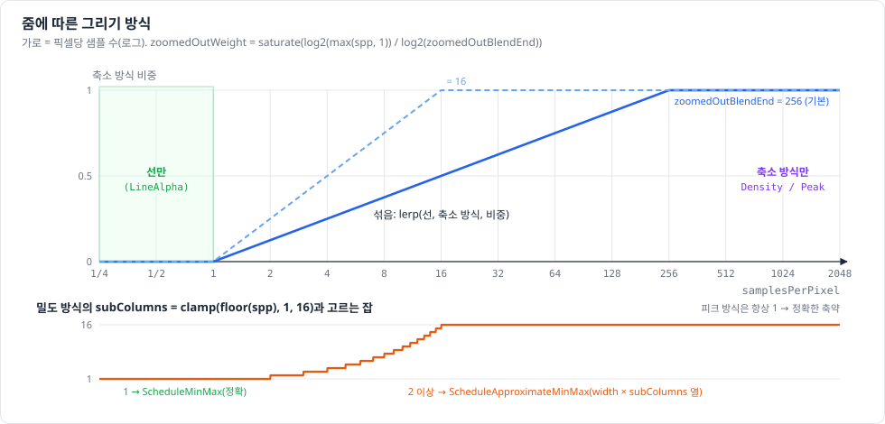
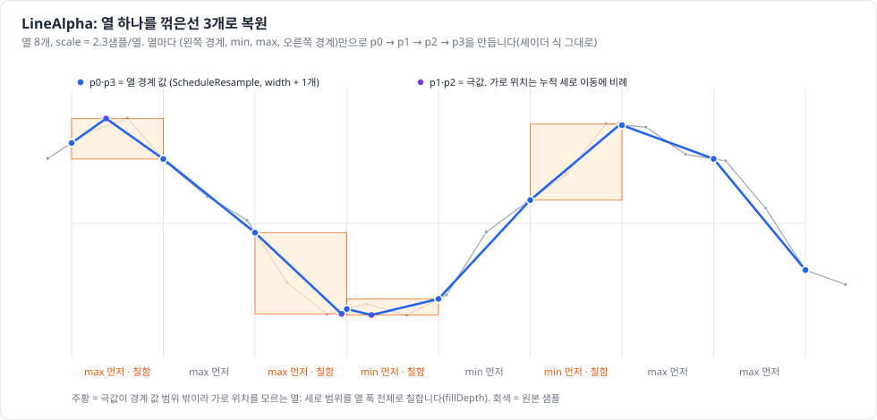

# 6. 파형 렌더링: `WaveformRenderer`와 `Waveform.shader`

> 기준 커밋: `3a2b24b9`. [← 목차](README.md) · 이전: [5. 파형 축약](05-waveform-reduction.md) · 다음: [7. 리소스와 생성](07-resources.md)

[`WaveformRenderer`](../Runtime/Sounds/WaveformRenderer.cs#L17)는 `Waveform`의 한 구간을 `RenderTexture`에 그립니다.
CPU는 픽셀 열마다 min/max와 열 경계 값만 잡으로 계산해 작은 텍스처에 담습니다. 실제 모양은 셰이더 [`Waveform.shader`](../Resources/RuniOS/Sounds/Waveform.shader#L1)가 픽셀마다 계산합니다.

핵심은 **줌에 따라 그리는 방식을 바꾸되, 바뀌는 지점에서 모양이 튀지 않게 섞는 것**입니다.

- 확대 상태(픽셀당 샘플 1개 이하)에서는 파형을 굵기를 가진 **선**으로 그립니다.
- 축소 상태에서는 파형이 면이 됩니다. 이때는 두 방식 중 하나로 그립니다.
  - **밀도(`Density`)**: 소리가 그 높이에 머문 비율로 진하기를 정합니다.
  - **피크(`Peak`)**: min/max 외곽선 사이를 채웁니다.

- [6.1 계약과 사용 예](#61-계약과-사용-예)
- [6.2 `Render`](#62-render)
- [6.3 텍스처 배치](#63-텍스처-배치)
- [6.4 `frag`: 레인과 줌 섞기](#64-frag-레인과-줌-섞기)
- [6.5 `LineAlpha`: 확대 상태의 선](#65-linealpha-확대-상태의-선)
- [6.6 `DensityAlpha`: 밀도 방식](#66-densityalpha-밀도-방식)
- [6.7 `PeakAlpha`: 피크 방식](#67-peakalpha-피크-방식)
- [6.8 `Coverage`: 안티에일리어싱](#68-coverage-안티에일리어싱)

---

## 6.1 계약과 사용 예

```csharp
// Runtime/Sounds/WaveformRenderer.cs
109  public void Render(Waveform waveform, double startSample, double endSample, RenderTexture target, Color color,
                        float thickness = 1, float antialiasing = 1, WaveformRenderMode mode = WaveformRenderMode.Density)
```

| 항목 | 내용 |
| --- | --- |
| 스레드 | 생성, 사용, 해제를 모두 메인 스레드에서 합니다. `Render`는 잡을 기다린 뒤 돌아옵니다(동기). |
| 구간 | [`ScheduleMinMax`](05-waveform-reduction.md#51-공통-계약)의 계약을 따릅니다. |
| 배치 | 대상 텍스처의 **픽셀 열 하나 = 파형 열 하나**, **채널 하나 = 가로 레인 하나**(`uv.y`가 가장 큰 레인이 채널 0) |
| `thickness` | 선에 수직으로 잰 굵기(픽셀) |
| `antialiasing` | 가장자리가 흐려지는 폭(픽셀). 0이면 딱 끊어 그립니다. |
| `mode` | 축소 상태의 방식([`WaveformRenderMode`](../Runtime/Sounds/WaveformRenderMode.cs#L12)) |
| 조정값 | [`zoomedOutBlendEnd`](../Runtime/Sounds/WaveformRenderer.cs#L63)(기본 256), [`densityGamma`](../Runtime/Sounds/WaveformRenderer.cs#L73)(기본 2.2) |
| 해제 | `Dispose`가 내부 텍스처를 해제합니다. 해제하지 않으면 종료자가 경고를 남깁니다([`#L219`](../Runtime/Sounds/WaveformRenderer.cs#L219)). 해제 후 `Render`는 `ObjectDisposedException`입니다. |

아래는 **이 저장소에 없는 예제**입니다.

```csharp
// 예제 (저장소에 없는 코드)
using Waveform waveform = new Waveform(planarSamples, channelCount);   // planarSamples의 소유권이 넘어감
using WaveformRenderer renderer = new WaveformRenderer();             // 텍스처를 크기별로 캐시하므로 재사용

renderer.Render(waveform, 0, waveform.sampleCount - 1, target, Color.white);
```

`Render` 하나가 축약 잡 두 개, 텍스처 업로드, `Blit` 한 번입니다. 같은 렌더러를 계속 쓰면 대상 크기와 하위 열 수가 바뀔 때만 내부 텍스처를 다시 만듭니다.

## 6.2 `Render`

```csharp
109  public void Render(…)
     {
         // 해제 후 호출되면 다시 만든 텍스처를 해제할 곳이 없어 누수되므로 거부합니다.
112      ObjectDisposedException.ThrowIf(isDisposed, this);
113      ArgumentNullException.ThrowIfNull(waveform);

115      if (target == null)                                                            // ①
116          throw new ArgumentNullException(nameof(target));

118      int width = target.width;
119      int channelCount = waveform.channelCount;
120      double samplesPerPixel = (endSample - startSample) / width;

         // 피크 방식은 픽셀마다 min/max 하나만 쓰므로 나누지 않습니다.
129      int subColumns = mode == WaveformRenderMode.Density ? (int)Math.Clamp(Math.Floor(samplesPerPixel), 1, maxSubColumns) : 1;   // ②
130      int rowCount = channelCount * subColumns;

132      if (minMaxTexture == null || minMaxTexture.width != width || minMaxTexture.height != rowCount)   // ③
         {
134          if (minMaxTexture != null)
135              Object.DestroyImmediate(minMaxTexture);

137          minMaxTexture = new Texture2D(width, rowCount, TextureFormat.RGFloat, false, true)
             {
139              filterMode = FilterMode.Point,
140              wrapMode = TextureWrapMode.Clamp,
141              hideFlags = HideFlags.HideAndDontSave
             };
         }

145      if (boundaryTexture == null || boundaryTexture.width != width + 1 || boundaryTexture.height != channelCount)
         {
             …
150          boundaryTexture = new Texture2D(width + 1, channelCount, TextureFormat.RFloat, false, true) { … };
         }

         // 두 잡은 원본을 읽기만 하므로 서로 기다리지 않고 함께 돌립니다.
         // 밀도 방식의 하위 열은 경계가 하위 열 하나보다 덜 어긋나도 보이지 않으므로, 경계를 다듬지 않는 근사 축약으로 비용을 줄입니다.
160      NativeArray<float2> minMaxData = minMaxTexture.GetPixelData<float2>(0);       // ④
161      JobHandle minMaxHandle = subColumns > 1
162          ? waveform.ScheduleApproximateMinMax(startSample, endSample, width * subColumns, minMaxData)   // ⑤
163          : waveform.ScheduleMinMax(startSample, endSample, width, minMaxData);
164      JobHandle boundaryHandle;
         try
         {
167          boundaryHandle = waveform.ScheduleResample(startSample, endSample, width + 1, boundaryTexture.GetPixelData<float>(0));
         }
         catch
         {
             // 이미 스케줄된 잡이 텍스처 메모리에 쓰는 중이므로, 텍스처가 다시 만들어지거나 해제되기 전에 끝냅니다.
172          minMaxHandle.Complete();                                                    // ⑥
173          throw;
         }

176      JobHandle.CombineDependencies(minMaxHandle, boundaryHandle).Complete();

178      minMaxTexture.Apply(false);                                                     // ⑦
179      boundaryTexture.Apply(false);

181      material.SetColor(colorID, color);
         …
190      material.SetTexture(boundaryTexID, boundaryTexture);

         // Blit은 활성 렌더 타겟을 바꾸고, IMGUI는 sRGB 쓰기를 끈 채 그리므로 호출자의 상태를 되돌립니다.
193      RenderTexture previous = RenderTexture.active;
194      bool previousSRGBWrite = GL.sRGBWrite;

196      GL.sRGBWrite = QualitySettings.activeColorSpace == ColorSpace.Linear;          // ⑧
197      Graphics.Blit(minMaxTexture, target, material);

199      GL.sRGBWrite = previousSRGBWrite;
200      RenderTexture.active = previous;
     }
```

1. ① `target`은 `UnityEngine.Object`이므로 `ThrowIfNull`이 아니라 Unity의 `== null`로 검사합니다. 파괴된 객체도 여기서 null로 취급됩니다.
2. ② **밀도 방식은 픽셀 하나를 하위 열로 나눕니다.** 하위 열 수는 `floor(픽셀당 샘플 수)`이고 1~16(`maxSubColumns`)으로 제한합니다. 이유는 [`#L122`](../Runtime/Sounds/WaveformRenderer.cs#L122)의 주석에 있습니다.
   - 픽셀당 샘플 수보다 잘게 나누면 비스듬한 선의 가로 경계가 더 부드러워집니다.
   - 하지만 그런 배율에서는 선 방식의 비중이 커서([6.4](#64-frag-레인과-줌-섞기)) 차이가 거의 보이지 않습니다. 비용만 열 수만큼 늘어납니다.
   - 피크 방식은 픽셀마다 min/max 하나만 쓰므로 나누지 않습니다.
3. ③ 크기가 바뀔 때만 텍스처를 다시 만듭니다. 마지막 인자 `true`는 linear 텍스처입니다. 값이 색이 아니라 데이터이므로 sRGB 변환을 받으면 안 됩니다. `Point` 필터도 텍셀 사이 보간을 막기 위한 것입니다.
4. ④ **잡이 텍스처 메모리에 직접 씁니다.** `GetPixelData`는 텍스처의 CPU 쪽 버퍼를 `NativeArray`로 돌려주므로 복사 단계가 없습니다.
5. ⑤ 하위 열이 있으면 `width × subColumns` 열로 근사 축약을 합니다. 주석대로, 하위 열 하나보다 작은 경계 오차는 밀도 평균에서 보이지 않습니다.
6. ⑥ Resample 스케줄이 예외를 던지면, 이미 돌고 있는 min/max 잡이 텍스처 메모리에 쓰는 중입니다. 다음 `Render`에서 텍스처를 다시 만들거나 `Dispose`로 해제하기 전에 끝내 둡니다.
7. ⑦ CPU 버퍼를 GPU로 올립니다. `false`는 밉맵을 갱신하지 않는다는 뜻입니다.
8. ⑧ 프로젝트가 linear 색 공간이면 출력 시 sRGB 변환을 켭니다. 주석대로 IMGUI는 sRGB 쓰기를 끈 채 그리므로, 이 상태와 활성 렌더 타겟을 원래대로 되돌립니다.

머티리얼은 모든 렌더러가 **하나를 공유**합니다([`#L34`](../Runtime/Sounds/WaveformRenderer.cs#L34)). `Blit`은 호출 시점의 프로퍼티로 즉시 그리므로, 렌더러마다 머티리얼을 둘 필요가 없습니다.
머티리얼은 처음 쓸 때 `Resources/RuniOS/Sounds/Waveform` 셰이더로 만들고, 코드가 언로드될 때(`[OnCodeDeinitializing]`, [`#L46`](../Runtime/Sounds/WaveformRenderer.cs#L46)) 파괴합니다.

## 6.3 텍스처 배치

| 텍스처 | 크기 | 텍셀 값 | 채우는 잡 |
| --- | --- | --- | --- |
| `_MainTex` (`minMaxTexture`) | `width × (channelCount · subColumns)`, `RGFloat` | 하위 열 하나의 `(min, max)` | `ScheduleMinMax` 또는 `ScheduleApproximateMinMax` |
| `_BoundaryTex` (`boundaryTexture`) | `(width + 1) × channelCount`, `RFloat` | 열 경계 위치의 파형 값 | `ScheduleResample` |

`_MainTex`에서 하위 열이 놓이는 방식이 특이합니다.

```hlsl
// Resources/RuniOS/Sounds/Waveform.shader
    // 텍셀 값은 하위 열 하나의 (min, max)입니다. [(채널 * 열 개수 + 열) * 하위 열 개수 + 하위 열]의 선형 순서로 폭이 열 개수인 텍스처에 줄을 바꿔 가며 놓입니다.
56  float2 FetchMinMax(int channel, int column, int subColumn, int width)
    {
58      int index = (((channel * width) + column) * (int)_SubColumns) + subColumn;
59      int row = index / width;
60      return tex2Dlod(_MainTex, float4(((index - (row * width)) + 0.5) * _MainTex_TexelSize.x, (row + 0.5) * _MainTex_TexelSize.y, 0, 0)).rg;
    }
```

- 축약 잡의 결과 배치 `[channel * (width·subColumns) + x']`(`x' = column·subColumns + subColumn`)는 위 `index`와 같습니다. 잡의 출력을 **그대로** 텍스처 메모리로 쓰기 위한 배치입니다.
- 텍스처 폭을 `width × subColumns`로 두지 않고 `width`로 두고 줄을 바꿔 이어 붙입니다. 주석대로 `폭 × 16`이 텍스처 최대 폭을 넘을 수 있기 때문입니다([`WaveformRenderer.cs#L126`](../Runtime/Sounds/WaveformRenderer.cs#L126)).
- 하위 열들은 열 구간을 빈틈없이 나누므로, 그 min/max를 합치면 열 전체의 min/max가 됩니다(`FetchColumnMinMax`, [`#L64`](../Resources/RuniOS/Sounds/Waveform.shader#L64)).

## 6.4 `frag`: 레인과 줌 섞기



```hlsl
246  float4 frag(v2f_img i) : SV_Target
     {
         // 경계 값 텍스처는 하위 열과 상관없이 (열 개수 + 1) × 채널 수입니다.
249      int width = (int)_BoundaryTex_TexelSize.z - 1;                       // ① 크기를 텍스처에서 읽음
250      int channelCount = (int)_BoundaryTex_TexelSize.w;
251      int laneHeight = (int)_TargetHeight / channelCount;
252      int y = (int)floor(i.uv.y * _TargetHeight);

254      int lane = laneHeight > 0 ? y / laneHeight : channelCount;
255      if (lane >= channelCount)                                             // ② 나머지 줄은 투명
256          return 0;

258      int channel = channelCount - lane - 1;                                // ③ 레인 번호를 뒤집음
259      float v = (channel + 0.5) * _BoundaryTex_TexelSize.y;

261      float halfLane = laneHeight / 2.0;
262      float center = (lane * laneHeight) + halfLane;
263      float2 pixel = float2(i.uv.x * width, y + 0.5);                       // ④ 픽셀 좌표: x는 열 단위

         // 줌은 픽셀당 샘플 수를 배수로 바꾸므로, 줌 한 단계가 비중을 같은 만큼 바꾸도록 로그 스케일로 섞습니다.
         // 끝 지점이 1 이하면 0으로 나누지 않도록 폭을 아주 작게 두어 1에서 바로 바뀌게 합니다.
271      float zoomedOutWeight = saturate(log2(max(_SamplesPerPixel, 1)) / max(log2(_ZoomedOutBlendEnd), 1e-6));   // ⑤

273      float alpha = 0;
274      if (zoomedOutWeight < 1)
275          alpha = LineAlpha(pixel, width, channel, v, center, halfLane);       // ⑥

277      if (zoomedOutWeight > 0)
         {
279          float zoomedOut = _Mode > 0.5 ? PeakAlpha(…) : DensityAlpha(…);
280          alpha = lerp(alpha, zoomedOut, zoomedOutWeight);
         }

283      return float4(_Color.rgb, _Color.a * alpha);                          // ⑦
     }
```

1. ① 열 개수와 채널 수를 프로퍼티로 넘기지 않고 경계 텍스처 크기에서 읽습니다. 경계 텍스처는 하위 열 수와 무관하게 `(width + 1) × channelCount`이기 때문입니다.
2. ② 레인 높이는 정수이므로, 대상 높이가 채널 수로 나누어떨어지지 않으면 위쪽 남는 줄은 그리지 않습니다.
3. ③ `lane`은 `uv.y`가 클수록 커집니다. 이것을 뒤집어 **`uv.y`가 가장 큰 레인(보통 화면의 위쪽)이 채널 0**이 되게 합니다.
4. ④ 픽셀 좌표의 x는 "열 단위"이고 y는 대상 텍스처의 픽셀 단위입니다. 열 하나가 픽셀 하나이므로 두 단위의 크기가 같습니다. 그래서 거리 계산(굵기, 안티에일리어싱)을 그대로 픽셀로 할 수 있습니다.
5. ⑤ **섞는 비중은 픽셀당 샘플 수의 로그에 비례합니다.** 그림처럼 1에서 0, `zoomedOutBlendEnd`(256)에서 1이 됩니다.
   - 줌은 보통 배율을 곱해 바꾸므로 로그 스케일이면 줌 한 단계가 비중을 같은 만큼 바꿉니다.
   - `zoomedOutBlendEnd <= 1`이면 분모가 아주 작아져 1을 넘자마자 축소 방식으로 바뀝니다(XML 주석 [`WaveformRenderer.cs#L60`](../Runtime/Sounds/WaveformRenderer.cs#L60)).
6. ⑥ 비중이 0이나 1이면 필요 없는 쪽을 계산하지 않습니다.
7. ⑦ 출력은 단색이고 모양은 알파로만 표현합니다.

**밀도 방식이 선과 자연스럽게 이어지는 이유**는 주석([`#L265`](../Resources/RuniOS/Sounds/Waveform.shader#L265))에 있습니다. 픽셀당 샘플이 1개면 그 픽셀의 소리는 그 샘플뿐이라 밀도가 100%입니다. 그래서 비중이 0에서 막 올라가기 시작하는 지점에서 두 방식의 모양이 같습니다.

## 6.5 `LineAlpha`: 확대 상태의 선

샘플 간격이 픽셀보다 넓거나 비슷하면, 열마다 min/max만 알아서는 선을 그릴 수 없습니다. 선이 열 안에서 어느 쪽으로 지나가는지 모르기 때문입니다.
`LineAlpha`는 열마다 **왼쪽 경계 → 첫 극값 → 두 번째 극값 → 오른쪽 경계**의 꺾은선(선분 3개)을 복원하고, 픽셀에서 가장 가까운 선분까지의 거리로 진하기를 정합니다.



```hlsl
93   float LineAlpha(float2 pixel, int width, int channel, float v, float center, float halfLane)
     {
         // 픽셀에서 굵기와 안티에일리어싱 폭의 절반 안에 들어오는 열만 선에 닿을 수 있습니다.
96       float reach = (_Thickness + _Antialiasing) / 2;
97       int firstColumn = max((int)floor(pixel.x - reach), 0);                                      // ① 이웃 열까지
98       int lastColumn = min((int)floor(pixel.x + reach), width - 1);

100      float nearest = 1e9;

         // 픽셀이 속한 열을 칠할 때, 그 열의 세로 범위 안쪽으로 들어온 거리(바깥은 음수)입니다.
103      int pixelColumn = (int)floor(pixel.x);
104      float fillDepth = -1e9;

107      for (int column = firstColumn; column <= lastColumn; column++)
         {
109          float2 minMax = FetchColumnMinMax(channel, column, width);
110          if (minMax.x > minMax.y)                                                                 // ② 빈 열
111              continue;

113          float left = tex2Dlod(_BoundaryTex, float4((column + 0.5) * _BoundaryTex_TexelSize.x, v, 0, 0)).r;
114          float right = tex2Dlod(_BoundaryTex, float4((column + 1.5) * _BoundaryTex_TexelSize.x, v, 0, 0)).r;

121          bool minFirst = abs(left - minMax.x) + abs(right - minMax.y) <= abs(left - minMax.y) + abs(right - minMax.x);   // ③
122          float firstValue = minFirst ? minMax.x : minMax.y;
123          float secondValue = minFirst ? minMax.y : minMax.x;

125          float rise0 = abs(firstValue - left);                                                    // ④
126          float rise1 = abs(secondValue - firstValue);
127          float rise2 = abs(right - secondValue);
128          float total = rise0 + rise1 + rise2;
129          float firstX = total > 0 ? rise0 / total : 1 / 3.0;
130          float secondX = total > 0 ? (rise0 + rise1) / total : 2 / 3.0;

132          float2 p0 = float2(column, center + (left * halfLane));
133          float2 p1 = float2(column + firstX, center + (firstValue * halfLane));
134          float2 p2 = float2(column + secondX, center + (secondValue * halfLane));
135          float2 p3 = float2(column + 1, center + (right * halfLane));

137          nearest = min(nearest, SegmentDistance(pixel, p0, p1));                                  // ⑤
138          nearest = min(nearest, SegmentDistance(pixel, p1, p2));
139          nearest = min(nearest, SegmentDistance(pixel, p2, p3));

146          if (column == pixelColumn && (minMax.x < min(left, right) || minMax.y > max(left, right)))   // ⑥
             {
148              float low = center + (minMax.x * halfLane);
149              float high = center + (minMax.y * halfLane);
150              fillDepth = min(pixel.y - low, high - pixel.y);
             }
         }

154      return Coverage(min(nearest, -fillDepth) - (_Thickness / 2));                                // ⑦
     }
```

1. ① 굵은 선은 옆 열까지 번집니다. 그래서 픽셀에서 `(굵기 + AA 폭) / 2` 안에 드는 이웃 열의 선분도 봅니다.
2. ② 빈 열(`min > max`)은 선분이 없습니다. 빈 파형일 때만 나옵니다([5.1](05-waveform-reduction.md#51-공통-계약)).
3. ③ **두 극값의 순서는 세로 이동 거리가 짧은 쪽으로 정합니다.**
   - 왼쪽 경계가 min에 가깝고 오른쪽이 max에 가까우면 min을 먼저 지나는 것이 자연스럽습니다.
   - 가파른 단조 구간에서는 `left ≈ min`, `right ≈ max`가 되어 p0≈p1, p2≈p3이 됩니다. 그러면 선이 대각선 하나가 됩니다.
4. ④ 극값의 가로 위치는 알 수 없습니다. 그래서 **누적 세로 이동 거리에 비례**하는 곳에 둡니다. 주석대로, 그 오차는 꼭짓점이 자기 열 안에서 가로로 밀리는 것뿐입니다. 세로 이동이 전혀 없으면 열을 삼등분합니다.
5. ⑤ 거리는 선분까지의 유클리드 거리입니다. 그래서 `thickness`가 기울기와 상관없이 선에 수직으로 잰 굵기가 됩니다.
6. ⑥ **극값이 경계 값 범위 밖이면 그 열 안에 가로 위치를 모르는 극값이 있다는 뜻입니다**(그림의 주황 열).
   - 꺾은선은 ④에서 지어낸 가로 위치를 지나갑니다. 안티에일리어싱하면 면 안에 그 위치가 무늬로 드러납니다.
   - 그래서 그런 열은 세로 범위를 열 폭(한 픽셀) 전체에 칠합니다. 위아래 끝만 세로 거리로 안티에일리어싱합니다.
   - 이 판정은 min/max가 경계 값을 포함한다는 사실에 기댑니다. 정확한 축약이 경계 값을 Resample과 같은 `Sample`로 계산하기 때문에 성립합니다([5.2](05-waveform-reduction.md#52-sample-샘플-사이의-선형-보간)).
7. ⑦ 선분까지의 거리와 칠하는 깊이 중 더 안쪽인 것을 쓰고, 굵기의 절반을 빼서 "가장자리 밖으로 벗어난 거리"로 만듭니다.

## 6.6 `DensityAlpha`: 밀도 방식

```hlsl
158  float SpanCoverage(float2 minMax, float pixelY, float center, float halfLane)
     {
160      if (minMax.x > minMax.y)
161          return 0;

163      float low = center + (minMax.x * halfLane);
164      float high = center + (minMax.y * halfLane);
165      float middle = (low + high) / 2;
166      float halfHeight = max((high - low) / 2, _Thickness / 2);                   // ① 최소 높이 = 굵기

168      return Coverage(abs(pixelY - middle) - halfHeight);
     }

176  float DensityAlpha(float2 pixel, int width, int channel, float center, float halfLane)
     {
178      int column = (int)floor(pixel.x);
179      int subColumns = (int)_SubColumns;

181      float sum = 0;

184      for (int subColumn = 0; subColumn < subColumns; subColumn++)
185          sum += SpanCoverage(FetchMinMax(channel, column, subColumn, width), pixel.y, center, halfLane);   // ②

         // 밀도 0과 1은 그대로 두고 그 사이만 휘므로, 1보다 큰 감마는 드문 소리를 더 잘 보이게 합니다.
188      return pow(sum / subColumns, 1 / max(_DensityGamma, 1e-6));               // ③
     }
```

1. ① 거의 평평한 구간도 보이도록, 범위가 굵기보다 얇으면 가운데를 기준으로 굵기만큼 벌립니다.
2. ② **픽셀의 진하기 = 하위 열 중 이 높이를 덮는 것의 비율**입니다.
   - 순간 피크 하나만 있는 높이는 하위 열 하나만 덮으므로 흐립니다.
   - 소리가 오래 머문 높이는 대부분의 하위 열이 덮으므로 진합니다.
   - 하위 열이 픽셀 안의 가로 변화를 담으므로, 열 사이를 보간하지 않아도 가로 경계가 부드럽습니다(주석 [`#L171`](../Resources/RuniOS/Sounds/Waveform.shader#L171)).
3. ③ 알파 = `밀도^(1/γ)`. 0과 1은 그대로이므로 6.4의 "선과 이어지는 지점"은 영향을 받지 않습니다. γ > 1이면 중간값이 올라가 드문 소리가 더 잘 보입니다.

## 6.7 `PeakAlpha`: 피크 방식

```hlsl
192  float3 EnvelopeAt(int channel, int column, int width, float center, float halfLane)
     {
194      float2 minMax = FetchColumnMinMax(channel, column, width);
195      if (minMax.x > minMax.y)
196          return 0;                                                        // z = 0: 빈 열
         …
203      float halfHeight = max((high - low) / 2, _Thickness / 2);
204      return float3(middle - halfHeight, middle + halfHeight, 1);         // 열 중앙의 (아래, 위) 꼭짓점
     }

212  float PeakAlpha(float2 pixel, int width, int channel, float center, float halfLane)
     {
214      int pixelColumn = (int)floor(pixel.x);
215      float3 own = EnvelopeAt(channel, pixelColumn, width, center, halfLane);
216      if (own.z == 0)
217          return 0;

219      float lowDistance = abs(pixel.y - own.x);
220      float highDistance = abs(pixel.y - own.y);

         // 이웃 꼭짓점은 한 픽셀 간격이므로 안티에일리어싱 폭의 절반 안에 드는 선분만 봅니다.
223      int reach = max((int)ceil(_Antialiasing / 2), 1);
224      int firstColumn = max(pixelColumn - reach, 0);
225      int lastColumn = min(pixelColumn + reach, width - 1);

227      float3 previous = EnvelopeAt(channel, firstColumn, width, center, halfLane);

230      for (int column = firstColumn + 1; column <= lastColumn; column++)
         {
232          float3 current = EnvelopeAt(channel, column, width, center, halfLane);
233          if (previous.z > 0 && current.z > 0)
             {
235              lowDistance = min(lowDistance, SegmentDistance(pixel, float2(column - 0.5, previous.x), float2(column + 0.5, current.x)));    // ①
236              highDistance = min(highDistance, SegmentDistance(pixel, float2(column - 0.5, previous.y), float2(column + 0.5, current.y)));
             }

239          previous = current;
         }

242      float outside = pixel.y > own.y ? highDistance : pixel.y < own.x ? lowDistance : -min(lowDistance, highDistance);   // ②
243      return Coverage(outside);
     }
```

1. ① 열마다 **열 중앙**에 `(아래, 위)` 꼭짓점을 두고, 이웃 열 꼭짓점끼리 이은 위·아래 외곽선을 만듭니다. 주석([`#L207`](../Resources/RuniOS/Sounds/Waveform.shader#L207))대로, 한 열짜리 피크가 옆 열로 번지지 않고 꼭짓점에서 뾰족하게 끝납니다.
2. ② 픽셀 중심은 자기 열의 중앙에 있으므로 **안쪽인지는 자기 열의 꼭짓점으로 판정**합니다. 가장자리 진하기는 가까운 외곽선 선분까지의 거리로 정합니다. 안쪽이면 음수 거리라 완전히 칠해집니다.

밀도와 달리 모든 피크를 같은 진하기로 그립니다. 그래서 피크 방식은 `subColumns = 1`이고 정확한 축약을 씁니다(6.2 ②).

| | 밀도 (`Density`, 기본) | 피크 (`Peak`) |
| --- | --- | --- |
| 픽셀당 데이터 | 하위 열 1~16개의 min/max | min/max 하나 |
| 축약 잡 | 하위 열 > 1이면 근사 | 항상 정확 |
| 진하기 | 소리가 그 높이에 머문 비율^(1/γ) | 외곽선 안쪽이면 1 |
| 보이는 모양 | 순간 피크는 흐리고 몰린 소리는 진함 | 모든 피크가 온전히 보임 |

## 6.8 `Coverage`: 안티에일리어싱

```hlsl
     // 선 가장자리 밖으로 벗어난 거리(안쪽은 음수)를 안티에일리어싱 폭에 걸쳐 알파로 바꿉니다.
87   float Coverage(float outside)
     {
89       return _Antialiasing > 0 ? saturate(0.5 - (outside / _Antialiasing)) : outside <= 0;
     }
```

세 방식 모두 "가장자리 밖으로 벗어난 거리"를 계산해 이 함수로 알파를 얻습니다.

- 가장자리(`outside = 0`)에서 알파 0.5입니다.
- 안쪽으로 AA 폭의 절반만큼 들어가면 1, 바깥으로 절반만큼 나가면 0입니다.
- AA 폭이 0이면 계단 함수입니다.
