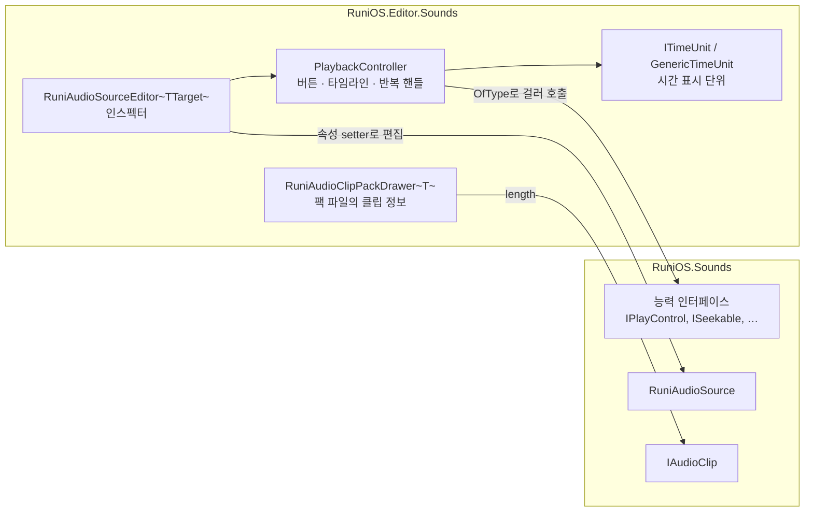

# 8. 에디터: 재생 컨트롤과 인스펙터

> 기준 커밋: `3a2b24b9`. [← 목차](README.md) · 이전: [7. 리소스와 생성](07-resources.md)

에디터 어셈블리 `RuniOS.Editor.Sounds`는 IMGUI로 재생 컨트롤을 그리는 [`PlaybackController`](../Editor/IMGUI/Sounds/PlaybackController.cs#L16)를 중심으로 이루어집니다.
`RuniAudioSource` 인스펙터와 리소스 팩의 클립 표시가 이것을 씁니다.
대부분은 IMGUI 배치 코드이므로, 이 장은 **어떤 대상에 어떤 조작이 적용되는지**를 정하는 부분만 자세히 다룹니다.

- [8.1 한눈에](#81-한눈에)
- [8.2 `PlaybackController`](#82-playbackcontroller)
- [8.3 `DrawControl`: 버튼과 기능 플래그](#83-drawcontrol-버튼과-기능-플래그)
- [8.4 `DrawSlider`: 타임라인과 반복 핸들](#84-drawslider-타임라인과-반복-핸들)
- [8.5 `ITimeUnit`과 `GenericTimeUnit`](#85-itimeunit과-generictimeunit)
- [8.6 `RuniAudioSourceEditor`](#86-runiaudiosourceeditor)
- [8.7 `RuniAudioClipPackDrawer`](#87-runiaudioclippackdrawer)

---

## 8.1 한눈에



| 파일 | 역할 |
| --- | --- |
| [`PlaybackController`](../Editor/IMGUI/Sounds/PlaybackController.cs#L16) | 여러 `IAudioPlayer`를 위한 재생 컨트롤 |
| [`PlaybackControllerFeatures`](../Editor/IMGUI/Sounds/PlaybackControllerFeatures.cs#L4) | 표시할 컨트롤을 고르는 플래그 |
| [`ITimeUnit`](../Editor/IMGUI/Sounds/ITimeUnit.cs#L6), [`ITimeUnit<T>`](../Editor/IMGUI/Sounds/ITimeUnit%601.cs#L6), [`GenericTimeUnit`](../Editor/IMGUI/Sounds/GenericTimeUnit.cs#L6) | 시간 입력 필드와 시간 문자열 |
| [`RuniAudioSourceEditor<TTarget>`](../Editor/Unity/Drawers/Sounds/RuniAudioSourceEditor.cs#L9) | `RuniAudioSource` 인스펙터의 기반, 기본 인스펙터 |
| [`RuniAudioClipPackDrawer<T>`](../Editor/Resource/Sounds/RuniAudioClipPackDrawer.cs#L9) | 리소스 팩 파일 보기의 클립 정보 |

## 8.2 `PlaybackController`

### 대상

```csharp
// Editor/IMGUI/Sounds/PlaybackController.cs
113  public List<IAudioPlayer> targets { get; } = [];          // ① 종류가 섞여도 됨

123  [DisallowNull]
124  public IAudioPlayer? target
     {
126      get => targets.Count == 1 ? targets[0] : null;       // ② 정확히 하나일 때만
         set
         {
129          targets.Clear();
130          targets.Add(value);
         }
     }

244  public T? GetTarget<T>() where T : IAudioPlayer
     {
246      T? result = default;
247      int count = 0;
248      for (int i = 0; i < targets.Count; i++)
         {
250          if (targets[i] is not T item)
251              continue;

253          result = item;
254          count++;

256          if (count > 1)
257              return default;                               // ③ 둘 이상이면 없음
         }

260      return result;
     }
```

1. ① 대상은 `IAudioPlayer` 목록입니다. **버튼마다 필요한 능력으로 걸러 적용**하므로 종류가 다른 플레이어를 섞어 넣을 수 있습니다([1.3](01-capability-interfaces.md#13-왜-나누는가)).
2. ② `target`은 대상이 하나일 때의 편의 속성입니다. 대입하면 목록을 비우고 하나만 넣습니다.
3. ③ `GetTarget<T>()`는 `T`인 대상이 **정확히 하나**일 때만 그것을 돌려줍니다. 타임라인처럼 "한 대상의 위치"를 보여 줘야 하는 컨트롤이 씁니다. 두 개면 어느 것의 위치를 보여 줄지 정할 수 없으므로 `null`(비활성)입니다.

### 기능 플래그

```csharp
// Editor/IMGUI/Sounds/PlaybackControllerFeatures.cs
3   [Flags]
4   public enum PlaybackControllerFeatures
    {
6       none = 0,
7       pause = 1 << 1,
8       timeline = 1 << 2,
9       skip = 1 << 3,
10      loopRange = 1 << 4,
11      timeUnit = 1 << 5,
12      groupedButtons = 1 << 6,
13      all = pause | timeline | skip | loopRange | timeUnit | groupedButtons
    }
```

| 플래그 | 켜면 |
| --- | --- |
| (항상) | 재생 버튼, 정지 버튼 |
| `pause` | 일시 정지 토글 버튼 |
| `skip` | ◀◀ / ▶▶ 1초 건너뛰기 버튼 |
| `timeline` | 타임라인 슬라이더와 그 아래 레인, 버튼 아래의 시간 입력 필드 |
| `loopRange` | 타임라인 위 반복 구간 핸들 (`timeline` 필요) |
| `timeUnit` | 슬라이더 아래 시간 라벨(현재 / 남은 / 전체) |
| `groupedButtons` | 버튼 스타일을 `<스타일 이름>left/mid/right`로 바꿔 한 덩어리처럼 그림 |

기본값은 `all`입니다([`#L142`](../Editor/IMGUI/Sounds/PlaybackController.cs#L142)).

### 배치

```csharp
// Editor/IMGUI/Sounds/PlaybackController.cs
277  public void Draw(Rect position)
     {
279      float orgWidth = position.width;
280      if (features.HasFlag(PlaybackControllerFeatures.timeline))
281          position.width = EditorGUIUtility.labelWidth;          // 왼쪽 = 라벨 폭

283      DrawControl(position);                                     // 버튼 + 시간 입력 필드

285      if (features.HasFlag(PlaybackControllerFeatures.timeline))
         {
287          position.x += position.width + 8;
288          position.width = orgWidth - (position.width + 8);

290          DrawSlider(position);                                  // 오른쪽 = 타임라인
         }
     }
```

인스펙터의 "라벨 | 값" 배치에 맞춰, 왼쪽 라벨 자리에 버튼을, 오른쪽 값 자리에 타임라인을 놓습니다. 두 열은 아래로 같은 줄 구조를 갖습니다.

| 줄 | 왼쪽 (`DrawControl`) | 오른쪽 (`DrawSlider`) |
| --- | --- | --- |
| 1 | 재생 · 일시 정지 · 정지 · 건너뛰기 버튼 | 타임라인 슬라이더 + 오버레이 + 반복 핸들 |
| 2 (`timelineLaneHeight > 0`일 때) | (비움) | `timelineLane` 콜백 레인 |
| 3… (시간 단위마다) | `ITimeUnit.DrawField` 입력 필드 | 현재 / 남은 / 전체 시간 라벨 |

타임라인을 꾸미는 확장점은 두 콜백입니다. 둘 다 고유한 `ISeekable` 대상이 있을 때만 불립니다.

- [`timelineOverlay`](../Editor/IMGUI/Sounds/PlaybackController.cs#L161): 슬라이더 트랙 위에 덧그립니다.
- [`timelineLane`](../Editor/IMGUI/Sounds/PlaybackController.cs#L177): 트랙 아래의 높이 `timelineLaneHeight`인 레인에 그립니다. 사각형은 트랙과 가로로 정렬됩니다(손잡이 폭의 절반만큼 안쪽, [`GetTimelineTrackPosition`](../Editor/IMGUI/Sounds/PlaybackController.cs#L648)).

## 8.3 `DrawControl`: 버튼과 기능 플래그

버튼마다 **활성 조건**과 **적용 대상**이 다릅니다. 모두 `targets`를 그 능력으로 거른 결과에 대해 동작합니다.

| 버튼 | 줄 | 활성 조건 | 클릭 시 |
| --- | --- | --- | --- |
| ▶ / ▶↻ | [#L318](../Editor/IMGUI/Sounds/PlaybackController.cs#L318) | `IPlayControl`이 하나라도 있음. 대상 중 하나라도 재생 중이면 글자가 ▶↻ | 모든 `IPlayControl`에 `Play()`(0초부터) |
| ▮▮ / ▶▮ | [#L340](../Editor/IMGUI/Sounds/PlaybackController.cs#L340) | `IPausable`이 하나라도 있음 | 모든 `IPausable`이 일시 정지면 ▶▮ = 전부 `UnPause()`, 아니면 ▮▮ = 전부 `Pause()` |
| ■ | [#L363](../Editor/IMGUI/Sounds/PlaybackController.cs#L363) | 재생 중인 `IStoppable`이 하나라도 있음 | 모든 `IStoppable`에 `Stop()` |
| ◀◀ / ▶▶ | [#L386](../Editor/IMGUI/Sounds/PlaybackController.cs#L386) | 대상 중 하나라도 재생 중이고 `ISeekable`이 하나라도 있음 | 모든 `ISeekable`의 `time`을 ∓1초 ([`Skip`](../Editor/IMGUI/Sounds/PlaybackController.cs#L436)) |
| 시간 입력 필드 | [#L406](../Editor/IMGUI/Sounds/PlaybackController.cs#L406) | 대상 중 하나라도 재생 중 | `ITimeUnit.DrawField(position, targets)`가 정함 |

알아 둘 점:

- **일시 정지 토글은 "모두"를 기준으로 합니다.** 하나라도 진행 중이면 ▮▮이 되어 전부 일시 정지시킵니다. 그래서 섞인 상태에서 한 번 누르면 상태가 통일됩니다.
- "재생 중"(`anyPlaying`)은 걸러지지 않은 전체 `targets` 기준입니다. 건너뛰기와 ▶↻ 표시는 재생 가능한 대상이 아니라도 재생 중인 대상이 있으면 반응합니다.
- 버튼 폭은 `skip`이 켜져 있으면 왼쪽 열의 2/3을 재생 버튼들이 나눠 쓰고, 나머지 1/3을 건너뛰기 버튼 둘이 씁니다.

> **관찰된 동작:** 버튼 아래의 시간 입력 필드는 `timeline` 플래그만 보고 그립니다([`#L406`](../Editor/IMGUI/Sounds/PlaybackController.cs#L406)). 그러나 `GetHeight`는 `timeUnit` 플래그가 켜져 있을 때만 시간 단위의 높이를 셉니다([`#L697`](../Editor/IMGUI/Sounds/PlaybackController.cs#L697)). `timeline`을 켜고 `timeUnit`을 끄면 필드가 할당된 영역 밖에 그려집니다. 오른쪽 시간 라벨은 `timeUnit`으로 가려집니다.

## 8.4 `DrawSlider`: 타임라인과 반복 핸들

```csharp
// Editor/IMGUI/Sounds/PlaybackController.cs
450  public void DrawSlider(Rect position)
     {
         …
457      ISeekable? timeControllable = GetTarget<ISeekable>();                                  // ① 고유한 대상
458      double time = timeControllable?.time ?? 0;
459      double length = timeControllable?.length ?? 0;

461      ILoopControl? loopablePlayer = timeControllable as ILoopControl;
462      bool loopHandlesEnabled = features.HasFlag(PlaybackControllerFeatures.loopRange) && loopablePlayer != null;

464      Rect timelineTrackPosition = GetTimelineTrackPosition(position);
465      int loopRangeControlID = GUIUtility.GetControlID(loopRangeHash, FocusType.Passive, position);

467      if (loopHandlesEnabled)
468          HandleLoopRangeInput(loopRangeControlID, position, timelineTrackPosition, loopablePlayer!, length);   // ② 슬라이더보다 먼저
469      else if (GUIUtility.hotControl == loopRangeControlID)
         {
471          GUIUtility.hotControl = 0;                                                         // ③ 드래그 중 핸들이 사라지면 해제
472          draggedLoopHandle = LoopHandle.none;
         }

475      EditorGUI.BeginDisabledGroup(timeControllable == null || !timeControllable.isPlaying);   // ④

477      EditorGUI.BeginChangeCheck();
478      float sliderValue = GUI.HorizontalSlider(position, time.ClampToFloat(), 0, length.ClampToFloat());
479      if (EditorGUI.EndChangeCheck() && timeControllable != null)
480          timeControllable.time = sliderValue;                                                // ⑤

482      if (timeControllable != null)
483          timelineOverlay?.Invoke(timelineTrackPosition, timeControllable, length);

485      if (loopHandlesEnabled)
486          DrawLoopHandles(loopRangeControlID, position, timelineTrackPosition, loopablePlayer!, length);
         …
500      if (!features.HasFlag(PlaybackControllerFeatures.timeUnit))
501          return;
         …                                                                                       // 시간 라벨
528      EditorGUI.EndDisabledGroup();
     }
```

1. ① 타임라인은 **한 대상의 위치**를 보여 주므로 `GetTarget<ISeekable>()`을 씁니다. `ISeekable`이 없거나 둘 이상이면 위치와 길이가 0이고 슬라이더는 비활성입니다.
2. ② 반복 핸들의 입력은 슬라이더보다 먼저 처리합니다. 핸들 위에서 누른 마우스는 핸들이 먼저 가져가므로(`hotControl`, `Event.Use`) 슬라이더는 반응하지 않습니다. 이 처리는 ④의 비활성 그룹보다 앞에 있어, 대상이 재생 중이 아니어도 핸들을 끌 수 있습니다.
3. ③ 드래그 도중 `loopRange` 플래그가 꺼지거나 대상이 바뀌면 잡고 있던 `hotControl`을 놓습니다.
4. ④ 슬라이더는 그 대상이 **재생 중일 때만** 움직일 수 있습니다.
5. ⑤ 슬라이더 값은 `float`입니다. `ClampToFloat`로 `double`을 `float` 범위에 맞춰 넘기고, 바뀌면 `time`에 대입합니다(`RuniAudioSource`라면 [기준점 재설정](03-time-interpolation.md#32-time-getter)).

반복 핸들:

- 시작 핸들은 트랙 위쪽에, 끝 핸들은 아래쪽에 삼각형으로 그립니다. `loop`가 꺼져 있으면 반투명입니다([`#L600`](../Editor/IMGUI/Sounds/PlaybackController.cs#L600)).
- 드래그하면 마우스 위치를 트랙 기준 `[0, length]`의 시간으로 바꿔 `loopStart`/`loopEnd`에 바로 대입합니다([`#L564`](../Editor/IMGUI/Sounds/PlaybackController.cs#L564)). 시작이 끝을 넘지 않게 하는 처리는 없습니다. 구간의 해석은 구현의 몫입니다([1.4](01-capability-interfaces.md#14-의미가-헷갈리기-쉬운-멤버)).
- 그릴 때 값은 [`GetTimelineValue`](../Editor/IMGUI/Sounds/PlaybackController.cs#L656)로 화면 범위에 맞춥니다. NaN은 기본값(시작 0, 끝 `length`), +∞는 `length`, −∞는 0, 나머지는 `[0, length]`로 자릅니다. 그래서 `loopEnd = double.MaxValue`(끝 없음)는 트랙 끝에 그려집니다.

> **관찰된 동작:** `timeUnit` 플래그가 꺼져 있으면 [`#L500`](../Editor/IMGUI/Sounds/PlaybackController.cs#L500)에서 바로 돌아갑니다. 그러면 ④에서 연 비활성 그룹을 [`#L528`](../Editor/IMGUI/Sounds/PlaybackController.cs#L528)의 `EndDisabledGroup`으로 닫지 못합니다. 저장소에서 `features`를 바꾸는 호출자는 없어, 기본값 `all`로는 이 경로에 들어가지 않습니다.

## 8.5 `ITimeUnit`과 `GenericTimeUnit`

시간 단위는 "시간을 어떤 단위로 입력하고 표시할지"를 정합니다. 기본은 초이고, 박자나 틱처럼 다른 단위를 쓰는 플레이어가 자기 단위를 추가할 수 있습니다.

```csharp
// Editor/IMGUI/Sounds/ITimeUnit.cs
6   public interface ITimeUnit
    {
8       public void DrawField(Rect position, IEnumerable<IAudioPlayer> values);
9       public float GetHeight();

11      public string TimeToString(IAudioPlayer? value);
12      public string RemainingTimeToString(IAudioPlayer? value);
13      public string LengthToString(IAudioPlayer? value);
    }

// Editor/IMGUI/Sounds/ITimeUnit`1.cs
6   public interface ITimeUnit<in T> : ITimeUnit where T : IAudioPlayer
    {
8       public void DrawField(Rect position, IEnumerable<T> playables);
9       void ITimeUnit.DrawField(Rect position, IEnumerable<IAudioPlayer> values) => DrawField(position, values.OfType<T>());   // ①

11      public string TimeToString(T? playable);
12      string ITimeUnit.TimeToString(IAudioPlayer? value) => TimeToString((T?)value);                                      // ②
        …
    }
```

1. ① 제네릭 인터페이스가 비제네릭 인터페이스를 **기본 인터페이스 구현**으로 이어 줍니다. 구현은 자기가 다루는 타입 `T`만 신경 쓰면 됩니다. 입력 필드에는 전체 `targets`가 넘어오고, 여기서 `T`인 것만 걸러집니다.
2. ② 문자열 메서드에는 [8.4](#84-drawslider-타임라인과-반복-핸들)의 고유한 `ISeekable` 대상(없으면 `null`)이 넘어오고, `T`로 캐스팅해 전달합니다.

[`GenericTimeUnit`](../Editor/IMGUI/Sounds/GenericTimeUnit.cs#L6)은 `ITimeUnit<ISeekable>`인 초 단위 구현입니다.

- 입력 필드는 `double` 초입니다. 대상이 없거나 둘 이상이면 혼합 값(—)으로 표시합니다. 고치면 걸러진 모든 대상의 `time`에 같은 값을 대입합니다.
- 문자열은 `TimeUtility.ToTimeString`으로 만듭니다. 대상이 없으면 NaN을 넘깁니다. 남은 시간은 `length - time`입니다.

## 8.6 `RuniAudioSourceEditor`

```csharp
// Editor/Unity/Drawers/Sounds/RuniAudioSourceEditor.cs
9   public abstract class RuniAudioSourceEditor<TTarget> : CustomInspectorBase<TTarget> where TTarget : RuniAudioSource
    {
11      public PlaybackController controller { get; } = new PlaybackController(new GenericTimeUnit());

13      protected override bool repaintInEditor => controller.targets.Any(t => t.isPlaying);    // ① 재생 중이면 계속 다시 그림

15      protected override void OnEnable()
        {
17          base.OnEnable();
18          controller.targets.SyncWithEnumerable(targets);                                    // ② 인스펙터 대상 = 컨트롤러 대상
        }

21      public override void OnInspectorGUI()
        {
23          serializedObject.UpdateIfRequiredOrScript();

25          if (DrawSourceLayout())                                                            // ③ 파생 클래스의 소스 영역
26              Space();

28          DrawPlaybackLayout();      // volume, tempo, pitch
            …
31          DrawLoopingLayout();       // loop, loopStart, loopEnd
            …
34          DrawSpatialLayout();       // panStereo … maxDistance + DrawAdditionalSpatialLayout()
            …
37          DrawTransportLayout();     // controller.DrawLayout()
            …
40          DrawInformationLayout();   // length + DrawAdditionalInformationLayout()
        }
        …
    }

175 [CanEditMultipleObjects]
176 [CustomEditor(typeof(RuniAudioSource), true)]
177 class RuniAudioSourceDefaultEditor : RuniAudioSourceEditor<RuniAudioSource>;           // ④
```

1. ① 재생 중에는 플레이헤드와 시간 라벨이 움직여야 하므로 에디터 모드에서도 계속 다시 그립니다.
2. ② 여러 객체를 함께 선택하면 컨트롤러가 그 전부를 대상으로 삼습니다. 버튼은 모두에 적용되고, 타임라인은 대상이 둘 이상이라 비활성입니다(8.4 ①).
3. ③ 섹션마다 `protected virtual` 메서드라 파생 인스펙터가 바꾸거나 덧붙일 수 있습니다. `DrawSourceLayout`은 무언가 그렸으면 `true`를 돌려 간격을 넣게 합니다.
4. ④ `CustomEditor(…, true)`라서 **전용 인스펙터가 없는 모든 `RuniAudioSource` 파생 클래스**가 이 기본 인스펙터를 씁니다. 전용 인스펙터는 `RuniAudioSourceEditor<자기 타입>`을 상속합니다.

**속성 편집은 직렬화 필드가 아니라 C# 속성 setter를 거칩니다.** core의 `CustomInspectorBase.EditPropertyValue`가 `Undo.RecordObject`와 `SetDirty`를 처리한 뒤, 넘긴 `writeFunc`(예: `x.tempo = value`)를 대상마다 부릅니다.
그래서 인스펙터에서 `tempo`를 바꾸면 [기준점 재설정](02-playback-state.md#22-설정-속성)이 일어나고, 파생 클래스가 재정의한 setter도 엔진에 값을 전달합니다.

| 필드 | 컨트롤 | 범위 |
| --- | --- | --- |
| `volume` | 슬라이더 | 0 ~ 2 |
| `tempo` | 슬라이더 | −3 ~ 3 |
| `pitch` | 슬라이더 | 0 ~ 3 |
| `loopEnd` | nullable 필드. `double.MaxValue`를 "없음"으로 표시하고, 비우면 `double.MaxValue` | — |
| `panStereo` | 슬라이더 | −1 ~ 1 |
| `spatialBlend` | 슬라이더 | 0 ~ 1 |
| `dopplerLevel` | 슬라이더 | 0 ~ 5 |
| `spread` | 슬라이더 | 0 ~ 360 |
| `loop`, `loopStart`, `minDistance`, `maxDistance` | 토글·숫자 필드 | — |

범위는 인스펙터 컨트롤의 범위일 뿐입니다. 코드로는 범위 밖 값도 넣을 수 있습니다.

## 8.7 `RuniAudioClipPackDrawer`

```csharp
// Editor/Resource/Sounds/RuniAudioClipPackDrawer.cs
9   public abstract class RuniAudioClipPackDrawer<T>(ImmutableArray<IONode> targets) : PackDrawer(targets) where T : class, IAudioClip
    {
11      public override string targetTypeName => typeof(T).GetTypeDisplayName();

13      public abstract T? targetClip { get; }

15      protected override void OnGUI(bool isDebug = false)
        {
17          if (DrawSettingLayout())
18              Space();

20          GUILayout.Label(TrTempContent("runios-editor:gui.info"), RuniStyles.largeLabel);
21          DrawInfoLayout();
        }

24      protected virtual bool DrawSettingLayout() => false;

26      protected virtual void DrawInfoLayout() => DrawInfoFieldLayout("runios-editor:gui.length", targetClip != null ? targetClip.length : "―");
        …
    }
```

리소스 팩의 파일을 선택했을 때 그 클립의 정보를 보여 주는 core `PackDrawer`의 기반입니다.

- 파생 클래스는 선택된 파일에서 클립을 얻는 `targetClip`만 구현하면 됩니다. 기본 정보로 길이가 표시되고, 클립이 없으면 "―"입니다.
- 설정 영역(`DrawSettingLayout`)과 정보 영역(`DrawInfoLayout`)은 재정의해 늘릴 수 있습니다. 클립 종류별 표시는 파생 클래스가 덧붙입니다.
