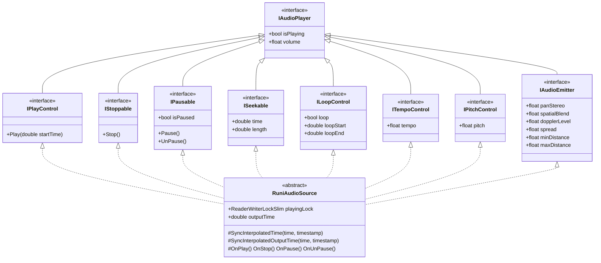
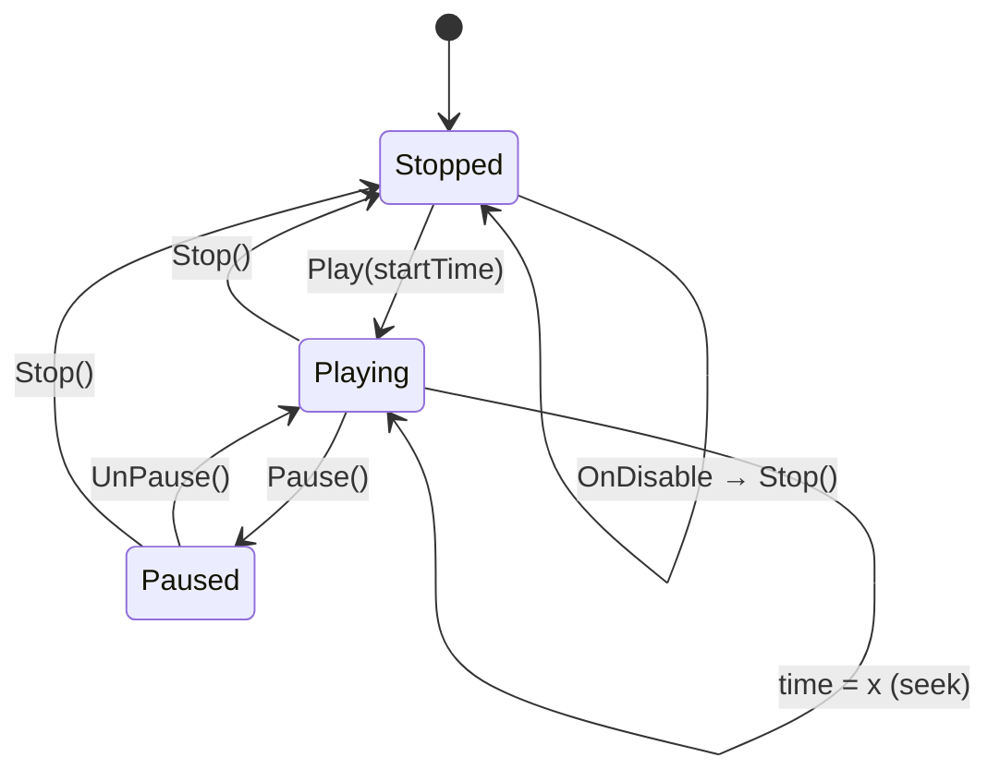

# Sound 패키지 구조 문서

> 기준 커밋: `440c549c`. 코드 링크의 줄 번호는 이 커밋 기준입니다.

`io.github.rumi727.runios.sound`(어셈블리 `RuniOS.Sounds`)는 **특정 오디오 엔진에 묶이지 않는 재생 추상화**입니다.
"재생할 수 있다", "위치를 옮길 수 있다", "속도를 바꿀 수 있다" 같은 능력을 작은 인터페이스로 나누고, 그것을 모두 구현하는 `MonoBehaviour` 기반 클래스 `RuniAudioSource`를 제공합니다.
실제 소리를 내는 일은 파생 패키지가 맡습니다(예: FMOD 패키지의 `WaveAudioSource`).

| 문서 | 내용 |
| --- | --- |
| [time-interpolation.md](time-interpolation.md) | `RuniAudioSource`의 `time` / `outputTime` 보간, 잠금, 파생 클래스 계약 (줄 단위) |

## 인터페이스 지도

- 모든 능력 인터페이스가 `IAudioPlayer`(재생 중 여부와 음량)를 상속합니다. 소비자는 **필요한 능력만 요구**합니다. 예를 들어 위치 표시 UI는 `ISeekable`만, 재생 버튼은 `IPlayControl`만 받습니다.
- `tempo`는 타임라인 진행 속도이고 `pitch`는 소리 높이입니다. 둘은 **별개**입니다. 어떻게 분리해서 구현할지는 파생 클래스가 정합니다.
- `loopStart`/`loopEnd`는 범위 값일 뿐입니다. 이 범위를 어떻게 해석할지(곡 범위로 제한하는지 등)도 파생 클래스가 정합니다.

## 그 밖의 타입

| 타입 | 역할 |
| --- | --- |
| [`AudioSpatialState`](../Runtime/Sounds/AudioSpatialState.cs) | 3D 소리의 위치, 속도, 회전을 담은 값 구조체. `Transform`에서 바로 만들 수 있습니다. |
| [`IAudioClip`](../Runtime/Sounds/IAudioClip.cs) | 길이(`length`)만 가진 최소 클립 계약 |
| [`SoundClipRef`](../Runtime/Sounds/SoundClipRef.cs) | `ResourceKey`를 감싼 직렬화용 참조. `ResourceKey`와 암시적으로 서로 변환됩니다. |
| [`SoundAssetRegistry`](../Runtime/Resource/Sounds/SoundAssetRegistry.cs) | `runios:sounds` 레지스트리(`SoundClipRef` 인스턴스 핸들) |
| [`AudioPlayerManager`](../Runtime/Sounds/AudioPlayerManager.cs) | 레지스트리 id → `RuniAudioSource` 생성 함수 표. `Create(resourceKey)`가 키의 레지스트리에 맞는 플레이어를 만듭니다. |
| `Waveform` + `*Job` | 16비트 planar 샘플과 min/max 피라미드로 임의 구간을 파형 열로 줄입니다(잡 시스템). 메인 스레드 전용입니다. |
| `WaveformRenderer` | 파형을 GPU로 렌더 텍스처에 그립니다. |
| Editor `PlaybackController` | 여러 `IAudioPlayer`를 위한 IMGUI 재생 컨트롤. 대상이 구현한 인터페이스에 따라 쓸 수 있는 컨트롤이 정해집니다. `ITimeUnit`으로 시간 표시 단위를 바꿀 수 있습니다. |

## `RuniAudioSource` 한눈에

- 상태 플래그는 `_isPlaying`과 `_isPaused` 두 개입니다. `Play`는 `_isPaused`를 건드리지 않으므로, 일시 정지 중에 `Play`하면 일시 정지 상태가 유지됩니다.
- `Play`, `Stop`, `Pause`, `UnPause`는 모두 `playingLock` 쓰기 잠금 안에서 상태를 바꾸고 파생 클래스 훅(`OnPlay`/`OnStop`/`OnPause`/`OnUnPause`)을 부릅니다. **훅은 쓰기 잠금을 보유한 채 실행됩니다.**
- `Play(startTime)`와 `Stop()`은 내부에서 `time = …`을 대입합니다. 파생 클래스가 `time` setter를 재정의했다면 재생 시작과 정지에서도 그 setter가 불립니다.

자세한 시간 계산은 [time-interpolation.md](time-interpolation.md)를 보세요.
